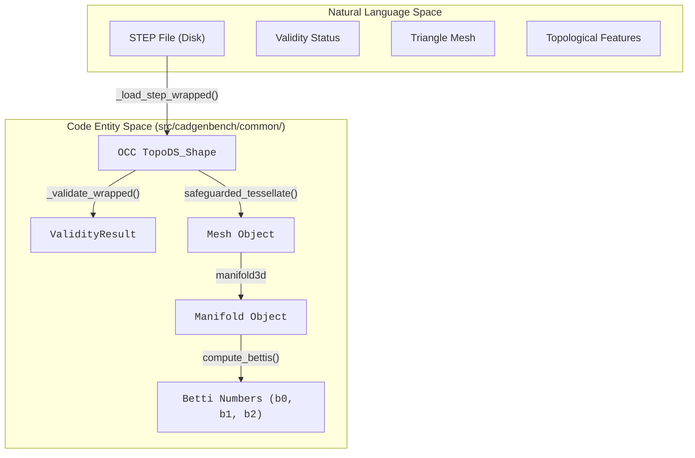
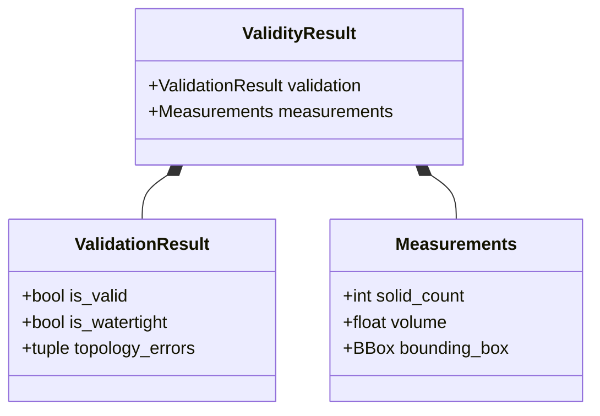

<!-- source: DeepWiki mcp.deepwiki.com · repo huggingface/cadgenbench · page 3.2 StepArtifacts and Caching · fetched 2026-10-26 -->

# StepArtifacts and Caching

Relevant source files

The following files were used as context for generating this wiki page:

- [src/cadgenbench/common/artifacts.py](src/cadgenbench/common/artifacts.py)
- [src/cadgenbench/common/measurements.py](src/cadgenbench/common/measurements.py)
- [src/cadgenbench/common/mesh.py](src/cadgenbench/common/mesh.py)
- [src/cadgenbench/common/validity.py](src/cadgenbench/common/validity.py)
- [tests/common/test_validity.py](tests/common/test_validity.py)

The `StepArtifacts` system provides a unified, lazy-loading interface for geometric data derived from STEP files. It ensures that expensive operations—such as Open Cascade (OCC) shape parsing, B-Rep validation, and high-fidelity tessellation—are performed exactly once and cached for downstream metric computation.

### Core Architecture

The system is built around the `StepArtifacts` class, which acts as a container for a single STEP file's lifecycle. It manages transition from raw disk bytes to a validated `Mesh` and finally to topological descriptors like Betti numbers.

#### Data Flow and Lifecycle
The following diagram illustrates the transformation of a STEP file into various cached artifacts:

**STEP Artifact Transformation Pipeline**

**Sources:** [src/cadgenbench/common/artifacts.py:66-146](), [src/cadgenbench/common/validity.py:107-118]()

---

### StepArtifacts Implementation

The `StepArtifacts` class implements a multi-tier caching strategy. It handles both in-memory Python object caching and on-disk serialization for validation results.

| Feature | Implementation Detail |
| :--- | :--- |
| **Lazy Loading** | Properties like `.wrapped`, `.analysis`, and `.mesh()` only compute on first access [src/cadgenbench/common/artifacts.py:93-162](). |
| **Identity Keying** | On-disk caches are keyed by the file's identity to prevent collisions between different versions of a candidate [src/cadgenbench/common/artifacts.py:206-224](). |
| **Deflection Policy** | Uses a `deflection_override` for sub-volumes (jigs) to ensure they are meshed at the same scale as the parent ground truth [src/cadgenbench/common/artifacts.py:148-161](). |
| **Memory Management** | Heavy objects like `manifold3d.Manifold` are kept process-local and not serialized, as they are not stable across versions [src/cadgenbench/common/artifacts.py:69-73](). |

**Sources:** [src/cadgenbench/common/artifacts.py:66-224]()

---

### Trusted-Mesh Sidecars

For scenarios where a mesh is already known (e.g., after a rigid alignment transformation), the system supports `.mesh.npz` sidecars.

1. **Detection**: If a file named `<stem>.mesh.npz` exists next to the STEP file, `StepArtifacts` marks the part as "trusted and valid by construction" [src/cadgenbench/common/artifacts.py:30-38]().
2. **Short-circuit**: The system skips the standard BRepCheck validation and the expensive `BRepMesh_IncrementalMesh` tessellation [src/cadgenbench/common/artifacts.py:103-115]().
3. **Serialization**: Sidecars store `vertices` (float64), `triangles` (int64), and the `linear_deflection_mm` used during the original creation [src/cadgenbench/common/artifacts.py:41-62]().

**Sources:** [src/cadgenbench/common/artifacts.py:30-62](), [src/cadgenbench/common/artifacts.py:103-115]()

---

### ValidityResult and Analysis

The `ValidityResult` is a composite object that bundles the outcome of the CAD Validity Gate with geometric measurements.

**Validity and Measurement Association**

- **ValidationResult**: Captures if the BREP is watertight and if the resulting mesh is a manifold. Any errors found by `BRepCheck_Analyzer` are collected into `topology_errors` [src/cadgenbench/common/validity.py:76-104]().
- **Measurements**: Provides the bounding box diagonal used to calculate the dynamic `linear_deflection_mm` for tessellation [src/cadgenbench/common/measurements.py:62-69]().

**Sources:** [src/cadgenbench/common/validity.py:76-118](), [src/cadgenbench/common/measurements.py:62-69]()

---

### Caching Mechanisms

The system employs two distinct caching layers to optimize performance across multiple evaluation runs.

#### 1. In-Memory Artifact Cache
Within a single `StepArtifacts` instance, dictionaries map deflection values to their respective objects. This prevents re-meshing the same part at the same resolution if requested by different metrics (e.g., Shape Similarity and Topology Match).
- `_meshes`: Stores `Mesh` objects [src/cadgenbench/common/artifacts.py:81]().
- `_manifolds`: Stores `manifold3d` handles [src/cadgenbench/common/artifacts.py:82]().
- `_bettis`: Stores computed Betti number tuples [src/cadgenbench/common/artifacts.py:83]().

#### 2. On-Disk Analysis Cache
The `CADGENBENCH_MESH_CACHE_DIR` environment variable controls where `ValidityResult` data is persisted.
- **Cache Key**: Generated using `_file_identity_key`, which incorporates file stats or content hashes [src/cadgenbench/common/artifacts.py:206-224]().
- **Persistence**: Results are stored as JSON. If a cache hit occurs, the system avoids reloading the OCC shape entirely if only validity status is needed [src/cadgenbench/common/artifacts.py:182-204]().

**Sources:** [src/cadgenbench/common/artifacts.py:74-91](), [src/cadgenbench/common/artifacts.py:182-224]()

---

