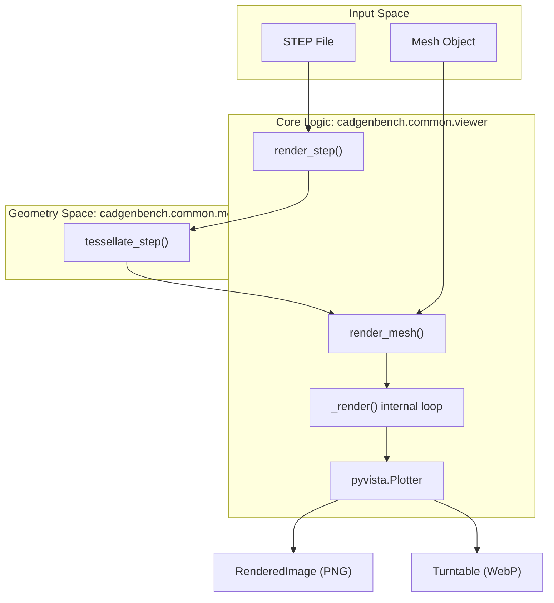
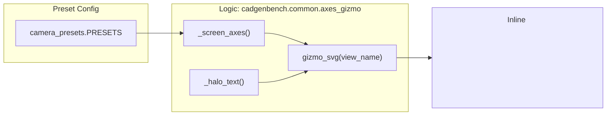

<!-- source: DeepWiki mcp.deepwiki.com · repo huggingface/cadgenbench · page 3.3 Headless Rendering and Visualization · fetched 2026-10-26 -->

# Headless Rendering and Visualization

Relevant source files

The following files were used as context for generating this wiki page:

- [.cursor/rules/style.mdc](.cursor/rules/style.mdc)
- [src/cadgenbench/baseline/__init__.py](src/cadgenbench/baseline/__init__.py)
- [src/cadgenbench/common/__init__.py](src/cadgenbench/common/__init__.py)
- [src/cadgenbench/common/axes_gizmo.py](src/cadgenbench/common/axes_gizmo.py)
- [src/cadgenbench/common/camera_presets.py](src/cadgenbench/common/camera_presets.py)
- [src/cadgenbench/common/edit_diff.py](src/cadgenbench/common/edit_diff.py)
- [src/cadgenbench/common/imaging.py](src/cadgenbench/common/imaging.py)
- [src/cadgenbench/common/viewer.py](src/cadgenbench/common/viewer.py)
- [tests/common/test_edit_diff.py](tests/common/test_edit_diff.py)
- [tests/common/test_imaging.py](tests/common/test_imaging.py)
- [tests/common/test_viewer.py](tests/common/test_viewer.py)

CADGenBench provides a high-performance, headless rendering pipeline designed for automated evaluation and agent feedback. It transforms STEP files and meshes into canonical 2D views and 3D animations without requiring a display server or a browser-based viewer. The system is built on **VTK** (Visualization Toolkit) via **PyVista**, supporting both GPU acceleration (EGL/Cocoa) and software rasterization (Mesa) in CI/CD environments [src/cadgenbench/common/viewer.py:15-39]().

## Rendering Architecture

The rendering process follows a "tessellate-then-draw" flow. STEP files are first converted into welded triangle meshes using the project's internal tessellation engine before being handed to the VTK pipeline [src/cadgenbench/common/viewer.py:17-19]().

### Technical Stack and Backend Selection
The renderer operates in-process and selects an OpenGL backend at runtime [src/cadgenbench/common/viewer.py:27-34]():
*   **macOS:** Cocoa / NSOpenGL.
*   **Linux (GPU):** EGL.
*   **Linux (Headless/CPU):** EGL + Mesa software rasterizer.

### Rendering Flow Diagram
This diagram maps the logical rendering steps to the internal functions and classes responsible for execution.

"Rendering Pipeline: STEP to Artifacts"

Sources: [src/cadgenbench/common/viewer.py:15-39](), [src/cadgenbench/common/viewer.py:194-220](), [src/cadgenbench/common/viewer.py:246-270]()

## View Management and Presets

The system uses orthographic (parallel) projection for all views to match canonical CAD drawing conventions [src/cadgenbench/common/viewer.py:21-25](). Camera placement is driven by fixed presets defined in `cadgenbench.common.camera_presets`.

*   **Standard Views:** `iso`, `front`, `top`, `right` [src/cadgenbench/common/camera_presets.py:41-41]().
*   **Auto-Framing:** The `parallel_scale` is dynamically fitted to the bounding box of the part to ensure consistent sizing regardless of the part's physical dimensions [src/cadgenbench/common/viewer.py:22-25]().
*   **Advisory Locking:** To prevent OpenGL context contention during parallel execution (e.g., in `ProcessPoolExecutor`), the renderer uses a global `RENDER_LOCK` [src/cadgenbench/common/viewer.py:173-191]().

Sources: [src/cadgenbench/common/camera_presets.py:37-78](), [src/cadgenbench/common/viewer.py:173-191]()

## Specialized Visualizations

### Edit-Diff Ghost-Body Visualization
For editing tasks, a simple shaded render is insufficient to show subtle changes. The `render_mesh_diff` function creates a specialized "ghost" view [src/cadgenbench/common/edit_diff.py:15-20]():
1.  **Ghost Body:** The candidate part is rendered as a translucent grey shell [src/cadgenbench/common/viewer.py:132-132]().
2.  **Surface Deviation Field:** A per-vertex field is painted on top, mirroring the `shape_similarity` F1 metric gates [src/cadgenbench/common/edit_diff.py:24-26]().
    *   **Red:** Material added by the candidate that is missing in the Ground Truth [src/cadgenbench/common/viewer.py:133-133]().
    *   **Amber:** Material missing from the candidate that exists in the Ground Truth [src/cadgenbench/common/viewer.py:134-134]().
3.  **Stability:** The system uses linear subdivision and consistent normal interpolation to prevent "tessellation noise" from lighting up as errors [src/cadgenbench/common/edit_diff.py:31-40]().

### Interface Overlays
`render_overlay` and `render_mesh_overlay` allow rendering a primary part (the "ghost") with highlighted sub-volumes (jigs/KORs/KIRs) superimposed [src/cadgenbench/common/viewer.py:108-116](). This is used in interface matching to show where a candidate part intersects or fails to fill required volumes.

Sources: [src/cadgenbench/common/edit_diff.py:15-44](), [src/cadgenbench/common/viewer.py:118-157](), [src/cadgenbench/common/viewer.py:465-498]()

## Animations and Thumbnails

### Turntable WebP
The system generates 360-degree turntable animations as animated WebP files.
*   **Functions:** `render_step_turntable_webp` and `render_mesh_diff_turntable_webp` [src/cadgenbench/common/viewer.py:284-307]().
*   **Implementation:** Iteratively rotates the camera around the Z-axis, captures frames, and assembles them using `PIL.Image` [src/cadgenbench/common/viewer.py:330-350]().

### Static Thumbnails
To avoid re-rendering for static reports, `first_frame_png` extracts the first frame of a turntable WebP [src/cadgenbench/common/imaging.py:29-39](). This ensures the thumbnail exactly matches the starting orientation of the animation.

Sources: [src/cadgenbench/common/viewer.py:309-353](), [src/cadgenbench/common/imaging.py:29-45]()

## Orientation Gizmo (SVG Overlay)

Since renders are orthographic and headless, users need a way to identify X/Y/Z directions. `axes_gizmo.py` generates an inline SVG overlay [src/cadgenbench/common/axes_gizmo.py:15-21]().

*   **Static Projection:** Because camera presets are fixed, the screen-space projection of the axes is identical for every part in a given view (e.g., "iso") [src/cadgenbench/common/axes_gizmo.py:24-27]().
*   **Visual Style:** Uses a muted palette (Red=X, Green=Y, Blue=Z) with white halos for legibility [src/cadgenbench/common/axes_gizmo.py:47-54]().
*   **Depth Cues:** Axes pointing into the screen are rendered as hollow circles; those pointing out are filled [src/cadgenbench/common/axes_gizmo.py:37-37]().

### Gizmo Data Flow
"SVG Gizmo Generation"

Sources: [src/cadgenbench/common/axes_gizmo.py:82-110](), [src/cadgenbench/common/axes_gizmo.py:113-161]()

---

