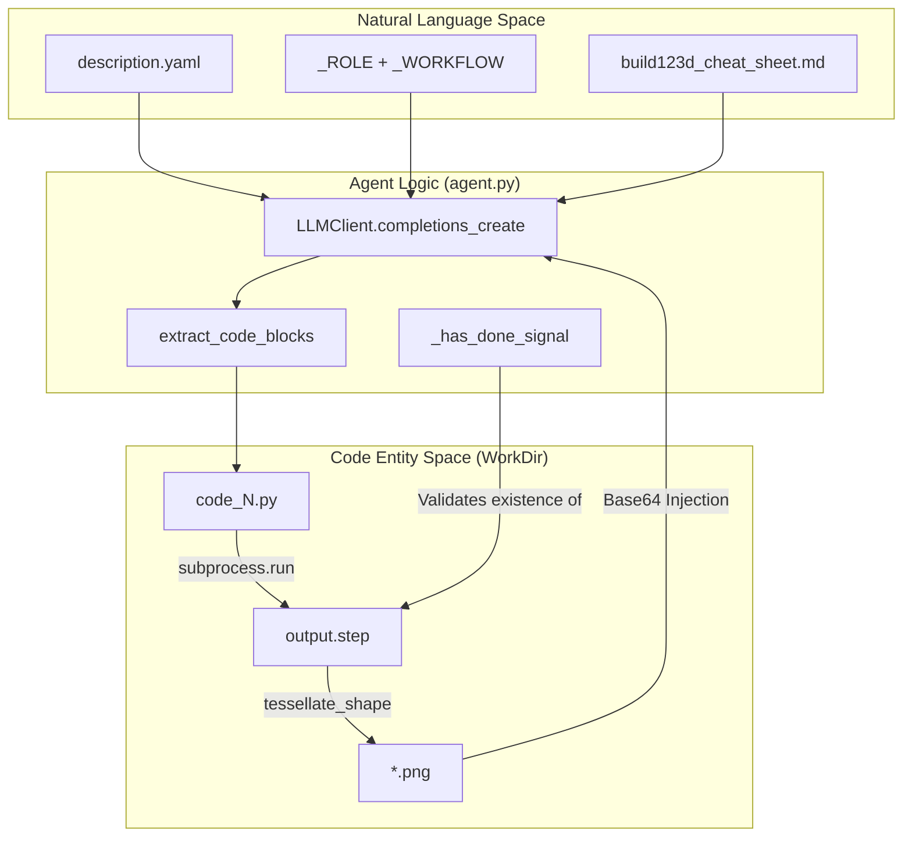
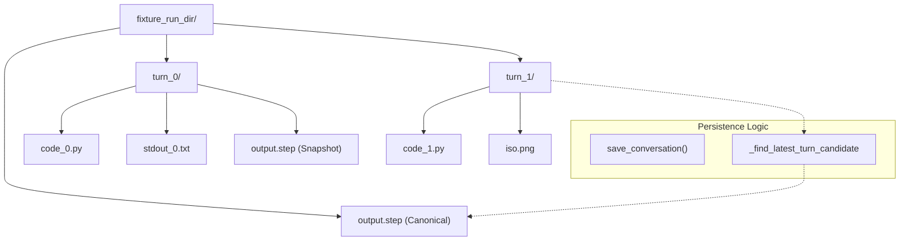

<!-- source: DeepWiki mcp.deepwiki.com · repo huggingface/cadgenbench · page 4.1 Agent Loop and Prompt Engineering · fetched 2026-10-26 -->

# Agent Loop and Prompt Engineering

Relevant source files

The following files were used as context for generating this wiki page:

- [src/cadgenbench/baseline/agent.py](src/cadgenbench/baseline/agent.py)
- [src/cadgenbench/baseline/default_config.yaml](src/cadgenbench/baseline/default_config.yaml)
- [src/cadgenbench/baseline/prompt.py](src/cadgenbench/baseline/prompt.py)
- [src/cadgenbench/baseline/types.py](src/cadgenbench/baseline/types.py)

The reference baseline agent in `cadgenbench` implements a stateful, iterative feedback loop where an LLM generates Python code to produce 3D CAD models. The loop manages code execution in a persistent environment, provides automatic geometric validation and rendering feedback, and enforces hard constraints like token budgets and wall-clock timers.

## Orchestration: The `run_agent` Loop

The `run_agent` function in [src/cadgenbench/baseline/agent.py:228-323]() manages the lifecycle of a single fixture. It maintains a persistent working directory where the agent can save files, including the primary artifact `output.step`.

### Turn Lifecycle
Each iteration of the loop constitutes a "Turn," recorded as a `TurnRecord` [src/cadgenbench/baseline/types.py:142-152]().

1.  **Prompt Assembly**: The system prompt, cheat sheets, and history (including images) are bundled [src/cadgenbench/baseline/prompt.py:213-268]().
2.  **LLM Dispatch**: The `LLMClient` is called to generate the next response.
3.  **Code Extraction**: Python blocks are extracted from the markdown response using `extract_code_blocks` [src/cadgenbench/baseline/agent.py:170-173]().
4.  **Execution**: Code is executed via `execute_code` [src/cadgenbench/baseline/agent.py:201-225](), which runs a subprocess with a `runner_timeout` [src/cadgenbench/baseline/types.py:116]().
5.  **Auto-Validation**: If `output.step` was modified, the system automatically triggers a validation and rendering pipeline to provide feedback for the next turn.
6.  **Persistence**: The state is incrementally saved to disk [src/cadgenbench/baseline/agent.py:313-314]().

### The [DONE] Hard Gate
The agent signals completion by outputting the `[DONE]` marker outside of code blocks [src/cadgenbench/baseline/agent.py:66-68](). However, this is a "hard gate": if the agent says `[DONE]` but `output.step` is missing from the working directory, the loop rejects the completion and provides an error message to the agent [src/cadgenbench/baseline/agent.py:291-299]().

### Termination Conditions
The loop terminates under five conditions, tracked in `stopped_reason` [src/cadgenbench/baseline/types.py:168]():
*   `done`: Agent explicitly signaled completion and passed the gate.
*   `max_iterations`: Reached the `max_iterations` limit (default 1000) [src/cadgenbench/baseline/default_config.yaml:16]().
*   `max_tokens`: Total token usage exceeded `max_total_tokens` [src/cadgenbench/baseline/default_config.yaml:15]().
*   `timeout`: The `_WallClockAlarm` triggered due to `max_duration_s` [src/cadgenbench/baseline/agent.py:116-154]().
*   `threshold`: (Optional) Reached a target score.

**Sources:** [src/cadgenbench/baseline/agent.py:26-154](), [src/cadgenbench/baseline/types.py:142-169](), [src/cadgenbench/baseline/default_config.yaml:11-20]()

---

## Data Flow: Natural Language to Geometry
The following diagram illustrates how the agent bridges the gap between the task description (Natural Language) and the generated STEP file (Code Entity Space).

**Agent Data Flow and Feedback Loop**

**Sources:** [src/cadgenbench/baseline/agent.py:58-68](), [src/cadgenbench/baseline/prompt.py:54-150](), [src/cadgenbench/baseline/agent.py:334-398]()

---

## Prompt Engineering and Cheat Sheets

The agent is guided by a multi-section system prompt defined in `prompt.py`. It uses "cheat sheets" to provide the LLM with immediate API context without requiring it to have perfect memorization of the underlying CAD libraries.

### Backend Dispatching
The system supports two backends, though `build123d` is the primary focus. The `_BackendSpec` [src/cadgenbench/baseline/agent.py:85-93]() determines which prompt components and cheat sheets are injected.

| Backend | Code Language | Artifact | Cheat Sheet File |
| :--- | :--- | :--- | :--- |
| `build123d` | `python` | `output.step` | `build123d_cheat_sheet.md` |
| `cadquery` | `python` | `output.step` | `cadquery_cheat_sheet.md` |

### Incremental Feedback
The loop implements an "auto-validate-and-render" pipeline. Every time the agent's code produces or modifies `output.step`, the system:
1.  Calculates geometric properties (Volume, Bounding Box).
2.  Checks B-Rep validity (Watertightness, Shell count).
3.  Generates an Isometric render using `render_mesh` [src/cadgenbench/common/viewer.py]().

This feedback is formatted as a `user` message for the next turn [src/cadgenbench/baseline/agent.py:381-398]().

**Sources:** [src/cadgenbench/baseline/prompt.py:32-37](), [src/cadgenbench/baseline/agent.py:96-109](), [src/cadgenbench/baseline/agent.py:334-379]()

---

## Incremental Artifact Saving

To prevent data loss during long-running tasks or timeouts, `AgentResult.save()` [src/cadgenbench/baseline/types.py:171-218]() and the `run_agent` loop perform incremental writes.

**File System Structure during Execution**

### Selection of Canonical Candidate
Since an agent might iterate many times, `_find_latest_turn_candidate` [src/cadgenbench/baseline/types.py:64-89]() scans the `turn_N` directories in reverse order. The highest-numbered turn containing a valid `output.step` is promoted to the fixture root. This ensures that even if the agent fails in its final turn, the best previous attempt is preserved for scoring.

**Sources:** [src/cadgenbench/baseline/types.py:64-89](), [src/cadgenbench/baseline/types.py:171-218](), [src/cadgenbench/baseline/agent.py:313-314]()

---

