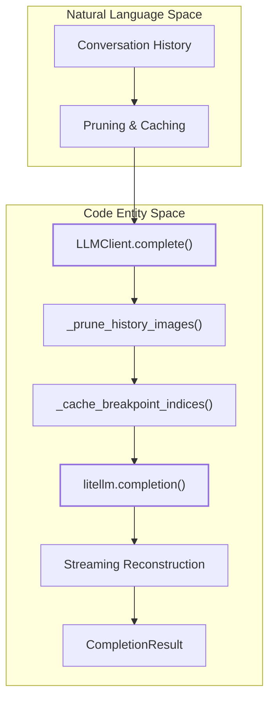
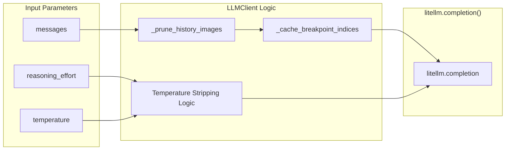

<!-- source: DeepWiki mcp.deepwiki.com · repo huggingface/cadgenbench · page 4.2 LLM Client and Reliability · fetched 2026-10-26 -->

# LLM Client and Reliability

Relevant source files

The following files were used as context for generating this wiki page:

- [src/cadgenbench/baseline/llm.py](src/cadgenbench/baseline/llm.py)
- [src/cadgenbench/eval/report/__init__.py](src/cadgenbench/eval/report/__init__.py)
- [tests/baseline/test_agent.py](tests/baseline/test_agent.py)
- [tests/baseline/test_llm.py](tests/baseline/test_llm.py)

The `LLMClient` serves as the unified interface for interacting with Large Language Models (LLMs) in CADGenBench. It abstracts provider-specific complexities, ensures robust execution through sophisticated retry logic, and optimizes request payloads for long-running iterative CAD generation tasks.

## LLMClient Architecture

The `LLMClient` class [src/cadgenbench/baseline/llm.py:204-205]() wraps `litellm.completion` [src/cadgenbench/baseline/llm.py:372-373]() to provide a consistent API across providers (Anthropic, OpenAI, Google, and Hugging Face). It handles environment variable loading via `python-dotenv` [src/cadgenbench/baseline/llm.py:31-33]() and manages model-specific parameter translations.

### Key Components and Data Flow

The following diagram illustrates the flow of a request through the `LLMClient` and how it maps to internal code entities.

**LLM Request Pipeline**

**Sources:** [src/cadgenbench/baseline/llm.py:204-450]()

## Reliability and Error Handling

CADGenBench is designed to handle transient network issues and provider-specific quotas through a multi-layered reliability strategy.

### Exponential Backoff with Jitter
The client implements a retry loop [src/cadgenbench/baseline/llm.py:339-410]() targeting `RETRYABLE_ERRORS` [src/cadgenbench/baseline/llm.py:87-94](), which include rate limits, timeouts, and internal server errors. 
- **Backoff:** The wait time increases exponentially based on the `initial_backoff` parameter [src/cadgenbench/baseline/llm.py:214]().
- **Jitter:** Random jitter is applied [src/cadgenbench/baseline/llm.py:402-403]() to prevent "thundering herd" problems when multiple agents are running in parallel.
- **HTTP Fallback:** It uses a duck-typed fallback for transient status codes (408, 429, 5xx) [src/cadgenbench/baseline/llm.py:104]() for providers that do not use standard LiteLLM exception classes.

### Response Cleaning
To maintain clean logs and readable error messages, the client uses `_short()` [src/cadgenbench/baseline/llm.py:66-84]() to truncate long error bodies. It specifically detects and collapses full HTML error pages returned by routers (like the Hugging Face router) into a single-line diagnostic [src/cadgenbench/baseline/llm.py:78-79]().

**Sources:** [src/cadgenbench/baseline/llm.py:66-104](), [src/cadgenbench/baseline/llm.py:339-410]()

## Optimization Strategies

### History Image Pruning
As the agent iterates, the conversation history grows. Including high-resolution renders for every turn can exceed token limits or trigger provider-specific image caps.
- `_prune_history_images()` [src/cadgenbench/baseline/llm.py:122-162]() preserves the original task input image and the $N$ most recent turn renders (default $N=2$).
- Older renders are replaced with a text placeholder [src/cadgenbench/baseline/llm.py:154-158](), ensuring the model remains aware that previous steps occurred without bloating the request.

### Anthropic Prompt Caching
For Anthropic models, the client automatically injects `cache_control` blocks [src/cadgenbench/baseline/llm.py:171]().
- `_cache_breakpoint_indices()` [src/cadgenbench/baseline/llm.py:175-201]() identifies stable prefixes in the message history.
- This allows the API to cache the encoded prompt, significantly reducing latency and cost for subsequent turns in a multi-turn CAD session.

**Sources:** [src/cadgenbench/baseline/llm.py:122-201]()

## Advanced Parameter Handling

### Streaming Reconstruction
To bypass 60-second non-streaming timeouts imposed by many API routers (notably the Hugging Face router), the `LLMClient` defaults to `stream=True` [src/cadgenbench/baseline/llm.py:216](). It transparently reconstructs the full response from the stream [src/cadgenbench/baseline/llm.py:412-441](), providing the caller with a standard `CompletionResult` object [src/cadgenbench/baseline/llm.py:443-450]().

### Reasoning and Thinking
The client supports "reasoning" or "thinking" models (like OpenAI o1/o3 or DeepSeek R1).
- **Parameter Translation:** It translates `reasoning_effort` into the appropriate provider-specific fields [src/cadgenbench/baseline/llm.py:310-320]().
- **Temperature Locking:** Models that use reasoning often reject custom temperatures. The client automatically drops the `temperature` parameter if `reasoning_effort` is set or if the model is known to be temperature-locked [src/cadgenbench/baseline/llm.py:284-308]().

### LLM Interface Mapping
The following diagram maps the logical LLM parameters to the internal `LLMClient` logic and `litellm` calls.

**Parameter Mapping and Logic**

**Sources:** [src/cadgenbench/baseline/llm.py:284-337](), [tests/baseline/test_llm.py:101-143]()

## Completion Results
The client returns a `CompletionResult` dataclass [src/cadgenbench/baseline/llm.py:186-201](), which provides:
- `content`: The generated text/code.
- `reasoning_content`: Internal chain-of-thought if provided by the model.
- `usage`: Token counts (prompt, completion, and reasoning) for precise billing and tracking [src/cadgenbench/baseline/llm.py:192-195]().

**Sources:** [src/cadgenbench/baseline/llm.py:186-201]()

---

