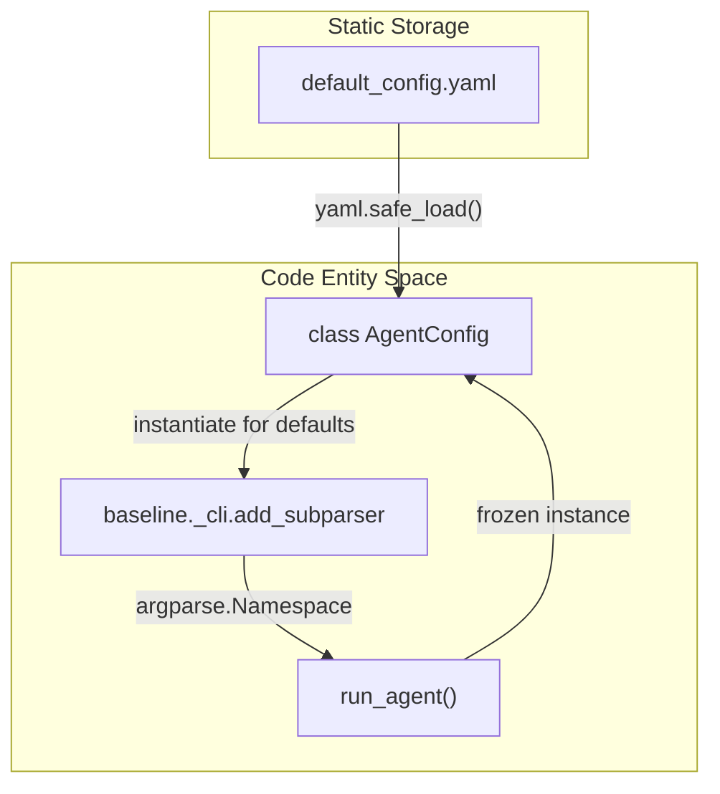
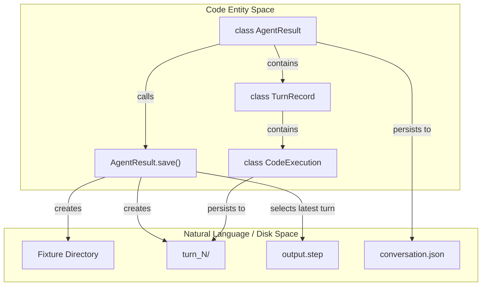

<!-- source: DeepWiki mcp.deepwiki.com · repo huggingface/cadgenbench · page 4.3 Agent Configuration and Result Persistence · fetched 2026-10-26 -->

# Agent Configuration and Result Persistence

<details>
<summary>Relevant source files</summary>

The following files were used as context for generating this wiki page:

- [src/cadgenbench/baseline/_cli.py](src/cadgenbench/baseline/_cli.py)
- [src/cadgenbench/baseline/default_config.yaml](src/cadgenbench/baseline/default_config.yaml)
- [src/cadgenbench/baseline/types.py](src/cadgenbench/baseline/types.py)

</details>


This page details the configuration schema and persistence mechanisms for the Reference Baseline Agent. It covers how `AgentConfig` serves as the single source of truth for execution parameters and how `AgentResult` manages the multi-turn directory structure required for debugging and submission.

## Agent Configuration Schema

The baseline agent's behavior is governed by the `AgentConfig` class, a frozen dataclass that ensures immutability during an agent run [src/cadgenbench/baseline/types.py:96-120]().

### Single Source of Truth
To prevent configuration drift between the codebase and the command-line interface, `cadgenbench` employs a tiered loading strategy:
1.  **`default_config.yaml`**: The base values for all parameters are defined in this YAML file [src/cadgenbench/baseline/default_config.yaml:1-21]().
2.  **`AgentConfig` Dataclass**: At import time, `cadgenbench.baseline.types` loads the YAML and uses its values as field defaults [src/cadgenbench/baseline/types.py:52-56]().
3.  **CLI Synchronization**: The `cadgenbench baseline run` subparser uses an instance of `AgentConfig()` to populate its `argparse` defaults [src/cadgenbench/baseline/_cli.py:86-128]().

### Key Configuration Parameters

| Parameter | Type | Description |
| :--- | :--- | :--- |
| `backend` | `str` | The geometry kernel targeted by the agent (`build123d` or `cadquery`) [src/cadgenbench/baseline/types.py:109](). |
| `max_iterations` | `int` | The maximum number of agent turns allowed [src/cadgenbench/baseline/types.py:114](). |
| `max_duration_s` | `float` | Wall-clock timeout for the entire fixture run [src/cadgenbench/baseline/types.py:115](). |
| `reasoning_effort` | `str` | Cross-provider budget for reasoning models (mapped via LiteLLM) [src/cadgenbench/baseline/types.py:118](). |
| `runner_timeout` | `int` | Timeout for individual code execution subprocesses [src/cadgenbench/baseline/types.py:116](). |

### Configuration Data Flow
The following diagram illustrates how configuration flows from the static YAML file to the active agent execution.

**Configuration Synchronization Diagram**

Sources: [src/cadgenbench/baseline/types.py:52-56](), [src/cadgenbench/baseline/_cli.py:88-128](), [src/cadgenbench/baseline/types.py:96-120]()

## Result Persistence and Directory Layout

The `AgentResult.save()` method is responsible for persisting the state of an agent run to disk [src/cadgenbench/baseline/types.py:171-236](). It organizes artifacts into a hierarchical structure that separates per-turn telemetry from the final submission candidate.

### Directory Structure
When an agent finishes (or is stopped), it creates the following layout in the output directory:

```text
<fixture_id>/
├── baseline_debug.json   # Metadata (stopped_reason, duration)
├── conversation.json     # Full LLM message history
├── output.step           # Canonical candidate (copied from latest turn)
└── turn_N/               # Per-iteration directory (0, 1, 2...)
    ├── code_M.py         # The Python code extracted from LLM response
    ├── stdout_M.txt      # Standard output from execution
    ├── stderr_M.txt      # Error logs (if any)
    ├── output.step       # Snapshot of the STEP file at this turn
    └── *.png             # Visual feedback renders saved by the agent
```
Sources: [src/cadgenbench/baseline/types.py:174-192](), [src/cadgenbench/baseline/types.py:210-236]()

### Canonical Candidate Selection
The baseline agent may produce multiple STEP files across several turns. To comply with the submission contract, `cadgenbench` must select a single "canonical" file. The logic implemented in `_find_latest_turn_candidate` scans all `turn_N` directories and selects the `output.step` from the highest-indexed turn [src/cadgenbench/baseline/types.py:64-90](). This file is then copied to the fixture root [src/cadgenbench/baseline/types.py:230-234]().

### Stopped Reasons
The `stopped_reason` field in `AgentResult` (persisted in `baseline_debug.json`) indicates why the agent loop terminated [src/cadgenbench/baseline/types.py:168]():
*   `done`: The agent explicitly emitted the `[DONE]` token [src/cadgenbench/baseline/types.py:168]().
*   `max_iterations`: The turn limit defined in `AgentConfig.max_iterations` was reached [src/cadgenbench/baseline/types.py:168]().
*   `timeout`: The global `max_duration_s` wall-clock timer expired [src/cadgenbench/baseline/types.py:168]().
*   `max_tokens`: The total token budget was exhausted [src/cadgenbench/baseline/types.py:168]().

### Persistence Logic Flow
The following diagram maps the persistence classes to the physical file system entities.

**Persistence Mapping Diagram**

Sources: [src/cadgenbench/baseline/types.py:126-170](), [src/cadgenbench/baseline/types.py:171-236](), [src/cadgenbench/baseline/types.py:64-90]()

## Implementation Details

### Incremental Saving
The agent loop is designed to be resilient. While `AgentResult.save()` is called at the end of a run, the agent loop often performs incremental saves to ensure that artifacts from early turns are preserved even if a crash or hard timeout occurs during a later turn [src/cadgenbench/baseline/types.py:40-50]().

### Stream Coercion
When capturing `stdout` or `stderr` from the `CodeExecution` subprocess, the data may arrive as `bytes` if the process was interrupted. The `_as_text` utility is used to safely decode these streams to UTF-8 (replacing invalid characters) before writing to disk, preventing `TypeError` during persistence [src/cadgenbench/baseline/types.py:40-50]().

Sources: [src/cadgenbench/baseline/types.py:40-50](), [src/cadgenbench/baseline/types.py:126-135]()

---

