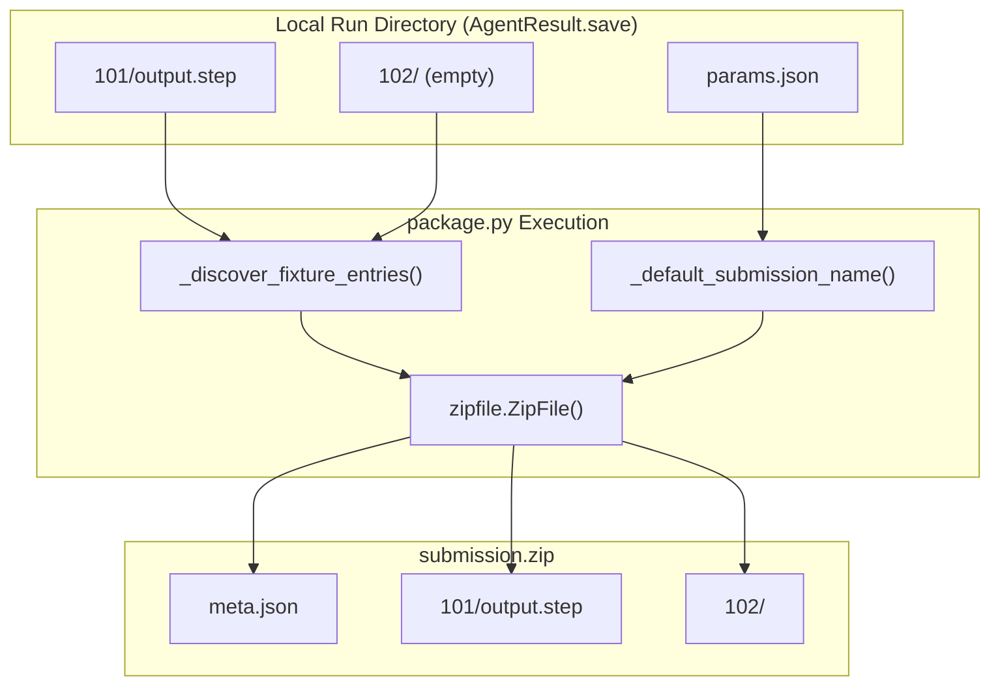

<!-- source: DeepWiki mcp.deepwiki.com · repo huggingface/cadgenbench · page 4.4 Submission Packaging · fetched 2026-10-26 -->

# Submission Packaging

<details>
<summary>Relevant source files</summary>

The following files were used as context for generating this wiki page:

- [README.md](README.md)
- [docs/benchmark/submission.md](docs/benchmark/submission.md)
- [src/cadgenbench/baseline/package.py](src/cadgenbench/baseline/package.py)
- [tests/baseline/test_package.py](tests/baseline/test_package.py)

</details>


The `cadgenbench baseline package` command automates the assembly of agent outputs into a submission-compliant ZIP archive. This ensures that results generated by the reference baseline or custom agents adhere to the directory structure and metadata requirements expected by the leaderboard's evaluation pipeline [src/cadgenbench/baseline/package.py:17-19]().

## Submission Layout and Contract

A valid submission must be a single ZIP file containing a `meta.json` file at the root and one directory per benchmark sample [src/cadgenbench/baseline/package.py:21-24]().

| Component | Path | Requirement |
| :--- | :--- | :--- |
| **Metadata** | `/meta.json` | Must contain submitter info and publication consent [src/cadgenbench/baseline/package.py:23-24](). |
| **Sample Dir** | `/<sample_id>/` | Named after the fixture (e.g., `101`). Must exist even if empty [src/cadgenbench/baseline/package.py:155-158](). |
| **Candidate** | `/<sample_id>/output.step` | The STEP/BREP file to be scored. `output.stp` is also accepted [src/cadgenbench/baseline/package.py:53-56](). |

A sample directory that does not contain an `output.step` file is explicitly preserved in the ZIP as an empty directory [src/cadgenbench/baseline/package.py:158](). This allows the evaluator to distinguish between a skipped sample (recorded as `status: "missing"`) and an excluded sample [docs/benchmark/submission.md:20-21]().

### Metadata Schema (`meta.json`)
The packaging logic mirrors the leaderboard's requirement for the following keys:
- `submitter_name`: Name of the individual or team [src/cadgenbench/baseline/package.py:143]().
- `submission_name`: A descriptive label for the run [src/cadgenbench/baseline/package.py:144]().
- `agent_url`: (Optional) Link to the agent source code [src/cadgenbench/baseline/package.py:145]().
- `notes`: (Optional) Brief description of the approach [src/cadgenbench/baseline/package.py:146]().
- `agree_to_publish`: Boolean. If `false`, the leaderboard will reject the submission [src/cadgenbench/baseline/package.py:147]().

## Packaging Implementation

The packaging process is handled by the `run` function in `src/cadgenbench/baseline/package.py`. It performs three primary phases: discovery, metadata synthesis, and archive construction.

### Process Flow: Run Dir to ZIP
The following diagram illustrates how the `cadgenbench baseline package` command transforms a local run directory into the final submission artifact.

**Submission Assembly Flow**

**Sources:** [src/cadgenbench/baseline/package.py:86-105](), [src/cadgenbench/baseline/package.py:108-119](), [src/cadgenbench/baseline/package.py:153-160]()

### Discovery and Filtering
The `_discover_fixture_entries` function scans the `run_dir` for subdirectories. For each subdirectory, it searches for a file named `output.step` or `output.stp` [src/cadgenbench/baseline/package.py:86-105]().
- Files must have a size greater than 0 bytes to be considered valid candidates [src/cadgenbench/baseline/package.py:101]().
- If no candidate is found, the fixture name is still returned with a `None` path to ensure the directory is created in the ZIP [src/cadgenbench/baseline/package.py:104]().

### Implementation Mapping
This diagram maps the natural language requirements of a submission to the specific code entities responsible for fulfilling them.

**Code Entity Mapping**
```mermaid
classDiagram
    class "Submission Requirement" {
        +meta.json
        +output.step
        +directory_per_sample
    }

    class "package.py" {
        +_discover_fixture_entries()
        +_default_submission_name()
        +run(args)
    }

    class "zipfile.ZipFile" {
        +writestr(name, data)
        +write(filename, arcname)
    }

    "Submission Requirement" --|> "package.py" : implemented_by
    "package.py" ..> "zipfile.ZipFile" : orchestrates
    "package.py" : _CANDIDATE_NAMES = ["output.step", "output.stp"]
```
**Sources:** [src/cadgenbench/baseline/package.py:53-56](), [src/cadgenbench/baseline/package.py:86-105](), [src/cadgenbench/baseline/package.py:121-160]()

## Pre-flight Sanity Check

Before uploading a generated ZIP to the leaderboard, users are encouraged to use the `sanity_check_submission.py` script. This script is distributed as part of the `cadgenbench-data` repository and exercises the same validity gate as the scoring engine [docs/benchmark/submission.md:127-134]().

### Functionality
- **B-Rep Analysis**: Uses `BRepCheck` to ensure the STEP file is well-formed [docs/benchmark/submission.md:117-119]().
- **Watertightness**: Verifies that the geometry forms a closed, watertight volume [docs/benchmark/submission.md:117-119]().
- **Manifold Check**: Ensures the resulting mesh is a closed manifold [docs/benchmark/submission.md:117-119]().
- **Exit Codes**: Returns a non-zero exit code if any check fails, providing a local "fail-fast" mechanism before remote evaluation [docs/benchmark/submission.md:136-137]().

**Sources:** [docs/benchmark/submission.md:113-137](), [README.md:67-70]()

## CLI Usage

The packaging utility is invoked via the `cgb` (or `cadgenbench`) CLI:

```bash
cadgenbench baseline package <run_dir> \
    --submitter "Engineer Name" \
    --name "Agent v1.0" \
    --agree \
    -o my_submission.zip
```

### Arguments
- `run_dir`: The directory containing the agent's output (usually `results/<timestamp>_<model>/`) [src/cadgenbench/baseline/package.py:67-68]().
- `--agree`: Sets `agree_to_publish: true` in `meta.json`. This is a mandatory opt-in for leaderboard participation [src/cadgenbench/baseline/package.py:80-82]().
- `-o`: Specifies the output path. Defaults to `<run_dir>.zip` [src/cadgenbench/baseline/package.py:69-70]().

**Sources:** [src/cadgenbench/baseline/package.py:59-84](), [README.md:163-166]()

---

