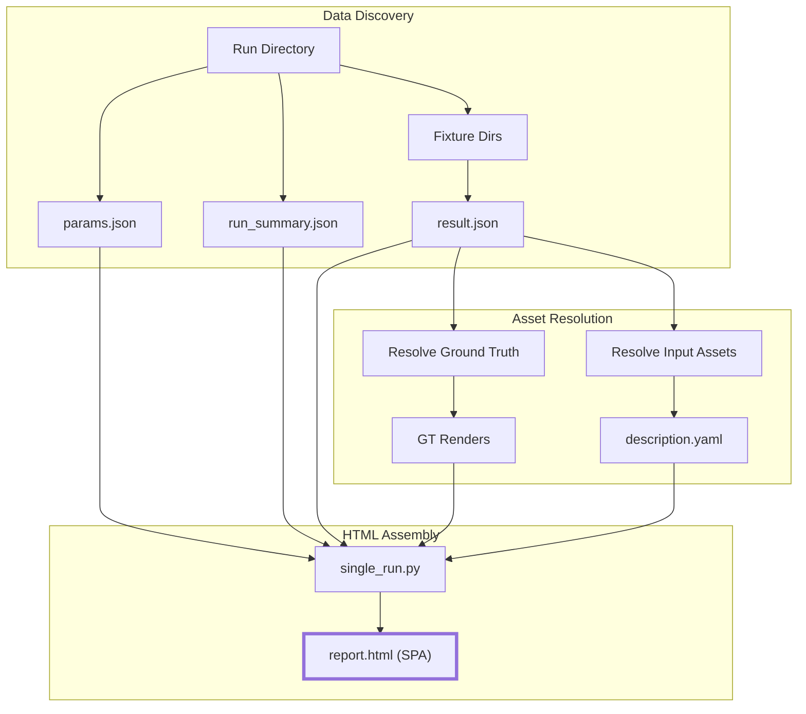

<!-- source: DeepWiki mcp.deepwiki.com · repo huggingface/cadgenbench · page 5 HTML Reporting · fetched 2026-10-26 -->

# HTML Reporting

<details>
<summary>Relevant source files</summary>

The following files were used as context for generating this wiki page:

- [src/cadgenbench/eval/report/single_run.py](src/cadgenbench/eval/report/single_run.py)
- [src/cadgenbench/eval/run_summary.py](src/cadgenbench/eval/run_summary.py)
- [tests/eval/test_report_input.py](tests/eval/test_report_input.py)
- [tests/eval/test_run_summary.py](tests/eval/test_run_summary.py)

</details>


The `cadgenbench report single` command transforms a results directory into a portable, interactive HTML report. This report provides a visual and quantitative summary of a model's performance across the benchmark, ranging from high-level aggregate metrics to granular, per-turn debug timelines for each fixture.

The reporting system is designed to handle both local development (where assets are inlined as base64) and hosted environments (where assets are served via a proxy to minimize HTML bloat).

### Report Generation Flow

The generation process follows a linear pipeline: discovery of data on disk, resolution of external assets (Ground Truth and Input files), and finally, the assembly of a Single Page Application (SPA) into a standalone HTML file.


**Sources:** [src/cadgenbench/eval/report/single_run.py:15-29](), [src/cadgenbench/eval/run_summary.py:78-103]()

---

### Data Discovery and Aggregation

Before the report is rendered, the system aggregates per-fixture results into a `run_summary.json`. This file acts as the primary data source for the report's summary grid.

*   **Metric Aggregation:** The `write_run_summary` function walks the run directory, reading every `result.json`. It calculates the mean `cad_score` across all samples, ensuring that invalid or missing samples contribute a score of `0.0` to avoid inflating the performance of unstable models [src/cadgenbench/eval/run_summary.py:50-53](), [src/cadgenbench/eval/run_summary.py:152-154]().
*   **Task Segmentation:** Results are grouped by `task_type` (e.g., `generation`, `editing`) as defined in the fixture's `description.yaml` [src/cadgenbench/eval/run_summary.py:27-30](), [src/cadgenbench/eval/run_summary.py:134-134]().
*   **Asset Mapping:** The report generator maps these results back to the original benchmark data to pull in descriptions and input media.

For details on how the system locates and processes these files, see [Report Data Discovery and Asset Resolution](#5.1).

---

### Interactive Frontend Architecture

The report is an embedded SPA that uses a "grid-to-detail" navigation pattern. It is designed for rapid manual inspection of model outputs.

| Component | Responsibility | Code Entity |
| :--- | :--- | :--- |
| **Summary Grid** | Thumbnail view of all fixtures with status pills and CAD scores. | `gcard` elements |
| **Filter Bar** | Search by fixture number and filter by task type or status. | `segmented control` |
| **Detail Card** | Three-column view (Input \| GT \| Output) with full metrics. | `fixture-card` |
| **Debug Panel** | Per-turn timeline, LLM responses, and code execution logs. | `debug-panel` |
| **Orientation** | SVG gizmo showing the current 3D view orientation. | `gizmo_svg` |

```mermaid
graph LR
    subgraph "SPA View State"
        GRID["Summary Grid"] -- "Click Card" --> DETAIL["Detail View"]
        DETAIL -- "Esc / Back" --> GRID
        DETAIL -- "J / K keys" --> DETAIL
    end

    subgraph "Detail Components"
        DETAIL --> METRICS["Metric Pills"]
        DETAIL --> RENDERS["Turntable WebPs"]
        DETAIL --> TIMELINE["Turn Slider"]
    end

    METRICS --- [src/cadgenbench/eval/report/single_run.py:47-52]()
    TIMELINE --- [src/cadgenbench/eval/report/single_run.py:18-20]()
    GRID --- [src/cadgenbench/eval/report/single_run.py:17-18]()
```
**Sources:** [src/cadgenbench/eval/report/single_run.py:15-23](), [src/cadgenbench/common/axes_gizmo.py:71-71]()

For details on the UI implementation and navigation features, see [Report Frontend Architecture](#5.2).

---

### Asset Handling: Local vs. Hosted

A key feature of the reporting system is the `_data_uri` abstraction, which allows the report to function in two distinct modes:

1.  **Local Mode (Portable):** Assets (images, renders) are read from disk and converted into base64 data URIs. This makes the resulting HTML file entirely self-contained and shareable without external dependencies [src/cadgenbench/eval/report/single_run.py:78-82]().
2.  **Hosted Mode (Lazy Loading):** When a `base_url` is provided, assets are referenced via URLs. This is used in the Hugging Face Space leaderboard to keep HTML file sizes small while streaming media lazily through an input proxy [src/cadgenbench/eval/report/single_run.py:85-100]().

The system also handles specialized assets like `edit_diff.webp` for editing tasks, which provides a ghosted visualization of the differences between the starting shape and the model's output [src/cadgenbench/eval/report/single_run.py:54-57]().

**Sources:** [src/cadgenbench/eval/report/single_run.py:85-100](), [src/cadgenbench/eval/report/single_run.py:148-163]()

---

## Child Pages

*   **[Report Data Discovery and Asset Resolution](#5.1)**: Deep dive into the `discover_run` logic, path resolution for GT/Inputs, and the base64/URL asset abstraction.
*   **[Report Frontend Architecture](#5.2)**: Technical details of the SPA, including the CSS grid layout, the interactive debug timeline, and keyboard-driven navigation.

---

