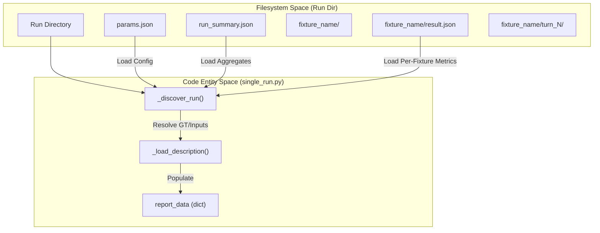
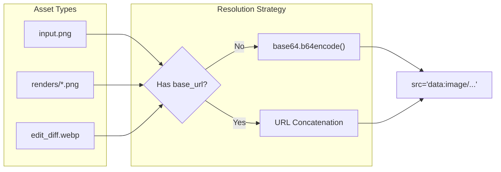

<!-- source: DeepWiki mcp.deepwiki.com · repo huggingface/cadgenbench · page 5.1 Report Data Discovery and Asset Resolution · fetched 2026-10-26 -->

# Report Data Discovery and Asset Resolution

Relevant source files

The following files were used as context for generating this wiki page:

- [src/cadgenbench/common/paths.py](src/cadgenbench/common/paths.py)
- [src/cadgenbench/eval/report/single_run.py](src/cadgenbench/eval/report/single_run.py)

The `cadgenbench report single` command transforms a raw experiment run directory into a self-contained, interactive HTML report. This process requires scanning the run directory to discover results, resolving external references to ground-truth (GT) and input datasets, and preparing binary assets (images and renders) for embedding or proxying.

## Run Directory Discovery

The discovery process begins by scanning a target directory for standardized JSON artifacts produced by the evaluation and agent pipelines.

### Key Artifacts
- **`params.json`**: Contains the experiment configuration, including model name, system prompts, and task parameters [src/cadgenbench/eval/report/single_run.py:255-257]().
- **`run_summary.json`**: Contains aggregated metrics across the entire run [src/cadgenbench/eval/report/single_run.py:261-263]().
- **`result.json`**: Per-fixture evaluation results. The discovery logic iterates through subdirectories (fixtures) to locate these files [src/cadgenbench/eval/report/single_run.py:270-272]().

### Data Flow: Discovery to Report
The following diagram illustrates how the `report single` command maps filesystem entities to the internal data structures used by the HTML template.

**Discovery and Resolution Mapping**

Sources: [src/cadgenbench/eval/report/single_run.py:246-300](), [src/cadgenbench/eval/report/single_run.py:148-163]()

## Asset Resolution and Path Mapping

A report must display three columns for every fixture: **Input**, **Ground Truth**, and **Output**. Since the run directory only contains the **Output**, the reporter must resolve the other two from the environment.

### Ground Truth (GT) Resolution
The GT directory is resolved using `data_gt_dir()`, which checks the `CADGENBENCH_DATA_GT_REPO` (Hub) or `CADGENBENCH_DATA_DIR` (local) environment variables [src/cadgenbench/common/paths.py:110-124](). The reporter specifically looks for `renders/*.png` within the GT fixture directory to display the canonical views (iso, front, top, etc.) [src/cadgenbench/eval/report/single_run.py:199-203]().

### Input Resolution
The reporter uses `_inputs_dir_for()` to locate input assets [src/cadgenbench/eval/report/single_run.py:114-115](). It prioritizes:
1. **Sibling Layout**: A local `data/inputs` directory sitting next to `data/gt` [src/cadgenbench/eval/report/single_run.py:134-136]().
2. **Canonical Resolver**: The Hub-based dataset resolved via `data_inputs_dir()` [src/cadgenbench/eval/report/single_run.py:138-139]().

### Asset Type Detection
The `_load_description` function determines what to display in the Input column [src/cadgenbench/eval/report/single_run.py:148-150]():
- **Generation Tasks**: Detects `input.png` or files listed in `description.yaml` [src/cadgenbench/eval/report/single_run.py:174-185]().
- **Editing Tasks**: Detects `input.step`. Since raw STEP files cannot be rendered in HTML `` tags, the reporter looks for pre-rendered PNGs in the `renders/` subdirectory of the input fixture [src/cadgenbench/eval/report/single_run.py:187-194]().

Sources: [src/cadgenbench/eval/report/single_run.py:114-143](), [src/cadgenbench/eval/report/single_run.py:148-208](), [src/cadgenbench/common/paths.py:15-47]()

## Hosted vs. Local Asset Abstraction

The reporter supports two modes of asset delivery: **Local Portable HTML** and **Hosted Space Report**. This is abstracted via the `_input_src` and `_data_uri` helpers.

| Mode | `base_url` | Asset Resolution Strategy | Implementation |
| :--- | :--- | :--- | :--- |
| **Local** | `None` | **Base64 Inlining**: Assets are read from disk, encoded, and embedded directly in the HTML. | `_data_uri(path)` [src/cadgenbench/eval/report/single_run.py:78-82]() |
| **Hosted** | Provided | **Proxy URL**: Assets are referenced via a URL relative to the input/GT root, allowing lazy loading. | `f"{base_url}/{rel}"` [src/cadgenbench/eval/report/single_run.py:94-99]() |

### Edit-Diff Asset Detection
For editing tasks, the reporter specifically looks for `edit_diff.webp` (an animation showing the transition from start to finish) and `edit_diff.png` (a static still for the grid view) [src/cadgenbench/eval/report/single_run.py:54-57](), [src/cadgenbench/eval/report/single_run.py:348-350]().

**Asset Resolution Logic**

Sources: [src/cadgenbench/eval/report/single_run.py:78-100](), [src/cadgenbench/eval/report/single_run.py:348-356]()

## Implementation Details

### Metadata Formatting
Metrics are formatted for display using `_fmt_metric`, which consults `METRIC_DISPLAY` (imported from the scoring engine) to apply correct decimal precision and suffixes (e.g., "%" for IoU) [src/cadgenbench/eval/report/single_run.py:103-107]().

### Path Safety
When resolving relative paths for hosted reports, the system uses `Path.relative_to` within a `try/except` block to fall back to the filename if the asset is outside the expected inputs directory [src/cadgenbench/eval/report/single_run.py:94-98]().

Sources: [src/cadgenbench/eval/report/single_run.py:66-70](), [src/cadgenbench/eval/report/single_run.py:94-100]()

---

