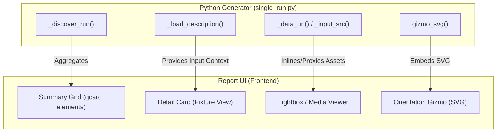
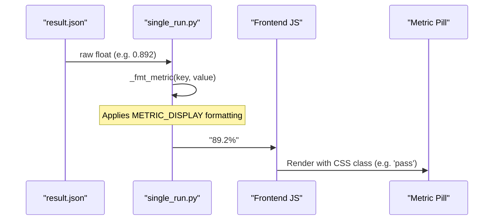

<!-- source: DeepWiki mcp.deepwiki.com · repo huggingface/cadgenbench · page 5.2 Report Frontend Architecture · fetched 2026-10-26 -->

# Report Frontend Architecture

Relevant source files

The following files were used as context for generating this wiki page:

- [src/cadgenbench/eval/report/single_run.py](src/cadgenbench/eval/report/single_run.py)

The `cadgenbench` report is a standalone, interactive HTML Single Page Application (SPA) designed to provide deep visibility into benchmark results. It transforms a collection of JSON summaries, STEP files, and WebP animations into a navigable interface for performance analysis and visual debugging.

The report serves two primary deployment modes:
1.  **Local Portable Report**: A single HTML file with all assets (images, metrics, logs) embedded as Base64 data URIs.
2.  **Hosted Space Report**: A lightweight HTML shell that lazily loads assets from a backend proxy (e.g., Hugging Face Spaces), optimized for large-scale benchmark runs.

## System Architecture and Data Flow

The reporting engine, defined in `cadgenbench.eval.report.single_run`, orchestrates the discovery of run artifacts and their transformation into a JSON state object consumed by the frontend JavaScript.

### Data Discovery and Transformation
The backend scans a run directory to build a comprehensive view of the experiment. It resolves three distinct data sources:
*   **Run Metadata**: `params.json` and `run_summary.json` providing global metrics and configuration [src/cadgenbench/eval/report/single_run.py:15-29]().
*   **Fixture Results**: `result.json` files containing individual metric breakdowns (Shape, Topology, Interface) and validity status [src/cadgenbench/eval/report/single_run.py:114-142]().
*   **Input Context**: Ground truth STEP renders and task descriptions resolved from the local environment or Hub [src/cadgenbench/eval/report/single_run.py:148-186]().

### Component Relationship Diagram
This diagram maps the high-level report sections to their corresponding implementation logic in the Python reporting engine.

**Report Component Map**

Sources: [src/cadgenbench/eval/report/single_run.py:15-101](), [src/cadgenbench/common/axes_gizmo.py:1-20]()

## The Summary Grid

The summary grid is the entry point of the report, providing a high-level overview of all fixtures in a run.

### Filtering and Segmentation
The grid supports three primary interaction patterns:
*   **Task-Type Segmented Control**: Filters fixtures by their category (e.g., `gen`, `edit`).
*   **Search Filter**: A text-based filter for fixture names.
*   **Metric Highlighting**: Visual indicators (pills) for the `cad_score` and validity status.

### Visual Cues
Each grid card (`gcard`) displays a representative thumbnail of the model. For editing tasks, the report uses a specialized `EDIT_DIFF_STILL` (a static PNG of the diff turntable) to immediately communicate the changes made to the base model [src/cadgenbench/eval/report/single_run.py:54-57]().

## Fixture Detail Cards

Clicking a grid card opens a detailed view of the fixture. The layout is strictly organized into a three-column architecture to facilitate direct comparison.

### Three-Column Layout
1.  **Input Column**: Displays the task description and input assets (drawings or starting STEP files). For editing tasks, it renders pre-rendered views of the base shape [src/cadgenbench/eval/report/single_run.py:148-190]().
2.  **Ground Truth (GT) Column**: Shows the reference model renders.
3.  **Output Column**: Displays the candidate model generated by the agent, including the turntable animation and metric pills.

### Metrics and Validation Pills
Metrics are displayed as interactive pills. If a `metrics_base_url` is provided, these pills deep-link to the technical documentation explaining the metric's calculation [src/cadgenbench/eval/report/single_run.py:43-52]().

**Data Flow: Metric to UI**

Sources: [src/cadgenbench/eval/report/single_run.py:103-108](), [src/cadgenbench/eval/shape_similarity.py:67-69]()

## Interactive Features

### Orientation Gizmo
The report embeds a custom SVG orientation gizmo in the corner of render views. This gizmo is generated server-side using `gizmo_svg` and provides a visual reference for the X, Y, and Z axes, ensuring the user understands the orientation of the isometric and orthographic views [src/cadgenbench/common/axes_gizmo.py:22-60]().

### Lightbox and Media Navigation
*   **Turntables**: WebP animations are used for 360-degree model inspection.
*   **Keyboard Navigation**: The SPA supports `j`/`k` or arrow keys for moving between fixtures and `Escape` to return to the grid [src/cadgenbench/eval/report/single_run.py:22-23]().
*   **URL Deep-Linking**: The application state is synchronized with the URL hash, allowing users to share links to specific fixtures or views.

### Debug Panel (Agent Runs)
For runs involving an iterative agent, a specialized debug panel is included. This panel features:
*   **Turn Timeline**: A slider to scrub through the agent's iterative attempts.
*   **LLM Logs**: Full raw responses from the LLM.
*   **Code Execution**: The generated CAD code and the resulting execution output/errors for each turn [src/cadgenbench/eval/report/single_run.py:18-20]().

## Asset Resolution Strategy

The report uses an abstraction layer to handle asset paths, ensuring portability.

| Asset Type | Local Mode (Default) | Hosted Mode (Space) |
| :--- | :--- | :--- |
| **Input Images** | Base64 via `_data_uri` | Proxy URL via `_input_src` |
| **GT Renders** | Base64 | Lazy-loaded from Hub |
| **Output Renders** | Base64 | Relative path to run dir |

This strategy prevents the HTML file from becoming excessively large (hundreds of MBs) when hosted, while maintaining a single-file "shareable" format for local development [src/cadgenbench/eval/report/single_run.py:78-101]().

Sources:
* `src/cadgenbench/eval/report/single_run.py`
* `src/cadgenbench/common/axes_gizmo.py`
* `src/cadgenbench/eval/shape_similarity.py`

---

