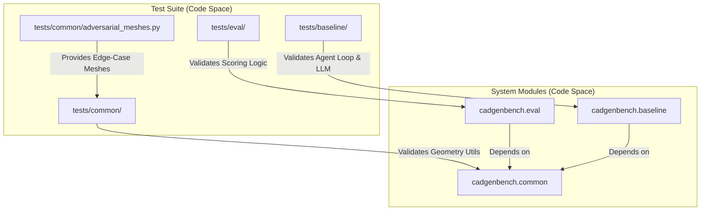

<!-- source: DeepWiki mcp.deepwiki.com · repo huggingface/cadgenbench · page 6 Testing Infrastructure · fetched 2026-10-26 -->

# Testing Infrastructure

Relevant source files

The following files were used as context for generating this wiki page:

- [src/cadgenbench/__init__.py](src/cadgenbench/__init__.py)
- [src/cadgenbench/baseline/llm.py](src/cadgenbench/baseline/llm.py)
- [src/cadgenbench/common/validity.py](src/cadgenbench/common/validity.py)
- [src/cadgenbench/eval/report/__init__.py](src/cadgenbench/eval/report/__init__.py)
- [src/cadgenbench/eval/sampling.py](src/cadgenbench/eval/sampling.py)
- [src/cadgenbench/eval/shape_similarity.py](src/cadgenbench/eval/shape_similarity.py)
- [tests/baseline/test_agent.py](tests/baseline/test_agent.py)
- [tests/baseline/test_llm.py](tests/baseline/test_llm.py)
- [tests/common/adversarial_meshes.py](tests/common/adversarial_meshes.py)
- [tests/common/test_mesh.py](tests/common/test_mesh.py)
- [tests/common/test_validity.py](tests/common/test_validity.py)
- [tests/eval/test_edit_baseline.py](tests/eval/test_edit_baseline.py)
- [tests/eval/test_shape_similarity.py](tests/eval/test_shape_similarity.py)

The CADGenBench testing infrastructure ensures the reliability of the scoring engine, geometry processing pipelines, and the reference baseline agent. The suite is organized to validate both the mathematical correctness of metrics and the robustness of the system against adversarial or malformed CAD data.

## Overview

The test suite is partitioned into two main domains:
1.  **Evaluation Logic**: Focuses on the scoring axes (Shape, Topology, Interface) and the orchestration of the evaluation pipeline.
2.  **Common and Baseline Logic**: Focuses on the shared geometry utilities (tessellation, manifold validation) and the iterative LLM agent loop.

### Testing Patterns
*   **Fixture-Based Testing**: Uses a dedicated set of generated STEP files (boxes, spheres, cylinders) and adversarial meshes to verify geometric gates [tests/common/test_mesh.py:1-14]().
*   **Mocked LLM Interactions**: The baseline agent is tested using a mocked `LLMClient` to verify loop logic, retry behavior, and code extraction without incurring API costs [tests/baseline/test_agent.py:1-19]().
*   **Property-Based Geometry Tests**: Verifies that metrics like `shape_surface_distance_f1` are symmetric and return exactly 1.0 for identical shapes [tests/eval/test_shape_similarity.py:57-73]().

### Test Suite Architecture

The following diagram maps the testing infrastructure to the core system components it validates.

**Test-to-System Mapping**

**Sources:** [tests/eval/test_edit_baseline.py:1-6](), [tests/baseline/test_agent.py:1-19](), [tests/common/test_mesh.py:1-14](), [src/cadgenbench/__init__.py:20-25]()

---

## 6.1 Eval Tests

The evaluation tests verify the integrity of the scoring pipeline. This includes the mathematical properties of the shape similarity metrics, the correctness of Betti number calculations for topology, and the logic for the editing task's renormalization.

### Key Coverage Areas
*   **Metric Exactness**: Ensures `shape_volume_iou` and `shape_surface_distance_f1` return 1.0 for identical geometry [tests/eval/test_shape_similarity.py:57-64]().
*   **Inversion Tolerance**: Validates that the normal-agreement gate accepts flipped surface normals (orientation-insensitive) for surface distance scoring [src/cadgenbench/eval/shape_similarity.py:173-182](), [tests/eval/test_shape_similarity.py:102-127]().
*   **Editing Renormalization**: Tests the `renormalize` function to ensure no-op edits score 0.0 and improvements are mapped correctly between the baseline and perfect scores [tests/eval/test_edit_baseline.py:47-68]().
*   **Interface Match**: Verifies that keep-in/keep-out regions are correctly identified and scored against the ground truth jigs.

For details, see [Eval Tests](#6.1).

**Sources:** [src/cadgenbench/eval/shape_similarity.py:22-35](), [tests/eval/test_edit_baseline.py:125-131](), [tests/eval/test_shape_similarity.py:135-140]()

---

## 6.2 Common and Baseline Tests

The common and baseline tests cover the foundational geometry utilities and the reference LLM agent's operational logic.

### Geometry Validation Patterns
The `validate_mesh` function is tested against a library of adversarial meshes designed to trigger specific failure modes in the CAD Validity Gate.

| Test Fixture | Target Failure Mode | Code Entity |
| :--- | :--- | :--- |
| `nonmanifold_t_mesh` | Non-manifold edges (3+ triangles) | [tests/common/adversarial_meshes.py:70-75]() |
| `open_tetrahedron_mesh` | Non-watertight (naked edges) | [tests/common/adversarial_meshes.py:97-102]() |
| `flipped_winding_mesh` | Inconsistent orientation | [tests/common/adversarial_meshes.py:124-130]() |
| `pinch_vertex_mesh` | Non-manifold vertex (pinch point) | [tests/common/adversarial_meshes.py:139-150]() |

### Agent and LLM Testing
*   **Code Extraction**: Verifies `extract_code_blocks` correctly identifies Python blocks within LLM prose [tests/baseline/test_agent.py:77-101]().
*   **Reliability**: Tests the `LLMClient` exponential backoff and retry logic for transient HTTP errors like 429 or 503 [src/cadgenbench/baseline/llm.py:87-104](), [tests/baseline/test_llm.py:144-168]().
*   **Loop Control**: Ensures the `run_agent` loop respects the `[DONE]` signal and wall-clock timeouts [tests/baseline/test_agent.py:125-143]().

For details, see [Common and Baseline Tests](#6.2).

**Sources:** [src/cadgenbench/common/validity.py:15-52](), [src/cadgenbench/common/mesh.py:22-32](), [tests/baseline/test_agent.py:168-196](), [tests/common/test_mesh.py:48-155]()

---

