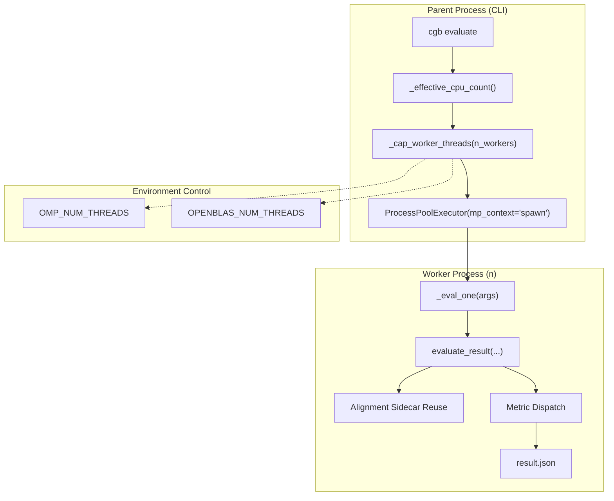
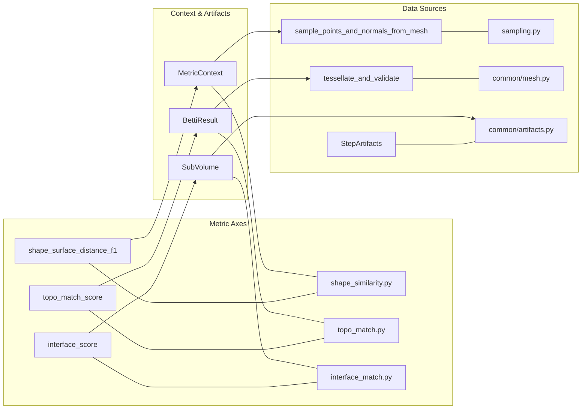

<!-- source: DeepWiki mcp.deepwiki.com · repo huggingface/cadgenbench · page 6.1 Eval Tests · fetched 2026-10-26 -->

# Eval Tests

Relevant source files

The following files were used as context for generating this wiki page:

- [src/cadgenbench/__init__.py](src/cadgenbench/__init__.py)
- [src/cadgenbench/common/profiling.py](src/cadgenbench/common/profiling.py)
- [src/cadgenbench/eval/_cli.py](src/cadgenbench/eval/_cli.py)
- [src/cadgenbench/eval/interface_match.py](src/cadgenbench/eval/interface_match.py)
- [src/cadgenbench/eval/sampling.py](src/cadgenbench/eval/sampling.py)
- [src/cadgenbench/eval/shape_similarity.py](src/cadgenbench/eval/shape_similarity.py)
- [src/cadgenbench/eval/topo_match.py](src/cadgenbench/eval/topo_match.py)
- [tests/eval/test_alignment.py](tests/eval/test_alignment.py)
- [tests/eval/test_cli_parallelism.py](tests/eval/test_cli_parallelism.py)
- [tests/eval/test_edit_baseline.py](tests/eval/test_edit_baseline.py)
- [tests/eval/test_evaluate_invalid_fastpath.py](tests/eval/test_evaluate_invalid_fastpath.py)
- [tests/eval/test_interface_match.py](tests/eval/test_interface_match.py)
- [tests/eval/test_shape_similarity.py](tests/eval/test_shape_similarity.py)
- [tests/eval/test_sidecar_alignment.py](tests/eval/test_sidecar_alignment.py)
- [tests/eval/test_topo_match.py](tests/eval/test_topo_match.py)

This page details the test coverage for the **Scoring Engine**. The suite ensures the mathematical correctness of metric axes, the robustness of the alignment system, and the determinism of the evaluation orchestrator.

## Overview of Test Coverage

The evaluation tests are designed to verify the integrity of the scoring pipeline across three primary dimensions:
1.  **Metric Exactness**: Confirming that identical geometry yields perfect scores ($1.0$) and that specific topological or geometric deviations result in predictable, monotonic score decay.
2.  **Robustness & Invariance**: Ensuring scores are invariant to non-geometric changes (e.g., face winding, vertex ordering, or global orientation) and that invalid STEP files are handled gracefully via fast-paths.
3.  **Orchestration Integrity**: Verifying that parallel execution via `ProcessPoolExecutor` does not introduce non-determinism or resource contention.

## Shape Similarity Tests

The tests in `tests/eval/test_shape_similarity.py` verify the two components of the shape axis: Surface F1 and Volumetric IoU.

### Surface Distance F1 and Normal Gating
The `shape_surface_distance_f1` metric is tested for its ability to handle "dirty" geometry like flipped normals.

*   **Identity Exactness**: Confirms that identical STEP files score exactly $1.0$ [tests/eval/test_shape_similarity.py:57-64]().
*   **Inversion Tolerance**: A critical test verifies that if a candidate has fully inverted surface normals (flipped winding) but identical geometry, the score remains $\approx 1.0$. This is achieved by using the absolute dot product $|n_{cand} \cdot n_{gt}|$ in the normal agreement gate [tests/eval/test_shape_similarity.py:102-127]().
*   **Symmetry**: Ensures that `score(A, B) \approx score(B, A)` within sampling noise [tests/eval/test_shape_similarity.py:66-73]().

### Volumetric IoU
*   **Manifold Boolean Logic**: Tests `shape_volume_iou` using `manifold3d` to ensure volumetric overlap is computed correctly for standard primitives (boxes) [tests/eval/test_shape_similarity.py:133-146]().

Sources: [src/cadgenbench/eval/shape_similarity.py:58-160](), [tests/eval/test_shape_similarity.py:1-160]()

## Topology Match Tests

Tests in `tests/eval/test_topo_match.py` exercise the Betti number extraction logic ($b_0, b_1, b_2$) and the fuzzy log-ratio aggregation.

### Betti Number Extraction
The suite uses `build123d` to generate known topological primitives at runtime to verify the extraction logic:
*   **Box**: $(1, 0, 0)$ [tests/eval/test_topo_match.py:58-62]().
*   **Plate with 1-4 Holes**: $(1, 1, 0)$ to $(1, 4, 0)$ [tests/eval/test_topo_match.py:64-81]().
*   **Hollow Ball**: $(1, 0, 1)$ [tests/eval/test_topo_match.py:83-88]().
*   **Multiple Bodies**: $(2, 0, 0)$ [tests/eval/test_topo_match.py:90-97]().

### Scoring Logic
*   **Product Aggregation**: Verifies that the `topo_match_score` is a product of per-axis scores, meaning a single badly wrong axis (e.g., missing a hole) collapses the total score toward zero [src/cadgenbench/eval/topo_match.py:46-64]().
*   **Fuzzy Decay**: Validates the `BETTI_SHARPNESS` (alpha=2) penalty using a reference implementation of the log-ratio formula [tests/eval/test_topo_match.py:29-34]().

Sources: [src/cadgenbench/eval/topo_match.py:15-65](), [tests/eval/test_topo_match.py:1-203]()

## Interface Match Tests

The interface match tests verify the sub-volume (jig) discovery and the bounded pose-search logic.

### Jig Discovery and Contexts
*   **Naming Convention**: Tests `discover_sub_volumes` against the regex `jig_(\d+)__(\d+)__(KOR|KIR)\.step` [src/cadgenbench/eval/interface_match.py:58-101]().
*   **Context Grouping**: Ensures that multiple sub-volumes sharing a `context_id` (e.g., a bolt pattern) are correctly identified as a single mating interface [tests/eval/test_interface_match.py:101-111]().

### Discrimination & Pose Search
*   **Bounded Search**: Verifies that `best_iou_in_context` can find the correct fit even if the candidate is slightly misaligned (within $\pm 1\%$ of bbox diagonal and $\pm 1^\circ$ rotation) [src/cadgenbench/eval/interface_match.py:166-175]().
*   **Pass/Fail Thresholds**: Uses a set of "broken" fixtures (e.g., holes too small, boss shifted) to ensure the `DEFAULT_IOU_THRESHOLD` (0.95) correctly discriminates between valid and invalid interfaces [tests/eval/test_interface_match.py:141-169]().

Sources: [src/cadgenbench/eval/interface_match.py:15-180](), [tests/eval/test_interface_match.py:1-186]()

## Edit Baseline Tests

Editing tasks are scored relative to a "no-op" baseline (the input file). Tests in `tests/eval/test_edit_baseline.py` verify the renormalization and axis classification logic.

### Axis Classification
The system classifies each metric axis into roles based on the baseline score:
*   **ROLE_TARGET**: High headroom ($1.0 - baseline > floor$), indicating the user intended to change this axis [tests/eval/test_edit_baseline.py:94-107]().
*   **ROLE_PRESERVE**: Low headroom, indicating this axis should remain unchanged [tests/eval/test_edit_baseline.py:103-109]().

### Renormalization and Gating
*   **Target Renormalization**: Maps the no-op score to $0.0$ and a perfect score to $1.0$ [tests/eval/test_edit_baseline.py:47-53]().
*   **Preserve Gate**: Acts as a one-sided penalty; if a preserved axis is "broken" (score drops below baseline), it multiplies the final score [tests/eval/test_edit_baseline.py:75-84]().

Sources: [tests/eval/test_edit_baseline.py:1-185]()

## Orchestration and CLI Tests

### Parallelism and Determinism
Tests in `tests/eval/test_cli_parallelism.py` verify that the `evaluate` subcommand remains deterministic when using multiple workers.

*   **Worker Picklability**: Ensures `_eval_one` is module-level and picklable, a requirement for the `spawn` multiprocessing context used on Linux/macOS to ensure VTK fork-safety [src/cadgenbench/eval/_cli.py:53-54](), [tests/eval/test_cli_parallelism.py:111-117]().
*   **Order Preservation**: Stubs `evaluate_result` to verify that the orchestrator collects and writes results in the correct order regardless of which worker finishes first [tests/eval/test_cli_parallelism.py:135-182]().

### Parallelism Data Flow
The following diagram illustrates how the CLI manages worker processes and thread caps to prevent CPU oversubscription.

**CLI Orchestration and Resource Management**

Sources: [src/cadgenbench/eval/_cli.py:53-122](), [tests/eval/test_cli_parallelism.py:1-182]()

## Evaluation Logic Entities

This diagram bridges the high-level test concepts to the specific code entities responsible for the evaluation logic.

**Scoring Engine Code Entity Map**

Sources: [src/cadgenbench/eval/shape_similarity.py:58-64](), [src/cadgenbench/eval/topo_match.py:88-100](), [src/cadgenbench/eval/interface_match.py:62-80](), [src/cadgenbench/eval/sampling.py:115-122]()

---

