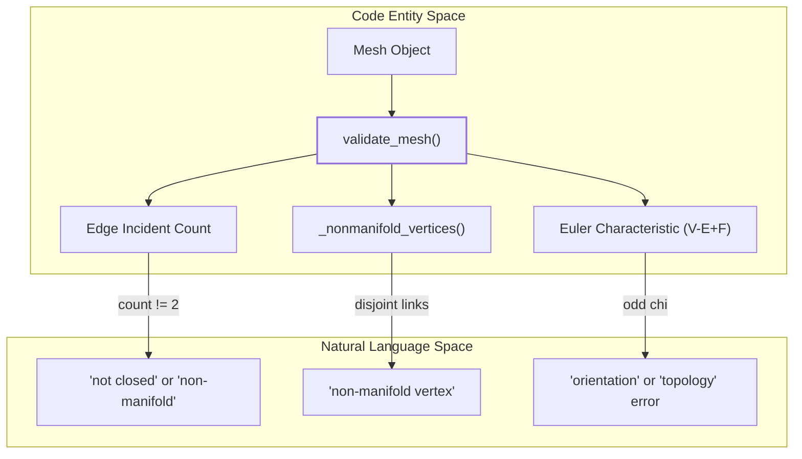
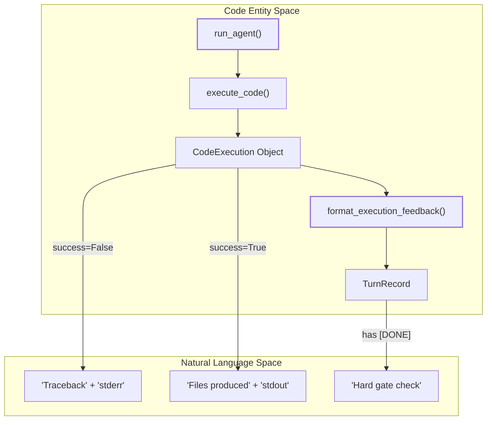

<!-- source: DeepWiki mcp.deepwiki.com · repo huggingface/cadgenbench · page 6.2 Common and Baseline Tests · fetched 2026-10-26 -->

# Common and Baseline Tests

Relevant source files

The following files were used as context for generating this wiki page:

- [.cursor/rules/style.mdc](.cursor/rules/style.mdc)
- [src/cadgenbench/baseline/llm.py](src/cadgenbench/baseline/llm.py)
- [src/cadgenbench/baseline/package.py](src/cadgenbench/baseline/package.py)
- [src/cadgenbench/common/imaging.py](src/cadgenbench/common/imaging.py)
- [src/cadgenbench/common/viewer.py](src/cadgenbench/common/viewer.py)
- [src/cadgenbench/eval/report/__init__.py](src/cadgenbench/eval/report/__init__.py)
- [tests/baseline/test_agent.py](tests/baseline/test_agent.py)
- [tests/baseline/test_llm.py](tests/baseline/test_llm.py)
- [tests/baseline/test_package.py](tests/baseline/test_package.py)
- [tests/common/adversarial_meshes.py](tests/common/adversarial_meshes.py)
- [tests/common/test_imaging.py](tests/common/test_imaging.py)
- [tests/common/test_mesh.py](tests/common/test_mesh.py)
- [tests/common/test_mesh_safeguards.py](tests/common/test_mesh_safeguards.py)
- [tests/common/test_viewer.py](tests/common/test_viewer.py)

This section details the test coverage for shared geometry utilities and the reference baseline agent. These tests ensure the reliability of the core geometric primitives (manifold validation, rendering, and tessellation) and the stability of the iterative LLM-driven agent loop.

## Geometry and Mesh Validation Tests

The system employs a strict mesh-manifold gate to ensure that candidate STEP files can be reliably scored by downstream metric engines (e.g., Boolean IoU and Betti number computation). Testing for this infrastructure uses hand-built adversarial meshes to verify that specific failure modes are correctly detected.

### Adversarial Mesh Coverage
The `tests/common/adversarial_meshes.py` module provides tiny, verifiable meshes (≤ 12 triangles) designed to trip individual validation gates [tests/common/adversarial_meshes.py:25-27]().

| Fixture | Target Gate | Description |
|:---|:---|:---|
| `cube_mesh` | Happy Path | A closed manifold unit cube that passes all checks [tests/common/adversarial_meshes.py:37-42](). |
| `nonmanifold_t_mesh` | Manifold Gate | Three triangles sharing a single edge [tests/common/adversarial_meshes.py:70-75](). |
| `open_tetrahedron_mesh` | Closed Gate | A tetrahedron with one face removed, creating open edges [tests/common/adversarial_meshes.py:97-102](). |
| `flipped_winding_mesh` | Orientation Gate | A cube with one triangle's winding reversed [tests/common/adversarial_meshes.py:124-131](). |
| `pinch_vertex_mesh` | Vertex-Manifold Gate | Two tetrahedra sharing only a single apex vertex [tests/common/adversarial_meshes.py:139-150](). |

### Mesh Validation Logic
The `validate_mesh` function in `src/cadgenbench/common/mesh.py` is tested against these fixtures to ensure it raises `MeshSanityError` with descriptive diagnostics [tests/common/test_mesh.py:71-120]().

**Data Flow: Mesh Validation**
"Natural Language Space" (Validation Results) maps to "Code Entity Space" (Mesh Analysis).

Sources: [src/cadgenbench/common/mesh.py:22-33](), [tests/common/test_mesh.py:48-130](), [tests/common/adversarial_meshes.py:1-27]()

## Imaging and Rendering Tests

Headless rendering tests verify that VTK/PyVista produces consistent visual artifacts across different camera presets without stale buffers.

### Rendering Determinism
`TestRenderStep` ensures that requested views (e.g., `iso`, `front`, `top`) produce distinct PNG images by hashing the resulting bytes [tests/common/test_viewer.py:62-73](). This prevents regressions where the plotter might return a stale screenshot from a previous camera position.

### Image Transforms
The `cadgenbench.common.imaging` module provides renderer-free transforms using Pillow. Tests in `tests/common/test_imaging.py` verify that `first_frame_png` correctly extracts frame 0 from an animated turntable WebP, ensuring the static thumbnail matches the start of the animation [tests/common/imaging.py:29-39](), [tests/common/test_imaging.py:34-40]().

Sources: [src/cadgenbench/common/viewer.py:101-158](), [tests/common/test_viewer.py:50-92](), [src/cadgenbench/common/imaging.py:29-45]()

## Baseline Agent Infrastructure Tests

Tests for the reference baseline agent focus on the iterative loop, code extraction, and reliability of the LLM client.

### Code Extraction and Execution
The agent must reliably extract Python blocks from LLM prose and execute them in a persistent directory.
- **Extraction:** `extract_code_blocks` and `extract_code` are tested to ensure they ignore non-Python blocks and correctly strip whitespace [tests/baseline/test_agent.py:77-120]().
- **Execution:** `execute_code` is tested for success/failure handling, timeout enforcement, and file persistence across turns [tests/baseline/test_agent.py:168-197]().

### LLM Client Reliability
`LLMClient` (wrapping LiteLLM) is tested for:
- **Retries:** Exponential backoff on transient errors (RateLimit, Timeout, etc.) [src/cadgenbench/baseline/llm.py:87-94](), [tests/baseline/test_llm.py:148-168]().
- **History Pruning:** `_prune_history_images` is verified to keep only the most recent $N$ images to bound request size while preserving the initial input image [src/cadgenbench/baseline/llm.py:122-162]().
- **Prompt Caching:** Injection of `cache_control` breakpoints for Anthropic models [src/cadgenbench/baseline/llm.py:171-180]().

### Agent State and Feedback
"Natural Language Space" (Agent Feedback) maps to "Code Entity Space" (Execution State).

Sources: [src/cadgenbench/baseline/agent.py:11-20](), [tests/baseline/test_agent.py:1-21](), [src/cadgenbench/baseline/llm.py:15-22]()

## Packaging and Submission Tests

The `cadgenbench baseline package` command transforms a run directory into a ZIP file compliant with the leaderboard submission contract.

### Submission Contract Validation
Tests in `tests/baseline/test_package.py` verify that:
1. **Missing Fixtures:** Directories for fixtures that failed to produce an `output.step` are preserved in the ZIP as empty folders, allowing the evaluator to record a "missing" status [tests/baseline/package.py:86-93](), [tests/baseline/test_package.py:28-45]().
2. **Metadata:** The `meta.json` file is correctly populated with submitter info and the `agree_to_publish` flag [tests/baseline/package.py:142-148]().
3. **Candidate Discovery:** The packager correctly identifies `output.step` or `output.stp` files within fixture subdirectories [tests/baseline/package.py:53-57]().

Sources: [src/cadgenbench/baseline/package.py:15-37](), [tests/baseline/test_package.py:28-62]()

---

