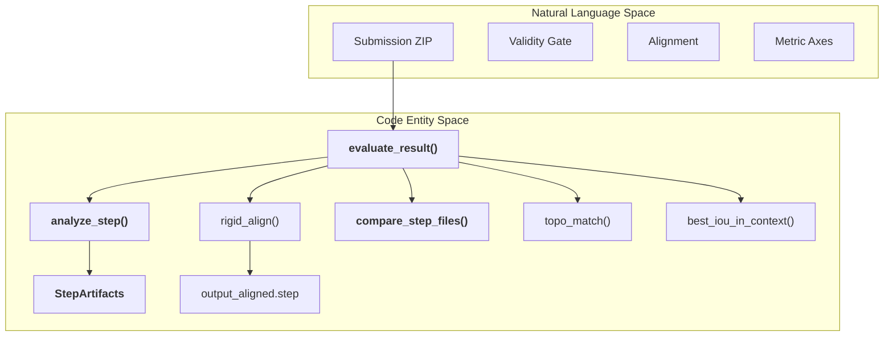
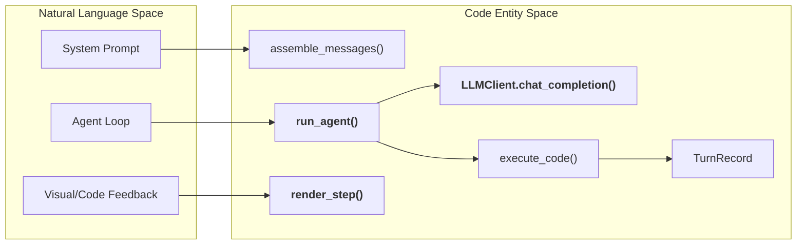

<!-- source: DeepWiki mcp.deepwiki.com · repo huggingface/cadgenbench · page 7 Glossary · fetched 2026-10-26 -->

# Glossary

Relevant source files

The following files were used as context for generating this wiki page:

- [.cursor/rules/style.mdc](.cursor/rules/style.mdc)
- [README.md](README.md)
- [docs/metrics.md](docs/metrics.md)
- [docs/metrics/interface_match.md](docs/metrics/interface_match.md)
- [docs/metrics/shape_similarity.md](docs/metrics/shape_similarity.md)
- [docs/metrics/topo_match.md](docs/metrics/topo_match.md)
- [src/cadgenbench/baseline/agent.py](src/cadgenbench/baseline/agent.py)
- [src/cadgenbench/baseline/prompt.py](src/cadgenbench/baseline/prompt.py)
- [src/cadgenbench/common/artifacts.py](src/cadgenbench/common/artifacts.py)
- [src/cadgenbench/common/mesh.py](src/cadgenbench/common/mesh.py)
- [src/cadgenbench/common/validity.py](src/cadgenbench/common/validity.py)
- [src/cadgenbench/common/viewer.py](src/cadgenbench/common/viewer.py)
- [src/cadgenbench/eval/alignment.py](src/cadgenbench/eval/alignment.py)
- [src/cadgenbench/eval/edit_baseline.py](src/cadgenbench/eval/edit_baseline.py)
- [src/cadgenbench/eval/evaluate.py](src/cadgenbench/eval/evaluate.py)
- [tests/common/test_validity.py](tests/common/test_validity.py)
- [tests/common/test_viewer.py](tests/common/test_viewer.py)

This page defines the core technical terms, domain concepts, and implementation-specific identifiers used throughout the CADGenBench codebase.

## Core Domain Concepts

### CAD Score
The primary aggregate metric used to rank submissions. It is a weighted mean of three orthogonal $[0, 1]$ metrics, gated by **CAD Validity**.
*   **Generation Formula**: $0.4 \cdot \text{Shape} + 0.4 \cdot \text{Interface} + 0.2 \cdot \text{Topology}$ [src/cadgenbench/eval/evaluate.py:95-99]().
*   **Editing Formula**: A renormalized product of target axes and preserve gates [src/cadgenbench/eval/edit_baseline.py:33-37]().

### Validity Gate
A mandatory check that a candidate STEP file must pass. If the gate fails, the `cad_score` is forced to $0$ [docs/metrics.md:14-15](). It checks:
1.  **B-Rep Well-formedness**: Using OpenCascade's `BRepCheck_Analyzer` [src/cadgenbench/common/validity.py:22-23]().
2.  **Watertightness**: Ensuring all shells are closed with no naked edges [src/cadgenbench/common/validity.py:24-25]().
3.  **Manifold Mesh**: The ability to tessellate into a closed, orientation-consistent triangle mesh [src/cadgenbench/common/validity.py:32-37]().

### Task Types
*   **Generation**: Creating a part from a description or drawing [README.md:11-12]().
*   **Editing**: Modifying an existing `input.step` to match a requested change [README.md:13-14]().

---

## Technical Entities and Implementation

### Geometry and Mesh Space

| Term | Definition | Code Pointer |
| :--- | :--- | :--- |
| `StepArtifacts` | A lazy-loading container for OCC shapes, meshes, and Betti numbers. | [src/cadgenbench/common/artifacts.py:66-83]() |
| `Mesh` | A dataclass holding validated, welded triangle arrays (`vertices`, `triangles`). | [src/cadgenbench/common/mesh.py:75-93]() |
| `Deflection` | The chord-error tolerance for tessellation, relative to the GT bounding box. | [src/cadgenbench/common/mesh.py:113-127]() |
| `Sidecar` | A `.mesh.npz` file containing pre-computed mesh data to skip re-tessellation. | [src/cadgenbench/common/artifacts.py:30-38]() |

### Evaluation Space

| Term | Definition | Code Pointer |
| :--- | :--- | :--- |
| `Interface Match` | Volumetric IoU scoring of keep-in (KIR) and keep-out (KOR) regions. | [docs/metrics/interface_match.md:9-17]() |
| `Topology Match` | Comparison of Betti numbers ($b_0, b_1, b_2$) of the boundary surface. | [src/cadgenbench/eval/evaluate.py:33-38]() |
| `Edit Baseline` | A JSON sidecar in GT dirs defining the "no-op" score for renormalization. | [src/cadgenbench/eval/edit_baseline.py:64-66]() |
| `Renormalization` | Mapping the "no-op" strategy to 0 and perfect edits to 1. | [src/cadgenbench/eval/edit_baseline.py:23-26]() |

---

## System Architecture Diagrams

### Natural Language to Code Entity: Scoring Pipeline
This diagram maps the high-level scoring concepts to the specific Python classes and functions that implement them.

**Scoring Orchestration Logic**

**Sources:** [src/cadgenbench/eval/evaluate.py:139-164](), [src/cadgenbench/common/validity.py:107-113](), [src/cadgenbench/common/artifacts.py:66-73](), [src/cadgenbench/eval/interface_match.py:100-105]()

### Natural Language to Code Entity: Baseline Agent
This diagram associates the agent's behavioral loop with the underlying implementation modules.

**Agent Feedback Loop**

**Sources:** [src/cadgenbench/baseline/agent.py:15-26](), [src/cadgenbench/baseline/prompt.py:15-24](), [src/cadgenbench/baseline/llm.py:1-20](), [src/cadgenbench/common/viewer.py:87-90]()

---

## Glossary of Abbreviations

*   **B-Rep**: Boundary Representation. The standard mathematical model for CAD geometry (faces, edges, vertices).
*   **KIR / KOR**: Keep-In Region / Keep-Out Region. Sub-volumes used for interface matching [docs/metrics/interface_match.md:12-14]().
*   **OCC**: OpenCascade. The underlying geometric kernel used for STEP parsing and tessellation [src/cadgenbench/common/mesh.py:24-28]().
*   **IoU**: Intersection over Union. A volumetric similarity metric [docs/metrics/shape_similarity.md:15-17]().
*   **F1**: A metric combining precision and recall, used here for surface distance agreement [docs/metrics/shape_similarity.md:11-13]().
*   **Betti Numbers**: Topological invariants ($b_0$: components, $b_1$: handles, $b_2$: voids) [src/cadgenbench/eval/evaluate.py:33-38]().

**Sources:** [README.md:1-20](), [src/cadgenbench/eval/evaluate.py:15-64](), [src/cadgenbench/eval/edit_baseline.py:15-53](), [src/cadgenbench/common/mesh.py:15-56](), [docs/metrics.md:1-35]()