# Page: CADGenBench Overview

# CADGenBench Overview

<details>
<summary>Relevant source files</summary>

The following files were used as context for generating this wiki page:

- [.cursor/rules/project-context.mdc](.cursor/rules/project-context.mdc)
- [README.md](README.md)
- [docs/metrics.md](docs/metrics.md)
- [pyproject.toml](pyproject.toml)
- [src/cadgenbench/baseline/cadquery_cheat_sheet.md](src/cadgenbench/baseline/cadquery_cheat_sheet.md)
- [src/cadgenbench/cli.py](src/cadgenbench/cli.py)
- [src/cadgenbench/common/baseline_models.py](src/cadgenbench/common/baseline_models.py)
- [tests/test_cli_optional_extras.py](tests/test_cli_optional_extras.py)

</details>


**CADGenBench** is a technical benchmark designed to measure the performance of AI systems in producing 3D mechanical parts. It evaluates systems on two primary tasks: **Generation** (creating a 3D model from a textual or visual description) and **Editing** (applying a requested change to an existing STEP file) [README.md:8-14]().

The benchmark is system-agnostic. It does not assume a specific CAD kernel or modeling approach; instead, it defines a contract where a submission consists of one candidate STEP/BREP file (`output.step`) per sample [README.md:16-21]().

## System Architecture

The codebase is organized into three major subsystems: a scoring engine for evaluation, shared geometric infrastructure, and a reference baseline agent.

### Subsystem Relationship
The following diagram illustrates how the major components interact to transform natural language/image inputs into scored CAD entities.

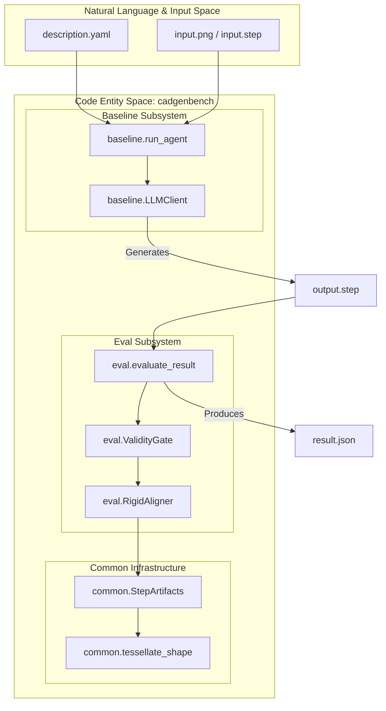
Sources: [README.md:31-38](), [src/cadgenbench/cli.py:48-60](), [.cursor/rules/project-context.mdc:62-71]()

## Key Subsystems

### 1. Scoring Engine (Eval)
The scoring engine implements the **CAD Score**, a weighted combination of three orthogonal metrics gated by a validity check [docs/metrics.md:16-23]().
- **CAD Validity Gate**: A mandatory check ensuring the STEP file is a well-formed, watertight B-rep that can be meshed into a closed manifold [docs/metrics.md:96-101]().
- **Shape Similarity**: Measures surface distance F1 and volumetric IoU [docs/metrics.md:105-109]().
- **Topology Match**: Compares Betti numbers ($b_0, b_1, b_2$) to verify the number of pieces, holes, and voids [docs/metrics.md:111-115]().
- **Interface Match**: Evaluates mating-feature correctness using keep-in/keep-out sub-volumes [docs/metrics.md:117-121]().

For details, see [Scoring Engine](#2).

### 2. Reference Baseline Agent
The repo includes an optional iterative agent that uses Large Language Models (LLMs) to write CAD code (supporting `build123d` and `cadquery` backends) [README.md:35-38](). It operates in a feedback loop, reviewing renders of its generated STEP files to refine the code until it passes validity checks [README.md:91-93]().

For details, see [Reference Baseline Agent](#4).

### 3. Geometry and Mesh Infrastructure
Shared utilities handle the heavy lifting of CAD geometry. The system strictly loads geometry from BREP/STEP using OpenCascade (OCCT) via the `OCP` bindings [README.md:13-16](), [.cursor/rules/project-context.mdc:38-41](). It provides:
- **Tessellation**: Converting B-reps to meshes for rendering and IoU calculations [pyproject.toml:29-33]().
- **Headless Rendering**: Using PyVista and VTK to generate visual feedback and report assets without requiring a GPU or browser [pyproject.toml:29-33]().

For details, see [Geometry and Mesh Infrastructure](#3).

## CLI and Tooling

The primary entry point is the `cadgenbench` (alias `cgb`) command-line tool [src/cadgenbench/cli.py:39-44]().

### CLI Command Structure
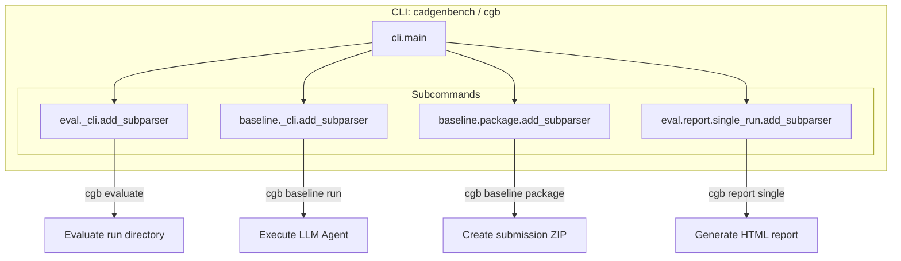
Sources: [src/cadgenbench/cli.py:45-61](), [README.md:121-168]()

For details on flags and usage, see [CLI Reference](#1.3).

## Data and Fixtures
Benchmark samples are hosted on the Hugging Face Hub in two repositories:
1. `cadgenbench-data`: Publicly available inputs (descriptions, images, input STEPs) [README.md:173-175]().
2. `cadgenbench-data-gt`: Private ground-truth data used by the leaderboard Space [README.md:40-42]().

The system resolves these paths at runtime using environment variables like `CADGENBENCH_DATA_REPO` [README.md:110]().

For details, see [Data Layout and Fixture Structure](#1.2).

## Installation
The core library requires Python 3.12+ [pyproject.toml:11](). Optional extras are available for the baseline agent (`[baseline]`) and development tools (`[dev]`) [pyproject.toml:43-54]().

For details, see [Getting Started: Installation and Configuration](#1.1).

---

# Page: Getting Started: Installation and Configuration

# Getting Started: Installation and Configuration

<details>
<summary>Relevant source files</summary>

The following files were used as context for generating this wiki page:

- [.cursor/rules/project-context.mdc](.cursor/rules/project-context.mdc)
- [README.md](README.md)
- [pyproject.toml](pyproject.toml)
- [src/cadgenbench/baseline/cadquery_cheat_sheet.md](src/cadgenbench/baseline/cadquery_cheat_sheet.md)
- [src/cadgenbench/cli.py](src/cadgenbench/cli.py)
- [src/cadgenbench/common/baseline_models.py](src/cadgenbench/common/baseline_models.py)
- [src/cadgenbench/common/paths.py](src/cadgenbench/common/paths.py)
- [tests/test_cli_optional_extras.py](tests/test_cli_optional_extras.py)

</details>


This page provides a technical guide for setting up the **CADGenBench** environment. It covers the installation of the core scoring engine and the optional reference baseline agent, the configuration of data paths via environment variables, and the integration of LLM providers.

## Installation Overview

CADGenBench is built on Python 3.12+ and leverages the OpenCascade (OCCT) kernel via `build123d` and `cadquery-ocp` [pyproject.toml:11-17](). The project is designed to be tool-agnostic, meaning the scoring engine evaluates standard STEP/BREP files regardless of how they were generated [README.md:16-21]().

### Core Installation
The core package includes the scoring engine and geometry utilities. It is sufficient for users who only need to evaluate existing submissions or run the local sanity checker.

```bash
# 1. Create a Python 3.12 environment
python -m venv .venv && source .venv/bin/activate

# 2. Install core dependencies
pip install -e .
```

### Baseline Agent Installation
To run the iterative LLM-driven CAD agent, you must install the `[baseline]` extra. This pulls in `litellm` for model routing and `python-dotenv` for secret management [pyproject.toml:43-50]().

```bash
# Install with baseline and development extras
pip install -e ".[baseline,dev]"
```

### System Dependencies
While the Python stack is self-contained via `pip` (including OCCT wheels), the headless renderer (`pyvista`/`VTK`) requires system-level OpenGL libraries on Linux (e.g., `libgl1` or Mesa) [README.md:113-116](). macOS generally works out of the box.

Sources: [pyproject.toml:11-54](), [README.md:97-116](), [src/cadgenbench/cli.py:80-90]()

---

## Configuration and Environment Variables

CADGenBench uses environment variables to resolve the location of fixture inputs and ground-truth data. This allows the system to switch between local development directories and cloud-hosted Hugging Face Hub datasets.

### Data Path Resolution
The `cadgenbench.common.paths` module manages a tiered resolution strategy for data directories [src/cadgenbench/common/paths.py:15-47]().

| Variable | Purpose | Default / Fallback |
|---|---|---|
| `CADGENBENCH_DATA_REPO` | HF Dataset ID for public inputs (e.g., `HuggingAI4Engineering/cadgenbench-data`). | `./data/inputs/` |
| `CADGENBENCH_DATA_GT_REPO` | HF Dataset ID for private ground truth. Requires `HF_TOKEN`. | `./data/gt/` |
| `CADGENBENCH_DATA_DIR` | Local override for the parent data folder. | `Path.cwd() / "data"` |

### LLM API Keys
If using the reference baseline, create a `.env` file in the project root to store your provider keys. The agent uses `litellm`, so any supported provider string (e.g., `anthropic/`, `openai/`, `gemini/`) can be used [README.md:104-105]().

```bash
ANTHROPIC_API_KEY=sk-...
OPENAI_API_KEY=sk-...
GEMINI_API_KEY=...
```

### Data Flow Diagram: Path Resolution
This diagram illustrates how `cadgenbench.common.paths` bridges the environment configuration to the local file system.

**Figure 1: Path Resolution Logic**
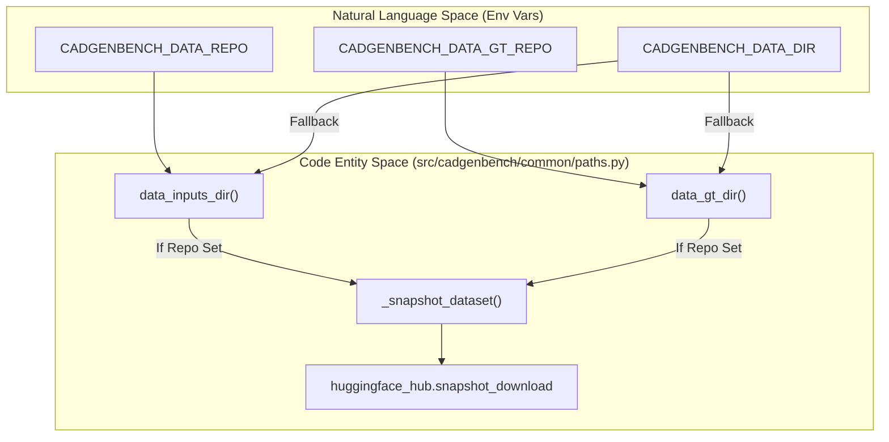
Sources: [src/cadgenbench/common/paths.py:56-139](), [README.md:107-111]()

---

## Verifying the Setup

Once installed, verify the installation by checking the CLI and running the test suite.

### CLI Smoke Test
The `cadgenbench` entry point (aliased as `cgb`) provides access to all subcommands. If the `[baseline]` extra is missing, the `baseline` subcommand will be gracefully omitted from the help menu [src/cadgenbench/cli.py:80-105]().

```bash
# Check if CLI is accessible
cgb --help

# Verify baseline registration (requires [baseline] extra)
cgb baseline --help
```

### Running Tests
The repository includes a comprehensive test suite using `pytest`. This verifies geometry kernels, mesh validation, and CLI routing [README.md:121-123]().

```bash
pytest tests/ -q
```

### System Entry Point Mapping
The following diagram maps the CLI commands to their respective internal implementation modules.

**Figure 2: CLI Command Routing**
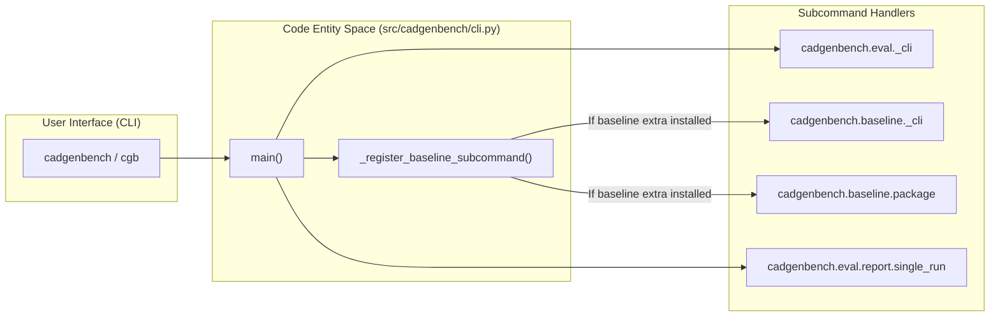
Sources: [src/cadgenbench/cli.py:39-106](), [pyproject.toml:56-58](), [tests/test_cli_optional_extras.py:47-77]()

---

## Baseline Quick Start

To verify the LLM integration, run the baseline agent on a single sample. This will execute the iterative loop: generating code, exporting a STEP file, and rendering visual feedback [README.md:129-135]().

```bash
# Run on sample 101 using GPT-5.5
cgb baseline run 101 --model openai/gpt-5.5
```

The output will be stored in `results/<timestamp>_<model>/101/output.step`. You can then package this for submission:

```bash
cgb baseline package results/<timestamp>_<model> --submitter "Name" --agree
```

Sources: [README.md:129-170](), [src/cadgenbench/baseline/cadquery_cheat_sheet.md:8-30]()

---

# Page: Data Layout and Fixture Structure

# Data Layout and Fixture Structure

<details>
<summary>Relevant source files</summary>

The following files were used as context for generating this wiki page:

- [README.md](README.md)
- [docs/benchmark/submission.md](docs/benchmark/submission.md)
- [src/cadgenbench/common/paths.py](src/cadgenbench/common/paths.py)

</details>


This page describes how CADGenBench organizes its benchmark data across local storage and the Hugging Face Hub. It details the file-level contract for inputs and ground-truth fixtures, and how the codebase resolves these paths at runtime.

## Overview of Fixture Organization

CADGenBench splits benchmark data into two distinct logical sets:
1.  **Inputs**: Publicly available data (drawings, text descriptions, starting STEP files) used by agents to generate or edit parts.
2.  **Ground Truth (GT)**: Privately held data (target STEP files, interface jigs) used by the scoring engine to evaluate candidates.

These sets are typically hosted in separate Hugging Face dataset repositories but can be mirrored locally for development or offline evaluation.

### Path Resolution Logic

The `cadgenbench.common.paths` module provides a single source of truth for locating these directories. It uses a hierarchical resolution strategy where environment variables take precedence.

| Environment Variable | Role | Description |
|---|---|---|
| `CADGENBENCH_DATA_REPO` | Public Inputs | HF Dataset ID (e.g., `HuggingAI4Engineering/cadgenbench-data`). |
| `CADGENBENCH_DATA_GT_REPO` | Private GT | HF Dataset ID (requires `HF_TOKEN` for access). |
| `CADGENBENCH_DATA_DIR` | Local Override | Path to a local directory containing `inputs/` and `gt/` subfolders. |

**Resolution Flow:**
The system first checks for Hub repository variables. If present, it uses `huggingface_hub.snapshot_download` to fetch and cache the data [src/cadgenbench/common/paths.py:127-138](). If no Hub variables are set, it looks for the local override path, and finally defaults to a `./data/` directory in the current working directory [src/cadgenbench/common/paths.py:61-94]().

**Sources:** [src/cadgenbench/common/paths.py:15-47](), [src/cadgenbench/common/paths.py:56-58]()

## Input Fixture Structure

The input directory contains one folder per sample (e.g., `101/`). Each folder contains the necessary context for a CAD generation or editing task.

| File | Requirement | Description |
|---|---|---|
| `description.yaml` | **Required** | Metadata including `task_type` (`generation` or `editing`) and the text prompt. |
| `input.png` | **Required** | High-resolution engineering drawing or reference image. |
| `input.step` | Optional | The starting geometry for **Editing** tasks. Not used for Generation tasks. |

**Sources:** [src/cadgenbench/common/paths.py:17-19](), [docs/benchmark/submission.md:23-26]()

## Ground-Truth Fixture Structure

The ground-truth directory mirrors the input folder names. These files are never shown to the agent and are only accessed by the `evaluate` command.

| File/Folder | Description |
|---|---|
| `ground_truth.step` | The "gold standard" CAD model used for shape similarity and topology scoring. |
| `jigs/` | A subdirectory containing STEP files representing keep-in (KIR) and keep-out (KOR) volumes. |
| `renders/` | Optional pre-rendered views of the ground truth for reporting. |

### Interface Jigs
Jigs are sub-volumes used to score the **Interface Match** metric. They represent functional constraints, such as a bolt hole that must remain empty (KOR) or a structural tab that must be filled (KIR).

**Sources:** [src/cadgenbench/common/paths.py:20-21](), [README.md:81-81]()

## System Entity Mapping

The following diagrams illustrate how the abstract concept of "Data Layout" maps to specific code entities and filesystem paths.

### Path Resolution and Data Flow
This diagram shows how `cadgenbench.common.paths` mediates between the environment and the rest of the system.

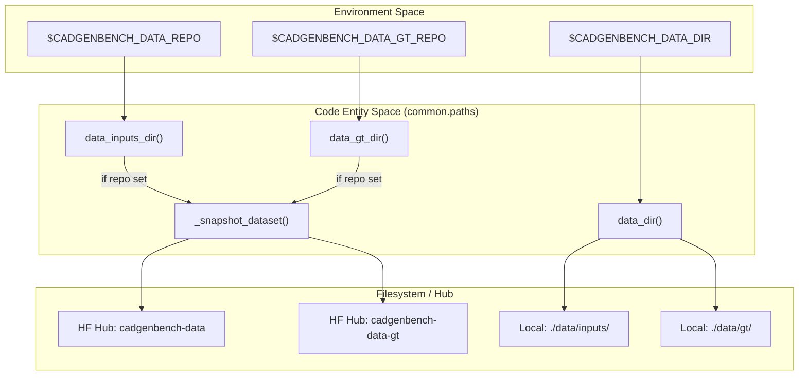
**Sources:** [src/cadgenbench/common/paths.py:56-138]()

### Fixture Component Mapping
This diagram associates specific files on disk with the metrics and tasks they support.

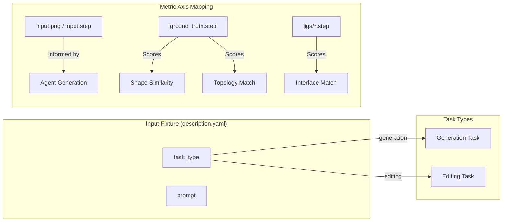
**Sources:** [README.md:11-21](), [docs/benchmark/submission.md:76-80](), [README.md:77-82]()

## Submission Directory Layout

When an agent or user produces results, they must be organized in a specific structure to be compatible with the `cadgenbench evaluate` and `cadgenbench baseline package` commands.

```text
results/
└── <run_name>/
    ├── meta.json                # Submission metadata (name, submitter, etc.)
    ├── <sample_id_101>/
    │   └── output.step          # The candidate CAD file (Required)
    ├── <sample_id_102>/
    │   └── output.step
    └── run_summary.json         # Generated by 'evaluate' after scoring
```

### The Candidate Contract
The primary artifact of any task is `output.step` (or `output.stp`).
- **Generation**: The file represents the entire part described in the prompt.
- **Editing**: The file represents the *entire* part after the requested modification has been applied [docs/benchmark/submission.md:23-26]().
- **Validity**: Every `output.step` must pass the "Validity Gate" (watertight, manifold, BRep-valid) to receive a non-zero score [docs/benchmark/submission.md:113-119]().

**Sources:** [docs/benchmark/submission.md:8-21](), [docs/benchmark/submission.md:113-119]()

---

# Page: CLI Reference

# CLI Reference

<details>
<summary>Relevant source files</summary>

The following files were used as context for generating this wiki page:

- [.cursor/rules/project-context.mdc](.cursor/rules/project-context.mdc)
- [src/cadgenbench/baseline/_cli.py](src/cadgenbench/baseline/_cli.py)
- [src/cadgenbench/baseline/package.py](src/cadgenbench/baseline/package.py)
- [src/cadgenbench/cli.py](src/cadgenbench/cli.py)
- [src/cadgenbench/common/baseline_models.py](src/cadgenbench/common/baseline_models.py)
- [src/cadgenbench/common/profiling.py](src/cadgenbench/common/profiling.py)
- [src/cadgenbench/eval/_cli.py](src/cadgenbench/eval/_cli.py)
- [src/cadgenbench/eval/report/single_run.py](src/cadgenbench/eval/report/single_run.py)
- [tests/baseline/test_package.py](tests/baseline/test_package.py)
- [tests/eval/test_cli_parallelism.py](tests/eval/test_cli_parallelism.py)
- [tests/test_cli_optional_extras.py](tests/test_cli_optional_extras.py)

</details>


The `cadgenbench` CLI (aliased as `cgb`) is the primary interface for running benchmark experiments, evaluating CAD models, and generating interactive reports [src/cadgenbench/cli.py:15-18](). It is designed to be system-agnostic, handling CAD geometry via STEP files regardless of whether they were produced by an LLM agent, a script, or a human [src/cadgenbench/cli.py:43-44]().

## Command Overview

The CLI uses a modular architecture where heavy dependencies (like `litellm`, `scipy`, or `manifold3d`) are lazily imported within specific subcommand handlers to keep `--help` commands fast [src/cadgenbench/cli.py:22-25]().

### Subcommand Registration and Dispatch
The CLI employs a "spawn" multiprocessing context on Linux to ensure VTK/OpenGL safety during parallel evaluation [src/cadgenbench/eval/_cli.py:53-53]().

| Subcommand | Purpose | Primary File |
| :--- | :--- | :--- |
| `evaluate` | (Re)compute metrics for result directories. | [src/cadgenbench/eval/_cli.py:15-31]() |
| `baseline run` | Execute the reference LLM agent on fixtures. | [src/cadgenbench/baseline/_cli.py:15-30]() |
| `baseline package` | Bundle run outputs into a leaderboard ZIP. | [src/cadgenbench/baseline/package.py:15-37]() |
| `report single` | Generate an interactive HTML report for a run. | [src/cadgenbench/eval/report/single_run.py:15-29]() |

### Optional Extras
The `baseline` subcommands require the `[baseline]` optional dependencies. If these are missing (e.g., in an eval-only environment), the CLI gracefully omits these commands from the help menu instead of failing [src/cadgenbench/cli.py:26-32]().

## `cadgenbench evaluate`

Computes or updates metrics for one or more experiment runs. It orchestrates the alignment of candidate STEP files, fills in missing renders, and writes the `result.json` for each fixture [src/cadgenbench/eval/_cli.py:15-22]().

### Usage
```bash
cadgenbench evaluate results/my_run_dir --workers 4
```

### Arguments and Flags
* `run_dirs`: One or more paths to directories containing fixture results [src/cadgenbench/eval/_cli.py:134-136]().
* `--force`: Realign and re-render even if cached artifacts exist [src/cadgenbench/eval/_cli.py:138-140]().
* `--workers`: Number of parallel worker processes. Defaults to `min(8, os.cpu_count())` [src/cadgenbench/eval/_cli.py:142-148]().

### Implementation: Parallel Orchestration
The evaluator dispatches work across a `ProcessPoolExecutor`. To avoid CPU oversubscription by underlying libraries like Open3D (OpenMP) and NumPy (BLAS), the CLI automatically caps the thread count for each worker based on the allocated CPU quota [src/cadgenbench/eval/_cli.py:105-122]().

#### Evaluation Data Flow
The diagram below illustrates how `_process_run` coordinates the evaluation lifecycle.

"CLI Evaluation Flow"
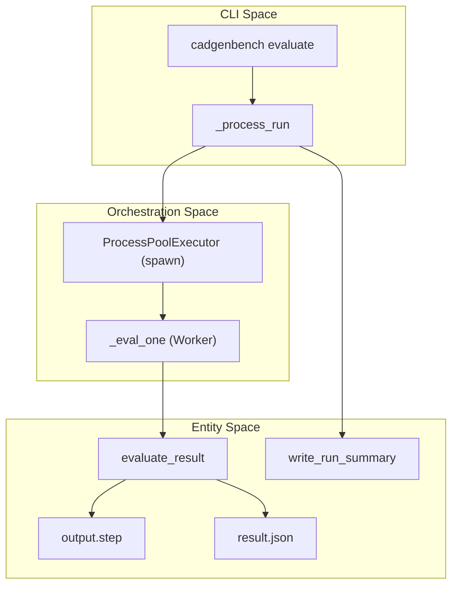
Sources: [src/cadgenbench/eval/_cli.py:152-180](), [src/cadgenbench/eval/_cli.py:53-53]()

## `cadgenbench baseline run`

Runs the reference LLM agent against benchmark fixtures. It reads descriptions from the `data/inputs/` directory and generates `output.step` files [src/cadgenbench/baseline/_cli.py:15-22]().

### Usage
```bash
cadgenbench baseline run 101 --model openai/gpt-5.5 --parallel 4
```

### Key Flags
* `fixtures`: Specific fixture names to run [src/cadgenbench/baseline/_cli.py:90-91]().
* `--all`: Run all available fixtures in the input dataset [src/cadgenbench/baseline/_cli.py:92-93]().
* `--model`: LiteLLM model string (e.g., `anthropic/claude-3-5-sonnet`) [src/cadgenbench/baseline/_cli.py:115-116]().
* `--backend`: The CAD kernel targeted by the agent (`build123d` or `cadquery`) [src/cadgenbench/baseline/_cli.py:110-114]().
* `--parallel`: Number of fixtures to run concurrently [src/cadgenbench/baseline/_cli.py:108-109]().

### Resource Management
The agent respects several "hard gates" to prevent runaway costs or time:
* `--max-iter`: Maximum agent turns per fixture [src/cadgenbench/baseline/_cli.py:96-97]().
* `--max-tokens`: Total token budget across all turns [src/cadgenbench/baseline/_cli.py:98-99]().
* `--max-duration`: Wall-clock timeout in seconds [src/cadgenbench/baseline/_cli.py:104-105]().

Sources: [src/cadgenbench/baseline/_cli.py:70-131]()

## `cadgenbench baseline package`

Bundles a baseline run directory into a ZIP file compliant with the leaderboard submission contract [src/cadgenbench/baseline/package.py:15-19]().

### Submission Contract
The resulting ZIP contains:
1. A `meta.json` file with submitter information [src/cadgenbench/baseline/package.py:142-148]().
2. One folder per fixture, containing the `output.step` candidate if generated [src/cadgenbench/baseline/package.py:155-160]().

### Arguments
* `run_dir`: Path to the directory produced by `baseline run` [src/cadgenbench/baseline/package.py:67-68]().
* `--agree`: Required flag to set `agree_to_publish=true` in `meta.json` [src/cadgenbench/baseline/package.py:80-82]().

Sources: [src/cadgenbench/baseline/package.py:59-83](), [src/cadgenbench/baseline/package.py:153-161]()

## `cadgenbench report single`

Generates an interactive, standalone HTML report for a specific run. The report includes a thumbnail grid, metric pills, and a debug panel with the full LLM conversation and execution history [src/cadgenbench/eval/report/single_run.py:15-23]().

### Usage
```bash
cadgenbench report single results/my_run -o report.html
```

### Implementation Details
* **Asset Inlining**: By default, the command inlines images and renders as Base64 data URIs to make the HTML file portable [src/cadgenbench/eval/report/single_run.py:78-82]().
* **Data Discovery**: It scans the run directory for `params.json`, `run_summary.json`, and per-fixture `result.json` files [src/cadgenbench/eval/report/single_run.py:15-23]().
* **Metrics Display**: Uses `METRIC_DISPLAY` metadata to format scores (e.g., F1 scores, IoU) and links them to documentation anchors [src/cadgenbench/eval/report/single_run.py:47-52](), [src/cadgenbench/eval/report/single_run.py:103-107]().

#### Report Generation Data Flow
"Report Generation Architecture"
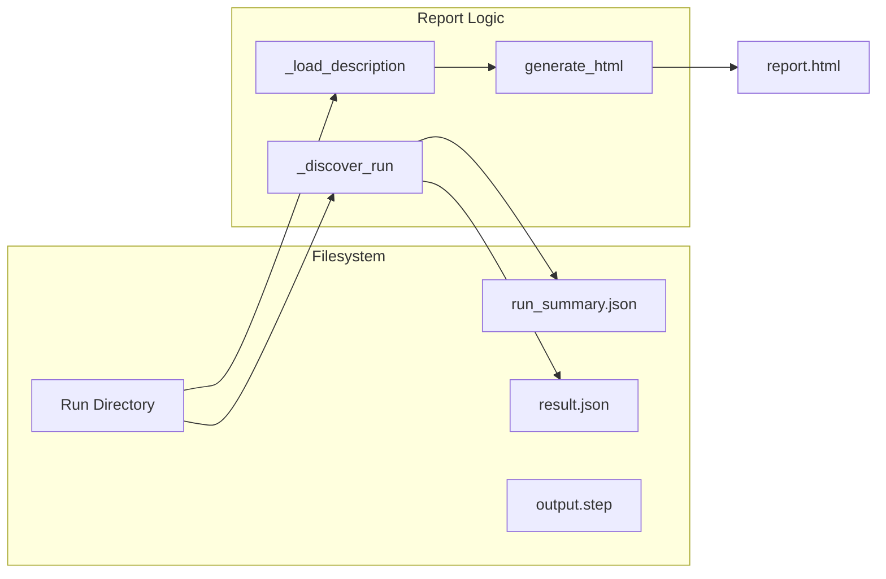
Sources: [src/cadgenbench/eval/report/single_run.py:15-29](), [src/cadgenbench/eval/report/single_run.py:148-163]()

## Exit Codes

The CLI follows standard POSIX exit code conventions [src/cadgenbench/cli.py:77-77]():

| Code | Meaning |
| :--- | :--- |
| `0` | Success. |
| `1` | General failure (e.g., evaluation errors, missing fixtures) [src/cadgenbench/eval/_cli.py:176-176](). |
| `2` | Configuration or environment error (e.g., `data/` directory not found) [src/cadgenbench/baseline/_cli.py:154-154](). |

Sources: [src/cadgenbench/cli.py:39-77](), [src/cadgenbench/eval/_cli.py:152-176](), [src/cadgenbench/baseline/_cli.py:137-164]()

---

# Page: Scoring Engine

# Scoring Engine

<details>
<summary>Relevant source files</summary>

The following files were used as context for generating this wiki page:

- [docs/benchmark/submission.md](docs/benchmark/submission.md)
- [docs/metrics.md](docs/metrics.md)
- [src/cadgenbench/eval/evaluate.py](src/cadgenbench/eval/evaluate.py)

</details>


The Scoring Engine is the core evaluation pipeline of `cadgenbench`. It transforms a raw candidate STEP file into a `cad_score`—a single scalar value in the range $[0, 1]$ that represents how well the generated geometry matches the ground truth (GT) across multiple engineering axes.

The engine is designed to be idempotent and generator-agnostic. It handles the mandatory validity checks, rigid alignment to the ground truth, and the computation of three orthogonal metric axes: **Shape Similarity**, **Topology Match**, and **Interface Match**.

### Evaluation Pipeline Flow

The scoring process follows a strict sequence: a hard validity gate, followed by spatial alignment, and finally metric computation. If the validity gate fails, the score is zeroed immediately, and further metrics are skipped to save resources.

**The Scoring Lifecycle**

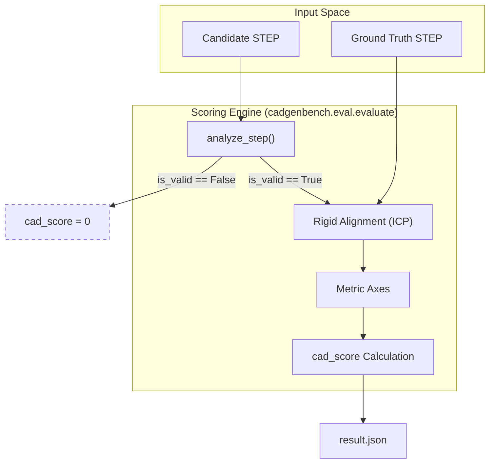
Sources: [src/cadgenbench/eval/evaluate.py:15-64](), [docs/metrics.md:52-80]()

---

### 2.1 Evaluation Orchestration
The evaluation is driven by `evaluate_result`, which manages the per-fixture lifecycle. It coordinates calling the validity gate, performing (or loading cached) alignment, and dispatching to specific metric modules. It persists results into a standardized `result.json` and aggregates run-wide statistics into `run_summary.json`.

For details, see [Evaluation Orchestration](#2.1).

Sources: [src/cadgenbench/eval/evaluate.py:139-168](), [docs/benchmark/submission.md:76-112]()

---

### 2.2 CAD Validity Gate
Every candidate must pass the `analyze_step` gate before it is considered for scoring. This gate ensures the STEP file contains a well-formed, watertight B-Rep that can be successfully tessellated into a manifold mesh. It checks for B-Rep errors, solid counts, and physical sanity (e.g., non-zero volume).

For details, see [CAD Validity Gate](#2.2).

Sources: [src/cadgenbench/common/validity.py:1-20](), [docs/metrics.md:96-103]()

---

### 2.3 Rigid Alignment
Since candidates may be generated in arbitrary orientations, the engine performs rigid alignment (rotation and translation only) to the ground truth. This uses a PCA-based octahedral pose pool followed by multi-scale Open3D ICP refinement. The resulting transformation is cached as an `aligned/output_aligned.step` to accelerate subsequent re-runs.

For details, see [Rigid Alignment](#2.3).

Sources: [docs/metrics.md:38-50](), [docs/benchmark/submission.md:139-154]()

---

### 2.4 Metric Axes
The `cad_score` is a weighted mean of three orthogonal axes, each catching specific engineering failures:

| Axis | Weight (Gen) | Purpose |
| :--- | :--- | :--- |
| **Shape Similarity** | 0.4 | Matches bulk volume and surface positioning. |
| **Interface Match** | 0.4 | Ensures the part fits into its intended assembly (mating features). |
| **Topology Match** | 0.2 | Checks for correct hole counts, pieces, and internal voids (Betti numbers). |

For details, see [Metric Axes](#2.4).

Sources: [src/cadgenbench/eval/evaluate.py:95-99](), [docs/metrics.md:82-91]()

---

### 2.5 Editing Task Scoring
For editing tasks, the scoring logic shifts to "No-op Renormalization." Instead of measuring absolute similarity, the engine uses an `edit_baseline.json` to ensure that submitting the original input unchanged results in a score of `0`. Axes are classified as `ROLE_TARGET` (expected to change) or `ROLE_PRESERVE` (must remain identical), and the final score reflects the quality of the requested change while penalizing unintended alterations.

For details, see [Editing Task Scoring](#2.5).

Sources: [src/cadgenbench/eval/edit_baseline.py:80-89](), [docs/metrics.md:125-164]()

---

### System Entity Mapping

The following diagram maps the high-level scoring concepts to the specific code entities and files that implement them.

**Code Entity Mapping: Scoring Pipeline**

```mermaid
graph LR
    subgraph "Orchestration"
        Eval["evaluate_result()"]:::file
        Summary["run_summary.py"]:::file
    end

    subgraph "Validation & Data"
        StepArt["StepArtifacts"]:::class
        Analyze["analyze_step()"]:::func
    end

    subgraph "Metrics Logic"
        Shape["compare_step_files()"]:::func
        Topo["topo_match()"]:::func
        Interface["best_iou_in_context()"]:::func
    end

    Eval --> Analyze
    Eval --> StepArt
    Eval --> Shape
    Eval --> Topo
    Eval --> Interface
    Summary --> Eval

    classDef file font-family:monospace,fill:transparent
    classDef func font-family:monospace,fill:transparent
    classDef class font-family:monospace,fill:transparent
```
Sources: [src/cadgenbench/eval/evaluate.py:100-108](), [src/cadgenbench/common/artifacts.py:73-77]()

---

# Page: Evaluation Orchestration

# Evaluation Orchestration

<details>
<summary>Relevant source files</summary>

The following files were used as context for generating this wiki page:

- [docs/benchmark/submission.md](docs/benchmark/submission.md)
- [src/cadgenbench/common/profiling.py](src/cadgenbench/common/profiling.py)
- [src/cadgenbench/eval/_cli.py](src/cadgenbench/eval/_cli.py)
- [src/cadgenbench/eval/evaluate.py](src/cadgenbench/eval/evaluate.py)
- [src/cadgenbench/eval/run_summary.py](src/cadgenbench/eval/run_summary.py)
- [tests/eval/test_cli_parallelism.py](tests/eval/test_cli_parallelism.py)
- [tests/eval/test_run_summary.py](tests/eval/test_run_summary.py)

</details>


The evaluation orchestration layer manages the end-to-end lifecycle of scoring candidate CAD models. It is driven primarily by `evaluate_result`, which acts as a central coordinator for validity checking, rigid alignment, metric computation, and artifact persistence [src/cadgenbench/eval/evaluate.py:17-64]().

## Per-Fixture Lifecycle

Each fixture follows a deterministic pipeline to produce a `result.json`. This process is idempotent; it reuses cached alignment data and renders if they are fresher than the raw candidate STEP file [src/cadgenbench/eval/evaluate.py:19-21]().

### 1. Validity Gate
The orchestrator first subjects the candidate `output.step` to the CAD Validity Gate via `analyze_step`. If the file is missing, the status is set to `STATUS_MISSING`. If it exists but fails structural or manifold checks, it is marked `STATUS_INVALID` and assigned a `cad_score` of 0 [src/cadgenbench/eval/evaluate.py:129-132](), [src/cadgenbench/eval/evaluate.py:205-220]().

### 2. Rigid Alignment
Valid candidates are aligned to the ground truth using a multi-scale ICP process. The orchestrator checks for a cached aligned file at `aligned/output_aligned.step`. If missing or stale, it triggers the alignment pipeline and persists the transformation [src/cadgenbench/eval/evaluate.py:112-112](), [src/cadgenbench/eval/evaluate.py:246-265]().

### 3. Metric Dispatch
Once aligned, the orchestrator dispatches the model to three orthogonal metric axes:
*   **Shape Similarity**: Point-to-surface distances and volume IoU [src/cadgenbench/eval/evaluate.py:30-31]().
*   **Topology Match**: Betti-number agreement (b0, b1, b2) [src/cadgenbench/eval/evaluate.py:35-38]().
*   **Interface Match**: Scored only if jig sub-volumes are discovered in the ground truth directory [src/cadgenbench/eval/evaluate.py:33-34]().

### 4. Result Composition
The final `cad_score` is a weighted mean of the available axes. For standard generation tasks, the weights are defined in `GENERATION_AXIS_WEIGHTS` (Shape: 0.4, Interface: 0.4, Topology: 0.2) [src/cadgenbench/eval/evaluate.py:95-99](). For editing tasks, the orchestrator performs no-op renormalization against an `edit_baseline.json` and uses `EDITING_AXIS_WEIGHTS` [src/cadgenbench/eval/evaluate.py:80-89]().

### Data Flow: Per-Fixture Evaluation
This diagram maps the natural language lifecycle to the specific functions and files responsible for execution.

```mermaid
graph TD
    subgraph "Natural Language Space"
        A["Candidate STEP"] --> B["Validity Check"]
        B -- "Valid" --> C["Alignment"]
        C --> D["Metric Scoring"]
        D --> E["Result Persistence"]
    end

    subgraph "Code Entity Space"
        B1["analyze_step() in common/validity.py"]
        C1["compare_step_files() in eval/shape_similarity.py"]
        D1["topo_match() in eval/topo_match.py"]
        D2["best_iou_in_context() in eval/interface_match.py"]
        E1["evaluate_result() in eval/evaluate.py"]
        
        E1 --> B1
        B1 -- "ValidityResult" --> E1
        E1 -- "force_align" --> C1
        C1 -- "aligned/output_aligned.step" --> E1
        E1 --> D1
        E1 --> D2
        E1 -- "JSON Write" --> R["result.json"]
    end

    B --- B1
    C --- C1
    D --- D1
    D --- D2
    E --- E1
```
Sources: [src/cadgenbench/eval/evaluate.py:139-164](), [src/cadgenbench/eval/evaluate.py:205-240](), [src/cadgenbench/eval/evaluate.py:270-310](), [docs/benchmark/submission.md:34-58]()

---

## Parallel Execution and Resource Management

The `cadgenbench evaluate` CLI utilizes a `ProcessPoolExecutor` to parallelize evaluation across fixtures. Because the underlying OpenCascade (OCC) and VTK libraries involve heavy compute and OpenGL contexts, specific safeguards are implemented for stability and performance.

### Process Isolation and Fork Safety
On Linux, the orchestrator uses the `spawn` multiprocessing context. This is required because VTK/Mesa GL state is not fork-safe; forking a process after a GL context has been initialized can lead to `BrokenProcessPool` errors [src/cadgenbench/eval/_cli.py:45-53]().

### CPU Oversubscription Prevention
Native libraries like Open3D (OpenMP) and NumPy (BLAS) default to using all available cores. To prevent `N_workers * N_cores` thread explosions, the orchestrator calculates an effective CPU count (accounting for cgroup quotas) and caps worker threads via `_cap_worker_threads` [src/cadgenbench/eval/_cli.py:56-90](), [src/cadgenbench/eval/_cli.py:105-122]().

### Orchestration Architecture
This diagram illustrates the relationship between the CLI, the process pool, and the individual evaluation workers.

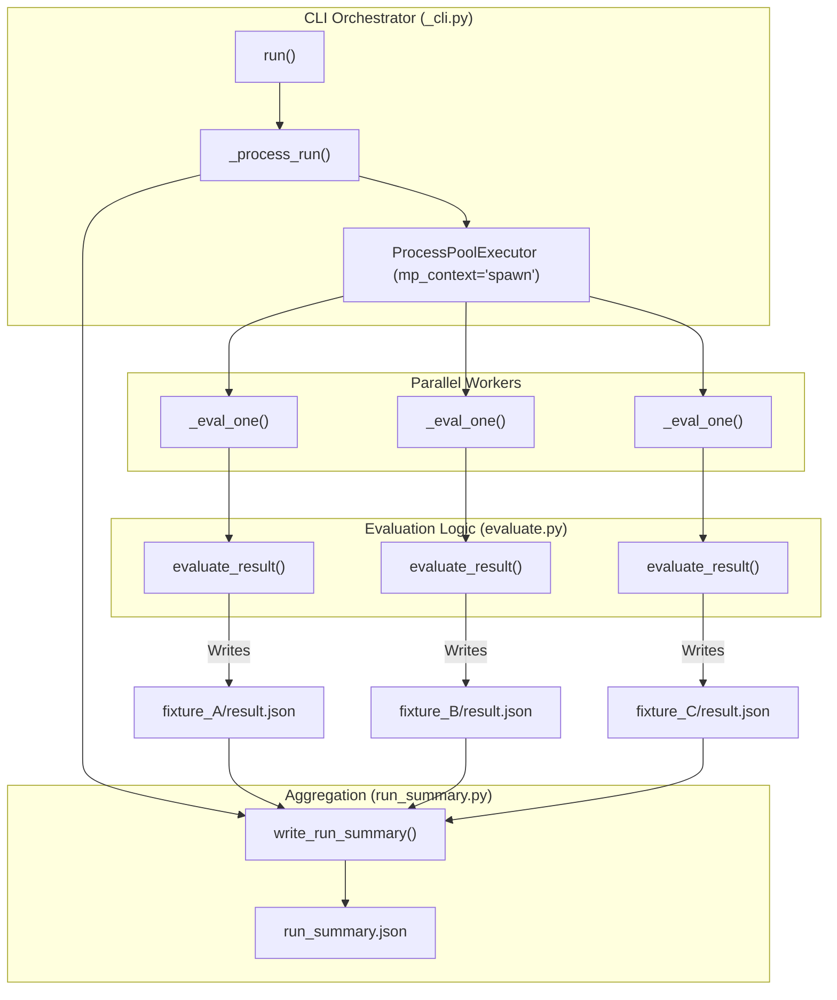
Sources: [src/cadgenbench/eval/_cli.py:152-176](), [src/cadgenbench/eval/_cli.py:179-205](), [src/cadgenbench/eval/_cli.py:214-250](), [tests/eval/test_cli_parallelism.py:1-20]()

---

## Run Aggregation

After all fixtures are processed, `write_run_summary` walks the run directory to aggregate individual `result.json` files into a single `run_summary.json` [src/cadgenbench/eval/run_summary.py:78-103]().

### Aggregation Rules
*   **Inclusion of Zeros**: The `aggregate_score` includes 0.0 values from `invalid` and `missing` samples to prevent inflating scores by only averaging successful runs [src/cadgenbench/eval/run_summary.py:50-53](), [src/cadgenbench/eval/run_summary.py:132-133]().
*   **Task Type Segmentation**: The aggregator reads `description.yaml` for each fixture to bucket results by `task_type` (e.g., `generation` vs `editing`) [src/cadgenbench/eval/run_summary.py:134-140]().
*   **Schema Stability**: Unknown task types are automatically added to the `per_task_scores` map without requiring schema changes [src/cadgenbench/eval/run_summary.py:56-58]().

### Summary Schema Example
| Field | Description |
| :--- | :--- |
| `aggregate_score` | Mean `cad_score` over all samples in the run [src/cadgenbench/eval/run_summary.py:21](). |
| `validity_rate` | Ratio of `n_valid` to `n_samples` [src/cadgenbench/eval/run_summary.py:22](). |
| `score_by_task_type` | Breakdown of mean scores by task family [src/cadgenbench/eval/run_summary.py:27-30](). |
| `per_sample_scores` | Map of fixture names to their status and score [src/cadgenbench/eval/run_summary.py:41-47](). |

Sources: [src/cadgenbench/eval/run_summary.py:15-59](), [src/cadgenbench/eval/run_summary.py:106-191](), [docs/benchmark/submission.md:76-105]()

---

# Page: CAD Validity Gate

# CAD Validity Gate

<details>
<summary>Relevant source files</summary>

The following files were used as context for generating this wiki page:

- [docs/benchmark/validation.md](docs/benchmark/validation.md)
- [docs/metrics/cad_validity.md](docs/metrics/cad_validity.md)
- [src/cadgenbench/common/validity.py](src/cadgenbench/common/validity.py)
- [tests/common/test_validity.py](tests/common/test_validity.py)

</details>


The **CAD Validity Gate** is a mandatory diagnostic pipeline that runs before any other metric on a raw candidate STEP file [docs/metrics/cad_validity.md:1-4](). It serves as a zero-cascade: if a file fails this gate, `is_valid` is set to `False` and the final `cad_score` is forced to `0` [src/cadgenbench/common/validity.py:75-86]().

The gate ensures that the geometry is not just parseable, but is a well-formed, watertight solid capable of supporting downstream topological analysis (like Betti number calculation) and Boolean operations [src/cadgenbench/common/validity.py:27-31]().

## Validation Workflow

The validity check is encapsulated in the `ValidationResult` class and is primarily driven by the `analyze_step` and `validate_step` functions [src/cadgenbench/common/validity.py:75-118]().

### The Three Pillars of Validity
A candidate is considered valid if and only if it satisfies three distinct criteria [docs/metrics/cad_validity.md:6-10]():

1.  **BRepCheck Analysis**: The OpenCASCADE `BRepCheck_Analyzer` must report no errors (e.g., self-intersecting wires, edges off-surface) [src/cadgenbench/common/validity.py:22-23]().
2.  **Watertightness**: Every shell in the shape must be closed, meaning no "naked" or free edges exist [src/cadgenbench/common/validity.py:24-25]().
3.  **Manifold Meshability**: The shape must successfully tessellate into a closed, orientable manifold mesh where every edge is shared by exactly two triangles with opposite orientations [src/cadgenbench/common/validity.py:32-37]().

### Code Entity Relationship: Validity Pipeline
The following diagram illustrates how the validity functions interact with the underlying OpenCASCADE (OCC) and Mesh logic.

"CAD Validity Logic Flow"
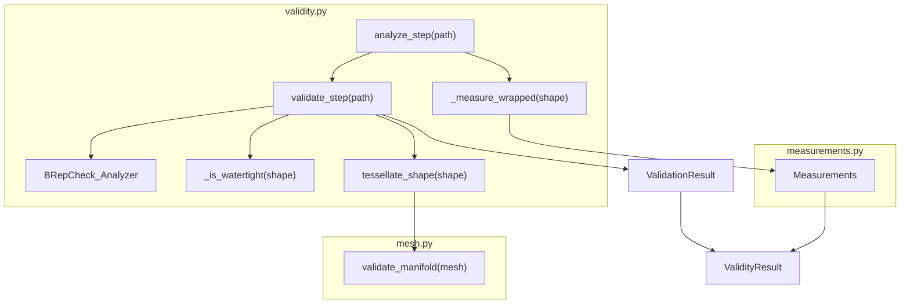
**Sources:** [src/cadgenbench/common/validity.py:75-118](), [src/cadgenbench/common/validity.py:15-52]().

---

## Safety Ceilings and Resource Management

To prevent pathological STEP files from exhausting system resources or hanging the evaluation process, the gate enforces three generous but firm limits [src/cadgenbench/common/validity.py:128-131]().

| Limit | Logic | Action |
| :--- | :--- | :--- |
| **File Size** | `MAX_STEP_FILE_BYTES` (Default: 50MB) | Rejects before parsing to prevent OOM [src/cadgenbench/common/validity.py:155-157](). |
| **Triangle Count** | `MAX_TRIANGLES` (Default: 1M) | Rejects after tessellation but before metrics [src/cadgenbench/common/validity.py:154-154](). |
| **Timeout** | `MESH_TIMEOUT_S` (Default: 30s) | Process-isolated kill for runaway OCC calls [src/cadgenbench/common/validity.py:161-163](). |

### Process Isolation
Because OpenCASCADE tessellation is a native C++ call, it does not reliably honor Python signals [src/cadgenbench/common/validity.py:142-144](). The validity gate runs the tessellation in a separate `multiprocessing.Process` and terminates it if the `MESH_TIMEOUT_S` is exceeded [src/cadgenbench/common/validity.py:144-147]().

**Sources:** [src/cadgenbench/common/validity.py:128-163]().

---

## Implementation Details

### BRepCheck and Watertightness
The function `_is_watertight` checks if a shape is closed by iterating through its shells and ensuring they have no free edges [src/cadgenbench/common/validity.py:24-25](). This is critical because non-watertight shapes cannot be reliably used for volume-based IoU or Betti number calculations [src/cadgenbench/common/validity.py:27-31]().

### Failure Memoization
When a failure occurs, the `topology_errors` field in `ValidationResult` captures a de-duplicated list of human-readable strings [src/cadgenbench/common/validity.py:91-98](). These strings combine:
*   OCC BRep errors (e.g., `BRepCheck_SelfIntersectingWire`).
*   Watertightness failures (`BREP not watertight: open shells / naked edges`).
*   Mesh-pipeline errors (e.g., `mesh non-manifold: edge shared by 4 triangles`).

### Advisory Diagnostics
In addition to the hard gate, the system computes advisory diagnostics that do **not** affect the score but flag "fragile" geometry [docs/metrics/cad_validity.md:14-19]():
*   **Minimum Face Area**: Flags below `0.001 mm²`.
*   **Max Face Aspect Ratio**: Flags above `1000`.
*   **Max BREP Tolerance**: Flags above `0.1 mm`.

"Data Flow from File to Result"
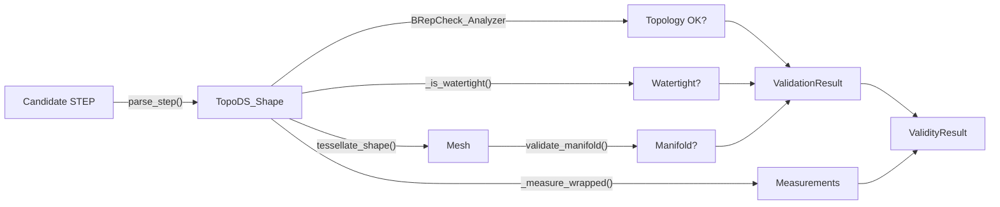
**Sources:** [src/cadgenbench/common/validity.py:75-118](), [docs/metrics/cad_validity.md:21-26](), [tests/common/test_validity.py:121-148]().

---

## Key Functions and Classes

### `ValidationResult`
The core dataclass storing the boolean `is_valid` status and the `topology_errors` list [src/cadgenbench/common/validity.py:75-104]().

### `analyze_step(path: Path) -> ValidityResult`
The primary entry point. It loads the STEP file once and performs both validity analysis and physical measurements (volume, bounding box, counts), returning them in a bundled `ValidityResult` [src/cadgenbench/common/validity.py:107-113]().

### `parse_step(path: Path) -> None`
A "cheap" gate used to verify that a file is at least a valid STEP format before attempting more expensive geometric analysis [tests/common/test_validity.py:154-188]().

**Sources:** [src/cadgenbench/common/validity.py:75-121](), [tests/common/test_validity.py:154-188]().

---

# Page: Rigid Alignment

# Rigid Alignment

<details>
<summary>Relevant source files</summary>

The following files were used as context for generating this wiki page:

- [docs/metrics.md](docs/metrics.md)
- [src/cadgenbench/eval/alignment.py](src/cadgenbench/eval/alignment.py)
- [src/cadgenbench/eval/edit_baseline.py](src/cadgenbench/eval/edit_baseline.py)
- [tests/eval/test_alignment.py](tests/eval/test_alignment.py)
- [tests/eval/test_sidecar_alignment.py](tests/eval/test_sidecar_alignment.py)

</details>


Rigid alignment is a critical preprocessing step in the CADGenBench evaluation pipeline. It ensures that candidate STEP files are correctly oriented and positioned relative to the ground truth (GT) before any geometric or topological metrics are computed [docs/metrics.md:38-43](). The aligner handles rotation and translation only; it never applies scaling, shearing, or mirroring [src/cadgenbench/eval/alignment.py:17-18]().

## Alignment Pipeline Overview

The alignment process follows a multi-stage strategy to find the optimal pose, combining global search via PCA-based orientations with local refinement using Iterative Closest Point (ICP).

### 1. Sampling and Initialization
The aligner first generates area-weighted point clouds from both the source and target geometries [src/cadgenbench/eval/alignment.py:103-113](). By default, 10,000 samples are used to ensure sufficient density for refinement [src/cadgenbench/eval/alignment.py:71]().

### 2. PCA and Octahedral Pose Pool
To overcome local minima in ICP, the system generates a pool of candidate starting poses:
*   **Identity**: The original pose provided in the submission.
*   **PCA Orientations**: Principal Component Analysis is performed on the point clouds to align the major axes of the candidate to the GT.
*   **Octahedral Symmetry**: The 24 octahedral rotations are applied to the PCA-aligned pose to account for axis-swapping or inversion errors [src/cadgenbench/eval/alignment.py:18-19]().

### 3. Multi-scale ICP Refinement
Each candidate pose in the pool is refined using **Open3D multi-scale point-to-plane ICP** [src/cadgenbench/eval/alignment.py:19-20](). The multi-scale approach uses a voxel-based divisor to progressively refine the alignment from coarse to fine [src/cadgenbench/eval/alignment.py:42]().

### 4. Pose Selection and Tie-Breaking
The best pose is selected based on shape agreement. The selector evaluates:
1.  **Bidirectional Surface F1**: The primary metric for pose quality [src/cadgenbench/eval/alignment.py:20-21]().
2.  **Capped Symmetric Chamfer**: Used as a secondary metric if F1 scores are within a tolerance of 0.005 [src/cadgenbench/eval/alignment.py:44-49]().
3.  **RMSE**: Root-mean-square error of nearest-neighbor distances [src/cadgenbench/eval/alignment.py:21-22]().
4.  **Canonical Tie-break**: If geometric fits are indistinguishable, the pose with the "least rotation" is chosen to ensure deterministic results for symmetric parts [src/cadgenbench/eval/alignment.py:44-50]().

### Data Flow: Alignment Logic
The following diagram illustrates the flow from raw STEP files to the final aligned result.

**Alignment Execution Flow**
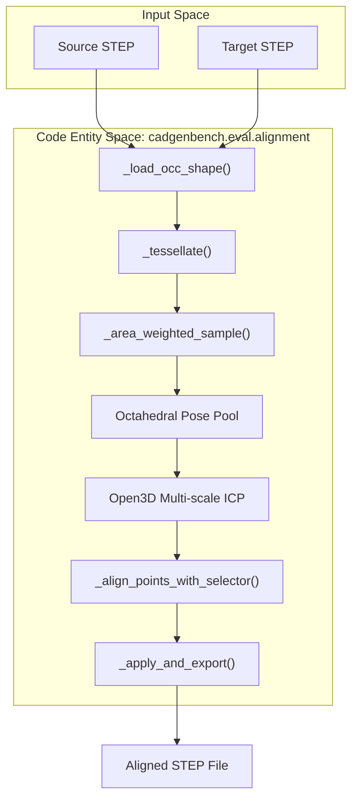
Sources: [src/cadgenbench/eval/alignment.py:15-50](), [src/cadgenbench/eval/alignment.py:67-132]()

## Implementation Details

### B-Rep Transformation
Once the optimal rotation ($R$) and translation ($t$) are found, they are applied directly to the Open CASCADE (OCC) B-Rep structure using `_apply_and_export` [src/cadgenbench/eval/alignment.py:124-125](). This ensures that the resulting `_aligned.step` file contains the exact original topology, simply moved in 3D space.

### Alignment Caching and Trusted Meshes
For performance and stability, CADGenBench utilizes **StepArtifacts** to manage alignment:
*   **Trusted Meshes**: If a "trusted mesh" sidecar (`.mesh.npz`) exists, the aligner operates entirely in memory. The transform is applied to the mesh vertices, and no re-tessellation occurs [src/cadgenbench/eval/alignment.py:24-25]().
*   **Sidecar-Awareness**: The function `align_cached_mesh` recovers the transform from the cached meshes directly, avoiding the overhead of loading the full B-Rep [src/cadgenbench/eval/alignment.py:152-159]().

**Entity Mapping: Alignment Types**
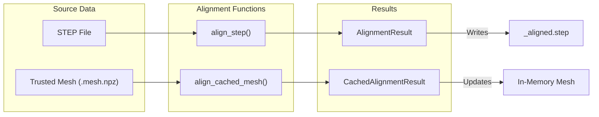
Sources: [src/cadgenbench/eval/alignment.py:53-61](), [src/cadgenbench/eval/alignment.py:135-143](), [src/cadgenbench/eval/alignment.py:152-178]()

## Alignment in Editing Tasks
In editing tasks, the `input.step` (the "no-op" baseline) must be aligned to the GT to determine the `edit_baseline.json` [src/cadgenbench/eval/edit_baseline.py:15-21]().
*   **No-op Alignment**: The alignment of the original input is treated as a fixture constant [src/cadgenbench/eval/edit_baseline.py:40-41]().
*   **Staleness Detection**: Baselines are stamped with the `cadgenbench_version`. If the alignment implementation changes, the system enforces regeneration of the baseline to prevent scoring against stale poses [src/cadgenbench/eval/edit_baseline.py:49-52]().

### Key Classes and Functions
| Entity | Description |
| :--- | :--- |
| `align_step` | Main entry point for aligning one STEP file to another and exporting the result [src/cadgenbench/eval/alignment.py:67-91](). |
| `align_cached_mesh` | Aligns meshes in-memory using `StepArtifacts`, skipping B-Rep processing [src/cadgenbench/eval/alignment.py:152-160](). |
| `AlignmentResult` | Dataclass containing the rotation matrix, translation vector, RMSE, and path to the aligned file [src/cadgenbench/eval/alignment.py:53-60](). |
| `_align_points_with_selector` | Internal logic for evaluating the pose pool and selecting the winner [src/cadgenbench/eval/alignment.py:115-122](). |

Sources: [src/cadgenbench/eval/alignment.py:53-178](), [src/cadgenbench/eval/edit_baseline.py:15-53]()

---

# Page: Metric Axes

# Metric Axes

<details>
<summary>Relevant source files</summary>

The following files were used as context for generating this wiki page:

- [docs/metrics.md](docs/metrics.md)
- [docs/metrics/shape_similarity.md](docs/metrics/shape_similarity.md)
- [docs/metrics/topo_match.md](docs/metrics/topo_match.md)
- [src/cadgenbench/eval/evaluate.py](src/cadgenbench/eval/evaluate.py)

</details>


The CADGenBench scoring engine evaluates candidate STEP files along three orthogonal axes. Each axis is designed to capture a specific category of geometric or functional error that the others might miss. These axes are combined into a single `cad_score` between 0 and 1, which serves as the headline performance metric for a fixture [src/cadgenbench/eval/evaluate.py:39-50]().

### The Orthogonality Principle

The metrics are constructed to be mutually exclusive in the types of defects they penalize:

*   **Shape Similarity:** Captures "wrong bulk geometry" (e.g., a cube instead of a sphere). It is blind to topology (a torus and a thin loop have similar IoU) [docs/metrics.md:86-86]().
*   **Topology Match:** Captures "wrong number of features" (e.g., missing a through-hole or having disconnected parts). It is blind to feature position (a hole on the left vs. a hole on the right is identical) [docs/metrics.md:87-87]().
*   **Interface Match:** Captures "functional failure" (e.g., a bolt hole is the wrong size or shifted). It is blind to the overall aesthetic shape of the part [docs/metrics.md:88-88]().

### Score Composition

For standard **Generation** tasks, the `cad_score` is a weighted mean of the three axes. The weights are biased toward shape and functional interfaces, with topology acting as a secondary check [src/cadgenbench/eval/evaluate.py:95-99]().

| Axis | Weight | Responsibility |
| :--- | :--- | :--- |
| **Shape Similarity** | 0.4 | Bulk volume and surface alignment. |
| **Interface Match** | 0.4 | Alignment with keep-in/keep-out functional jigs. |
| **Topology Match** | 0.2 | Correct count of pieces, holes, and voids. |

For **Editing** tasks, these axes are renormalized against a "no-op" baseline (the original input) to ensure that submitting an unchanged file scores 0. For details on editing logic, see [Editing Task Scoring](#2.5) [docs/metrics.md:125-133]().

### Metric Data Flow

The following diagram illustrates how the `evaluate_result` orchestrator [src/cadgenbench/eval/evaluate.py:139-164]() dispatches data from the `StepArtifacts` container [src/cadgenbench/common/artifacts.py:115-115]() to the specialized metric modules.

**Metric Dispatch Architecture**
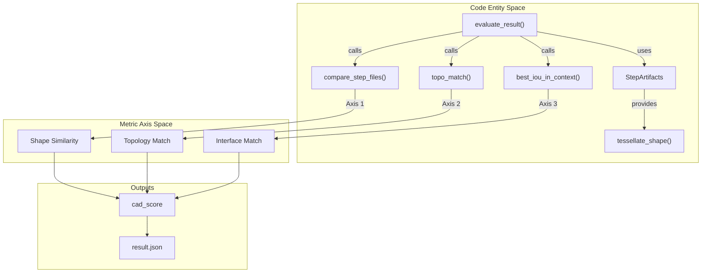
Sources: [src/cadgenbench/eval/evaluate.py:100-107](), [docs/metrics.md:54-80]()

---

### 2.4.1 Shape Similarity
The Shape Similarity axis measures the geometric agreement between the candidate and the ground truth. It consists of two sub-metrics:
1.  **Surface Distance F1:** A point-to-surface matching score that uses surface normals to ensure faces are oriented correctly [docs/metrics/shape_similarity.md:11-13]().
2.  **Volume IoU:** A volumetric Intersection over Union calculated using a manifold Boolean kernel [docs/metrics/shape_similarity.md:15-17]().

For details, see [Shape Similarity](#2.4.1).

### 2.4.2 Topology Match
The Topology Match axis evaluates the structural "skeleton" of the part using Betti numbers ($b_0, b_1, b_2$). This metric ensures the candidate has the correct number of disconnected pieces, through-holes, and internal cavities [docs/metrics/topo_match.md:7-11](). It is invariant to the CAD modeling kernel or feature tree used [docs/metrics/topo_match.md:13-13]().

For details, see [Topology Match](#2.4.2).

### 2.4.3 Interface Match
The Interface Match axis focuses on functional requirements. It uses "jigs" (sub-volumes representing mating parts or keep-out zones) to verify that the generated part will physically fit its intended assembly [docs/metrics/interface_match.md:117-121](). It performs a local pose search to find the best possible fit for each interface group [src/cadgenbench/eval/interface_match.py:270-275]().

For details, see [Interface Match](#2.4.3).

---

### System Integration

The `MetricContext` (defined in [src/cadgenbench/eval/shape_similarity.py:46-46]()) acts as a lazy-loading container that ensures meshes and point clouds are only computed once and shared across axes where applicable.

**Data Flow: Natural Language to Code Entities**
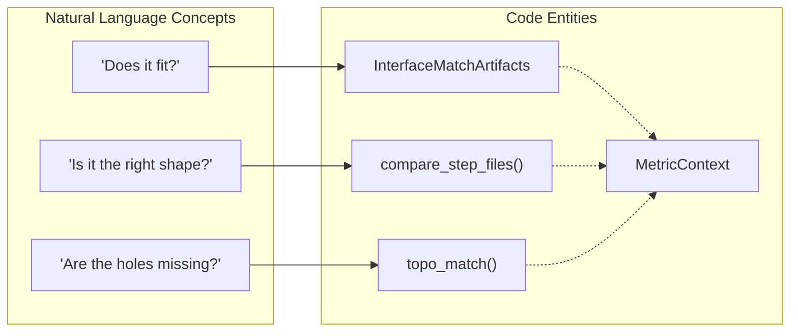
Sources: [src/cadgenbench/eval/evaluate.py:100-107](), [src/cadgenbench/eval/shape_similarity.py:46-46]()

---

# Page: Shape Similarity

# Shape Similarity

<details>
<summary>Relevant source files</summary>

The following files were used as context for generating this wiki page:

- [docs/metrics/shape_similarity.md](docs/metrics/shape_similarity.md)
- [docs/metrics/topo_match.md](docs/metrics/topo_match.md)
- [src/cadgenbench/eval/sampling.py](src/cadgenbench/eval/sampling.py)
- [src/cadgenbench/eval/shape_similarity.py](src/cadgenbench/eval/shape_similarity.py)
- [tests/eval/test_shape_similarity.py](tests/eval/test_shape_similarity.py)

</details>


Shape similarity scores whether a candidate's bulk geometry matches the ground truth (GT), independent of topology or mating interfaces [docs/metrics/shape_similarity.md:1-3](). It is defined as the arithmetic mean of two sub-metrics: **Surface Distance F1** and **Volume IoU** [docs/metrics/shape_similarity.md:5-7]().

These two metrics are complementary: Surface Distance F1 measures the placement and orientation of the boundary, while Volume IoU measures the overlapping 3D space [docs/metrics/shape_similarity.md:9-10]().

### Shape Similarity Data Flow

The diagram below illustrates how a candidate STEP file and a Ground Truth STEP file are processed through the `MetricContext` to produce the final similarity score.

**Shape Evaluation Pipeline**
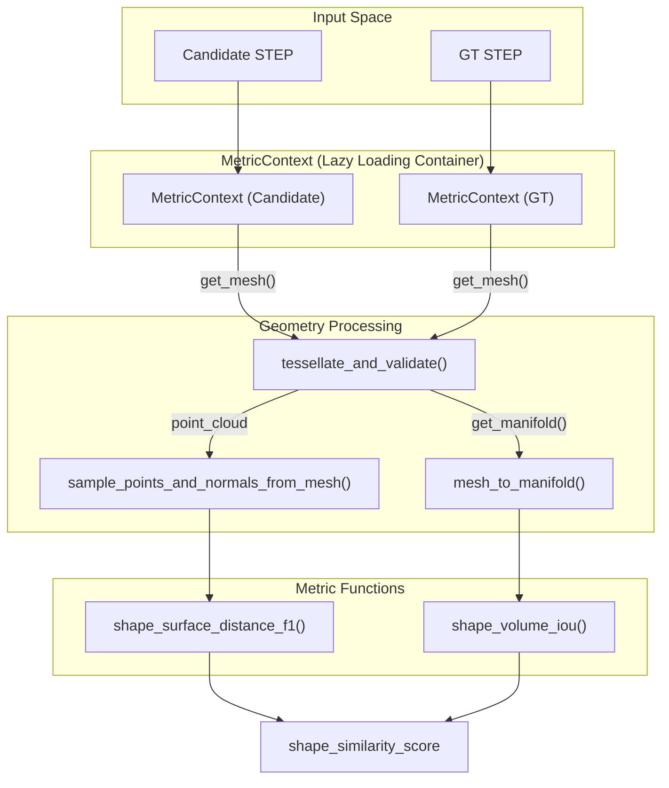
Sources: [src/cadgenbench/eval/shape_similarity.py:59-160](), [docs/metrics/shape_similarity.md:1-18]()

---

## MetricContext

The `MetricContext` class acts as a lazy-loading bundle for data required by shape metrics [src/cadgenbench/eval/shape_similarity.py:59-64](). It ensures that expensive operations like tessellation and point cloud sampling are performed only once and cached for subsequent metric calls.

### Shared Deflection and Sampling
To ensure metrics like Volume IoU are comparable, both candidate and GT should be tessellated at the same chord error [src/cadgenbench/eval/shape_similarity.py:70-72](). 
- **Linear Deflection**: The system typically derives `linear_deflection_mm` from the GT bounding box diagonal using `deflection_for_bbox` [src/cadgenbench/eval/shape_similarity.py:73-75]().
- **Sampling Strategy**: Surface points are drawn uniformly with respect to surface area (area-weighted triangle sampling) [src/cadgenbench/eval/sampling.py:33-36](). By default, 50,000 points are sampled [src/cadgenbench/eval/shape_similarity.py:55]().

Sources: [src/cadgenbench/eval/shape_similarity.py:58-103](), [src/cadgenbench/common/mesh.py:106-109]() (referenced), [src/cadgenbench/eval/sampling.py:27-49]()

---

## Surface Distance F1

The `shape_surface_distance_f1` metric checks if the candidate's surface lies where the GT's does and faces the same direction [docs/metrics/shape_similarity.md:11-13](). It uses point-to-surface matching, which is more robust than nearest-neighbor point cloud matching [src/cadgenbench/eval/sampling.py:175-180]().

### The Matching Logic
A sample point is considered a "hit" if it satisfies two conditions:
1.  **Distance Gate**: The distance to the closest point on the other mesh's surface is within 0.5% of the GT bounding-box diagonal [src/cadgenbench/eval/shape_similarity.py:24-26]().
2.  **Normal Gate**: The absolute dot product between the sample normal and the surface normal at the foot point must be $\ge \cos(20^\circ) \approx 0.94$ [src/cadgenbench/eval/shape_similarity.py:26-27]().

Using the **absolute** dot product (`|dot|`) makes the metric orientation-insensitive, accepting points even if the surface winding is flipped, as long as the geometric plane matches [src/cadgenbench/eval/shape_similarity.py:177-181]().

**Normal Gating Implementation**
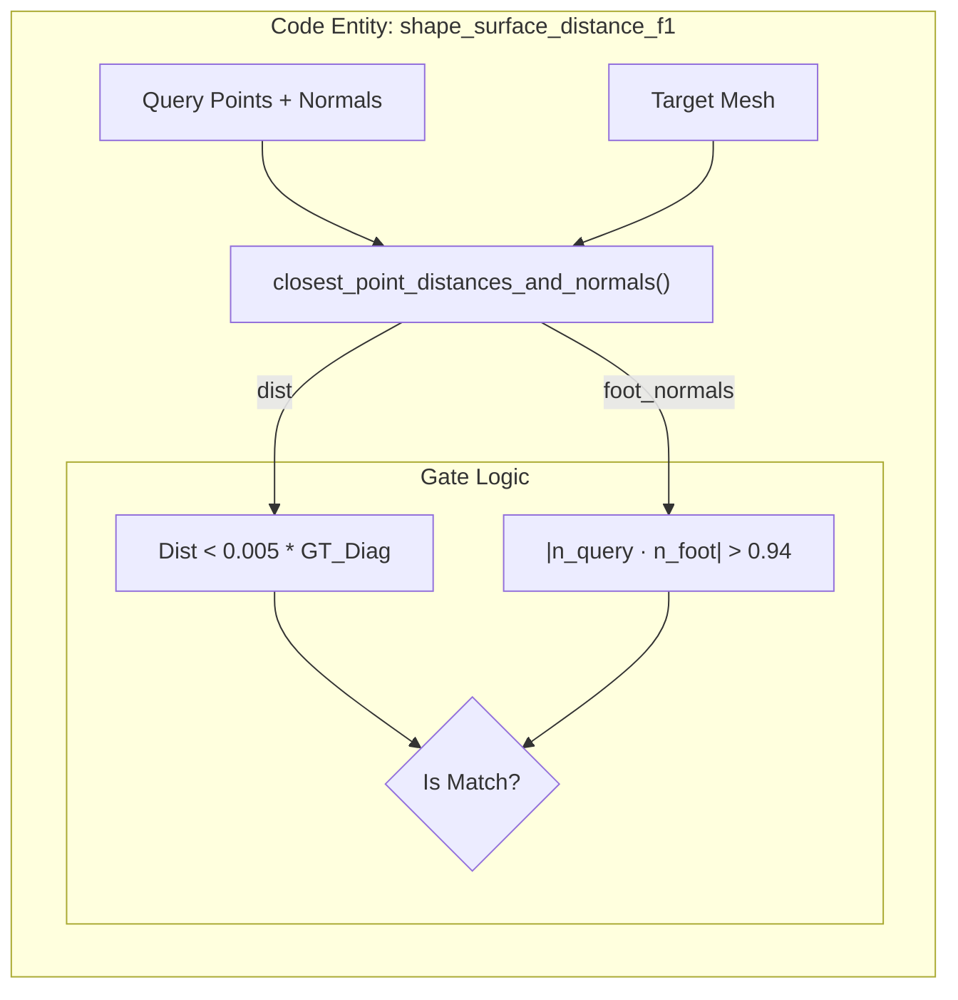
Sources: [src/cadgenbench/eval/shape_similarity.py:173-210](), [src/cadgenbench/eval/sampling.py:163-182](), [docs/metrics/shape_similarity.md:11-13]()

---

## Volume IoU

The `shape_volume_iou` metric calculates the Intersection over Union (IoU) of the two solids [docs/metrics/shape_similarity.md:15-17]().

### Implementation Details
- **Kernel**: It uses the `manifold3d` Boolean kernel for robust volumetric calculations [src/cadgenbench/eval/shape_similarity.py:28-29]().
- **Process**:
    1.  The `MetricContext` converts the cached mesh into a `manifold3d.Manifold` object via `mesh_to_manifold` [src/cadgenbench/eval/shape_similarity.py:148-158]().
    2.  The intersection volume and union volume are computed.
    3.  $IoU = \frac{Vol(A \cap B)}{Vol(A \cup B)}$ [src/cadgenbench/eval/shape_similarity.py:244-250]().

If either shape is not a valid manifold (e.g., failed the validity gate), the IoU metric is skipped [src/cadgenbench/eval/shape_similarity.py:236-240]().

Sources: [src/cadgenbench/eval/shape_similarity.py:230-252](), [docs/metrics/shape_similarity.md:15-17]()

---

## Summary of Metric Components

| Metric | Code Identifier | Threshold / Parameter | Description |
| :--- | :--- | :--- | :--- |
| **Surface F1** | `shape_surface_distance_f1` | 0.5% diagonal, 20° angle | Symmetric F1 of surface-to-surface matches. |
| **Volume IoU** | `shape_volume_iou` | N/A | Volumetric Intersection over Union using `manifold3d`. |
| **Shape Score** | `shape_similarity_score` | Mean of above | The aggregate shape similarity axis score. |

Sources: [src/cadgenbench/eval/shape_similarity.py:20-35](), [docs/metrics/shape_similarity.md:1-18]()

---

# Page: Topology Match

# Topology Match

<details>
<summary>Relevant source files</summary>

The following files were used as context for generating this wiki page:

- [docs/metrics/illustrations/example_1_shape/candidate_iso.png](docs/metrics/illustrations/example_1_shape/candidate_iso.png)
- [docs/metrics/illustrations/example_1_shape/gt_iso.png](docs/metrics/illustrations/example_1_shape/gt_iso.png)
- [docs/metrics/illustrations/example_2_topology/candidate_iso.png](docs/metrics/illustrations/example_2_topology/candidate_iso.png)
- [docs/metrics/illustrations/example_2_topology/components_candidate_iso.png](docs/metrics/illustrations/example_2_topology/components_candidate_iso.png)
- [docs/metrics/illustrations/example_2_topology/components_gt_iso.png](docs/metrics/illustrations/example_2_topology/components_gt_iso.png)
- [docs/metrics/shape_similarity.md](docs/metrics/shape_similarity.md)
- [docs/metrics/topo_match.md](docs/metrics/topo_match.md)
- [src/cadgenbench/eval/topo_match.py](src/cadgenbench/eval/topo_match.py)
- [tests/eval/test_topo_match.py](tests/eval/test_topo_match.py)

</details>


The **Topology Match** metric scores whether a candidate part's 3D topology (connected solid pieces, through-handles, and internal voids) matches the ground truth's. It uses integer invariants known as **Betti numbers** ($b_0, b_1, b_2$), which are coordinate- and representation-invariant, ensuring that the same physical part yields identical scores regardless of the underlying CAD feature tree or B-Rep decomposition [docs/metrics/topo_match.md:1-13]().

## Pipeline Overview

Betti numbers are computed once on a tessellated mesh. The pipeline assumes the mesh has passed the [CAD Validity Gate](./2.2) (watertight, manifold, and orientation-consistent) [docs/metrics/topo_match.md:28-30]().

### 1. Connected Components Analysis
The system performs a union-find operation on triangle adjacency. Each resulting component is a closed 2-manifold [docs/metrics/topo_match.md:32](). This is implemented via `_triangle_components` in [src/cadgenbench/eval/topo_match.py:162]().

### 2. Containment Classification ($b_0$ and $b_2$)
For every connected component, the system identifies an interior probe point. It then uses **ray casting** to count how many *other* components enclose that point [docs/metrics/topo_match.md:33]():
*   **Even Parity:** The component is an outer shell of a solid piece, contributing to **$b_0$** (connected solid components).
*   **Odd Parity:** The component is an inner shell of a void, contributing to **$b_2$** (enclosed internal voids).

### 3. Handle Calculation ($b_1$)
The number of independent through-handles (e.g., holes) is derived from the surface Euler characteristic ($\chi = V - E + F$) of the welded mesh [src/cadgenbench/eval/topo_match.py:36-39](). Using the topological identity $\chi(\partial S) = 2(b_0 - b_1 + b_2)$, the system solves for $b_1$:
$$b_1 = b_0 + b_2 - \chi_{\text{surface}}/2$$
[docs/metrics/topo_match.md:34](), [src/cadgenbench/eval/topo_match.py:164]().

### Topology Data Flow
The following diagram illustrates the transformation from a STEP file to topological invariants:

**Topological Analysis Workflow**
```mermaid
graph TD
    subgraph "Input Space"
        STEP["StepArtifacts (.step)"]
    end

    subgraph "src/cadgenbench/eval/topo_match.py"
        TESS["tessellate_and_validate()"]
        COMP["_triangle_components()"]
        CONT["_classify_components_by_containment()"]
        EULER["_euler_characteristic()"]
        BETTI["BettiResult (b0, b1, b2)"]
    end

    STEP --> TESS
    TESS --> COMP
    TESS --> EULER
    COMP --> CONT
    CONT --> BETTI
    EULER --> BETTI
```
Sources: [src/cadgenbench/eval/topo_match.py:130-174](), [docs/metrics/topo_match.md:28-35]()

## Scoring Logic

The topology match score is a **product aggregation** of fuzzy log-ratios for each Betti axis.

### Fuzzy Log-Ratio
Each axis ($i \in \{0, 1, 2\}$) is scored using a log-ratio to handle discrete counts smoothly. A sharpness exponent $\alpha$ (defined as `BETTI_SHARPNESS = 2`) is applied so that a wrong count results in a significant penalty [src/cadgenbench/eval/topo_match.py:54-55]().

$$s_i = \exp\left(-\alpha\left|\log\frac{b_i^{\text{cand}}+1}{b_i^{\text{gt}}+1}\right|\right) = \left(\frac{\min(b_i^{\text{cand}}, b_i^{\text{gt}})+1}{\max(b_i^{\text{cand}}, b_i^{\text{gt}})+1}\right)^{\alpha}$$

The $+1$ shift ensures the score remains finite when a count is zero [docs/metrics/topo_match.md:41-44]().

### Aggregate Score
The final `topology_match` score is the product of the three axes:
$$\text{score} = s_0 \cdot s_1 \cdot s_2$$

Because topology is discrete, the product ensures that failing any single invariant (e.g., missing a hole) collapses the overall score toward zero, rather than allowing a high average from the other two axes [docs/metrics/topo_match.md:44-50](), [src/cadgenbench/eval/topo_match.py:180-193]().

**Scoring Implementation Mapping**
```mermaid
graph LR
    subgraph "Code Entity Space"
        TMS["topo_match_score()"]
        BR_C["BettiResult (Candidate)"]
        BR_G["BettiResult (GT)"]
        RES["TopoMatchResult"]
    end

    subgraph "Mathematical Logic"
        LOG["Fuzzy Log-Ratio (s0, s1, s2)"]
        PROD["Product Aggregation"]
    end

    BR_C --> TMS
    BR_G --> TMS
    TMS --> LOG
    LOG --> PROD
    PROD --> RES
```
Sources: [src/cadgenbench/eval/topo_match.py:88-122](), [src/cadgenbench/eval/topo_match.py:177-204]()

## Data Structures

### BettiResult
Stores the raw topological counts and diagnostic metadata for a single shape.
*   `b0`, `b1`, `b2`: Integer Betti numbers [src/cadgenbench/eval/topo_match.py:92-94]().
*   `chi_surface`: The Euler characteristic $V-E+F$ [src/cadgenbench/eval/topo_match.py:95]().
*   `n_components`: Number of connected manifold shells [src/cadgenbench/eval/topo_match.py:96]().

### TopoMatchResult
Stores the comparison between a candidate and ground truth.
*   `candidate`: `BettiResult` for the output STEP [src/cadgenbench/eval/topo_match.py:109]().
*   `gt`: `BettiResult` for the ground truth STEP [src/cadgenbench/eval/topo_match.py:110]().
*   `per_axis_scores`: Dictionary containing $s_0, s_1, s_2$ [src/cadgenbench/eval/topo_match.py:111]().
*   `score`: The final product score [src/cadgenbench/eval/topo_match.py:112]().

## Limitations
*   **Position Invariance:** Topology Match does not test the position of features. A hole on the left vs. a hole on the right yields the same Betti numbers. Position is handled by [Shape Similarity](./2.4.1) and [Interface Match](./2.4.3) [docs/metrics/topo_match.md:57-59]().
*   **Blind Features:** Pockets or blind holes that do not go through the material are topologically trivial (they do not change Betti numbers) and are scored by other metrics [docs/metrics/topo_match.md:24-26]().

Sources: [docs/metrics/topo_match.md:1-60](), [src/cadgenbench/eval/topo_match.py:1-204]()

---

# Page: Interface Match

# Interface Match

<details>
<summary>Relevant source files</summary>

The following files were used as context for generating this wiki page:

- [docs/metrics/illustrations/example_3_interface/candidate_iso.png](docs/metrics/illustrations/example_3_interface/candidate_iso.png)
- [docs/metrics/illustrations/interface_concept.png](docs/metrics/illustrations/interface_concept.png)
- [docs/metrics/interface_match.md](docs/metrics/interface_match.md)
- [src/cadgenbench/eval/booleans.py](src/cadgenbench/eval/booleans.py)
- [src/cadgenbench/eval/interface_match.py](src/cadgenbench/eval/interface_match.py)
- [src/cadgenbench/eval/interface_match_viz.py](src/cadgenbench/eval/interface_match_viz.py)
- [tests/eval/test_interface_match.py](tests/eval/test_interface_match.py)
- [tests/eval/test_interface_viz_no_occt.py](tests/eval/test_interface_viz_no_occt.py)

</details>


The Interface Match metric evaluates whether a candidate part's mating features—such as holes, slots, bosses, and pockets—conform to the ground-truth specification. Unlike global shape similarity, this metric focuses on functional sub-volumes (jigs) that define how a part interacts with other components in an assembly.

## Functional Concept

Mating features are organized into **mating groups** (or contexts). A single mating group represents a set of features that must seat together, such as a bolt pattern or a locating pin and slot combination [docs/metrics/interface_match.md:5-8](). 

Each feature within a group is classified into one of two types:
*   **Keep-out Region (KOR):** A volume that must be empty in the candidate (e.g., a clearance hole). Material here would cause a mechanical interference [docs/metrics/interface_match.md:13-13]().
*   **Keep-in Region (KIR):** A volume that must be solid in the candidate (e.g., a locating boss). Missing material here would result in a lack of support or registration [docs/metrics/interface_match.md:14-14]().

### Data Flow: Discovery to Scoring

The system discovers these regions by scanning the fixture directory for STEP files following a specific naming convention: `jig_<context_id>__<index>__<fit_type>.step` [src/cadgenbench/eval/interface_match.py:58-59]().

```mermaid
graph TD
    subgraph "Discovery [interface_match.py]"
        DIR["Fixture Directory"] --> GLOB["glob('jig_*__*__*.step')"]
        GLOB --> REGEX["_SUBVOL_RE"]
        REGEX --> SV["SubVolume Objects"]
    end

    subgraph "Scoring Pipeline [interface_match.py]"
        SV --> ARTIFACTS["InterfaceMatchArtifacts"]
        ARTIFACTS --> IOU_POSE["iou_at_pose()"]
        IOU_POSE --> SEARCH["best_iou_in_context()"]
        SEARCH --> AGG["interface_score()"]
    end

    subgraph "Visualization [interface_match_viz.py]"
        SV --> VIZ["render_part_with_subvolumes()"]
        VIZ --> PNG["Interface Overlay PNG"]
    end
```
Sources: [src/cadgenbench/eval/interface_match.py:58-101](), [src/cadgenbench/eval/interface_match_viz.py:90-117]()

## Implementation Detail

### Sub-Volume Discovery
The `discover_sub_volumes` function parses the jig STEP files into `SubVolume` dataclasses [src/cadgenbench/eval/interface_match.py:82-101](). These objects store the mechanical `context_id` (mating group) and the `fit_type` (KOR/KIR) [src/cadgenbench/eval/interface_match.py:62-74]().

### Volumetric Scoring and the Verification Shell
To prevent a candidate from passing a KOR check by simply deleting all surrounding material, the metric uses a **verification shell**.
1.  The system calculates a bounding box `bbox_R` which is the union of the region `R` and a thin shell of the opposite material derived from the ground truth [src/cadgenbench/eval/interface_match_viz.py:34-47]().
2.  The Intersection over Union (IoU) is calculated within this local `bbox_R` [src/cadgenbench/eval/interface_match.py:145-154]().

### Bounded Pose Search
To ensure candidates are not penalized for minor global alignment residuals, the metric performs a deterministic bounded search around the ground-truth pose [src/cadgenbench/eval/interface_match.py:22-26]().
*   **Translation Window:** ±1% of the part's bounding box diagonal [src/cadgenbench/eval/interface_match.py:173-173]().
*   **Rotation Window:** ±1° per axis [src/cadgenbench/eval/interface_match.py:174-174]().
*   **Sampling:** 32 samples by default [src/cadgenbench/eval/interface_match.py:175-175]().

### Aggregate Scoring Logic
The final interface score is aggregated as follows:
1.  **Per-Feature:** Raw IoU is mapped through a soft ramp. IoU $\ge 0.95$ maps to 1.0; IoU $\le 0.80$ maps to 0.0 [src/cadgenbench/eval/interface_match.py:126-138]().
2.  **Per-Group:** A mating group's score is the **minimum** (worst-feature) score within that group [docs/metrics/interface_match.md:26-26]().
3.  **Fixture Score:** The final metric is the **mean** score across all independent mating groups [docs/metrics/interface_match.md:26-26]().

Sources: [src/cadgenbench/eval/interface_match.py:108-138](), [src/cadgenbench/eval/interface_match.py:173-180](), [docs/metrics/interface_match.md:19-28]()

## Geometry Engine: Manifold3D
The Interface Match metric uses the `manifold3d` kernel for all Boolean operations to ensure performance and robustness [src/cadgenbench/eval/booleans.py:22-29]().

```mermaid
graph LR
    subgraph "Entity Space"
        SV["SubVolume (STEP)"]
        CAN["Candidate (STEP)"]
    end

    subgraph "Code Space [booleans.py]"
        SV --> M3D_R["mesh_to_manifold()"]
        CAN --> M3D_C["mesh_to_manifold()"]
        M3D_R & M3D_C --> OP["intersect() / subtract()"]
        OP --> VOL["manifold_volume()"]
    end

    VOL --> SCORE["IoU Calculation"]
```
Sources: [src/cadgenbench/eval/booleans.py:47-76](), [src/cadgenbench/eval/booleans.py:114-124](), [src/cadgenbench/eval/booleans.py:162-167]()

## Visualization: Interface Overlay
The `interface_match_viz.py` module generates a visual report overlaying the candidate ghost against the mating regions.

| Color | Meaning | Implementation Logic |
| :--- | :--- | :--- |
| **Grey Ghost** | Candidate Geometry | `part_artifacts.mesh()` [src/cadgenbench/eval/interface_match_viz.py:84-84]() |
| **Blue** | Matched Volume | `subtract(R, P)` (KOR) or `intersect(R, P)` (KIR) [src/cadgenbench/eval/interface_match_viz.py:143-147]() |
| **Red** | Too Much Material | `intersect(R, P)` (KOR) or `intersect(shell, P)` (KIR) [src/cadgenbench/eval/interface_match_viz.py:144-148]() |
| **Amber** | Too Little Material | `subtract(shell, P)` (KOR) or `subtract(R, P)` (KIR) [src/cadgenbench/eval/interface_match_viz.py:145-149]() |

The visualization uses the same `manifold3d` logic as the scorer to ensure that the visual representation exactly matches the numerical score [src/cadgenbench/eval/interface_match_viz.py:17-19]().

Sources: [src/cadgenbench/eval/interface_match_viz.py:21-53](), [src/cadgenbench/eval/interface_match_viz.py:134-166]()

---

# Page: Editing Task Scoring

# Editing Task Scoring

<details>
<summary>Relevant source files</summary>

The following files were used as context for generating this wiki page:

- [docs/metrics.md](docs/metrics.md)
- [docs/metrics/illustrations/example_editing/edit_diff.png](docs/metrics/illustrations/example_editing/edit_diff.png)
- [src/cadgenbench/__init__.py](src/cadgenbench/__init__.py)
- [src/cadgenbench/eval/alignment.py](src/cadgenbench/eval/alignment.py)
- [src/cadgenbench/eval/edit_baseline.py](src/cadgenbench/eval/edit_baseline.py)
- [tests/eval/test_edit_baseline.py](tests/eval/test_edit_baseline.py)

</details>


Editing tasks (`task_type: editing`) evaluate a model's ability to perform local modifications on an existing CAD part. Unlike generation tasks, where a model starts from an empty canvas, editing tasks provide an `input.step` file and a natural language instruction to modify it. The ground truth (GT) is a modified version of that input.

Because the input and GT are often geometrically similar, a "no-op" submission (returning the `input.step` unchanged) would achieve a high raw score. To prevent this, the scoring engine uses **no-op renormalization** to ensure that doing nothing scores 0, while a perfect edit scores 1.

## The Edit Baseline Sidecar

For every editing fixture, a sidecar file named `edit_baseline.json` is stored alongside the ground truth. This file is the "single source of truth" that identifies a fixture as an editing task [src/cadgenbench/eval/edit_baseline.py:41-47]().

The baseline file contains precomputed scores of the `input.step` against the `ground_truth.step`. These values are used to anchor the scoring axes at evaluation time.

### Baseline Components
| Component | Description |
| :--- | :--- |
| `cadgenbench_version` | Ensures the baseline was computed with the current metric logic [src/cadgenbench/eval/edit_baseline.py:49-52](). |
| `axes` | A map of `shape`, `topology`, and `interface` to their respective baseline values and roles [src/cadgenbench/eval/edit_baseline.py:129-134](). |
| `alignment_rmse` | The RMSE of the rigid alignment between the input and GT [src/cadgenbench/eval/edit_baseline.py:132-132](). |

## Axis Classification: Target vs. Preserve

Each metric axis is assigned a **Role** based on how much the edit is expected to change that specific property. This classification is determined by the "headroom" ($1 - \text{baseline}$) available on that axis [src/cadgenbench/eval/edit_baseline.py:21-31]().

### ROLE_TARGET
*   **Definition**: The edit explicitly intends to change this axis.
*   **Logic**: The raw score is renormalized so the no-op baseline maps to 0.
*   **Assignment**: The `shape` axis is **always** a target [src/cadgenbench/eval/edit_baseline.py:115-116](). `topology` and `interface` become targets if their headroom exceeds `PRESERVE_HEADROOM_FLOOR` (0.01) [src/cadgenbench/eval/edit_baseline.py:102-117]().

### ROLE_PRESERVE
*   **Definition**: The edit should leave this axis unchanged.
*   **Logic**: Acts as a one-sided **gate**. It cannot increase the score, but it can pull the score down if the candidate accidentally modifies parts of the model that should have been preserved.
*   **Assignment**: Used for `topology` or `interface` when headroom is below the floor [src/cadgenbench/eval/edit_baseline.py:117-117]().

### ROLE_ABSENT
*   **Definition**: The metric does not apply to this fixture (e.g., no Interface Match jigs defined).
*   **Logic**: The axis is excluded from the calculation [src/cadgenbench/eval/edit_baseline.py:31-31]().

Sources: [src/cadgenbench/eval/edit_baseline.py:21-31](), [src/cadgenbench/eval/edit_baseline.py:70-72](), [src/cadgenbench/eval/edit_baseline.py:105-117]()

## Scoring Composition Formula

The final `cad_score` for an editing task is the product of the weighted mean of **Target** axes and the product of all **Preserve** gates.

### 1. Renormalization (Target Axes)
For axes marked as `ROLE_TARGET`, the raw metric $S_{raw}$ is transformed into $S_{renorm}$ using the baseline $B$:

$$S_{renorm} = \max\left(0, \frac{S_{raw} - B}{1 - B}\right)$$

This ensures that $S_{raw} = B$ results in 0, and $S_{raw} = 1$ results in 1 [src/cadgenbench/eval/edit_baseline.py:23-26]().

### 2. Preserve Gates
For axes marked as `ROLE_PRESERVE`, the raw metric is turned into a gate $G$:

$$G = \min\left(1, \frac{S_{raw}}{B}\right)$$

If the candidate maintains the property as well as the input did ($S_{raw} \ge B$), the gate is 1.0 (no penalty). If the candidate breaks the preserved property ($S_{raw} < B$), the score is penalized proportionally [src/cadgenbench/eval/edit_baseline.py:27-30]().

### 3. Final Composition
The scores are combined using `EDITING_AXIS_WEIGHTS` (Shape: 0.6, Interface: 0.3, Topology: 0.1), which are renormalized over the subset of axes that are actually targets [src/cadgenbench/eval/edit_baseline.py:80-84]().

**The Formula:**
`cad_score = weighted_mean(target_renorms) * product(preserve_gates)`

Sources: [docs/metrics.md:125-165](), [src/cadgenbench/eval/edit_baseline.py:21-37](), [src/cadgenbench/eval/edit_baseline.py:80-84]()

## Data Flow and Implementation

The following diagrams illustrate how the `_edit_cad_score` function in `evaluate.py` processes raw metrics using the `edit_baseline.json` metadata.

### Scoring Logic Flow
This diagram shows the transformation from raw metric values to the final composite score.

```mermaid
graph TD
    subgraph "Natural Language Space"
        Instruction["'Add a hole'"]
    end

    subgraph "Code Entity Space: src/cadgenbench/eval/edit_baseline.py"
        EB[("edit_baseline.json")]
        CT["classify_axis()"]
        RN["renormalize()"]
        PG["preserve_gate()"]
    end

    subgraph "Code Entity Space: src/cadgenbench/eval/evaluate.py"
        ECS["_edit_cad_score()"]
        RAW["Raw Metrics (Shape, Topo, Interface)"]
    end

    Instruction --> EB
    EB --> CT
    RAW --> ECS
    CT --> ECS
    
    ECS -->|Target Axis| RN
    ECS -->|Preserve Axis| PG
    
    RN --> FINAL["Final cad_score"]
    PG --> FINAL
```
Sources: [src/cadgenbench/eval/edit_baseline.py:105-117](), [src/cadgenbench/eval/evaluate.py:34-34](), [docs/metrics.md:162-164]()

### Axis Processing Pipeline
Detailed view of how individual metrics are routed based on their `ROLE`.

```mermaid
graph LR
    subgraph "Metric Inputs"
        S["Shape Raw"]
        T["Topo Raw"]
        I["Interface Raw"]
    end

    subgraph "Logic: src/cadgenbench/eval/edit_baseline.py"
        direction TB
        R_S{Role: Target}
        R_T{Role: ?}
        R_I{Role: ?}
        
        RE["renormalize()"]
        GA["preserve_gate()"]
    end

    S --> R_S --> RE
    T --> R_T
    I --> R_I
    
    R_T -- "Headroom > 0.01" --> RE
    R_T -- "Headroom <= 0.01" --> GA
    
    R_I -- "Headroom > 0.01" --> RE
    R_I -- "Headroom <= 0.01" --> GA

    RE --> MEAN["Weighted Mean (Targets)"]
    GA --> PROD["Product (Gates)"]
    
    MEAN --> FINAL["cad_score"]
    PROD --> FINAL
```
Sources: [src/cadgenbench/eval/edit_baseline.py:70-72](), [src/cadgenbench/eval/edit_baseline.py:105-117](), [tests/eval/test_edit_baseline.py:116-167]()

## Authoring Constraints
To ensure editing tasks are meaningful, the `shape` axis must have a minimum headroom of `EDIT_HEADROOM_FLOOR` (0.002). If an edit is so minor that the `input.step` already matches the GT shape within the noise floor of point-sampling (~2e-4), the fixture is rejected during the authoring phase [src/cadgenbench/eval/edit_baseline.py:94-95]().

Sources: [src/cadgenbench/eval/edit_baseline.py:92-95]()

---

# Page: Geometry and Mesh Infrastructure

# Geometry and Mesh Infrastructure

<details>
<summary>Relevant source files</summary>

The following files were used as context for generating this wiki page:

- [.cursor/rules/style.mdc](.cursor/rules/style.mdc)
- [src/cadgenbench/common/artifacts.py](src/cadgenbench/common/artifacts.py)
- [src/cadgenbench/common/mesh.py](src/cadgenbench/common/mesh.py)
- [src/cadgenbench/common/viewer.py](src/cadgenbench/common/viewer.py)
- [tests/common/test_viewer.py](tests/common/test_viewer.py)

</details>


The `cadgenbench` geometry and mesh infrastructure provides a shared foundation for both the scoring engine and the baseline agent. It handles the translation of B-Rep (Boundary Representation) data from STEP files into discrete triangle meshes used for metric calculation, manifold analysis, and headless visualization.

### System Overview

The infrastructure is built on three primary pillars:
1.  **Tessellation**: Converting precise mathematical surfaces into topologically consistent meshes [src/cadgenbench/common/mesh.py:15-56]().
2.  **Artifact Management**: Lazy-loading and caching geometric data to avoid redundant heavy computations [src/cadgenbench/common/artifacts.py:1-6]().
3.  **Headless Rendering**: Visualizing CAD models and metric diffs without a GPU or display server [src/cadgenbench/common/viewer.py:15-39]().

### Natural Language to Code Entity Mapping

The following diagrams bridge high-level geometric concepts to their specific implementations in the codebase.

**Geometric Data Flow**
```mermaid
graph TD
    subgraph "Natural Language Space"
        STEP["STEP File (B-Rep)"]
        Mesh["Triangle Mesh"]
        Validity["Validity Gate"]
    end

    subgraph "Code Entity Space"
        STEP_Path["Path / str"]
        Artifacts["StepArtifacts Class"]
        Tess["tessellate_shape()"]
        Mesh_Class["Mesh Dataclass"]
        Val_Res["ValidityResult"]
    end

    STEP --> STEP_Path
    STEP_Path --> Artifacts
    Artifacts -- "calls" --> Tess
    Tess -- "returns" --> Mesh_Class
    Artifacts -- "memoizes" --> Val_Res
    Mesh_Class --> Mesh
```
Sources: [src/cadgenbench/common/artifacts.py:66-83](), [src/cadgenbench/common/mesh.py:135-182]()

**Rendering and Visualization Pipeline**
```mermaid
graph TD
    subgraph "Natural Language Space"
        View["Camera View (e.g. ISO)"]
        Diff["Edit Difference"]
        PNG["Image Output"]
    end

    subgraph "Code Entity Space"
        Presets["CAMERA_PRESETS"]
        M_Diff["mesh_diff()"]
        R_Step["render_step()"]
        PV_Plotter["pyvista.Plotter"]
        R_Img["RenderedImage"]
    end

    View --> Presets
    Diff --> M_Diff
    Presets --> R_Step
    M_Diff --> R_Step
    R_Step -- "orchestrates" --> PV_Plotter
    PV_Plotter -- "produces" --> R_Img
    R_Img --> PNG
```
Sources: [src/cadgenbench/common/viewer.py:101-168](), [src/cadgenbench/common/viewer.py:421-460]()

### Core Components

#### STEP Tessellation and Mesh Pipeline
The system utilizes OpenCASCADE (via `build123d`) and `BRepMesh_IncrementalMesh` to generate triangulations [src/cadgenbench/common/mesh.py:24-28](). Unlike standard meshers that produce "triangle soup," this pipeline performs topology-based vertex stitching. It ensures that the resulting mesh is a closed, orientation-consistent manifold, which is a prerequisite for calculating topological metrics like Betti numbers [src/cadgenbench/common/mesh.py:18-20]().

For details, see [STEP Tessellation and Mesh Pipeline](#3.1).

#### StepArtifacts and Caching
`StepArtifacts` serves as a centralized, lazy-loading container for all geometric data associated with a STEP file [src/cadgenbench/common/artifacts.py:66-73](). It manages:
*   **In-memory caching**: Avoiding repeated STEP parsing or mesh welding [src/cadgenbench/common/artifacts.py:79-83]().
*   **On-disk caching**: Using `.mesh.npz` sidecar files to store "trusted" meshes, allowing the system to skip expensive validation gates for known-good geometry [src/cadgenbench/common/artifacts.py:30-38]().
*   **Validity State**: Encapsulating BRep check results and physical measurements [src/cadgenbench/common/artifacts.py:100-146]().

For details, see [StepArtifacts and Caching](#3.2).

#### Headless Rendering and Visualization
Visualization is handled via PyVista and VTK, supporting standard orthographic CAD views [src/cadgenbench/common/viewer.py:17-25](). The infrastructure supports:
*   **Standard Views**: ISO, Front, Top, and Right views with consistent lighting [src/cadgenbench/common/viewer.py:101-102]().
*   **Edit Diffs**: A specialized "ghost-body" visualization that highlights added material in red and missing material in amber [src/cadgenbench/common/viewer.py:118-134]().
*   **Turntable Animations**: Generating WebP animations for 360-degree inspection [src/cadgenbench/common/viewer.py:534-550]().

For details, see [Headless Rendering and Visualization](#3.3).

### Infrastructure Constants
| Constant | Value | Description |
| :--- | :--- | :--- |
| `DEFLECTION_RELATIVE` | `0.001` | Default chord error relative to bbox diagonal [src/cadgenbench/common/mesh.py:108](). |
| `DIFF_TOL_FRACTION` | `0.005` | Distance gate for rendering surface deviations [src/cadgenbench/common/viewer.py:152](). |
| `DEFAULT_BODY_RGB` | `(0.85, 0.87, 0.90)` | Standard color for rendered CAD bodies [src/cadgenbench/common/viewer.py:101](). |

Sources: [src/cadgenbench/common/mesh.py:108-110](), [src/cadgenbench/common/viewer.py:101-153]()

---

# Page: STEP Tessellation and Mesh Pipeline

# STEP Tessellation and Mesh Pipeline

<details>
<summary>Relevant source files</summary>

The following files were used as context for generating this wiki page:

- [src/cadgenbench/common/artifacts.py](src/cadgenbench/common/artifacts.py)
- [src/cadgenbench/common/mesh.py](src/cadgenbench/common/mesh.py)
- [tests/common/adversarial_meshes.py](tests/common/adversarial_meshes.py)
- [tests/common/test_mesh.py](tests/common/test_mesh.py)
- [tests/common/test_mesh_safeguards.py](tests/common/test_mesh_safeguards.py)

</details>


The `cadgenbench` tessellation pipeline transforms B-Rep (Boundary Representation) geometry from STEP files into clean, closed, manifold triangle meshes. This pipeline is critical for the **Topology Match** metric, as it ensures the mesh's Euler characteristic accurately reflects the genuine topological $\chi$ of the boundary surface.

## Core Pipeline Architecture

The pipeline follows a multi-stage process to move from face-based B-Rep geometry to a single stitched manifold:

1.  **BRepMesh Generation**: Uses OpenCASCADE's `BRepMesh_IncrementalMesh` to produce a per-face triangulation based on a specific deflection [src/cadgenbench/common/mesh.py:24-28]().
2.  **Triangle Soup Collection**: Iterates through every face, emitting fresh global vertices for each face node. Winding is automatically flipped on `REVERSED` faces to ensure consistent outward orientation [src/cadgenbench/common/mesh.py:30-34]().
3.  **Topology-Based Stitching**: Instead of relying purely on spatial coordinates, the pipeline uses the underlying B-Rep topology (shared edges and vertices) to weld the mesh together [src/cadgenbench/common/mesh.py:192-195]().
4.  **Manifold Validation**: The resulting mesh is subjected to a rigorous "Validity Gate" to ensure it is watertight, winding-consistent, and free of "pinch" vertices [src/cadgenbench/common/mesh.py:42-51]().

### Implementation Flow

The primary entry point is `tessellate_shape`, which orchestrates the conversion from an OCC `TopoDS_Shape` to a `Mesh` object.

| Component | Function / Class | Role |
| :--- | :--- | :--- |
| **Orchestrator** | `tessellate_shape` | Manages the full stitching and welding logic [src/cadgenbench/common/mesh.py:170-182](). |
| **Data Container** | `Mesh` | Frozen dataclass holding `vertices`, `triangles`, and the `linear_deflection_mm` used [src/cadgenbench/common/mesh.py:76-93](). |
| **Stitcher** | `UnionFind` | Internal helper used to group coincident B-Rep entities (vertices/edges) [src/cadgenbench/common/mesh.py:202-211](). |
| **Validator** | `validate_mesh` | Enforces the manifold and watertightness constraints [src/cadgenbench/common/mesh.py:383-400](). |

**Sources:** [src/cadgenbench/common/mesh.py:15-56](), [src/cadgenbench/common/mesh.py:76-93]()

## Topology-Based Vertex Stitching

Unlike standard mesh welding which uses a spatial KD-tree, `cadgenbench` leverages the STEP file's internal connectivity. This prevents the "cracking" or "over-welding" often seen in purely coordinate-based approaches.

### Implementation Logic
1.  **Union-Find on Entities**: The pipeline identifies all unique `TopoDS_Vertex` and `TopoDS_Edge` objects. If multiple faces share the same B-Rep edge, they are grouped via a `UnionFind` structure [src/cadgenbench/common/mesh.py:202-211]().
2.  **Seam Merging**: Points along a `TopoDS_Edge` are mapped to global indices. This ensures that even if two faces have slightly different floating-point coordinates for a shared edge, they are merged into the same mesh vertices [src/cadgenbench/common/mesh.py:247-260]().
3.  **Flap Cancellation**: If the tessellator produces "flaps" (zero-area triangles or duplicate triangles with opposite winding on the same face), these are cancelled out to maintain a clean manifold [src/cadgenbench/common/mesh.py:300-310]().

**Sources:** [src/cadgenbench/common/mesh.py:192-211](), [src/cadgenbench/common/mesh.py:247-260]()

## The DEFLECTION_LADDER Escalation Strategy

Tessellation can fail if the chord error (deflection) is too coarse to resolve small features, leading to non-manifold "pinches." To handle this, `cadgenbench` uses an escalation strategy.

### Escalation Steps
1.  **Initial Deflection**: Calculated via `deflection_for_bbox` based on the Ground Truth bounding box [src/cadgenbench/common/mesh.py:113-127]().
2.  **Laddering**: If `validate_mesh` raises a `MeshSanityError`, the system attempts to re-tessellate using the `DEFLECTION_LADDER`. This ladder provides progressively finer resolutions (e.g., $0.5\times, 0.25\times$ of the original deflection) to resolve topological ambiguities [src/cadgenbench/common/validity.py:465-475]().
3.  **Terminal Failure**: If the finest level of the ladder still produces an invalid mesh, the part is marked `is_valid = False` [src/cadgenbench/common/validity.py:480-485]().

**Sources:** [src/cadgenbench/common/mesh.py:113-127](), [src/cadgenbench/common/validity.py:465-485]()

## Manifold Validation Gates

Every mesh must pass `validate_mesh` before it is used for scoring. A failure in any gate results in a `MeshSanityError`.

### Gate Requirements
*   **Watertightness**: Every edge must be incident to exactly 2 triangles [src/cadgenbench/common/mesh.py:410-415]().
*   **Winding Consistency**: Shared edges must be traversed in opposite orientations by their two incident triangles [src/cadgenbench/common/mesh.py:420-425]().
*   **Vertex-Manifold**: No "pinch" points where two surface sheets meet at a single vertex. This is detected by checking if the "link" of a vertex is a single closed loop of edges [src/cadgenbench/common/mesh.py:430-440](), [tests/common/test_mesh.py:108-113]().

### Pipeline Data Flow Diagram
This diagram shows the transition from STEP file entities to the validated `Mesh` object.

```mermaid
graph TD
    subgraph "B-Rep Space"
        STEP["STEP File"] --> OCC["TopoDS_Shape"]
        OCC --> FACES["TopoDS_Face(s)"]
        OCC --> EDGES["TopoDS_Edge(s)"]
    end

    subgraph "Tessellation Engine"
        FACES --> BMesh["BRepMesh_IncrementalMesh"]
        BMesh --> SOUP["Triangle Soup (Per-Face)"]
        EDGES --> UF["UnionFind (Topology Stitching)"]
    end

    subgraph "Mesh Refinement"
        SOUP --> WELD["Weld Coincident Vertices"]
        UF --> WELD
        WELD --> FLAP["_cancel_flaps"]
    end

    subgraph "Validation Gate"
        FLAP --> VAL["validate_mesh"]
        VAL -- "Fail" --> LADDER["DEFLECTION_LADDER Escalation"]
        LADDER --> BMesh
        VAL -- "Pass" --> FINAL["Mesh Object"]
    end

    style FINAL stroke-width:4px
```
**Sources:** [src/cadgenbench/common/mesh.py:22-56](), [src/cadgenbench/common/validity.py:465-485]()

## Safeguards and Resource Limits

To prevent adversarial or malformed STEP files from crashing the evaluation process, `safeguarded_tessellate` enforces three ceilings:

1.  **File-Size Ceiling**: STEP files exceeding `MAX_STEP_FILE_BYTES` (default 50MB) are rejected before parsing [src/cadgenbench/common/validity.py:50-55](), [tests/common/test_mesh_safeguards.py:73-84]().
2.  **Triangle Ceiling**: Meshes exceeding `MAX_TRIANGLES` (default 2M) are rejected [src/cadgenbench/common/validity.py:60-65](), [tests/common/test_mesh_safeguards.py:113-127]().
3.  **Process-Isolated Timeout**: Tessellation runs in a subprocess via `_mesh_in_subprocess`. If it exceeds `MESH_TIMEOUT_S`, the process is killed to prevent hangs [src/cadgenbench/common/validity.py:440-455](), [tests/common/test_mesh_safeguards.py:154-175]().

### Code Entity Mapping
This diagram bridges the conceptual safeguards to the specific code implementations.

```mermaid
graph LR
    subgraph "cadgenbench.common.validity"
        ST["safeguarded_tessellate"]
        MIS["_mesh_in_subprocess"]
        FSE["_file_size_error"]
    end

    subgraph "cadgenbench.common.mesh"
        TS["tessellate_shape"]
        VM["validate_mesh"]
    end

    ST --> FSE
    ST --> MIS
    MIS -- "Spawns Child" --> TS
    TS --> VM
    VM -- "Raises" --> MSE["MeshSanityError"]
    MSE -- "Caught by" --> ST
```
**Sources:** [src/cadgenbench/common/validity.py:430-460](), [src/cadgenbench/common/mesh.py:170-185](), [tests/common/test_mesh_safeguards.py:1-21]()

---

# Page: StepArtifacts and Caching

# StepArtifacts and Caching

<details>
<summary>Relevant source files</summary>

The following files were used as context for generating this wiki page:

- [src/cadgenbench/common/artifacts.py](src/cadgenbench/common/artifacts.py)
- [src/cadgenbench/common/measurements.py](src/cadgenbench/common/measurements.py)
- [src/cadgenbench/common/mesh.py](src/cadgenbench/common/mesh.py)
- [src/cadgenbench/common/validity.py](src/cadgenbench/common/validity.py)
- [tests/common/test_validity.py](tests/common/test_validity.py)

</details>


The `StepArtifacts` system provides a unified, lazy-loading interface for geometric data derived from STEP files. It ensures that expensive operations—such as Open Cascade (OCC) shape parsing, B-Rep validation, and high-fidelity tessellation—are performed exactly once and cached for downstream metric computation.

### Core Architecture

The system is built around the `StepArtifacts` class, which acts as a container for a single STEP file's lifecycle. It manages transition from raw disk bytes to a validated `Mesh` and finally to topological descriptors like Betti numbers.

#### Data Flow and Lifecycle
The following diagram illustrates the transformation of a STEP file into various cached artifacts:

**STEP Artifact Transformation Pipeline**
```mermaid
graph TD
    subgraph "Natural Language Space"
        STEP["STEP File (Disk)"]
        VALID["Validity Status"]
        MESH["Triangle Mesh"]
        TOPO["Topological Features"]
    end

    subgraph "Code Entity Space (src/cadgenbench/common/)"
        STEP -->|"_load_step_wrapped()"| OCC["OCC TopoDS_Shape"]
        OCC -->|"_validate_wrapped()"| VR["ValidityResult"]
        OCC -->|"safeguarded_tessellate()"| M["Mesh Object"]
        M -->|"manifold3d"| MANI["Manifold Object"]
        MANI -->|"compute_bettis()"| B["Betti Numbers (b0, b1, b2)"]
    end

    classDef code font-family:monospace;
    class OCC,VR,M,MANI,B code;
```
**Sources:** [src/cadgenbench/common/artifacts.py:66-146](), [src/cadgenbench/common/validity.py:107-118]()

---

### StepArtifacts Implementation

The `StepArtifacts` class implements a multi-tier caching strategy. It handles both in-memory Python object caching and on-disk serialization for validation results.

| Feature | Implementation Detail |
| :--- | :--- |
| **Lazy Loading** | Properties like `.wrapped`, `.analysis`, and `.mesh()` only compute on first access [src/cadgenbench/common/artifacts.py:93-162](). |
| **Identity Keying** | On-disk caches are keyed by the file's identity to prevent collisions between different versions of a candidate [src/cadgenbench/common/artifacts.py:206-224](). |
| **Deflection Policy** | Uses a `deflection_override` for sub-volumes (jigs) to ensure they are meshed at the same scale as the parent ground truth [src/cadgenbench/common/artifacts.py:148-161](). |
| **Memory Management** | Heavy objects like `manifold3d.Manifold` are kept process-local and not serialized, as they are not stable across versions [src/cadgenbench/common/artifacts.py:69-73](). |

**Sources:** [src/cadgenbench/common/artifacts.py:66-224]()

---

### Trusted-Mesh Sidecars

For scenarios where a mesh is already known (e.g., after a rigid alignment transformation), the system supports `.mesh.npz` sidecars.

1. **Detection**: If a file named `<stem>.mesh.npz` exists next to the STEP file, `StepArtifacts` marks the part as "trusted and valid by construction" [src/cadgenbench/common/artifacts.py:30-38]().
2. **Short-circuit**: The system skips the standard BRepCheck validation and the expensive `BRepMesh_IncrementalMesh` tessellation [src/cadgenbench/common/artifacts.py:103-115]().
3. **Serialization**: Sidecars store `vertices` (float64), `triangles` (int64), and the `linear_deflection_mm` used during the original creation [src/cadgenbench/common/artifacts.py:41-62]().

**Sources:** [src/cadgenbench/common/artifacts.py:30-62](), [src/cadgenbench/common/artifacts.py:103-115]()

---

### ValidityResult and Analysis

The `ValidityResult` is a composite object that bundles the outcome of the CAD Validity Gate with geometric measurements.

**Validity and Measurement Association**
```mermaid
classDiagram
    class ValidityResult {
        +ValidationResult validation
        +Measurements measurements
    }
    class ValidationResult {
        +bool is_valid
        +bool is_watertight
        +tuple topology_errors
    }
    class Measurements {
        +int solid_count
        +float volume
        +BBox bounding_box
    }
    ValidityResult *-- ValidationResult
    ValidityResult *-- Measurements
```

- **ValidationResult**: Captures if the BREP is watertight and if the resulting mesh is a manifold. Any errors found by `BRepCheck_Analyzer` are collected into `topology_errors` [src/cadgenbench/common/validity.py:76-104]().
- **Measurements**: Provides the bounding box diagonal used to calculate the dynamic `linear_deflection_mm` for tessellation [src/cadgenbench/common/measurements.py:62-69]().

**Sources:** [src/cadgenbench/common/validity.py:76-118](), [src/cadgenbench/common/measurements.py:62-69]()

---

### Caching Mechanisms

The system employs two distinct caching layers to optimize performance across multiple evaluation runs.

#### 1. In-Memory Artifact Cache
Within a single `StepArtifacts` instance, dictionaries map deflection values to their respective objects. This prevents re-meshing the same part at the same resolution if requested by different metrics (e.g., Shape Similarity and Topology Match).
- `_meshes`: Stores `Mesh` objects [src/cadgenbench/common/artifacts.py:81]().
- `_manifolds`: Stores `manifold3d` handles [src/cadgenbench/common/artifacts.py:82]().
- `_bettis`: Stores computed Betti number tuples [src/cadgenbench/common/artifacts.py:83]().

#### 2. On-Disk Analysis Cache
The `CADGENBENCH_MESH_CACHE_DIR` environment variable controls where `ValidityResult` data is persisted.
- **Cache Key**: Generated using `_file_identity_key`, which incorporates file stats or content hashes [src/cadgenbench/common/artifacts.py:206-224]().
- **Persistence**: Results are stored as JSON. If a cache hit occurs, the system avoids reloading the OCC shape entirely if only validity status is needed [src/cadgenbench/common/artifacts.py:182-204]().

**Sources:** [src/cadgenbench/common/artifacts.py:74-91](), [src/cadgenbench/common/artifacts.py:182-224]()

---

# Page: Headless Rendering and Visualization

# Headless Rendering and Visualization

<details>
<summary>Relevant source files</summary>

The following files were used as context for generating this wiki page:

- [.cursor/rules/style.mdc](.cursor/rules/style.mdc)
- [src/cadgenbench/baseline/__init__.py](src/cadgenbench/baseline/__init__.py)
- [src/cadgenbench/common/__init__.py](src/cadgenbench/common/__init__.py)
- [src/cadgenbench/common/axes_gizmo.py](src/cadgenbench/common/axes_gizmo.py)
- [src/cadgenbench/common/camera_presets.py](src/cadgenbench/common/camera_presets.py)
- [src/cadgenbench/common/edit_diff.py](src/cadgenbench/common/edit_diff.py)
- [src/cadgenbench/common/imaging.py](src/cadgenbench/common/imaging.py)
- [src/cadgenbench/common/viewer.py](src/cadgenbench/common/viewer.py)
- [tests/common/test_edit_diff.py](tests/common/test_edit_diff.py)
- [tests/common/test_imaging.py](tests/common/test_imaging.py)
- [tests/common/test_viewer.py](tests/common/test_viewer.py)

</details>


CADGenBench provides a high-performance, headless rendering pipeline designed for automated evaluation and agent feedback. It transforms STEP files and meshes into canonical 2D views and 3D animations without requiring a display server or a browser-based viewer. The system is built on **VTK** (Visualization Toolkit) via **PyVista**, supporting both GPU acceleration (EGL/Cocoa) and software rasterization (Mesa) in CI/CD environments [src/cadgenbench/common/viewer.py:15-39]().

## Rendering Architecture

The rendering process follows a "tessellate-then-draw" flow. STEP files are first converted into welded triangle meshes using the project's internal tessellation engine before being handed to the VTK pipeline [src/cadgenbench/common/viewer.py:17-19]().

### Technical Stack and Backend Selection
The renderer operates in-process and selects an OpenGL backend at runtime [src/cadgenbench/common/viewer.py:27-34]():
*   **macOS:** Cocoa / NSOpenGL.
*   **Linux (GPU):** EGL.
*   **Linux (Headless/CPU):** EGL + Mesa software rasterizer.

### Rendering Flow Diagram
This diagram maps the logical rendering steps to the internal functions and classes responsible for execution.

"Rendering Pipeline: STEP to Artifacts"
```mermaid
graph TD
    subgraph "Input Space"
        STEP["STEP File"]
        MeshObj["Mesh Object"]
    end

    subgraph "Core Logic: cadgenbench.common.viewer"
        render_step["render_step()"]
        render_mesh["render_mesh()"]
        _render_internal["_render() internal loop"]
        Plotter["pyvista.Plotter"]
    end

    subgraph "Geometry Space: cadgenbench.common.mesh"
        tess["tessellate_step()"]
    end

    STEP --> render_step
    render_step --> tess
    tess --> render_mesh
    MeshObj --> render_mesh
    render_mesh --> _render_internal
    _render_internal --> Plotter
    Plotter --> PNG["RenderedImage (PNG)"]
    Plotter --> WebP["Turntable (WebP)"]
```
Sources: [src/cadgenbench/common/viewer.py:15-39](), [src/cadgenbench/common/viewer.py:194-220](), [src/cadgenbench/common/viewer.py:246-270]()

## View Management and Presets

The system uses orthographic (parallel) projection for all views to match canonical CAD drawing conventions [src/cadgenbench/common/viewer.py:21-25](). Camera placement is driven by fixed presets defined in `cadgenbench.common.camera_presets`.

*   **Standard Views:** `iso`, `front`, `top`, `right` [src/cadgenbench/common/camera_presets.py:41-41]().
*   **Auto-Framing:** The `parallel_scale` is dynamically fitted to the bounding box of the part to ensure consistent sizing regardless of the part's physical dimensions [src/cadgenbench/common/viewer.py:22-25]().
*   **Advisory Locking:** To prevent OpenGL context contention during parallel execution (e.g., in `ProcessPoolExecutor`), the renderer uses a global `RENDER_LOCK` [src/cadgenbench/common/viewer.py:173-191]().

Sources: [src/cadgenbench/common/camera_presets.py:37-78](), [src/cadgenbench/common/viewer.py:173-191]()

## Specialized Visualizations

### Edit-Diff Ghost-Body Visualization
For editing tasks, a simple shaded render is insufficient to show subtle changes. The `render_mesh_diff` function creates a specialized "ghost" view [src/cadgenbench/common/edit_diff.py:15-20]():
1.  **Ghost Body:** The candidate part is rendered as a translucent grey shell [src/cadgenbench/common/viewer.py:132-132]().
2.  **Surface Deviation Field:** A per-vertex field is painted on top, mirroring the `shape_similarity` F1 metric gates [src/cadgenbench/common/edit_diff.py:24-26]().
    *   **Red:** Material added by the candidate that is missing in the Ground Truth [src/cadgenbench/common/viewer.py:133-133]().
    *   **Amber:** Material missing from the candidate that exists in the Ground Truth [src/cadgenbench/common/viewer.py:134-134]().
3.  **Stability:** The system uses linear subdivision and consistent normal interpolation to prevent "tessellation noise" from lighting up as errors [src/cadgenbench/common/edit_diff.py:31-40]().

### Interface Overlays
`render_overlay` and `render_mesh_overlay` allow rendering a primary part (the "ghost") with highlighted sub-volumes (jigs/KORs/KIRs) superimposed [src/cadgenbench/common/viewer.py:108-116](). This is used in interface matching to show where a candidate part intersects or fails to fill required volumes.

Sources: [src/cadgenbench/common/edit_diff.py:15-44](), [src/cadgenbench/common/viewer.py:118-157](), [src/cadgenbench/common/viewer.py:465-498]()

## Animations and Thumbnails

### Turntable WebP
The system generates 360-degree turntable animations as animated WebP files.
*   **Functions:** `render_step_turntable_webp` and `render_mesh_diff_turntable_webp` [src/cadgenbench/common/viewer.py:284-307]().
*   **Implementation:** Iteratively rotates the camera around the Z-axis, captures frames, and assembles them using `PIL.Image` [src/cadgenbench/common/viewer.py:330-350]().

### Static Thumbnails
To avoid re-rendering for static reports, `first_frame_png` extracts the first frame of a turntable WebP [src/cadgenbench/common/imaging.py:29-39](). This ensures the thumbnail exactly matches the starting orientation of the animation.

Sources: [src/cadgenbench/common/viewer.py:309-353](), [src/cadgenbench/common/imaging.py:29-45]()

## Orientation Gizmo (SVG Overlay)

Since renders are orthographic and headless, users need a way to identify X/Y/Z directions. `axes_gizmo.py` generates an inline SVG overlay [src/cadgenbench/common/axes_gizmo.py:15-21]().

*   **Static Projection:** Because camera presets are fixed, the screen-space projection of the axes is identical for every part in a given view (e.g., "iso") [src/cadgenbench/common/axes_gizmo.py:24-27]().
*   **Visual Style:** Uses a muted palette (Red=X, Green=Y, Blue=Z) with white halos for legibility [src/cadgenbench/common/axes_gizmo.py:47-54]().
*   **Depth Cues:** Axes pointing into the screen are rendered as hollow circles; those pointing out are filled [src/cadgenbench/common/axes_gizmo.py:37-37]().

### Gizmo Data Flow
"SVG Gizmo Generation"
```mermaid
graph LR
    subgraph "Preset Config"
        PRESETS["camera_presets.PRESETS"]
    end

    subgraph "Logic: cadgenbench.common.axes_gizmo"
        gizmo_svg["gizmo_svg(view_name)"]
        _screen_axes["_screen_axes()"]
        _halo_text["_halo_text()"]
    end

    PRESETS --> _screen_axes
    _screen_axes --> gizmo_svg
    _halo_text --> gizmo_svg
    gizmo_svg --> SVG["Inline <svg> String"]
```
Sources: [src/cadgenbench/common/axes_gizmo.py:82-110](), [src/cadgenbench/common/axes_gizmo.py:113-161]()

---

# Page: Reference Baseline Agent

# Reference Baseline Agent

<details>
<summary>Relevant source files</summary>

The following files were used as context for generating this wiki page:

- [README.md](README.md)
- [src/cadgenbench/baseline/agent.py](src/cadgenbench/baseline/agent.py)
- [src/cadgenbench/baseline/llm.py](src/cadgenbench/baseline/llm.py)
- [src/cadgenbench/baseline/prompt.py](src/cadgenbench/baseline/prompt.py)
- [src/cadgenbench/eval/report/__init__.py](src/cadgenbench/eval/report/__init__.py)
- [tests/baseline/test_agent.py](tests/baseline/test_agent.py)
- [tests/baseline/test_llm.py](tests/baseline/test_llm.py)

</details>


The reference baseline agent is an iterative, LLM-driven system designed to solve CAD generation and editing tasks. It follows a "code-act-observe" loop: generating Python CAD code (using `build123d` or `cadquery`), executing it to produce a STEP file, and using automated visual and geometric feedback to refine the model until it meets the requirements.

### System Architecture

The agent bridges the gap between natural language requirements and valid B-Rep geometry by treating CAD construction as a stateful programming task. It maintains a persistent working directory across turns, allowing it to build upon previous attempts or load existing `input.step` files for editing tasks [src/cadgenbench/baseline/agent.py:15-26]().

#### Space Mapping: Language to Code Entity
The following diagram illustrates how the agent maps high-level task concepts to specific code components and file artifacts.

```mermaid
graph TD
    subgraph "Natural Language Space"
        A["Task Description"]
        B["Visual Feedback (Renders)"]
        C["Geometric Feedback (Validation)"]
    end

    subgraph "Agent Logic (src/cadgenbench/baseline/)"
        D["run_agent()"]
        E["LLMClient"]
        F["assemble_messages()"]
    end

    subgraph "Code Entity Space"
        G["build123d / cadquery scripts"]
        H["output.step (StepArtifacts)"]
        I["TurnRecord / AgentResult"]
    end

    A --> F
    F --> E
    E --> D
    D -- "extract_code()" --> G
    G -- "execute_code()" --> H
    H -- "render_mesh() / BRepCheck" --> B
    H -- "StepArtifacts.validity" --> C
    B --> F
    C --> F
    D -- "persist state" --> I
```
**Sources:** [src/cadgenbench/baseline/agent.py:15-54](), [src/cadgenbench/baseline/prompt.py:54-88](), [src/cadgenbench/baseline/types.py:45-51]()

---

### Core Components

#### 1. The Iterative Loop
The `run_agent` function manages the lifecycle of a single task. It handles the transition between turns, manages the wall-clock budget via `_WallClockAlarm`, and enforces "hard gates" (e.g., the agent cannot signal `[DONE]` unless an `output.step` has been successfully produced) [src/cadgenbench/baseline/agent.py:66-152]().
For details, see [Agent Loop and Prompt Engineering](#4.1).

#### 2. LLM Communication
The `LLMClient` provides a unified interface to various model providers via `litellm`. It includes specialized reliability features such as exponential backoff for rate limits, history pruning to stay within image-count limits, and streaming reconstruction to prevent timeouts on long reasoning chains [src/cadgenbench/baseline/llm.py:15-46]().
For details, see [LLM Client and Reliability](#4.2).

#### 3. Execution and Feedback
Code execution happens in a sub-process via `execute_code`. After execution, the system automatically triggers `_auto_validate_and_render`, which uses the same geometric kernels as the [Scoring Engine](#2) to provide the agent with professional-grade feedback:
*   **Validity:** Watertightness and B-Rep integrity checks.
*   **Visuals:** Headless renders of the `output.step` from multiple angles.
*   **Logs:** Captured `stdout` and `stderr` from the CAD script.

#### 4. Result Persistence and Packaging
Every turn is recorded as a `TurnRecord`, and the final state is saved as an `AgentResult`. This data is structured to allow for easy inspection via the [HTML Reporting](#5) system and can be bundled into a ZIP file for leaderboard submission using the `baseline package` command [src/cadgenbench/baseline/types.py:45-51]().
For details, see [Agent Configuration and Result Persistence](#4.3) and [Submission Packaging](#4.4).

### Data Flow and Integration
The agent integrates with the core `cadgenbench` infrastructure to ensure that the feedback it receives during the loop is consistent with the final evaluation metrics.

```mermaid
graph LR
    subgraph "Baseline Agent"
        direction TB
        L["LLMClient"]
        AL["run_agent loop"]
        EX["execute_code"]
    end

    subgraph "Common Infra"
        direction TB
        SA["StepArtifacts"]
        RV["render_mesh"]
        VG["Validity Gate"]
    end

    AL -- "Prompt" --> L
    L -- "Python Code" --> AL
    AL -- "Subprocess" --> EX
    EX -- "output.step" --> SA
    SA -- "OCC Shape" --> RV
    SA -- "BRepCheck" --> VG
    RV -- "PNG Bytes" --> AL
    VG -- "Error String" --> AL
```
**Sources:** [src/cadgenbench/baseline/agent.py:201-240](), [src/cadgenbench/common/artifacts.py:1-50](), [src/cadgenbench/common/viewer.py:1-30]()

### Supported Backends
The baseline currently supports two Python-based CAD backends, defined via `_BackendSpec` [src/cadgenbench/baseline/agent.py:85-99]():
| Backend | Language | Artifact | Description |
| :--- | :--- | :--- | :--- |
| `build123d` | Python | `output.step` | Modern, functional-style CAD API (Default). |
| `cadquery` | Python | `output.step` | Fluent, chainable CAD API. |

---

### Child Pages
*   **[Agent Loop and Prompt Engineering](#4.1)** — Turn management, completion markers, and system prompt construction.
*   **[LLM Client and Reliability](#4.2)** — Provider abstraction, retries, and history management.
*   **[Agent Configuration and Result Persistence](#4.3)** — Config schemas and the `results/` directory layout.
*   **[Submission Packaging](#4.4)** — Creating `submission.zip` and the `meta.json` contract.

---

# Page: Agent Loop and Prompt Engineering

# Agent Loop and Prompt Engineering

<details>
<summary>Relevant source files</summary>

The following files were used as context for generating this wiki page:

- [src/cadgenbench/baseline/agent.py](src/cadgenbench/baseline/agent.py)
- [src/cadgenbench/baseline/default_config.yaml](src/cadgenbench/baseline/default_config.yaml)
- [src/cadgenbench/baseline/prompt.py](src/cadgenbench/baseline/prompt.py)
- [src/cadgenbench/baseline/types.py](src/cadgenbench/baseline/types.py)

</details>


The reference baseline agent in `cadgenbench` implements a stateful, iterative feedback loop where an LLM generates Python code to produce 3D CAD models. The loop manages code execution in a persistent environment, provides automatic geometric validation and rendering feedback, and enforces hard constraints like token budgets and wall-clock timers.

## Orchestration: The `run_agent` Loop

The `run_agent` function in [src/cadgenbench/baseline/agent.py:228-323]() manages the lifecycle of a single fixture. It maintains a persistent working directory where the agent can save files, including the primary artifact `output.step`.

### Turn Lifecycle
Each iteration of the loop constitutes a "Turn," recorded as a `TurnRecord` [src/cadgenbench/baseline/types.py:142-152]().

1.  **Prompt Assembly**: The system prompt, cheat sheets, and history (including images) are bundled [src/cadgenbench/baseline/prompt.py:213-268]().
2.  **LLM Dispatch**: The `LLMClient` is called to generate the next response.
3.  **Code Extraction**: Python blocks are extracted from the markdown response using `extract_code_blocks` [src/cadgenbench/baseline/agent.py:170-173]().
4.  **Execution**: Code is executed via `execute_code` [src/cadgenbench/baseline/agent.py:201-225](), which runs a subprocess with a `runner_timeout` [src/cadgenbench/baseline/types.py:116]().
5.  **Auto-Validation**: If `output.step` was modified, the system automatically triggers a validation and rendering pipeline to provide feedback for the next turn.
6.  **Persistence**: The state is incrementally saved to disk [src/cadgenbench/baseline/agent.py:313-314]().

### The [DONE] Hard Gate
The agent signals completion by outputting the `[DONE]` marker outside of code blocks [src/cadgenbench/baseline/agent.py:66-68](). However, this is a "hard gate": if the agent says `[DONE]` but `output.step` is missing from the working directory, the loop rejects the completion and provides an error message to the agent [src/cadgenbench/baseline/agent.py:291-299]().

### Termination Conditions
The loop terminates under five conditions, tracked in `stopped_reason` [src/cadgenbench/baseline/types.py:168]():
*   `done`: Agent explicitly signaled completion and passed the gate.
*   `max_iterations`: Reached the `max_iterations` limit (default 1000) [src/cadgenbench/baseline/default_config.yaml:16]().
*   `max_tokens`: Total token usage exceeded `max_total_tokens` [src/cadgenbench/baseline/default_config.yaml:15]().
*   `timeout`: The `_WallClockAlarm` triggered due to `max_duration_s` [src/cadgenbench/baseline/agent.py:116-154]().
*   `threshold`: (Optional) Reached a target score.

**Sources:** [src/cadgenbench/baseline/agent.py:26-154](), [src/cadgenbench/baseline/types.py:142-169](), [src/cadgenbench/baseline/default_config.yaml:11-20]()

---

## Data Flow: Natural Language to Geometry
The following diagram illustrates how the agent bridges the gap between the task description (Natural Language) and the generated STEP file (Code Entity Space).

**Agent Data Flow and Feedback Loop**
```mermaid
graph TD
    subgraph "Natural Language Space"
        TaskDesc["description.yaml"]
        SystemPrompt["_ROLE + _WORKFLOW"]
        CheatSheet["build123d_cheat_sheet.md"]
    end

    subgraph "Agent Logic (agent.py)"
        LLM["LLMClient.completions_create"]
        Parser["extract_code_blocks"]
        Gate["_has_done_signal"]
    end

    subgraph "Code Entity Space (WorkDir)"
        Script["code_N.py"]
        OutputStep["output.step"]
        Renders["*.png"]
    end

    TaskDesc --> LLM
    SystemPrompt --> LLM
    CheatSheet --> LLM
    LLM --> Parser
    Parser --> Script
    Script -- "subprocess.run" --> OutputStep
    OutputStep -- "tessellate_shape" --> Renders
    Renders -- "Base64 Injection" --> LLM
    Gate -- "Validates existence of" --> OutputStep
```
**Sources:** [src/cadgenbench/baseline/agent.py:58-68](), [src/cadgenbench/baseline/prompt.py:54-150](), [src/cadgenbench/baseline/agent.py:334-398]()

---

## Prompt Engineering and Cheat Sheets

The agent is guided by a multi-section system prompt defined in `prompt.py`. It uses "cheat sheets" to provide the LLM with immediate API context without requiring it to have perfect memorization of the underlying CAD libraries.

### Backend Dispatching
The system supports two backends, though `build123d` is the primary focus. The `_BackendSpec` [src/cadgenbench/baseline/agent.py:85-93]() determines which prompt components and cheat sheets are injected.

| Backend | Code Language | Artifact | Cheat Sheet File |
| :--- | :--- | :--- | :--- |
| `build123d` | `python` | `output.step` | `build123d_cheat_sheet.md` |
| `cadquery` | `python` | `output.step` | `cadquery_cheat_sheet.md` |

### Incremental Feedback
The loop implements an "auto-validate-and-render" pipeline. Every time the agent's code produces or modifies `output.step`, the system:
1.  Calculates geometric properties (Volume, Bounding Box).
2.  Checks B-Rep validity (Watertightness, Shell count).
3.  Generates an Isometric render using `render_mesh` [src/cadgenbench/common/viewer.py]().

This feedback is formatted as a `user` message for the next turn [src/cadgenbench/baseline/agent.py:381-398]().

**Sources:** [src/cadgenbench/baseline/prompt.py:32-37](), [src/cadgenbench/baseline/agent.py:96-109](), [src/cadgenbench/baseline/agent.py:334-379]()

---

## Incremental Artifact Saving

To prevent data loss during long-running tasks or timeouts, `AgentResult.save()` [src/cadgenbench/baseline/types.py:171-218]() and the `run_agent` loop perform incremental writes.

**File System Structure during Execution**
```mermaid
graph TD
    RunDir["fixture_run_dir/"]
    RunDir --> Turn0["turn_0/"]
    RunDir --> Turn1["turn_1/"]
    RunDir --> FinalStep["output.step (Canonical)"]
    
    Turn0 --> Code0["code_0.py"]
    Turn0 --> Out0["stdout_0.txt"]
    Turn0 --> Step0["output.step (Snapshot)"]
    
    Turn1 --> Code1["code_1.py"]
    Turn1 --> Render1["iso.png"]
    
    subgraph "Persistence Logic"
        SaveConv["save_conversation()"]
        SelectLatest["_find_latest_turn_candidate"]
    end
    
    Turn1 -.-> SelectLatest
    SelectLatest -.-> FinalStep
```

### Selection of Canonical Candidate
Since an agent might iterate many times, `_find_latest_turn_candidate` [src/cadgenbench/baseline/types.py:64-89]() scans the `turn_N` directories in reverse order. The highest-numbered turn containing a valid `output.step` is promoted to the fixture root. This ensures that even if the agent fails in its final turn, the best previous attempt is preserved for scoring.

**Sources:** [src/cadgenbench/baseline/types.py:64-89](), [src/cadgenbench/baseline/types.py:171-218](), [src/cadgenbench/baseline/agent.py:313-314]()

---

# Page: LLM Client and Reliability

# LLM Client and Reliability

<details>
<summary>Relevant source files</summary>

The following files were used as context for generating this wiki page:

- [src/cadgenbench/baseline/llm.py](src/cadgenbench/baseline/llm.py)
- [src/cadgenbench/eval/report/__init__.py](src/cadgenbench/eval/report/__init__.py)
- [tests/baseline/test_agent.py](tests/baseline/test_agent.py)
- [tests/baseline/test_llm.py](tests/baseline/test_llm.py)

</details>


The `LLMClient` serves as the unified interface for interacting with Large Language Models (LLMs) in CADGenBench. It abstracts provider-specific complexities, ensures robust execution through sophisticated retry logic, and optimizes request payloads for long-running iterative CAD generation tasks.

## LLMClient Architecture

The `LLMClient` class [src/cadgenbench/baseline/llm.py:204-205]() wraps `litellm.completion` [src/cadgenbench/baseline/llm.py:372-373]() to provide a consistent API across providers (Anthropic, OpenAI, Google, and Hugging Face). It handles environment variable loading via `python-dotenv` [src/cadgenbench/baseline/llm.py:31-33]() and manages model-specific parameter translations.

### Key Components and Data Flow

The following diagram illustrates the flow of a request through the `LLMClient` and how it maps to internal code entities.

**LLM Request Pipeline**
```mermaid
graph TD
    subgraph "Natural Language Space"
        A["Conversation History"] --> B["Pruning & Caching"]
    end

    subgraph "Code Entity Space"
        B --> C["LLMClient.complete()"]
        C --> D["_prune_history_images()"]
        D --> E["_cache_breakpoint_indices()"]
        E --> F["litellm.completion()"]
        F --> G["Streaming Reconstruction"]
        G --> H["CompletionResult"]
    end

    style C stroke-width:2px
    style F stroke-width:2px
```
**Sources:** [src/cadgenbench/baseline/llm.py:204-450]()

## Reliability and Error Handling

CADGenBench is designed to handle transient network issues and provider-specific quotas through a multi-layered reliability strategy.

### Exponential Backoff with Jitter
The client implements a retry loop [src/cadgenbench/baseline/llm.py:339-410]() targeting `RETRYABLE_ERRORS` [src/cadgenbench/baseline/llm.py:87-94](), which include rate limits, timeouts, and internal server errors. 
- **Backoff:** The wait time increases exponentially based on the `initial_backoff` parameter [src/cadgenbench/baseline/llm.py:214]().
- **Jitter:** Random jitter is applied [src/cadgenbench/baseline/llm.py:402-403]() to prevent "thundering herd" problems when multiple agents are running in parallel.
- **HTTP Fallback:** It uses a duck-typed fallback for transient status codes (408, 429, 5xx) [src/cadgenbench/baseline/llm.py:104]() for providers that do not use standard LiteLLM exception classes.

### Response Cleaning
To maintain clean logs and readable error messages, the client uses `_short()` [src/cadgenbench/baseline/llm.py:66-84]() to truncate long error bodies. It specifically detects and collapses full HTML error pages returned by routers (like the Hugging Face router) into a single-line diagnostic [src/cadgenbench/baseline/llm.py:78-79]().

**Sources:** [src/cadgenbench/baseline/llm.py:66-104](), [src/cadgenbench/baseline/llm.py:339-410]()

## Optimization Strategies

### History Image Pruning
As the agent iterates, the conversation history grows. Including high-resolution renders for every turn can exceed token limits or trigger provider-specific image caps.
- `_prune_history_images()` [src/cadgenbench/baseline/llm.py:122-162]() preserves the original task input image and the $N$ most recent turn renders (default $N=2$).
- Older renders are replaced with a text placeholder [src/cadgenbench/baseline/llm.py:154-158](), ensuring the model remains aware that previous steps occurred without bloating the request.

### Anthropic Prompt Caching
For Anthropic models, the client automatically injects `cache_control` blocks [src/cadgenbench/baseline/llm.py:171]().
- `_cache_breakpoint_indices()` [src/cadgenbench/baseline/llm.py:175-201]() identifies stable prefixes in the message history.
- This allows the API to cache the encoded prompt, significantly reducing latency and cost for subsequent turns in a multi-turn CAD session.

**Sources:** [src/cadgenbench/baseline/llm.py:122-201]()

## Advanced Parameter Handling

### Streaming Reconstruction
To bypass 60-second non-streaming timeouts imposed by many API routers (notably the Hugging Face router), the `LLMClient` defaults to `stream=True` [src/cadgenbench/baseline/llm.py:216](). It transparently reconstructs the full response from the stream [src/cadgenbench/baseline/llm.py:412-441](), providing the caller with a standard `CompletionResult` object [src/cadgenbench/baseline/llm.py:443-450]().

### Reasoning and Thinking
The client supports "reasoning" or "thinking" models (like OpenAI o1/o3 or DeepSeek R1).
- **Parameter Translation:** It translates `reasoning_effort` into the appropriate provider-specific fields [src/cadgenbench/baseline/llm.py:310-320]().
- **Temperature Locking:** Models that use reasoning often reject custom temperatures. The client automatically drops the `temperature` parameter if `reasoning_effort` is set or if the model is known to be temperature-locked [src/cadgenbench/baseline/llm.py:284-308]().

### LLM Interface Mapping
The following diagram maps the logical LLM parameters to the internal `LLMClient` logic and `litellm` calls.

**Parameter Mapping and Logic**
```mermaid
graph LR
    subgraph "Input Parameters"
        RE["reasoning_effort"]
        TEMP["temperature"]
        MSGS["messages"]
    end

    subgraph "LLMClient Logic"
        P1["_prune_history_images"]
        P2["_cache_breakpoint_indices"]
        P3["Temperature Stripping Logic"]
    end

    subgraph "litellm.completion()"
        LC["litellm.completion"]
    end

    RE --> P3
    TEMP --> P3
    MSGS --> P1
    P1 --> P2
    P2 --> LC
    P3 --> LC
```
**Sources:** [src/cadgenbench/baseline/llm.py:284-337](), [tests/baseline/test_llm.py:101-143]()

## Completion Results
The client returns a `CompletionResult` dataclass [src/cadgenbench/baseline/llm.py:186-201](), which provides:
- `content`: The generated text/code.
- `reasoning_content`: Internal chain-of-thought if provided by the model.
- `usage`: Token counts (prompt, completion, and reasoning) for precise billing and tracking [src/cadgenbench/baseline/llm.py:192-195]().

**Sources:** [src/cadgenbench/baseline/llm.py:186-201]()

---

# Page: Agent Configuration and Result Persistence

# Agent Configuration and Result Persistence

<details>
<summary>Relevant source files</summary>

The following files were used as context for generating this wiki page:

- [src/cadgenbench/baseline/_cli.py](src/cadgenbench/baseline/_cli.py)
- [src/cadgenbench/baseline/default_config.yaml](src/cadgenbench/baseline/default_config.yaml)
- [src/cadgenbench/baseline/types.py](src/cadgenbench/baseline/types.py)

</details>


This page details the configuration schema and persistence mechanisms for the Reference Baseline Agent. It covers how `AgentConfig` serves as the single source of truth for execution parameters and how `AgentResult` manages the multi-turn directory structure required for debugging and submission.

## Agent Configuration Schema

The baseline agent's behavior is governed by the `AgentConfig` class, a frozen dataclass that ensures immutability during an agent run [src/cadgenbench/baseline/types.py:96-120]().

### Single Source of Truth
To prevent configuration drift between the codebase and the command-line interface, `cadgenbench` employs a tiered loading strategy:
1.  **`default_config.yaml`**: The base values for all parameters are defined in this YAML file [src/cadgenbench/baseline/default_config.yaml:1-21]().
2.  **`AgentConfig` Dataclass**: At import time, `cadgenbench.baseline.types` loads the YAML and uses its values as field defaults [src/cadgenbench/baseline/types.py:52-56]().
3.  **CLI Synchronization**: The `cadgenbench baseline run` subparser uses an instance of `AgentConfig()` to populate its `argparse` defaults [src/cadgenbench/baseline/_cli.py:86-128]().

### Key Configuration Parameters

| Parameter | Type | Description |
| :--- | :--- | :--- |
| `backend` | `str` | The geometry kernel targeted by the agent (`build123d` or `cadquery`) [src/cadgenbench/baseline/types.py:109](). |
| `max_iterations` | `int` | The maximum number of agent turns allowed [src/cadgenbench/baseline/types.py:114](). |
| `max_duration_s` | `float` | Wall-clock timeout for the entire fixture run [src/cadgenbench/baseline/types.py:115](). |
| `reasoning_effort` | `str` | Cross-provider budget for reasoning models (mapped via LiteLLM) [src/cadgenbench/baseline/types.py:118](). |
| `runner_timeout` | `int` | Timeout for individual code execution subprocesses [src/cadgenbench/baseline/types.py:116](). |

### Configuration Data Flow
The following diagram illustrates how configuration flows from the static YAML file to the active agent execution.

**Configuration Synchronization Diagram**
```mermaid
graph TD
    subgraph "Static Storage"
        YAML["default_config.yaml"]
    end

    subgraph "Code Entity Space"
        AC["class AgentConfig"]
        CLI["baseline._cli.add_subparser"]
        RUN["run_agent()"]
    end

    YAML -- "yaml.safe_load()" --> AC
    AC -- "instantiate for defaults" --> CLI
    CLI -- "argparse.Namespace" --> RUN
    RUN -- "frozen instance" --> AC
```
Sources: [src/cadgenbench/baseline/types.py:52-56](), [src/cadgenbench/baseline/_cli.py:88-128](), [src/cadgenbench/baseline/types.py:96-120]()

## Result Persistence and Directory Layout

The `AgentResult.save()` method is responsible for persisting the state of an agent run to disk [src/cadgenbench/baseline/types.py:171-236](). It organizes artifacts into a hierarchical structure that separates per-turn telemetry from the final submission candidate.

### Directory Structure
When an agent finishes (or is stopped), it creates the following layout in the output directory:

```text
<fixture_id>/
├── baseline_debug.json   # Metadata (stopped_reason, duration)
├── conversation.json     # Full LLM message history
├── output.step           # Canonical candidate (copied from latest turn)
└── turn_N/               # Per-iteration directory (0, 1, 2...)
    ├── code_M.py         # The Python code extracted from LLM response
    ├── stdout_M.txt      # Standard output from execution
    ├── stderr_M.txt      # Error logs (if any)
    ├── output.step       # Snapshot of the STEP file at this turn
    └── *.png             # Visual feedback renders saved by the agent
```
Sources: [src/cadgenbench/baseline/types.py:174-192](), [src/cadgenbench/baseline/types.py:210-236]()

### Canonical Candidate Selection
The baseline agent may produce multiple STEP files across several turns. To comply with the submission contract, `cadgenbench` must select a single "canonical" file. The logic implemented in `_find_latest_turn_candidate` scans all `turn_N` directories and selects the `output.step` from the highest-indexed turn [src/cadgenbench/baseline/types.py:64-90](). This file is then copied to the fixture root [src/cadgenbench/baseline/types.py:230-234]().

### Stopped Reasons
The `stopped_reason` field in `AgentResult` (persisted in `baseline_debug.json`) indicates why the agent loop terminated [src/cadgenbench/baseline/types.py:168]():
*   `done`: The agent explicitly emitted the `[DONE]` token [src/cadgenbench/baseline/types.py:168]().
*   `max_iterations`: The turn limit defined in `AgentConfig.max_iterations` was reached [src/cadgenbench/baseline/types.py:168]().
*   `timeout`: The global `max_duration_s` wall-clock timer expired [src/cadgenbench/baseline/types.py:168]().
*   `max_tokens`: The total token budget was exhausted [src/cadgenbench/baseline/types.py:168]().

### Persistence Logic Flow
The following diagram maps the persistence classes to the physical file system entities.

**Persistence Mapping Diagram**
```mermaid
graph TD
    subgraph "Code Entity Space"
        AR["class AgentResult"]
        TR["class TurnRecord"]
        CE["class CodeExecution"]
        SAVE["AgentResult.save()"]
    end

    subgraph "Natural Language / Disk Space"
        DIR["Fixture Directory"]
        TDIR["turn_N/"]
        STEP["output.step"]
        CONV["conversation.json"]
    end

    AR -- "contains" --> TR
    TR -- "contains" --> CE
    
    AR -- "calls" --> SAVE
    SAVE -- "creates" --> DIR
    SAVE -- "creates" --> TDIR
    
    CE -- "persists to" --> TDIR
    AR -- "persists to" --> CONV
    SAVE -- "selects latest turn" --> STEP
```
Sources: [src/cadgenbench/baseline/types.py:126-170](), [src/cadgenbench/baseline/types.py:171-236](), [src/cadgenbench/baseline/types.py:64-90]()

## Implementation Details

### Incremental Saving
The agent loop is designed to be resilient. While `AgentResult.save()` is called at the end of a run, the agent loop often performs incremental saves to ensure that artifacts from early turns are preserved even if a crash or hard timeout occurs during a later turn [src/cadgenbench/baseline/types.py:40-50]().

### Stream Coercion
When capturing `stdout` or `stderr` from the `CodeExecution` subprocess, the data may arrive as `bytes` if the process was interrupted. The `_as_text` utility is used to safely decode these streams to UTF-8 (replacing invalid characters) before writing to disk, preventing `TypeError` during persistence [src/cadgenbench/baseline/types.py:40-50]().

Sources: [src/cadgenbench/baseline/types.py:40-50](), [src/cadgenbench/baseline/types.py:126-135]()

---

# Page: Submission Packaging

# Submission Packaging

<details>
<summary>Relevant source files</summary>

The following files were used as context for generating this wiki page:

- [README.md](README.md)
- [docs/benchmark/submission.md](docs/benchmark/submission.md)
- [src/cadgenbench/baseline/package.py](src/cadgenbench/baseline/package.py)
- [tests/baseline/test_package.py](tests/baseline/test_package.py)

</details>


The `cadgenbench baseline package` command automates the assembly of agent outputs into a submission-compliant ZIP archive. This ensures that results generated by the reference baseline or custom agents adhere to the directory structure and metadata requirements expected by the leaderboard's evaluation pipeline [src/cadgenbench/baseline/package.py:17-19]().

## Submission Layout and Contract

A valid submission must be a single ZIP file containing a `meta.json` file at the root and one directory per benchmark sample [src/cadgenbench/baseline/package.py:21-24]().

| Component | Path | Requirement |
| :--- | :--- | :--- |
| **Metadata** | `/meta.json` | Must contain submitter info and publication consent [src/cadgenbench/baseline/package.py:23-24](). |
| **Sample Dir** | `/<sample_id>/` | Named after the fixture (e.g., `101`). Must exist even if empty [src/cadgenbench/baseline/package.py:155-158](). |
| **Candidate** | `/<sample_id>/output.step` | The STEP/BREP file to be scored. `output.stp` is also accepted [src/cadgenbench/baseline/package.py:53-56](). |

A sample directory that does not contain an `output.step` file is explicitly preserved in the ZIP as an empty directory [src/cadgenbench/baseline/package.py:158](). This allows the evaluator to distinguish between a skipped sample (recorded as `status: "missing"`) and an excluded sample [docs/benchmark/submission.md:20-21]().

### Metadata Schema (`meta.json`)
The packaging logic mirrors the leaderboard's requirement for the following keys:
- `submitter_name`: Name of the individual or team [src/cadgenbench/baseline/package.py:143]().
- `submission_name`: A descriptive label for the run [src/cadgenbench/baseline/package.py:144]().
- `agent_url`: (Optional) Link to the agent source code [src/cadgenbench/baseline/package.py:145]().
- `notes`: (Optional) Brief description of the approach [src/cadgenbench/baseline/package.py:146]().
- `agree_to_publish`: Boolean. If `false`, the leaderboard will reject the submission [src/cadgenbench/baseline/package.py:147]().

## Packaging Implementation

The packaging process is handled by the `run` function in `src/cadgenbench/baseline/package.py`. It performs three primary phases: discovery, metadata synthesis, and archive construction.

### Process Flow: Run Dir to ZIP
The following diagram illustrates how the `cadgenbench baseline package` command transforms a local run directory into the final submission artifact.

**Submission Assembly Flow**
```mermaid
graph TD
    subgraph "Local Run Directory (AgentResult.save)"
        A1["params.json"]
        A2["101/output.step"]
        A3["102/ (empty)"]
    end

    subgraph "package.py Execution"
        B1["_discover_fixture_entries()"]
        B2["_default_submission_name()"]
        B3["zipfile.ZipFile()"]
    end

    subgraph "submission.zip"
        C1["meta.json"]
        C2["101/output.step"]
        C3["102/"]
    end

    A1 --> B2
    A2 --> B1
    A3 --> B1
    B1 --> B3
    B2 --> B3
    B3 --> C1
    B3 --> C2
    B3 --> C3
```
**Sources:** [src/cadgenbench/baseline/package.py:86-105](), [src/cadgenbench/baseline/package.py:108-119](), [src/cadgenbench/baseline/package.py:153-160]()

### Discovery and Filtering
The `_discover_fixture_entries` function scans the `run_dir` for subdirectories. For each subdirectory, it searches for a file named `output.step` or `output.stp` [src/cadgenbench/baseline/package.py:86-105]().
- Files must have a size greater than 0 bytes to be considered valid candidates [src/cadgenbench/baseline/package.py:101]().
- If no candidate is found, the fixture name is still returned with a `None` path to ensure the directory is created in the ZIP [src/cadgenbench/baseline/package.py:104]().

### Implementation Mapping
This diagram maps the natural language requirements of a submission to the specific code entities responsible for fulfilling them.

**Code Entity Mapping**
```mermaid
classDiagram
    class "Submission Requirement" {
        +meta.json
        +output.step
        +directory_per_sample
    }

    class "package.py" {
        +_discover_fixture_entries()
        +_default_submission_name()
        +run(args)
    }

    class "zipfile.ZipFile" {
        +writestr(name, data)
        +write(filename, arcname)
    }

    "Submission Requirement" --|> "package.py" : implemented_by
    "package.py" ..> "zipfile.ZipFile" : orchestrates
    "package.py" : _CANDIDATE_NAMES = ["output.step", "output.stp"]
```
**Sources:** [src/cadgenbench/baseline/package.py:53-56](), [src/cadgenbench/baseline/package.py:86-105](), [src/cadgenbench/baseline/package.py:121-160]()

## Pre-flight Sanity Check

Before uploading a generated ZIP to the leaderboard, users are encouraged to use the `sanity_check_submission.py` script. This script is distributed as part of the `cadgenbench-data` repository and exercises the same validity gate as the scoring engine [docs/benchmark/submission.md:127-134]().

### Functionality
- **B-Rep Analysis**: Uses `BRepCheck` to ensure the STEP file is well-formed [docs/benchmark/submission.md:117-119]().
- **Watertightness**: Verifies that the geometry forms a closed, watertight volume [docs/benchmark/submission.md:117-119]().
- **Manifold Check**: Ensures the resulting mesh is a closed manifold [docs/benchmark/submission.md:117-119]().
- **Exit Codes**: Returns a non-zero exit code if any check fails, providing a local "fail-fast" mechanism before remote evaluation [docs/benchmark/submission.md:136-137]().

**Sources:** [docs/benchmark/submission.md:113-137](), [README.md:67-70]()

## CLI Usage

The packaging utility is invoked via the `cgb` (or `cadgenbench`) CLI:

```bash
cadgenbench baseline package <run_dir> \
    --submitter "Engineer Name" \
    --name "Agent v1.0" \
    --agree \
    -o my_submission.zip
```

### Arguments
- `run_dir`: The directory containing the agent's output (usually `results/<timestamp>_<model>/`) [src/cadgenbench/baseline/package.py:67-68]().
- `--agree`: Sets `agree_to_publish: true` in `meta.json`. This is a mandatory opt-in for leaderboard participation [src/cadgenbench/baseline/package.py:80-82]().
- `-o`: Specifies the output path. Defaults to `<run_dir>.zip` [src/cadgenbench/baseline/package.py:69-70]().

**Sources:** [src/cadgenbench/baseline/package.py:59-84](), [README.md:163-166]()

---

# Page: HTML Reporting

# HTML Reporting

<details>
<summary>Relevant source files</summary>

The following files were used as context for generating this wiki page:

- [src/cadgenbench/eval/report/single_run.py](src/cadgenbench/eval/report/single_run.py)
- [src/cadgenbench/eval/run_summary.py](src/cadgenbench/eval/run_summary.py)
- [tests/eval/test_report_input.py](tests/eval/test_report_input.py)
- [tests/eval/test_run_summary.py](tests/eval/test_run_summary.py)

</details>


The `cadgenbench report single` command transforms a results directory into a portable, interactive HTML report. This report provides a visual and quantitative summary of a model's performance across the benchmark, ranging from high-level aggregate metrics to granular, per-turn debug timelines for each fixture.

The reporting system is designed to handle both local development (where assets are inlined as base64) and hosted environments (where assets are served via a proxy to minimize HTML bloat).

### Report Generation Flow

The generation process follows a linear pipeline: discovery of data on disk, resolution of external assets (Ground Truth and Input files), and finally, the assembly of a Single Page Application (SPA) into a standalone HTML file.

```mermaid
graph TD
    subgraph "Data Discovery"
        DIR["Run Directory"] --> PS["params.json"]
        DIR --> RS["run_summary.json"]
        DIR --> FIX["Fixture Dirs"]
        FIX --> RJ["result.json"]
    end

    subgraph "Asset Resolution"
        RJ --> GT["Resolve Ground Truth"]
        RJ --> IN["Resolve Input Assets"]
        GT --> REND["GT Renders"]
        IN --> DESC["description.yaml"]
    end

    subgraph "HTML Assembly"
        PS & RS & RJ & REND & DESC --> GEN["single_run.py"]
        GEN --> HTML["report.html (SPA)"]
    end

    style HTML stroke-width:4px
```
**Sources:** [src/cadgenbench/eval/report/single_run.py:15-29](), [src/cadgenbench/eval/run_summary.py:78-103]()

---

### Data Discovery and Aggregation

Before the report is rendered, the system aggregates per-fixture results into a `run_summary.json`. This file acts as the primary data source for the report's summary grid.

*   **Metric Aggregation:** The `write_run_summary` function walks the run directory, reading every `result.json`. It calculates the mean `cad_score` across all samples, ensuring that invalid or missing samples contribute a score of `0.0` to avoid inflating the performance of unstable models [src/cadgenbench/eval/run_summary.py:50-53](), [src/cadgenbench/eval/run_summary.py:152-154]().
*   **Task Segmentation:** Results are grouped by `task_type` (e.g., `generation`, `editing`) as defined in the fixture's `description.yaml` [src/cadgenbench/eval/run_summary.py:27-30](), [src/cadgenbench/eval/run_summary.py:134-134]().
*   **Asset Mapping:** The report generator maps these results back to the original benchmark data to pull in descriptions and input media.

For details on how the system locates and processes these files, see [Report Data Discovery and Asset Resolution](#5.1).

---

### Interactive Frontend Architecture

The report is an embedded SPA that uses a "grid-to-detail" navigation pattern. It is designed for rapid manual inspection of model outputs.

| Component | Responsibility | Code Entity |
| :--- | :--- | :--- |
| **Summary Grid** | Thumbnail view of all fixtures with status pills and CAD scores. | `gcard` elements |
| **Filter Bar** | Search by fixture number and filter by task type or status. | `segmented control` |
| **Detail Card** | Three-column view (Input \| GT \| Output) with full metrics. | `fixture-card` |
| **Debug Panel** | Per-turn timeline, LLM responses, and code execution logs. | `debug-panel` |
| **Orientation** | SVG gizmo showing the current 3D view orientation. | `gizmo_svg` |

```mermaid
graph LR
    subgraph "SPA View State"
        GRID["Summary Grid"] -- "Click Card" --> DETAIL["Detail View"]
        DETAIL -- "Esc / Back" --> GRID
        DETAIL -- "J / K keys" --> DETAIL
    end

    subgraph "Detail Components"
        DETAIL --> METRICS["Metric Pills"]
        DETAIL --> RENDERS["Turntable WebPs"]
        DETAIL --> TIMELINE["Turn Slider"]
    end

    METRICS --- [src/cadgenbench/eval/report/single_run.py:47-52]()
    TIMELINE --- [src/cadgenbench/eval/report/single_run.py:18-20]()
    GRID --- [src/cadgenbench/eval/report/single_run.py:17-18]()
```
**Sources:** [src/cadgenbench/eval/report/single_run.py:15-23](), [src/cadgenbench/common/axes_gizmo.py:71-71]()

For details on the UI implementation and navigation features, see [Report Frontend Architecture](#5.2).

---

### Asset Handling: Local vs. Hosted

A key feature of the reporting system is the `_data_uri` abstraction, which allows the report to function in two distinct modes:

1.  **Local Mode (Portable):** Assets (images, renders) are read from disk and converted into base64 data URIs. This makes the resulting HTML file entirely self-contained and shareable without external dependencies [src/cadgenbench/eval/report/single_run.py:78-82]().
2.  **Hosted Mode (Lazy Loading):** When a `base_url` is provided, assets are referenced via URLs. This is used in the Hugging Face Space leaderboard to keep HTML file sizes small while streaming media lazily through an input proxy [src/cadgenbench/eval/report/single_run.py:85-100]().

The system also handles specialized assets like `edit_diff.webp` for editing tasks, which provides a ghosted visualization of the differences between the starting shape and the model's output [src/cadgenbench/eval/report/single_run.py:54-57]().

**Sources:** [src/cadgenbench/eval/report/single_run.py:85-100](), [src/cadgenbench/eval/report/single_run.py:148-163]()

---

## Child Pages

*   **[Report Data Discovery and Asset Resolution](#5.1)**: Deep dive into the `discover_run` logic, path resolution for GT/Inputs, and the base64/URL asset abstraction.
*   **[Report Frontend Architecture](#5.2)**: Technical details of the SPA, including the CSS grid layout, the interactive debug timeline, and keyboard-driven navigation.

---

# Page: Report Data Discovery and Asset Resolution

# Report Data Discovery and Asset Resolution

<details>
<summary>Relevant source files</summary>

The following files were used as context for generating this wiki page:

- [src/cadgenbench/common/paths.py](src/cadgenbench/common/paths.py)
- [src/cadgenbench/eval/report/single_run.py](src/cadgenbench/eval/report/single_run.py)

</details>


The `cadgenbench report single` command transforms a raw experiment run directory into a self-contained, interactive HTML report. This process requires scanning the run directory to discover results, resolving external references to ground-truth (GT) and input datasets, and preparing binary assets (images and renders) for embedding or proxying.

## Run Directory Discovery

The discovery process begins by scanning a target directory for standardized JSON artifacts produced by the evaluation and agent pipelines.

### Key Artifacts
- **`params.json`**: Contains the experiment configuration, including model name, system prompts, and task parameters [src/cadgenbench/eval/report/single_run.py:255-257]().
- **`run_summary.json`**: Contains aggregated metrics across the entire run [src/cadgenbench/eval/report/single_run.py:261-263]().
- **`result.json`**: Per-fixture evaluation results. The discovery logic iterates through subdirectories (fixtures) to locate these files [src/cadgenbench/eval/report/single_run.py:270-272]().

### Data Flow: Discovery to Report
The following diagram illustrates how the `report single` command maps filesystem entities to the internal data structures used by the HTML template.

**Discovery and Resolution Mapping**
```mermaid
graph TD
    subgraph "Filesystem Space (Run Dir)"
        RUN_DIR["Run Directory"]
        P_JSON["params.json"]
        S_JSON["run_summary.json"]
        FIX_DIR["fixture_name/"]
        R_JSON["fixture_name/result.json"]
        TURNS["fixture_name/turn_N/"]
    end

    subgraph "Code Entity Space (single_run.py)"
        DISCOVER["_discover_run()"]
        LOAD_DESC["_load_description()"]
        REPORT_DATA["report_data (dict)"]
    end

    RUN_DIR --> DISCOVER
    P_JSON -- "Load Config" --> DISCOVER
    S_JSON -- "Load Aggregates" --> DISCOVER
    R_JSON -- "Load Per-Fixture Metrics" --> DISCOVER
    
    DISCOVER -- "Resolve GT/Inputs" --> LOAD_DESC
    LOAD_DESC -- "Populate" --> REPORT_DATA
```
Sources: [src/cadgenbench/eval/report/single_run.py:246-300](), [src/cadgenbench/eval/report/single_run.py:148-163]()

## Asset Resolution and Path Mapping

A report must display three columns for every fixture: **Input**, **Ground Truth**, and **Output**. Since the run directory only contains the **Output**, the reporter must resolve the other two from the environment.

### Ground Truth (GT) Resolution
The GT directory is resolved using `data_gt_dir()`, which checks the `CADGENBENCH_DATA_GT_REPO` (Hub) or `CADGENBENCH_DATA_DIR` (local) environment variables [src/cadgenbench/common/paths.py:110-124](). The reporter specifically looks for `renders/*.png` within the GT fixture directory to display the canonical views (iso, front, top, etc.) [src/cadgenbench/eval/report/single_run.py:199-203]().

### Input Resolution
The reporter uses `_inputs_dir_for()` to locate input assets [src/cadgenbench/eval/report/single_run.py:114-115](). It prioritizes:
1. **Sibling Layout**: A local `data/inputs` directory sitting next to `data/gt` [src/cadgenbench/eval/report/single_run.py:134-136]().
2. **Canonical Resolver**: The Hub-based dataset resolved via `data_inputs_dir()` [src/cadgenbench/eval/report/single_run.py:138-139]().

### Asset Type Detection
The `_load_description` function determines what to display in the Input column [src/cadgenbench/eval/report/single_run.py:148-150]():
- **Generation Tasks**: Detects `input.png` or files listed in `description.yaml` [src/cadgenbench/eval/report/single_run.py:174-185]().
- **Editing Tasks**: Detects `input.step`. Since raw STEP files cannot be rendered in HTML `` tags, the reporter looks for pre-rendered PNGs in the `renders/` subdirectory of the input fixture [src/cadgenbench/eval/report/single_run.py:187-194]().

Sources: [src/cadgenbench/eval/report/single_run.py:114-143](), [src/cadgenbench/eval/report/single_run.py:148-208](), [src/cadgenbench/common/paths.py:15-47]()

## Hosted vs. Local Asset Abstraction

The reporter supports two modes of asset delivery: **Local Portable HTML** and **Hosted Space Report**. This is abstracted via the `_input_src` and `_data_uri` helpers.

| Mode | `base_url` | Asset Resolution Strategy | Implementation |
| :--- | :--- | :--- | :--- |
| **Local** | `None` | **Base64 Inlining**: Assets are read from disk, encoded, and embedded directly in the HTML. | `_data_uri(path)` [src/cadgenbench/eval/report/single_run.py:78-82]() |
| **Hosted** | Provided | **Proxy URL**: Assets are referenced via a URL relative to the input/GT root, allowing lazy loading. | `f"{base_url}/{rel}"` [src/cadgenbench/eval/report/single_run.py:94-99]() |

### Edit-Diff Asset Detection
For editing tasks, the reporter specifically looks for `edit_diff.webp` (an animation showing the transition from start to finish) and `edit_diff.png` (a static still for the grid view) [src/cadgenbench/eval/report/single_run.py:54-57](), [src/cadgenbench/eval/report/single_run.py:348-350]().

**Asset Resolution Logic**
```mermaid
graph LR
    subgraph "Resolution Strategy"
        direction TB
        CHECK_HOSTED{"Has base_url?"}
        B64["base64.b64encode()"]
        PROXY["URL Concatenation"]
    end

    subgraph "Asset Types"
        IMG["input.png"]
        REND["renders/*.png"]
        DIFF["edit_diff.webp"]
    end

    IMG --> CHECK_HOSTED
    REND --> CHECK_HOSTED
    DIFF --> CHECK_HOSTED

    CHECK_HOSTED -- "No" --> B64
    CHECK_HOSTED -- "Yes" --> PROXY

    B64 --> HTML["src='data:image/...'"]
    PROXY --> HTML
```
Sources: [src/cadgenbench/eval/report/single_run.py:78-100](), [src/cadgenbench/eval/report/single_run.py:348-356]()

## Implementation Details

### Metadata Formatting
Metrics are formatted for display using `_fmt_metric`, which consults `METRIC_DISPLAY` (imported from the scoring engine) to apply correct decimal precision and suffixes (e.g., "%" for IoU) [src/cadgenbench/eval/report/single_run.py:103-107]().

### Path Safety
When resolving relative paths for hosted reports, the system uses `Path.relative_to` within a `try/except` block to fall back to the filename if the asset is outside the expected inputs directory [src/cadgenbench/eval/report/single_run.py:94-98]().

Sources: [src/cadgenbench/eval/report/single_run.py:66-70](), [src/cadgenbench/eval/report/single_run.py:94-100]()

---

# Page: Report Frontend Architecture

# Report Frontend Architecture

<details>
<summary>Relevant source files</summary>

The following files were used as context for generating this wiki page:

- [src/cadgenbench/eval/report/single_run.py](src/cadgenbench/eval/report/single_run.py)

</details>


The `cadgenbench` report is a standalone, interactive HTML Single Page Application (SPA) designed to provide deep visibility into benchmark results. It transforms a collection of JSON summaries, STEP files, and WebP animations into a navigable interface for performance analysis and visual debugging.

The report serves two primary deployment modes:
1.  **Local Portable Report**: A single HTML file with all assets (images, metrics, logs) embedded as Base64 data URIs.
2.  **Hosted Space Report**: A lightweight HTML shell that lazily loads assets from a backend proxy (e.g., Hugging Face Spaces), optimized for large-scale benchmark runs.

## System Architecture and Data Flow

The reporting engine, defined in `cadgenbench.eval.report.single_run`, orchestrates the discovery of run artifacts and their transformation into a JSON state object consumed by the frontend JavaScript.

### Data Discovery and Transformation
The backend scans a run directory to build a comprehensive view of the experiment. It resolves three distinct data sources:
*   **Run Metadata**: `params.json` and `run_summary.json` providing global metrics and configuration [src/cadgenbench/eval/report/single_run.py:15-29]().
*   **Fixture Results**: `result.json` files containing individual metric breakdowns (Shape, Topology, Interface) and validity status [src/cadgenbench/eval/report/single_run.py:114-142]().
*   **Input Context**: Ground truth STEP renders and task descriptions resolved from the local environment or Hub [src/cadgenbench/eval/report/single_run.py:148-186]().

### Component Relationship Diagram
This diagram maps the high-level report sections to their corresponding implementation logic in the Python reporting engine.

**Report Component Map**
```mermaid
graph TD
    subgraph "Report UI (Frontend)"
        GRID["Summary Grid (gcard elements)"]
        DETAIL["Detail Card (Fixture View)"]
        LIGHTBOX["Lightbox / Media Viewer"]
        GIZMO["Orientation Gizmo (SVG)"]
    end

    subgraph "Python Generator (single_run.py)"
        DISCOVER["_discover_run()"]
        LOAD_DESC["_load_description()"]
        URI_HELPER["_data_uri() / _input_src()"]
        GIZMO_GEN["gizmo_svg()"]
    end

    DISCOVER -->|Aggregates| GRID
    LOAD_DESC -->|Provides Input Context| DETAIL
    URI_HELPER -->|Inlines/Proxies Assets| LIGHTBOX
    GIZMO_GEN -->|Embeds SVG| GIZMO
```
Sources: [src/cadgenbench/eval/report/single_run.py:15-101](), [src/cadgenbench/common/axes_gizmo.py:1-20]()

## The Summary Grid

The summary grid is the entry point of the report, providing a high-level overview of all fixtures in a run.

### Filtering and Segmentation
The grid supports three primary interaction patterns:
*   **Task-Type Segmented Control**: Filters fixtures by their category (e.g., `gen`, `edit`).
*   **Search Filter**: A text-based filter for fixture names.
*   **Metric Highlighting**: Visual indicators (pills) for the `cad_score` and validity status.

### Visual Cues
Each grid card (`gcard`) displays a representative thumbnail of the model. For editing tasks, the report uses a specialized `EDIT_DIFF_STILL` (a static PNG of the diff turntable) to immediately communicate the changes made to the base model [src/cadgenbench/eval/report/single_run.py:54-57]().

## Fixture Detail Cards

Clicking a grid card opens a detailed view of the fixture. The layout is strictly organized into a three-column architecture to facilitate direct comparison.

### Three-Column Layout
1.  **Input Column**: Displays the task description and input assets (drawings or starting STEP files). For editing tasks, it renders pre-rendered views of the base shape [src/cadgenbench/eval/report/single_run.py:148-190]().
2.  **Ground Truth (GT) Column**: Shows the reference model renders.
3.  **Output Column**: Displays the candidate model generated by the agent, including the turntable animation and metric pills.

### Metrics and Validation Pills
Metrics are displayed as interactive pills. If a `metrics_base_url` is provided, these pills deep-link to the technical documentation explaining the metric's calculation [src/cadgenbench/eval/report/single_run.py:43-52]().

**Data Flow: Metric to UI**
```mermaid
sequenceDiagram
    participant JSON as "result.json"
    participant PY as "single_run.py"
    participant JS as "Frontend JS"
    participant UI as "Metric Pill"

    JSON->>PY: raw float (e.g. 0.892)
    PY->>PY: _fmt_metric(key, value)
    Note over PY: Applies METRIC_DISPLAY formatting
    PY->>JS: "89.2%"
    JS->>UI: Render with CSS class (e.g. 'pass')
```
Sources: [src/cadgenbench/eval/report/single_run.py:103-108](), [src/cadgenbench/eval/shape_similarity.py:67-69]()

## Interactive Features

### Orientation Gizmo
The report embeds a custom SVG orientation gizmo in the corner of render views. This gizmo is generated server-side using `gizmo_svg` and provides a visual reference for the X, Y, and Z axes, ensuring the user understands the orientation of the isometric and orthographic views [src/cadgenbench/common/axes_gizmo.py:22-60]().

### Lightbox and Media Navigation
*   **Turntables**: WebP animations are used for 360-degree model inspection.
*   **Keyboard Navigation**: The SPA supports `j`/`k` or arrow keys for moving between fixtures and `Escape` to return to the grid [src/cadgenbench/eval/report/single_run.py:22-23]().
*   **URL Deep-Linking**: The application state is synchronized with the URL hash, allowing users to share links to specific fixtures or views.

### Debug Panel (Agent Runs)
For runs involving an iterative agent, a specialized debug panel is included. This panel features:
*   **Turn Timeline**: A slider to scrub through the agent's iterative attempts.
*   **LLM Logs**: Full raw responses from the LLM.
*   **Code Execution**: The generated CAD code and the resulting execution output/errors for each turn [src/cadgenbench/eval/report/single_run.py:18-20]().

## Asset Resolution Strategy

The report uses an abstraction layer to handle asset paths, ensuring portability.

| Asset Type | Local Mode (Default) | Hosted Mode (Space) |
| :--- | :--- | :--- |
| **Input Images** | Base64 via `_data_uri` | Proxy URL via `_input_src` |
| **GT Renders** | Base64 | Lazy-loaded from Hub |
| **Output Renders** | Base64 | Relative path to run dir |

This strategy prevents the HTML file from becoming excessively large (hundreds of MBs) when hosted, while maintaining a single-file "shareable" format for local development [src/cadgenbench/eval/report/single_run.py:78-101]().

Sources:
* `src/cadgenbench/eval/report/single_run.py`
* `src/cadgenbench/common/axes_gizmo.py`
* `src/cadgenbench/eval/shape_similarity.py`

---

# Page: Testing Infrastructure

# Testing Infrastructure

<details>
<summary>Relevant source files</summary>

The following files were used as context for generating this wiki page:

- [src/cadgenbench/__init__.py](src/cadgenbench/__init__.py)
- [src/cadgenbench/baseline/llm.py](src/cadgenbench/baseline/llm.py)
- [src/cadgenbench/common/validity.py](src/cadgenbench/common/validity.py)
- [src/cadgenbench/eval/report/__init__.py](src/cadgenbench/eval/report/__init__.py)
- [src/cadgenbench/eval/sampling.py](src/cadgenbench/eval/sampling.py)
- [src/cadgenbench/eval/shape_similarity.py](src/cadgenbench/eval/shape_similarity.py)
- [tests/baseline/test_agent.py](tests/baseline/test_agent.py)
- [tests/baseline/test_llm.py](tests/baseline/test_llm.py)
- [tests/common/adversarial_meshes.py](tests/common/adversarial_meshes.py)
- [tests/common/test_mesh.py](tests/common/test_mesh.py)
- [tests/common/test_validity.py](tests/common/test_validity.py)
- [tests/eval/test_edit_baseline.py](tests/eval/test_edit_baseline.py)
- [tests/eval/test_shape_similarity.py](tests/eval/test_shape_similarity.py)

</details>


The CADGenBench testing infrastructure ensures the reliability of the scoring engine, geometry processing pipelines, and the reference baseline agent. The suite is organized to validate both the mathematical correctness of metrics and the robustness of the system against adversarial or malformed CAD data.

## Overview

The test suite is partitioned into two main domains:
1.  **Evaluation Logic**: Focuses on the scoring axes (Shape, Topology, Interface) and the orchestration of the evaluation pipeline.
2.  **Common and Baseline Logic**: Focuses on the shared geometry utilities (tessellation, manifold validation) and the iterative LLM agent loop.

### Testing Patterns
*   **Fixture-Based Testing**: Uses a dedicated set of generated STEP files (boxes, spheres, cylinders) and adversarial meshes to verify geometric gates [tests/common/test_mesh.py:1-14]().
*   **Mocked LLM Interactions**: The baseline agent is tested using a mocked `LLMClient` to verify loop logic, retry behavior, and code extraction without incurring API costs [tests/baseline/test_agent.py:1-19]().
*   **Property-Based Geometry Tests**: Verifies that metrics like `shape_surface_distance_f1` are symmetric and return exactly 1.0 for identical shapes [tests/eval/test_shape_similarity.py:57-73]().

### Test Suite Architecture

The following diagram maps the testing infrastructure to the core system components it validates.

**Test-to-System Mapping**
```mermaid
graph TD
    subgraph "Test Suite (Code Space)"
        ET["tests/eval/"]
        BT["tests/baseline/"]
        CT["tests/common/"]
        AM["tests/common/adversarial_meshes.py"]
    end

    subgraph "System Modules (Code Space)"
        EV["cadgenbench.eval"]
        BS["cadgenbench.baseline"]
        CM["cadgenbench.common"]
    end

    ET -- "Validates Scoring Logic" --> EV
    BT -- "Validates Agent Loop & LLM" --> BS
    CT -- "Validates Geometry Utils" --> CM
    AM -- "Provides Edge-Case Meshes" --> CT

    EV -- "Depends on" --> CM
    BS -- "Depends on" --> CM
```
**Sources:** [tests/eval/test_edit_baseline.py:1-6](), [tests/baseline/test_agent.py:1-19](), [tests/common/test_mesh.py:1-14](), [src/cadgenbench/__init__.py:20-25]()

---

## 6.1 Eval Tests

The evaluation tests verify the integrity of the scoring pipeline. This includes the mathematical properties of the shape similarity metrics, the correctness of Betti number calculations for topology, and the logic for the editing task's renormalization.

### Key Coverage Areas
*   **Metric Exactness**: Ensures `shape_volume_iou` and `shape_surface_distance_f1` return 1.0 for identical geometry [tests/eval/test_shape_similarity.py:57-64]().
*   **Inversion Tolerance**: Validates that the normal-agreement gate accepts flipped surface normals (orientation-insensitive) for surface distance scoring [src/cadgenbench/eval/shape_similarity.py:173-182](), [tests/eval/test_shape_similarity.py:102-127]().
*   **Editing Renormalization**: Tests the `renormalize` function to ensure no-op edits score 0.0 and improvements are mapped correctly between the baseline and perfect scores [tests/eval/test_edit_baseline.py:47-68]().
*   **Interface Match**: Verifies that keep-in/keep-out regions are correctly identified and scored against the ground truth jigs.

For details, see [Eval Tests](#6.1).

**Sources:** [src/cadgenbench/eval/shape_similarity.py:22-35](), [tests/eval/test_edit_baseline.py:125-131](), [tests/eval/test_shape_similarity.py:135-140]()

---

## 6.2 Common and Baseline Tests

The common and baseline tests cover the foundational geometry utilities and the reference LLM agent's operational logic.

### Geometry Validation Patterns
The `validate_mesh` function is tested against a library of adversarial meshes designed to trigger specific failure modes in the CAD Validity Gate.

| Test Fixture | Target Failure Mode | Code Entity |
| :--- | :--- | :--- |
| `nonmanifold_t_mesh` | Non-manifold edges (3+ triangles) | [tests/common/adversarial_meshes.py:70-75]() |
| `open_tetrahedron_mesh` | Non-watertight (naked edges) | [tests/common/adversarial_meshes.py:97-102]() |
| `flipped_winding_mesh` | Inconsistent orientation | [tests/common/adversarial_meshes.py:124-130]() |
| `pinch_vertex_mesh` | Non-manifold vertex (pinch point) | [tests/common/adversarial_meshes.py:139-150]() |

### Agent and LLM Testing
*   **Code Extraction**: Verifies `extract_code_blocks` correctly identifies Python blocks within LLM prose [tests/baseline/test_agent.py:77-101]().
*   **Reliability**: Tests the `LLMClient` exponential backoff and retry logic for transient HTTP errors like 429 or 503 [src/cadgenbench/baseline/llm.py:87-104](), [tests/baseline/test_llm.py:144-168]().
*   **Loop Control**: Ensures the `run_agent` loop respects the `[DONE]` signal and wall-clock timeouts [tests/baseline/test_agent.py:125-143]().

For details, see [Common and Baseline Tests](#6.2).

**Sources:** [src/cadgenbench/common/validity.py:15-52](), [src/cadgenbench/common/mesh.py:22-32](), [tests/baseline/test_agent.py:168-196](), [tests/common/test_mesh.py:48-155]()

---

# Page: Eval Tests

# Eval Tests

<details>
<summary>Relevant source files</summary>

The following files were used as context for generating this wiki page:

- [src/cadgenbench/__init__.py](src/cadgenbench/__init__.py)
- [src/cadgenbench/common/profiling.py](src/cadgenbench/common/profiling.py)
- [src/cadgenbench/eval/_cli.py](src/cadgenbench/eval/_cli.py)
- [src/cadgenbench/eval/interface_match.py](src/cadgenbench/eval/interface_match.py)
- [src/cadgenbench/eval/sampling.py](src/cadgenbench/eval/sampling.py)
- [src/cadgenbench/eval/shape_similarity.py](src/cadgenbench/eval/shape_similarity.py)
- [src/cadgenbench/eval/topo_match.py](src/cadgenbench/eval/topo_match.py)
- [tests/eval/test_alignment.py](tests/eval/test_alignment.py)
- [tests/eval/test_cli_parallelism.py](tests/eval/test_cli_parallelism.py)
- [tests/eval/test_edit_baseline.py](tests/eval/test_edit_baseline.py)
- [tests/eval/test_evaluate_invalid_fastpath.py](tests/eval/test_evaluate_invalid_fastpath.py)
- [tests/eval/test_interface_match.py](tests/eval/test_interface_match.py)
- [tests/eval/test_shape_similarity.py](tests/eval/test_shape_similarity.py)
- [tests/eval/test_sidecar_alignment.py](tests/eval/test_sidecar_alignment.py)
- [tests/eval/test_topo_match.py](tests/eval/test_topo_match.py)

</details>


This page details the test coverage for the **Scoring Engine**. The suite ensures the mathematical correctness of metric axes, the robustness of the alignment system, and the determinism of the evaluation orchestrator.

## Overview of Test Coverage

The evaluation tests are designed to verify the integrity of the scoring pipeline across three primary dimensions:
1.  **Metric Exactness**: Confirming that identical geometry yields perfect scores ($1.0$) and that specific topological or geometric deviations result in predictable, monotonic score decay.
2.  **Robustness & Invariance**: Ensuring scores are invariant to non-geometric changes (e.g., face winding, vertex ordering, or global orientation) and that invalid STEP files are handled gracefully via fast-paths.
3.  **Orchestration Integrity**: Verifying that parallel execution via `ProcessPoolExecutor` does not introduce non-determinism or resource contention.

## Shape Similarity Tests

The tests in `tests/eval/test_shape_similarity.py` verify the two components of the shape axis: Surface F1 and Volumetric IoU.

### Surface Distance F1 and Normal Gating
The `shape_surface_distance_f1` metric is tested for its ability to handle "dirty" geometry like flipped normals.

*   **Identity Exactness**: Confirms that identical STEP files score exactly $1.0$ [tests/eval/test_shape_similarity.py:57-64]().
*   **Inversion Tolerance**: A critical test verifies that if a candidate has fully inverted surface normals (flipped winding) but identical geometry, the score remains $\approx 1.0$. This is achieved by using the absolute dot product $|n_{cand} \cdot n_{gt}|$ in the normal agreement gate [tests/eval/test_shape_similarity.py:102-127]().
*   **Symmetry**: Ensures that `score(A, B) \approx score(B, A)` within sampling noise [tests/eval/test_shape_similarity.py:66-73]().

### Volumetric IoU
*   **Manifold Boolean Logic**: Tests `shape_volume_iou` using `manifold3d` to ensure volumetric overlap is computed correctly for standard primitives (boxes) [tests/eval/test_shape_similarity.py:133-146]().

Sources: [src/cadgenbench/eval/shape_similarity.py:58-160](), [tests/eval/test_shape_similarity.py:1-160]()

## Topology Match Tests

Tests in `tests/eval/test_topo_match.py` exercise the Betti number extraction logic ($b_0, b_1, b_2$) and the fuzzy log-ratio aggregation.

### Betti Number Extraction
The suite uses `build123d` to generate known topological primitives at runtime to verify the extraction logic:
*   **Box**: $(1, 0, 0)$ [tests/eval/test_topo_match.py:58-62]().
*   **Plate with 1-4 Holes**: $(1, 1, 0)$ to $(1, 4, 0)$ [tests/eval/test_topo_match.py:64-81]().
*   **Hollow Ball**: $(1, 0, 1)$ [tests/eval/test_topo_match.py:83-88]().
*   **Multiple Bodies**: $(2, 0, 0)$ [tests/eval/test_topo_match.py:90-97]().

### Scoring Logic
*   **Product Aggregation**: Verifies that the `topo_match_score` is a product of per-axis scores, meaning a single badly wrong axis (e.g., missing a hole) collapses the total score toward zero [src/cadgenbench/eval/topo_match.py:46-64]().
*   **Fuzzy Decay**: Validates the `BETTI_SHARPNESS` (alpha=2) penalty using a reference implementation of the log-ratio formula [tests/eval/test_topo_match.py:29-34]().

Sources: [src/cadgenbench/eval/topo_match.py:15-65](), [tests/eval/test_topo_match.py:1-203]()

## Interface Match Tests

The interface match tests verify the sub-volume (jig) discovery and the bounded pose-search logic.

### Jig Discovery and Contexts
*   **Naming Convention**: Tests `discover_sub_volumes` against the regex `jig_(\d+)__(\d+)__(KOR|KIR)\.step` [src/cadgenbench/eval/interface_match.py:58-101]().
*   **Context Grouping**: Ensures that multiple sub-volumes sharing a `context_id` (e.g., a bolt pattern) are correctly identified as a single mating interface [tests/eval/test_interface_match.py:101-111]().

### Discrimination & Pose Search
*   **Bounded Search**: Verifies that `best_iou_in_context` can find the correct fit even if the candidate is slightly misaligned (within $\pm 1\%$ of bbox diagonal and $\pm 1^\circ$ rotation) [src/cadgenbench/eval/interface_match.py:166-175]().
*   **Pass/Fail Thresholds**: Uses a set of "broken" fixtures (e.g., holes too small, boss shifted) to ensure the `DEFAULT_IOU_THRESHOLD` (0.95) correctly discriminates between valid and invalid interfaces [tests/eval/test_interface_match.py:141-169]().

Sources: [src/cadgenbench/eval/interface_match.py:15-180](), [tests/eval/test_interface_match.py:1-186]()

## Edit Baseline Tests

Editing tasks are scored relative to a "no-op" baseline (the input file). Tests in `tests/eval/test_edit_baseline.py` verify the renormalization and axis classification logic.

### Axis Classification
The system classifies each metric axis into roles based on the baseline score:
*   **ROLE_TARGET**: High headroom ($1.0 - baseline > floor$), indicating the user intended to change this axis [tests/eval/test_edit_baseline.py:94-107]().
*   **ROLE_PRESERVE**: Low headroom, indicating this axis should remain unchanged [tests/eval/test_edit_baseline.py:103-109]().

### Renormalization and Gating
*   **Target Renormalization**: Maps the no-op score to $0.0$ and a perfect score to $1.0$ [tests/eval/test_edit_baseline.py:47-53]().
*   **Preserve Gate**: Acts as a one-sided penalty; if a preserved axis is "broken" (score drops below baseline), it multiplies the final score [tests/eval/test_edit_baseline.py:75-84]().

Sources: [tests/eval/test_edit_baseline.py:1-185]()

## Orchestration and CLI Tests

### Parallelism and Determinism
Tests in `tests/eval/test_cli_parallelism.py` verify that the `evaluate` subcommand remains deterministic when using multiple workers.

*   **Worker Picklability**: Ensures `_eval_one` is module-level and picklable, a requirement for the `spawn` multiprocessing context used on Linux/macOS to ensure VTK fork-safety [src/cadgenbench/eval/_cli.py:53-54](), [tests/eval/test_cli_parallelism.py:111-117]().
*   **Order Preservation**: Stubs `evaluate_result` to verify that the orchestrator collects and writes results in the correct order regardless of which worker finishes first [tests/eval/test_cli_parallelism.py:135-182]().

### Parallelism Data Flow
The following diagram illustrates how the CLI manages worker processes and thread caps to prevent CPU oversubscription.

**CLI Orchestration and Resource Management**
```mermaid
graph TD
    subgraph "Parent Process (CLI)"
        A["cgb evaluate"] --> B["_effective_cpu_count()"]
        B --> C["_cap_worker_threads(n_workers)"]
        C --> D["ProcessPoolExecutor(mp_context='spawn')"]
    end

    subgraph "Worker Process (n)"
        D --> E["_eval_one(args)"]
        E --> F["evaluate_result(...)"]
        F --> G["Alignment Sidecar Reuse"]
        F --> H["Metric Dispatch"]
        H --> I["result.json"]
    end

    subgraph "Environment Control"
        C -.-> J["OMP_NUM_THREADS"]
        C -.-> K["OPENBLAS_NUM_THREADS"]
    end
```
Sources: [src/cadgenbench/eval/_cli.py:53-122](), [tests/eval/test_cli_parallelism.py:1-182]()

## Evaluation Logic Entities

This diagram bridges the high-level test concepts to the specific code entities responsible for the evaluation logic.

**Scoring Engine Code Entity Map**
```mermaid
graph LR
    subgraph "Metric Axes"
        direction TB
        M1["shape_surface_distance_f1"] --- F1["shape_similarity.py"]
        M2["topo_match_score"] --- F2["topo_match.py"]
        M3["interface_score"] --- F3["interface_match.py"]
    end

    subgraph "Context & Artifacts"
        C1["MetricContext"] --- F1
        C2["BettiResult"] --- F2
        C3["SubVolume"] --- F3
    end

    subgraph "Data Sources"
        S1["sample_points_and_normals_from_mesh"] --- G1["sampling.py"]
        S2["tessellate_and_validate"] --- G2["common/mesh.py"]
        S3["StepArtifacts"] --- G3["common/artifacts.py"]
    end

    M1 --> C1
    M2 --> C2
    M3 --> C3
    C1 --> S1
    C2 --> S2
    C3 --> G3
```
Sources: [src/cadgenbench/eval/shape_similarity.py:58-64](), [src/cadgenbench/eval/topo_match.py:88-100](), [src/cadgenbench/eval/interface_match.py:62-80](), [src/cadgenbench/eval/sampling.py:115-122]()

---

# Page: Common and Baseline Tests

# Common and Baseline Tests

<details>
<summary>Relevant source files</summary>

The following files were used as context for generating this wiki page:

- [.cursor/rules/style.mdc](.cursor/rules/style.mdc)
- [src/cadgenbench/baseline/llm.py](src/cadgenbench/baseline/llm.py)
- [src/cadgenbench/baseline/package.py](src/cadgenbench/baseline/package.py)
- [src/cadgenbench/common/imaging.py](src/cadgenbench/common/imaging.py)
- [src/cadgenbench/common/viewer.py](src/cadgenbench/common/viewer.py)
- [src/cadgenbench/eval/report/__init__.py](src/cadgenbench/eval/report/__init__.py)
- [tests/baseline/test_agent.py](tests/baseline/test_agent.py)
- [tests/baseline/test_llm.py](tests/baseline/test_llm.py)
- [tests/baseline/test_package.py](tests/baseline/test_package.py)
- [tests/common/adversarial_meshes.py](tests/common/adversarial_meshes.py)
- [tests/common/test_imaging.py](tests/common/test_imaging.py)
- [tests/common/test_mesh.py](tests/common/test_mesh.py)
- [tests/common/test_mesh_safeguards.py](tests/common/test_mesh_safeguards.py)
- [tests/common/test_viewer.py](tests/common/test_viewer.py)

</details>


This section details the test coverage for shared geometry utilities and the reference baseline agent. These tests ensure the reliability of the core geometric primitives (manifold validation, rendering, and tessellation) and the stability of the iterative LLM-driven agent loop.

## Geometry and Mesh Validation Tests

The system employs a strict mesh-manifold gate to ensure that candidate STEP files can be reliably scored by downstream metric engines (e.g., Boolean IoU and Betti number computation). Testing for this infrastructure uses hand-built adversarial meshes to verify that specific failure modes are correctly detected.

### Adversarial Mesh Coverage
The `tests/common/adversarial_meshes.py` module provides tiny, verifiable meshes (≤ 12 triangles) designed to trip individual validation gates [tests/common/adversarial_meshes.py:25-27]().

| Fixture | Target Gate | Description |
|:---|:---|:---|
| `cube_mesh` | Happy Path | A closed manifold unit cube that passes all checks [tests/common/adversarial_meshes.py:37-42](). |
| `nonmanifold_t_mesh` | Manifold Gate | Three triangles sharing a single edge [tests/common/adversarial_meshes.py:70-75](). |
| `open_tetrahedron_mesh` | Closed Gate | A tetrahedron with one face removed, creating open edges [tests/common/adversarial_meshes.py:97-102](). |
| `flipped_winding_mesh` | Orientation Gate | A cube with one triangle's winding reversed [tests/common/adversarial_meshes.py:124-131](). |
| `pinch_vertex_mesh` | Vertex-Manifold Gate | Two tetrahedra sharing only a single apex vertex [tests/common/adversarial_meshes.py:139-150](). |

### Mesh Validation Logic
The `validate_mesh` function in `src/cadgenbench/common/mesh.py` is tested against these fixtures to ensure it raises `MeshSanityError` with descriptive diagnostics [tests/common/test_mesh.py:71-120]().

**Data Flow: Mesh Validation**
"Natural Language Space" (Validation Results) maps to "Code Entity Space" (Mesh Analysis).

```mermaid
graph TD
    subgraph "Code Entity Space"
        A["Mesh Object"] --> B["validate_mesh()"]
        B --> C["_nonmanifold_vertices()"]
        B --> D["Euler Characteristic (V-E+F)"]
        B --> E["Edge Incident Count"]
    end

    subgraph "Natural Language Space"
        E -- "count != 2" --> F["'not closed' or 'non-manifold'"]
        C -- "disjoint links" --> G["'non-manifold vertex'"]
        D -- "odd chi" --> H["'orientation' or 'topology' error"]
    end

    style B stroke-width:2px
```
Sources: [src/cadgenbench/common/mesh.py:22-33](), [tests/common/test_mesh.py:48-130](), [tests/common/adversarial_meshes.py:1-27]()

## Imaging and Rendering Tests

Headless rendering tests verify that VTK/PyVista produces consistent visual artifacts across different camera presets without stale buffers.

### Rendering Determinism
`TestRenderStep` ensures that requested views (e.g., `iso`, `front`, `top`) produce distinct PNG images by hashing the resulting bytes [tests/common/test_viewer.py:62-73](). This prevents regressions where the plotter might return a stale screenshot from a previous camera position.

### Image Transforms
The `cadgenbench.common.imaging` module provides renderer-free transforms using Pillow. Tests in `tests/common/test_imaging.py` verify that `first_frame_png` correctly extracts frame 0 from an animated turntable WebP, ensuring the static thumbnail matches the start of the animation [tests/common/imaging.py:29-39](), [tests/common/test_imaging.py:34-40]().

Sources: [src/cadgenbench/common/viewer.py:101-158](), [tests/common/test_viewer.py:50-92](), [src/cadgenbench/common/imaging.py:29-45]()

## Baseline Agent Infrastructure Tests

Tests for the reference baseline agent focus on the iterative loop, code extraction, and reliability of the LLM client.

### Code Extraction and Execution
The agent must reliably extract Python blocks from LLM prose and execute them in a persistent directory.
- **Extraction:** `extract_code_blocks` and `extract_code` are tested to ensure they ignore non-Python blocks and correctly strip whitespace [tests/baseline/test_agent.py:77-120]().
- **Execution:** `execute_code` is tested for success/failure handling, timeout enforcement, and file persistence across turns [tests/baseline/test_agent.py:168-197]().

### LLM Client Reliability
`LLMClient` (wrapping LiteLLM) is tested for:
- **Retries:** Exponential backoff on transient errors (RateLimit, Timeout, etc.) [src/cadgenbench/baseline/llm.py:87-94](), [tests/baseline/test_llm.py:148-168]().
- **History Pruning:** `_prune_history_images` is verified to keep only the most recent $N$ images to bound request size while preserving the initial input image [src/cadgenbench/baseline/llm.py:122-162]().
- **Prompt Caching:** Injection of `cache_control` breakpoints for Anthropic models [src/cadgenbench/baseline/llm.py:171-180]().

### Agent State and Feedback
"Natural Language Space" (Agent Feedback) maps to "Code Entity Space" (Execution State).

```mermaid
graph TD
    subgraph "Code Entity Space"
        A["run_agent()"] --> B["execute_code()"]
        B --> C["CodeExecution Object"]
        C --> D["format_execution_feedback()"]
        D --> E["TurnRecord"]
    end

    subgraph "Natural Language Space"
        C -- "success=False" --> F["'Traceback' + 'stderr'"]
        C -- "success=True" --> G["'Files produced' + 'stdout'"]
        E -- "has [DONE]" --> H["'Hard gate check'"]
    end

    style A stroke-width:2px
    style D stroke-width:2px
```
Sources: [src/cadgenbench/baseline/agent.py:11-20](), [tests/baseline/test_agent.py:1-21](), [src/cadgenbench/baseline/llm.py:15-22]()

## Packaging and Submission Tests

The `cadgenbench baseline package` command transforms a run directory into a ZIP file compliant with the leaderboard submission contract.

### Submission Contract Validation
Tests in `tests/baseline/test_package.py` verify that:
1. **Missing Fixtures:** Directories for fixtures that failed to produce an `output.step` are preserved in the ZIP as empty folders, allowing the evaluator to record a "missing" status [tests/baseline/package.py:86-93](), [tests/baseline/test_package.py:28-45]().
2. **Metadata:** The `meta.json` file is correctly populated with submitter info and the `agree_to_publish` flag [tests/baseline/package.py:142-148]().
3. **Candidate Discovery:** The packager correctly identifies `output.step` or `output.stp` files within fixture subdirectories [tests/baseline/package.py:53-57]().

Sources: [src/cadgenbench/baseline/package.py:15-37](), [tests/baseline/test_package.py:28-62]()

---

# Page: Glossary

# Glossary

<details>
<summary>Relevant source files</summary>

The following files were used as context for generating this wiki page:

- [.cursor/rules/style.mdc](.cursor/rules/style.mdc)
- [README.md](README.md)
- [docs/metrics.md](docs/metrics.md)
- [docs/metrics/interface_match.md](docs/metrics/interface_match.md)
- [docs/metrics/shape_similarity.md](docs/metrics/shape_similarity.md)
- [docs/metrics/topo_match.md](docs/metrics/topo_match.md)
- [src/cadgenbench/baseline/agent.py](src/cadgenbench/baseline/agent.py)
- [src/cadgenbench/baseline/prompt.py](src/cadgenbench/baseline/prompt.py)
- [src/cadgenbench/common/artifacts.py](src/cadgenbench/common/artifacts.py)
- [src/cadgenbench/common/mesh.py](src/cadgenbench/common/mesh.py)
- [src/cadgenbench/common/validity.py](src/cadgenbench/common/validity.py)
- [src/cadgenbench/common/viewer.py](src/cadgenbench/common/viewer.py)
- [src/cadgenbench/eval/alignment.py](src/cadgenbench/eval/alignment.py)
- [src/cadgenbench/eval/edit_baseline.py](src/cadgenbench/eval/edit_baseline.py)
- [src/cadgenbench/eval/evaluate.py](src/cadgenbench/eval/evaluate.py)
- [tests/common/test_validity.py](tests/common/test_validity.py)
- [tests/common/test_viewer.py](tests/common/test_viewer.py)

</details>


This page defines the core technical terms, domain concepts, and implementation-specific identifiers used throughout the CADGenBench codebase.

## Core Domain Concepts

### CAD Score
The primary aggregate metric used to rank submissions. It is a weighted mean of three orthogonal $[0, 1]$ metrics, gated by **CAD Validity**.
*   **Generation Formula**: $0.4 \cdot \text{Shape} + 0.4 \cdot \text{Interface} + 0.2 \cdot \text{Topology}$ [src/cadgenbench/eval/evaluate.py:95-99]().
*   **Editing Formula**: A renormalized product of target axes and preserve gates [src/cadgenbench/eval/edit_baseline.py:33-37]().

### Validity Gate
A mandatory check that a candidate STEP file must pass. If the gate fails, the `cad_score` is forced to $0$ [docs/metrics.md:14-15](). It checks:
1.  **B-Rep Well-formedness**: Using OpenCascade's `BRepCheck_Analyzer` [src/cadgenbench/common/validity.py:22-23]().
2.  **Watertightness**: Ensuring all shells are closed with no naked edges [src/cadgenbench/common/validity.py:24-25]().
3.  **Manifold Mesh**: The ability to tessellate into a closed, orientation-consistent triangle mesh [src/cadgenbench/common/validity.py:32-37]().

### Task Types
*   **Generation**: Creating a part from a description or drawing [README.md:11-12]().
*   **Editing**: Modifying an existing `input.step` to match a requested change [README.md:13-14]().

---

## Technical Entities and Implementation

### Geometry and Mesh Space

| Term | Definition | Code Pointer |
| :--- | :--- | :--- |
| `StepArtifacts` | A lazy-loading container for OCC shapes, meshes, and Betti numbers. | [src/cadgenbench/common/artifacts.py:66-83]() |
| `Mesh` | A dataclass holding validated, welded triangle arrays (`vertices`, `triangles`). | [src/cadgenbench/common/mesh.py:75-93]() |
| `Deflection` | The chord-error tolerance for tessellation, relative to the GT bounding box. | [src/cadgenbench/common/mesh.py:113-127]() |
| `Sidecar` | A `.mesh.npz` file containing pre-computed mesh data to skip re-tessellation. | [src/cadgenbench/common/artifacts.py:30-38]() |

### Evaluation Space

| Term | Definition | Code Pointer |
| :--- | :--- | :--- |
| `Interface Match` | Volumetric IoU scoring of keep-in (KIR) and keep-out (KOR) regions. | [docs/metrics/interface_match.md:9-17]() |
| `Topology Match` | Comparison of Betti numbers ($b_0, b_1, b_2$) of the boundary surface. | [src/cadgenbench/eval/evaluate.py:33-38]() |
| `Edit Baseline` | A JSON sidecar in GT dirs defining the "no-op" score for renormalization. | [src/cadgenbench/eval/edit_baseline.py:64-66]() |
| `Renormalization` | Mapping the "no-op" strategy to 0 and perfect edits to 1. | [src/cadgenbench/eval/edit_baseline.py:23-26]() |

---

## System Architecture Diagrams

### Natural Language to Code Entity: Scoring Pipeline
This diagram maps the high-level scoring concepts to the specific Python classes and functions that implement them.

**Scoring Orchestration Logic**
```mermaid
graph TD
    subgraph "Natural Language Space"
        A["Submission ZIP"]
        B["Validity Gate"]
        C["Alignment"]
        D["Metric Axes"]
    end

    subgraph "Code Entity Space"
        A --> E["evaluate_result()"]
        E --> F["analyze_step()"]
        F --> G["StepArtifacts"]
        E --> H["rigid_align()"]
        H --> I["output_aligned.step"]
        E --> J["compare_step_files()"]
        E --> K["topo_match()"]
        E --> L["best_iou_in_context()"]
    end

    style E font-weight:bold
    style F font-weight:bold
    style G font-weight:bold
    style J font-weight:bold
```
**Sources:** [src/cadgenbench/eval/evaluate.py:139-164](), [src/cadgenbench/common/validity.py:107-113](), [src/cadgenbench/common/artifacts.py:66-73](), [src/cadgenbench/eval/interface_match.py:100-105]()

### Natural Language to Code Entity: Baseline Agent
This diagram associates the agent's behavioral loop with the underlying implementation modules.

**Agent Feedback Loop**
```mermaid
graph LR
    subgraph "Natural Language Space"
        Prompt["System Prompt"]
        Loop["Agent Loop"]
        Feedback["Visual/Code Feedback"]
    end

    subgraph "Code Entity Space"
        Prompt --> AS["assemble_messages()"]
        Loop --> RA["run_agent()"]
        RA --> LLM["LLMClient.chat_completion()"]
        RA --> EC["execute_code()"]
        EC --> TR["TurnRecord"]
        Feedback --> RS["render_step()"]
    end

    style RA font-weight:bold
    style LLM font-weight:bold
    style RS font-weight:bold
```
**Sources:** [src/cadgenbench/baseline/agent.py:15-26](), [src/cadgenbench/baseline/prompt.py:15-24](), [src/cadgenbench/baseline/llm.py:1-20](), [src/cadgenbench/common/viewer.py:87-90]()

---

## Glossary of Abbreviations

*   **B-Rep**: Boundary Representation. The standard mathematical model for CAD geometry (faces, edges, vertices).
*   **KIR / KOR**: Keep-In Region / Keep-Out Region. Sub-volumes used for interface matching [docs/metrics/interface_match.md:12-14]().
*   **OCC**: OpenCascade. The underlying geometric kernel used for STEP parsing and tessellation [src/cadgenbench/common/mesh.py:24-28]().
*   **IoU**: Intersection over Union. A volumetric similarity metric [docs/metrics/shape_similarity.md:15-17]().
*   **F1**: A metric combining precision and recall, used here for surface distance agreement [docs/metrics/shape_similarity.md:11-13]().
*   **Betti Numbers**: Topological invariants ($b_0$: components, $b_1$: handles, $b_2$: voids) [src/cadgenbench/eval/evaluate.py:33-38]().

**Sources:** [README.md:1-20](), [src/cadgenbench/eval/evaluate.py:15-64](), [src/cadgenbench/eval/edit_baseline.py:15-53](), [src/cadgenbench/common/mesh.py:15-56](), [docs/metrics.md:1-35]()