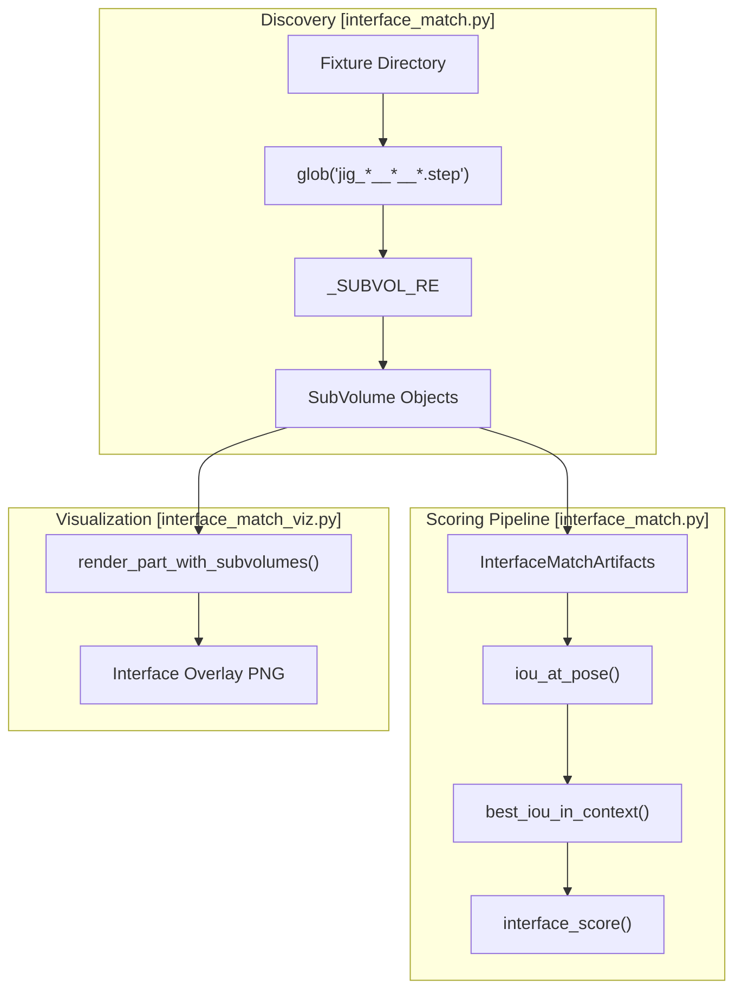
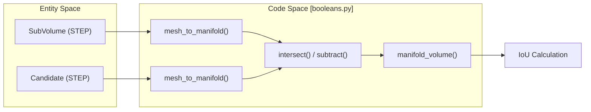

<!-- source: DeepWiki mcp.deepwiki.com · repo huggingface/cadgenbench · extra page Interface Match · fetched 2026-10-26 -->

# Interface Match

Relevant source files

The following files were used as context for generating this wiki page:

- [docs/metrics/illustrations/example_3_interface/candidate_iso.png](docs/metrics/illustrations/example_3_interface/candidate_iso.png)
- [docs/metrics/illustrations/interface_concept.png](docs/metrics/illustrations/interface_concept.png)
- [docs/metrics/interface_match.md](docs/metrics/interface_match.md)
- [src/cadgenbench/eval/booleans.py](src/cadgenbench/eval/booleans.py)
- [src/cadgenbench/eval/interface_match.py](src/cadgenbench/eval/interface_match.py)
- [src/cadgenbench/eval/interface_match_viz.py](src/cadgenbench/eval/interface_match_viz.py)
- [tests/eval/test_interface_match.py](tests/eval/test_interface_match.py)
- [tests/eval/test_interface_viz_no_occt.py](tests/eval/test_interface_viz_no_occt.py)

The Interface Match metric evaluates whether a candidate part's mating features—such as holes, slots, bosses, and pockets—conform to the ground-truth specification. Unlike global shape similarity, this metric focuses on functional sub-volumes (jigs) that define how a part interacts with other components in an assembly.

## Functional Concept

Mating features are organized into **mating groups** (or contexts). A single mating group represents a set of features that must seat together, such as a bolt pattern or a locating pin and slot combination [docs/metrics/interface_match.md:5-8](). 

Each feature within a group is classified into one of two types:
*   **Keep-out Region (KOR):** A volume that must be empty in the candidate (e.g., a clearance hole). Material here would cause a mechanical interference [docs/metrics/interface_match.md:13-13]().
*   **Keep-in Region (KIR):** A volume that must be solid in the candidate (e.g., a locating boss). Missing material here would result in a lack of support or registration [docs/metrics/interface_match.md:14-14]().

### Data Flow: Discovery to Scoring

The system discovers these regions by scanning the fixture directory for STEP files following a specific naming convention: `jig_<context_id>__<index>__<fit_type>.step` [src/cadgenbench/eval/interface_match.py:58-59]().

Sources: [src/cadgenbench/eval/interface_match.py:58-101](), [src/cadgenbench/eval/interface_match_viz.py:90-117]()

## Implementation Detail

### Sub-Volume Discovery
The `discover_sub_volumes` function parses the jig STEP files into `SubVolume` dataclasses [src/cadgenbench/eval/interface_match.py:82-101](). These objects store the mechanical `context_id` (mating group) and the `fit_type` (KOR/KIR) [src/cadgenbench/eval/interface_match.py:62-74]().

### Volumetric Scoring and the Verification Shell
To prevent a candidate from passing a KOR check by simply deleting all surrounding material, the metric uses a **verification shell**.
1.  The system calculates a bounding box `bbox_R` which is the union of the region `R` and a thin shell of the opposite material derived from the ground truth [src/cadgenbench/eval/interface_match_viz.py:34-47]().
2.  The Intersection over Union (IoU) is calculated within this local `bbox_R` [src/cadgenbench/eval/interface_match.py:145-154]().

### Bounded Pose Search
To ensure candidates are not penalized for minor global alignment residuals, the metric performs a deterministic bounded search around the ground-truth pose [src/cadgenbench/eval/interface_match.py:22-26]().
*   **Translation Window:** ±1% of the part's bounding box diagonal [src/cadgenbench/eval/interface_match.py:173-173]().
*   **Rotation Window:** ±1° per axis [src/cadgenbench/eval/interface_match.py:174-174]().
*   **Sampling:** 32 samples by default [src/cadgenbench/eval/interface_match.py:175-175]().

### Aggregate Scoring Logic
The final interface score is aggregated as follows:
1.  **Per-Feature:** Raw IoU is mapped through a soft ramp. IoU $\ge 0.95$ maps to 1.0; IoU $\le 0.80$ maps to 0.0 [src/cadgenbench/eval/interface_match.py:126-138]().
2.  **Per-Group:** A mating group's score is the **minimum** (worst-feature) score within that group [docs/metrics/interface_match.md:26-26]().
3.  **Fixture Score:** The final metric is the **mean** score across all independent mating groups [docs/metrics/interface_match.md:26-26]().

Sources: [src/cadgenbench/eval/interface_match.py:108-138](), [src/cadgenbench/eval/interface_match.py:173-180](), [docs/metrics/interface_match.md:19-28]()

## Geometry Engine: Manifold3D
The Interface Match metric uses the `manifold3d` kernel for all Boolean operations to ensure performance and robustness [src/cadgenbench/eval/booleans.py:22-29]().

Sources: [src/cadgenbench/eval/booleans.py:47-76](), [src/cadgenbench/eval/booleans.py:114-124](), [src/cadgenbench/eval/booleans.py:162-167]()

## Visualization: Interface Overlay
The `interface_match_viz.py` module generates a visual report overlaying the candidate ghost against the mating regions.

| Color | Meaning | Implementation Logic |
| :--- | :--- | :--- |
| **Grey Ghost** | Candidate Geometry | `part_artifacts.mesh()` [src/cadgenbench/eval/interface_match_viz.py:84-84]() |
| **Blue** | Matched Volume | `subtract(R, P)` (KOR) or `intersect(R, P)` (KIR) [src/cadgenbench/eval/interface_match_viz.py:143-147]() |
| **Red** | Too Much Material | `intersect(R, P)` (KOR) or `intersect(shell, P)` (KIR) [src/cadgenbench/eval/interface_match_viz.py:144-148]() |
| **Amber** | Too Little Material | `subtract(shell, P)` (KOR) or `subtract(R, P)` (KIR) [src/cadgenbench/eval/interface_match_viz.py:145-149]() |

The visualization uses the same `manifold3d` logic as the scorer to ensure that the visual representation exactly matches the numerical score [src/cadgenbench/eval/interface_match_viz.py:17-19]().

Sources: [src/cadgenbench/eval/interface_match_viz.py:21-53](), [src/cadgenbench/eval/interface_match_viz.py:134-166]()

---

