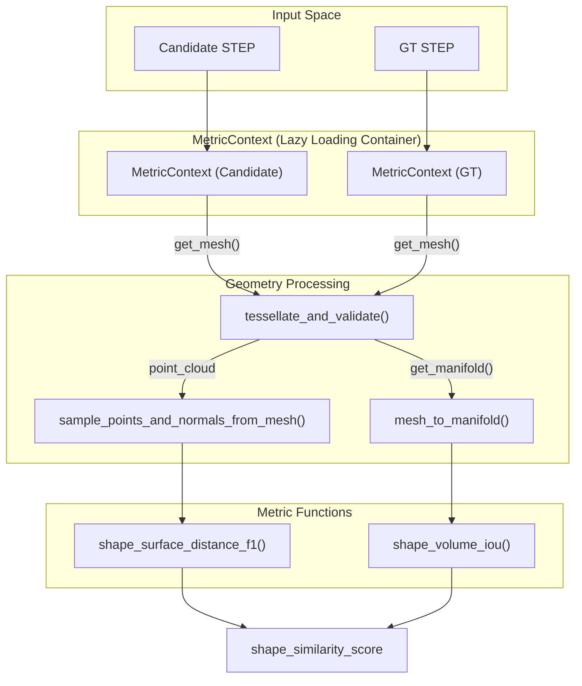
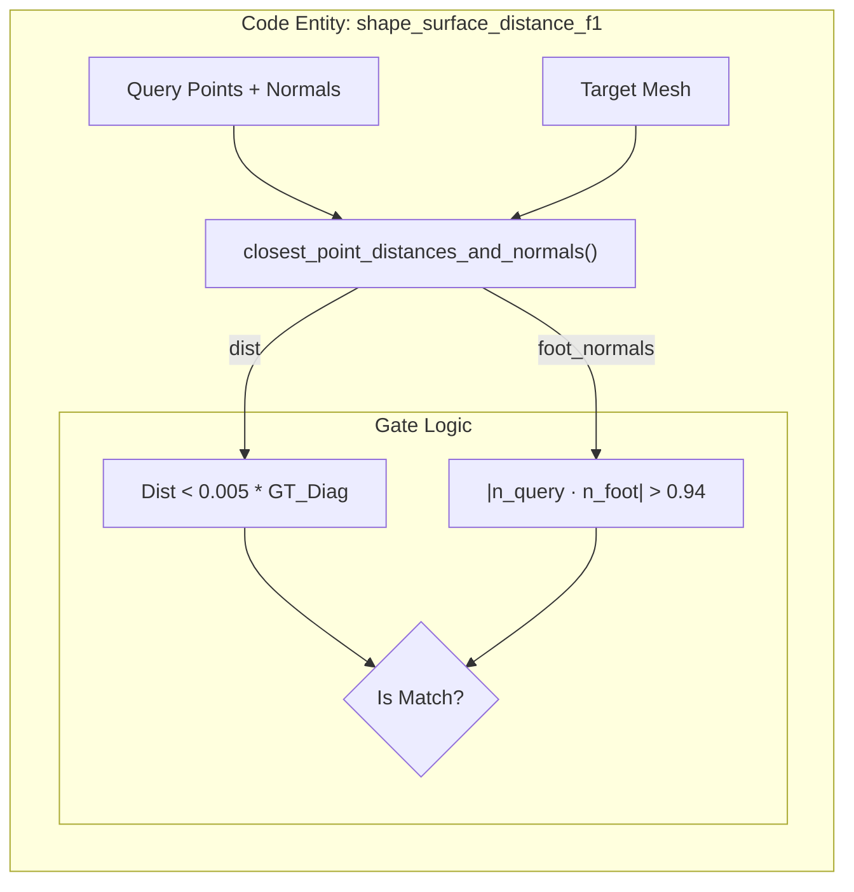

<!-- source: DeepWiki mcp.deepwiki.com · repo huggingface/cadgenbench · extra page Shape Similarity · fetched 2026-10-26 -->

# Shape Similarity

Relevant source files

The following files were used as context for generating this wiki page:

- [docs/metrics/shape_similarity.md](docs/metrics/shape_similarity.md)
- [docs/metrics/topo_match.md](docs/metrics/topo_match.md)
- [src/cadgenbench/eval/sampling.py](src/cadgenbench/eval/sampling.py)
- [src/cadgenbench/eval/shape_similarity.py](src/cadgenbench/eval/shape_similarity.py)
- [tests/eval/test_shape_similarity.py](tests/eval/test_shape_similarity.py)

Shape similarity scores whether a candidate's bulk geometry matches the ground truth (GT), independent of topology or mating interfaces [docs/metrics/shape_similarity.md:1-3](). It is defined as the arithmetic mean of two sub-metrics: **Surface Distance F1** and **Volume IoU** [docs/metrics/shape_similarity.md:5-7]().

These two metrics are complementary: Surface Distance F1 measures the placement and orientation of the boundary, while Volume IoU measures the overlapping 3D space [docs/metrics/shape_similarity.md:9-10]().

### Shape Similarity Data Flow

The diagram below illustrates how a candidate STEP file and a Ground Truth STEP file are processed through the `MetricContext` to produce the final similarity score.

**Shape Evaluation Pipeline**

Sources: [src/cadgenbench/eval/shape_similarity.py:59-160](), [docs/metrics/shape_similarity.md:1-18]()

---

## MetricContext

The `MetricContext` class acts as a lazy-loading bundle for data required by shape metrics [src/cadgenbench/eval/shape_similarity.py:59-64](). It ensures that expensive operations like tessellation and point cloud sampling are performed only once and cached for subsequent metric calls.

### Shared Deflection and Sampling
To ensure metrics like Volume IoU are comparable, both candidate and GT should be tessellated at the same chord error [src/cadgenbench/eval/shape_similarity.py:70-72](). 
- **Linear Deflection**: The system typically derives `linear_deflection_mm` from the GT bounding box diagonal using `deflection_for_bbox` [src/cadgenbench/eval/shape_similarity.py:73-75]().
- **Sampling Strategy**: Surface points are drawn uniformly with respect to surface area (area-weighted triangle sampling) [src/cadgenbench/eval/sampling.py:33-36](). By default, 50,000 points are sampled [src/cadgenbench/eval/shape_similarity.py:55]().

Sources: [src/cadgenbench/eval/shape_similarity.py:58-103](), [src/cadgenbench/common/mesh.py:106-109]() (referenced), [src/cadgenbench/eval/sampling.py:27-49]()

---

## Surface Distance F1

The `shape_surface_distance_f1` metric checks if the candidate's surface lies where the GT's does and faces the same direction [docs/metrics/shape_similarity.md:11-13](). It uses point-to-surface matching, which is more robust than nearest-neighbor point cloud matching [src/cadgenbench/eval/sampling.py:175-180]().

### The Matching Logic
A sample point is considered a "hit" if it satisfies two conditions:
1.  **Distance Gate**: The distance to the closest point on the other mesh's surface is within 0.5% of the GT bounding-box diagonal [src/cadgenbench/eval/shape_similarity.py:24-26]().
2.  **Normal Gate**: The absolute dot product between the sample normal and the surface normal at the foot point must be $\ge \cos(20^\circ) \approx 0.94$ [src/cadgenbench/eval/shape_similarity.py:26-27]().

Using the **absolute** dot product (`|dot|`) makes the metric orientation-insensitive, accepting points even if the surface winding is flipped, as long as the geometric plane matches [src/cadgenbench/eval/shape_similarity.py:177-181]().

**Normal Gating Implementation**

Sources: [src/cadgenbench/eval/shape_similarity.py:173-210](), [src/cadgenbench/eval/sampling.py:163-182](), [docs/metrics/shape_similarity.md:11-13]()

---

## Volume IoU

The `shape_volume_iou` metric calculates the Intersection over Union (IoU) of the two solids [docs/metrics/shape_similarity.md:15-17]().

### Implementation Details
- **Kernel**: It uses the `manifold3d` Boolean kernel for robust volumetric calculations [src/cadgenbench/eval/shape_similarity.py:28-29]().
- **Process**:
    1.  The `MetricContext` converts the cached mesh into a `manifold3d.Manifold` object via `mesh_to_manifold` [src/cadgenbench/eval/shape_similarity.py:148-158]().
    2.  The intersection volume and union volume are computed.
    3.  $IoU = \frac{Vol(A \cap B)}{Vol(A \cup B)}$ [src/cadgenbench/eval/shape_similarity.py:244-250]().

If either shape is not a valid manifold (e.g., failed the validity gate), the IoU metric is skipped [src/cadgenbench/eval/shape_similarity.py:236-240]().

Sources: [src/cadgenbench/eval/shape_similarity.py:230-252](), [docs/metrics/shape_similarity.md:15-17]()

---

## Summary of Metric Components

| Metric | Code Identifier | Threshold / Parameter | Description |
| :--- | :--- | :--- | :--- |
| **Surface F1** | `shape_surface_distance_f1` | 0.5% diagonal, 20° angle | Symmetric F1 of surface-to-surface matches. |
| **Volume IoU** | `shape_volume_iou` | N/A | Volumetric Intersection over Union using `manifold3d`. |
| **Shape Score** | `shape_similarity_score` | Mean of above | The aggregate shape similarity axis score. |

Sources: [src/cadgenbench/eval/shape_similarity.py:20-35](), [docs/metrics/shape_similarity.md:1-18]()

---

