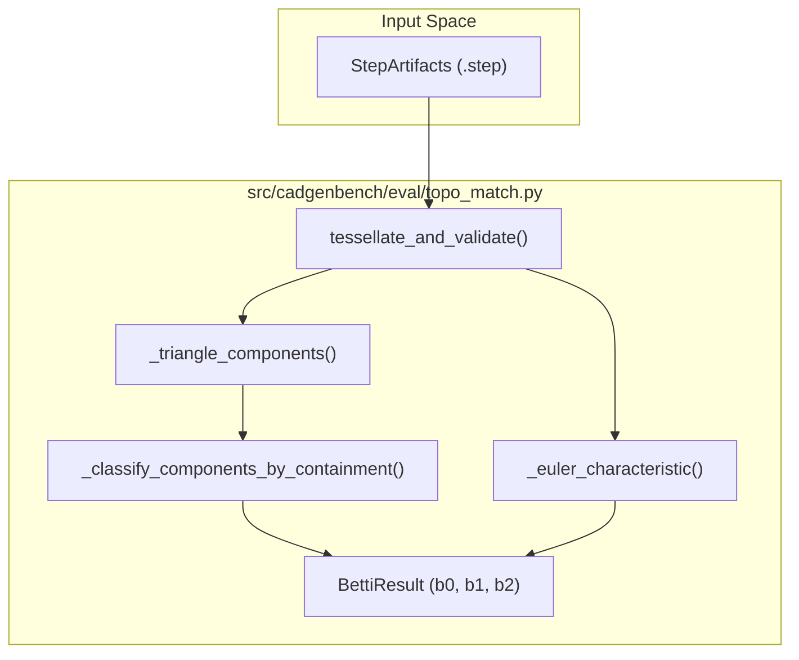
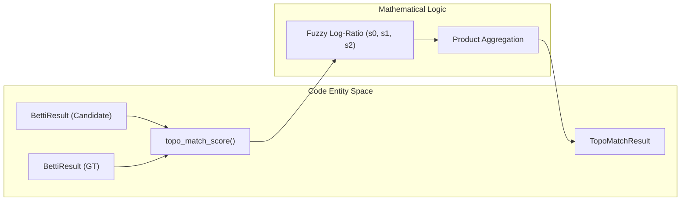

<!-- source: DeepWiki mcp.deepwiki.com · repo huggingface/cadgenbench · extra page Topology Match · fetched 2026-10-26 -->

# Topology Match

Relevant source files

The following files were used as context for generating this wiki page:

- [docs/metrics/illustrations/example_1_shape/candidate_iso.png](docs/metrics/illustrations/example_1_shape/candidate_iso.png)
- [docs/metrics/illustrations/example_1_shape/gt_iso.png](docs/metrics/illustrations/example_1_shape/gt_iso.png)
- [docs/metrics/illustrations/example_2_topology/candidate_iso.png](docs/metrics/illustrations/example_2_topology/candidate_iso.png)
- [docs/metrics/illustrations/example_2_topology/components_candidate_iso.png](docs/metrics/illustrations/example_2_topology/components_candidate_iso.png)
- [docs/metrics/illustrations/example_2_topology/components_gt_iso.png](docs/metrics/illustrations/example_2_topology/components_gt_iso.png)
- [docs/metrics/shape_similarity.md](docs/metrics/shape_similarity.md)
- [docs/metrics/topo_match.md](docs/metrics/topo_match.md)
- [src/cadgenbench/eval/topo_match.py](src/cadgenbench/eval/topo_match.py)
- [tests/eval/test_topo_match.py](tests/eval/test_topo_match.py)

The **Topology Match** metric scores whether a candidate part's 3D topology (connected solid pieces, through-handles, and internal voids) matches the ground truth's. It uses integer invariants known as **Betti numbers** ($b_0, b_1, b_2$), which are coordinate- and representation-invariant, ensuring that the same physical part yields identical scores regardless of the underlying CAD feature tree or B-Rep decomposition [docs/metrics/topo_match.md:1-13]().

## Pipeline Overview

Betti numbers are computed once on a tessellated mesh. The pipeline assumes the mesh has passed the [CAD Validity Gate](./2.2) (watertight, manifold, and orientation-consistent) [docs/metrics/topo_match.md:28-30]().

### 1. Connected Components Analysis
The system performs a union-find operation on triangle adjacency. Each resulting component is a closed 2-manifold [docs/metrics/topo_match.md:32](). This is implemented via `_triangle_components` in [src/cadgenbench/eval/topo_match.py:162]().

### 2. Containment Classification ($b_0$ and $b_2$)
For every connected component, the system identifies an interior probe point. It then uses **ray casting** to count how many *other* components enclose that point [docs/metrics/topo_match.md:33]():
*   **Even Parity:** The component is an outer shell of a solid piece, contributing to **$b_0$** (connected solid components).
*   **Odd Parity:** The component is an inner shell of a void, contributing to **$b_2$** (enclosed internal voids).

### 3. Handle Calculation ($b_1$)
The number of independent through-handles (e.g., holes) is derived from the surface Euler characteristic ($\chi = V - E + F$) of the welded mesh [src/cadgenbench/eval/topo_match.py:36-39](). Using the topological identity $\chi(\partial S) = 2(b_0 - b_1 + b_2)$, the system solves for $b_1$:
$$b_1 = b_0 + b_2 - \chi_{\text{surface}}/2$$
[docs/metrics/topo_match.md:34](), [src/cadgenbench/eval/topo_match.py:164]().

### Topology Data Flow
The following diagram illustrates the transformation from a STEP file to topological invariants:

**Topological Analysis Workflow**

Sources: [src/cadgenbench/eval/topo_match.py:130-174](), [docs/metrics/topo_match.md:28-35]()

## Scoring Logic

The topology match score is a **product aggregation** of fuzzy log-ratios for each Betti axis.

### Fuzzy Log-Ratio
Each axis ($i \in \{0, 1, 2\}$) is scored using a log-ratio to handle discrete counts smoothly. A sharpness exponent $\alpha$ (defined as `BETTI_SHARPNESS = 2`) is applied so that a wrong count results in a significant penalty [src/cadgenbench/eval/topo_match.py:54-55]().

$$s_i = \exp\left(-\alpha\left|\log\frac{b_i^{\text{cand}}+1}{b_i^{\text{gt}}+1}\right|\right) = \left(\frac{\min(b_i^{\text{cand}}, b_i^{\text{gt}})+1}{\max(b_i^{\text{cand}}, b_i^{\text{gt}})+1}\right)^{\alpha}$$

The $+1$ shift ensures the score remains finite when a count is zero [docs/metrics/topo_match.md:41-44]().

### Aggregate Score
The final `topology_match` score is the product of the three axes:
$$\text{score} = s_0 \cdot s_1 \cdot s_2$$

Because topology is discrete, the product ensures that failing any single invariant (e.g., missing a hole) collapses the overall score toward zero, rather than allowing a high average from the other two axes [docs/metrics/topo_match.md:44-50](), [src/cadgenbench/eval/topo_match.py:180-193]().

**Scoring Implementation Mapping**

Sources: [src/cadgenbench/eval/topo_match.py:88-122](), [src/cadgenbench/eval/topo_match.py:177-204]()

## Data Structures

### BettiResult
Stores the raw topological counts and diagnostic metadata for a single shape.
*   `b0`, `b1`, `b2`: Integer Betti numbers [src/cadgenbench/eval/topo_match.py:92-94]().
*   `chi_surface`: The Euler characteristic $V-E+F$ [src/cadgenbench/eval/topo_match.py:95]().
*   `n_components`: Number of connected manifold shells [src/cadgenbench/eval/topo_match.py:96]().

### TopoMatchResult
Stores the comparison between a candidate and ground truth.
*   `candidate`: `BettiResult` for the output STEP [src/cadgenbench/eval/topo_match.py:109]().
*   `gt`: `BettiResult` for the ground truth STEP [src/cadgenbench/eval/topo_match.py:110]().
*   `per_axis_scores`: Dictionary containing $s_0, s_1, s_2$ [src/cadgenbench/eval/topo_match.py:111]().
*   `score`: The final product score [src/cadgenbench/eval/topo_match.py:112]().

## Limitations
*   **Position Invariance:** Topology Match does not test the position of features. A hole on the left vs. a hole on the right yields the same Betti numbers. Position is handled by [Shape Similarity](./2.4.1) and [Interface Match](./2.4.3) [docs/metrics/topo_match.md:57-59]().
*   **Blind Features:** Pockets or blind holes that do not go through the material are topologically trivial (they do not change Betti numbers) and are scored by other metrics [docs/metrics/topo_match.md:24-26]().

Sources: [docs/metrics/topo_match.md:1-60](), [src/cadgenbench/eval/topo_match.py:1-204]()

---

