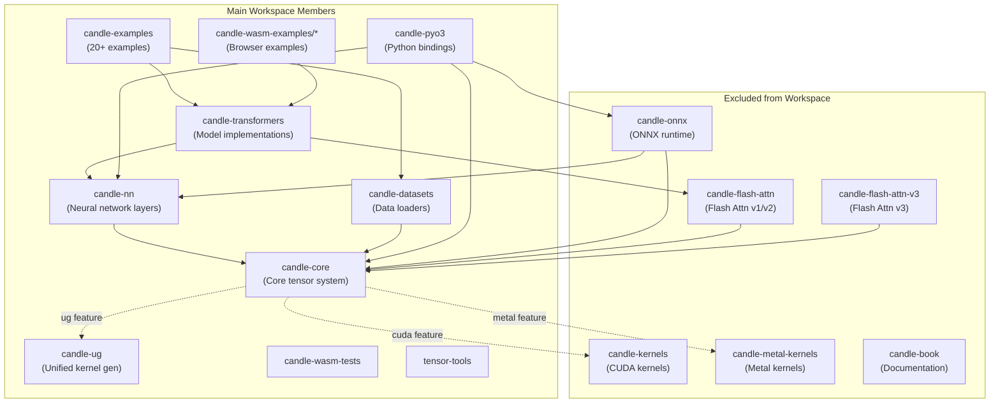
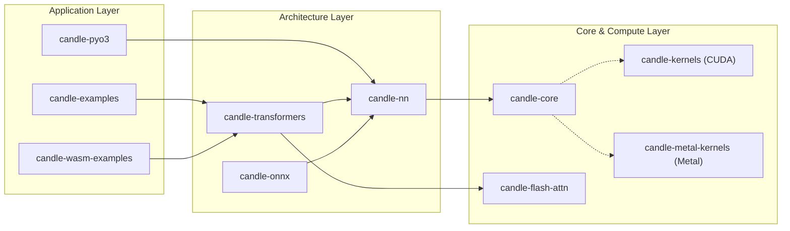
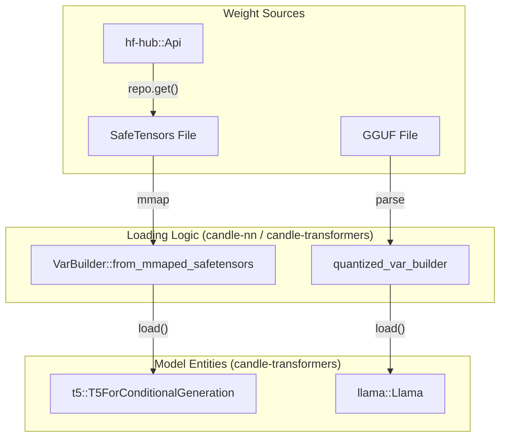

<!-- source: DeepWiki mcp.deepwiki.com · repo huggingface/candle · page 1.1 Project Structure and Crates · fetched 2026-10-26 -->

# Project Structure and Crates

Relevant source files

The following files were used as context for generating this wiki page:

- [Cargo.toml](Cargo.toml)
- [candle-core/Cargo.toml](candle-core/Cargo.toml)
- [candle-datasets/Cargo.toml](candle-datasets/Cargo.toml)
- [candle-examples/Cargo.toml](candle-examples/Cargo.toml)
- [candle-examples/examples/quantized-t5/README.md](candle-examples/examples/quantized-t5/README.md)
- [candle-examples/examples/quantized-t5/main.rs](candle-examples/examples/quantized-t5/main.rs)
- [candle-examples/examples/t5/README.md](candle-examples/examples/t5/README.md)
- [candle-examples/examples/t5/main.rs](candle-examples/examples/t5/main.rs)
- [candle-flash-attn-v3/Cargo.toml](candle-flash-attn-v3/Cargo.toml)
- [candle-flash-attn/Cargo.toml](candle-flash-attn/Cargo.toml)
- [candle-kernels/Cargo.toml](candle-kernels/Cargo.toml)
- [candle-metal-kernels/Cargo.toml](candle-metal-kernels/Cargo.toml)
- [candle-nn/Cargo.toml](candle-nn/Cargo.toml)
- [candle-nn/src/conv.rs](candle-nn/src/conv.rs)
- [candle-nn/src/embedding.rs](candle-nn/src/embedding.rs)
- [candle-nn/src/group_norm.rs](candle-nn/src/group_norm.rs)
- [candle-nn/src/layer_norm.rs](candle-nn/src/layer_norm.rs)
- [candle-nn/src/lib.rs](candle-nn/src/lib.rs)
- [candle-nn/src/linear.rs](candle-nn/src/linear.rs)
- [candle-nn/tests/layer_norm.rs](candle-nn/tests/layer_norm.rs)
- [candle-onnx/Cargo.toml](candle-onnx/Cargo.toml)
- [candle-pyo3/Cargo.toml](candle-pyo3/Cargo.toml)
- [candle-transformers/Cargo.toml](candle-transformers/Cargo.toml)
- [candle-transformers/src/lib.rs](candle-transformers/src/lib.rs)
- [candle-transformers/src/models/quantized_t5.rs](candle-transformers/src/models/quantized_t5.rs)
- [candle-transformers/src/models/t5.rs](candle-transformers/src/models/t5.rs)
- [candle-transformers/src/quantized_var_builder.rs](candle-transformers/src/quantized_var_builder.rs)
- [candle-wasm-examples/llama2-c/Cargo.toml](candle-wasm-examples/llama2-c/Cargo.toml)
- [candle-wasm-examples/quant-qwen3/Cargo.toml](candle-wasm-examples/quant-qwen3/Cargo.toml)
- [candle-wasm-examples/whisper/Cargo.toml](candle-wasm-examples/whisper/Cargo.toml)
- [candle-wasm-examples/yolo/Cargo.toml](candle-wasm-examples/yolo/Cargo.toml)
- [tensor-tools/Cargo.toml](tensor-tools/Cargo.toml)

This page documents the organization of the Candle workspace, describing the purpose of each crate, their dependencies, and how they fit together. For details on the build system and feature flags, see [Build System and Feature Flags](#1.2). For backend-specific implementations, see sections on [CPU Backend](#3.2), [CUDA Backend](#3.3), and [Metal Backend](#3.4).

## Workspace Organization

The Candle project is organized as a Cargo workspace containing multiple member crates plus several excluded crates that require specialized build handling (often involving non-Rust compilers like `nvcc` or `xcrun`). The workspace structure separates concerns into layers: core tensor operations, neural network primitives, model implementations, and application examples.

**Workspace Structure**

Sources: [Cargo.toml:1-22]()

The workspace uses a resolver version 2 and shares common metadata across all crates including version (0.11.0), edition (2021), and license (MIT OR Apache-2.0).

Sources: [Cargo.toml:22-32]()

## Core Framework Crates

### candle-core

The foundational crate providing tensor operations, automatic differentiation, and device abstraction. This is the only required dependency for all other Candle crates.

**Key components**:
- `Device`: Enum for dispatching to `Cpu`, `Cuda`, or `Metal` backends.
- `Tensor`: The primary data structure for multi-dimensional arrays.
- `DType`: Data type system supporting `F32`, `F16`, `BF16`, and low-bit quantization types like `F8E4M3`. [candle-core/Cargo.toml:21-22]()
- `Storage`: Backend-specific memory management.

**Dependencies**:
- Core numeric: `gemm`, `half`, `float8`, `num-traits`, `libm`.
- Parallelization: `rayon`, `num_cpus`.
- Serialization: `safetensors`, `memmap2`, `zip`, `tokenizers`.
- CUDA (optional): `cudarc`, `candle-kernels`.
- Metal (optional): `objc2-metal`, `objc2-foundation`, `candle-metal-kernels`.
- CPU acceleration (optional): `intel-mkl-src`, `accelerate-src`.
- Unified kernels (optional): `candle-ug`.

Sources: [candle-core/Cargo.toml:12-41]()

**Feature flags**:
- `cuda`: Enable CUDA backend and kernels. [candle-core/Cargo.toml:51]()
- `cudnn`: Enable cuDNN integration (requires `cuda`). [candle-core/Cargo.toml:52]()
- `nccl`: Enable NCCL for multi-GPU (requires `cuda`). [candle-core/Cargo.toml:53]()
- `metal`: Enable Metal backend and kernels. [candle-core/Cargo.toml:56-61]()
- `mkl`: Enable Intel MKL for CPU acceleration. [candle-core/Cargo.toml:54]()
- `accelerate`: Enable Apple Accelerate framework. [candle-core/Cargo.toml:55]()
- `ug`: Enable unified kernel generation system via `candle-ug`. [candle-core/Cargo.toml:63]()

### candle-nn

Neural network building blocks including layers, activations, normalization, and the `VarBuilder` weight management system.

**Key components**:
- Layer types: `Linear`, `Embedding`, `Conv1d`, `Conv2d`, `LayerNorm`, `RmsNorm`, `BatchNorm`, `GroupNorm`. [candle-nn/src/lib.rs:46-60]()
- `VarBuilder`: Abstraction for loading weights from `SafeTensors` or memory-mapped files. [candle-nn/src/lib.rs:65](), [candle-examples/examples/t5/main.rs:174-185]()
- `Module` trait: Standard forward pass interface. [candle-nn/src/lib.rs:68](), [candle-transformers/src/models/t5.rs:81-92]()
- `Optimizers`: Implementations for `SGD` and `AdamW`. [candle-nn/src/lib.rs:62]()

The crate depends on `candle-core` and inherits its feature flags for backend selection.

Sources: [candle-nn/Cargo.toml:1-44](), [candle-nn/src/lib.rs:1-68]()

### candle-transformers

High-level model implementations including LLMs, vision models, and audio models. This crate provides production-ready architectures built on top of `candle-nn`.

**Supported Models**:
- **LLMs**: T5, LLaMA, Mistral, Phi, Qwen, Gemma, Falcon, Granite, Mamba. [candle-transformers/src/models/t5.rs:1-17]()
- **Audio**: Whisper, EnCodec, Mimi, SNAC, Parler-TTS. [candle-examples/examples/t5/main.rs:137-146]()
- **Vision**: YOLO (v3/v8), DINOv2, Segment Anything (SAM), DepthAnythingV2. [candle-examples/Cargo.toml:149-150]()
- **Multimodal**: BLIP, Moondream, PaliGemma, Voxtral. [candle-examples/Cargo.toml:161-162]()

Sources: [candle-transformers/Cargo.toml:1-36](), [candle-transformers/src/models/t5.rs:1-199]()

### candle-datasets

Dataset loaders for common benchmarks and training data including MNIST, CIFAR, and utilities for working with Hugging Face Hub datasets.

Sources: [candle-datasets/Cargo.toml:1-23](), [candle-examples/Cargo.toml:129-134]()

## GPU Kernel and Specialized Crates

### candle-kernels

Custom CUDA kernels compiled from `.cu` files using the `cudaforge` build tool. These kernels provide optimized implementations for operations that benefit from custom GPU code.

Sources: [candle-kernels/Cargo.toml:1-15]()

### candle-metal-kernels

Metal compute shaders for Apple Silicon GPUs. The crate compiles Metal Shading Language (MSL) kernels at build time and provides a registry for runtime access via `objc2-metal`.

Sources: [candle-metal-kernels/Cargo.toml:1-31]()

### candle-flash-attn and candle-flash-attn-v3

Optimized attention layers for CUDA.
- `candle-flash-attn`: Implements Flash Attention v1 and v2. [candle-flash-attn/Cargo.toml:6]()
- `candle-flash-attn-v3`: Implements Flash Attention v3 for Hopper (SM90+) GPUs. [candle-flash-attn-v3/Cargo.toml:6]()

Sources: [candle-flash-attn/Cargo.toml:1-27](), [candle-flash-attn-v3/Cargo.toml:1-20]()

### candle-onnx

ONNX (Open Neural Network Exchange) runtime integration. It allows loading and evaluating ONNX models using Candle's backend via a `prost`-based parser.

Sources: [candle-onnx/Cargo.toml:1-22]()

## Integration and Tooling Crates

### candle-pyo3

Python bindings exposing Candle's API to Python via PyO3. The crate builds as a `cdylib` for Python import under the name `candle`. [candle-pyo3/Cargo.toml:13-14]()

Sources: [candle-pyo3/Cargo.toml:1-34]()

### candle-wasm-examples

Multiple browser-based examples compiled to WebAssembly. Each subdirectory (e.g., `whisper`, `llama2-c`, `yolo`) is a separate crate. These allow running models like Whisper or LLaMA2 directly in the browser using `wasm-bindgen`.

Sources: [Cargo.toml:10](), [candle-wasm-examples/whisper/Cargo.toml:1-20]()

### tensor-tools

A CLI utility for inspecting and converting tensor files (e.g., between SafeTensors and GGUF).

Sources: [Cargo.toml:12](), [tensor-tools/Cargo.toml:1-16]()

### candle-ug

A crate for Unified Kernel Generation, enabling SSA-based kernel language support. It provides backends for both CUDA and Metal to generate kernels dynamically. [candle-core/Cargo.toml:51, 60]()

Sources: [Cargo.toml:47](), [Cargo.toml:100-102]()

## Dependency Flow and Entity Mapping

The following diagrams bridge the natural language concepts of the framework to the specific code entities and crates.

**Model Execution Dependency Flow**

Sources: [Cargo.toml:1-21](), [candle-examples/Cargo.toml:14-19]()

**Code Entity Mapping: Model Loading**

Sources: [candle-examples/examples/t5/main.rs:127-185](), [candle-transformers/src/models/t5.rs:64]()

## Workspace-Level Dependencies

Shared dependencies defined in `[workspace.dependencies]` at [Cargo.toml:33-105]():

| Dependency | Purpose | Code Reference |
|------------|---------|----------------|
| `half`, `float8` | Low-precision floating point types | [Cargo.toml:65, 71]() |
| `safetensors` | Zero-copy tensor serialization | [Cargo.toml:91]() |
| `cudarc` | Safe wrapper for CUDA APIs | [Cargo.toml:50]() |
| `gemm` | Pure Rust matrix multiplication (WASM SIMD support) | [Cargo.toml:63]() |
| `hf-hub` | Access to Hugging Face Hub | [Cargo.toml:64]() |
| `tokenizers` | Fast tokenization for LLMs | [Cargo.toml:96]() |

Sources: [Cargo.toml:33-105]()

---

