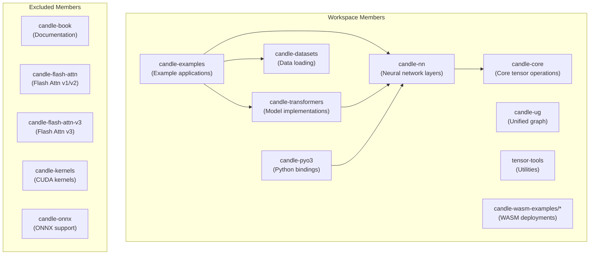
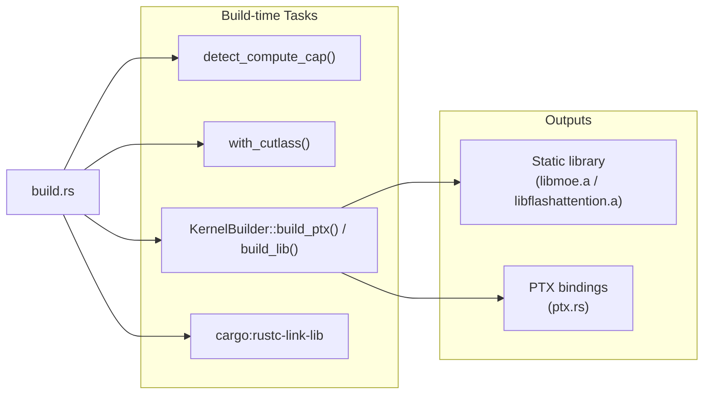

<!-- source: DeepWiki mcp.deepwiki.com · repo huggingface/candle · page 1.2 Build System and Feature Flags · fetched 2026-10-26 -->

# Build System and Feature Flags

Relevant source files

The following files were used as context for generating this wiki page:

- [.github/workflows/ci_cuda.yaml](.github/workflows/ci_cuda.yaml)
- [.github/workflows/maturin.yml](.github/workflows/maturin.yml)
- [.github/workflows/python.yml](.github/workflows/python.yml)
- [.github/workflows/rust-ci.yml](.github/workflows/rust-ci.yml)
- [.github/workflows/trufflehog.yml](.github/workflows/trufflehog.yml)
- [candle-book/CONTRIBUTING.md](candle-book/CONTRIBUTING.md)
- [candle-book/Cargo.toml](candle-book/Cargo.toml)
- [candle-book/book.toml](candle-book/book.toml)
- [candle-book/src/README.md](candle-book/src/README.md)
- [candle-book/src/SUMMARY.md](candle-book/src/SUMMARY.md)
- [candle-book/src/guide/hello_world.md](candle-book/src/guide/hello_world.md)
- [candle-book/src/guide/installation.md](candle-book/src/guide/installation.md)
- [candle-book/src/guide/mnist/intro.md](candle-book/src/guide/mnist/intro.md)
- [candle-book/src/guide/mnist/modeling.md](candle-book/src/guide/mnist/modeling.md)
- [candle-book/src/guide/mnist/saving_loading.md](candle-book/src/guide/mnist/saving_loading.md)
- [candle-book/src/guide/mnist/training.md](candle-book/src/guide/mnist/training.md)
- [candle-book/src/inference/inference.md](candle-book/src/inference/inference.md)
- [candle-book/src/lib.rs](candle-book/src/lib.rs)
- [candle-book/src/simplified.rs](candle-book/src/simplified.rs)
- [candle-book/src/tracing.md](candle-book/src/tracing.md)
- [candle-book/src/training/simplified.md](candle-book/src/training/simplified.md)
- [candle-book/src/training/training.md](candle-book/src/training/training.md)
- [candle-core/benches/benchmarks/reduce.rs](candle-core/benches/benchmarks/reduce.rs)
- [candle-core/benches/benchmarks/where_cond.rs](candle-core/benches/benchmarks/where_cond.rs)
- [candle-examples/build.rs](candle-examples/build.rs)
- [candle-examples/buildtime_downloader.rs](candle-examples/buildtime_downloader.rs)
- [candle-examples/examples/custom-ops/cuda_kernels.rs](candle-examples/examples/custom-ops/cuda_kernels.rs)
- [candle-examples/examples/custom-ops/kernels/layernorm_kernels.cu](candle-examples/examples/custom-ops/kernels/layernorm_kernels.cu)
- [candle-examples/examples/custom-ops/kernels/reduction_utils.cuh](candle-examples/examples/custom-ops/kernels/reduction_utils.cuh)
- [candle-examples/examples/custom-ops/main.rs](candle-examples/examples/custom-ops/main.rs)
- [candle-flash-attn/build.rs](candle-flash-attn/build.rs)
- [candle-kernels/README.md](candle-kernels/README.md)
- [candle-kernels/build.rs](candle-kernels/build.rs)
- [candle-kernels/src/lib.rs](candle-kernels/src/lib.rs)
- [candle-kernels/src/moe/moe_wmma.cu](candle-kernels/src/moe/moe_wmma.cu)
- [candle-nn/benches/benchmarks/softmax.rs](candle-nn/benches/benchmarks/softmax.rs)
- [candle-onnx/build.rs](candle-onnx/build.rs)
- [candle-onnx/src/onnx.proto3](candle-onnx/src/onnx.proto3)

## Purpose and Scope

This document describes the Candle framework's build system, Cargo workspace structure, and feature flag system. It explains how optional hardware backends (CUDA, Metal, MKL, Accelerate) and performance optimizations (Flash Attention) are enabled through Cargo features, and how custom GPU kernels are compiled during the build process.

## Cargo Workspace Structure

The Candle repository is organized as a Cargo workspace. The structure separates core functionality, neural network primitives, model implementations, examples, and deployment targets.

**Workspace Members**:

**Why Certain Crates Are Excluded**
The `candle-flash-attn`, `candle-flash-attn-v3`, `candle-kernels`, and `candle-onnx` crates are often excluded from the primary workspace default members or handled separately because:
1. They require specialized build processes (CUDA kernel compilation via `nvcc`).
2. They have platform-specific dependencies (CUDA toolkit).
3. They are optional dependencies activated only when specific features are enabled.

## Feature Flags Overview

Candle uses Cargo feature flags to enable optional backends and optimizations.

### Core Backend Features

| Feature | Purpose | Available In | Dependencies |
|---------|---------|--------------|--------------|
| `cuda` | Enable NVIDIA CUDA backend | core, nn, transformers, examples | Requires CUDA toolkit, `cudarc` |
| `metal` | Enable Apple Metal backend | core, nn, transformers, examples | macOS only |
| `mkl` | Enable Intel MKL for CPU | core, nn, transformers, examples | `intel-mkl-src` [candle-book/Cargo.toml:23]() |
| `accelerate` | Enable Apple Accelerate | core, nn, transformers, examples | `accelerate-src` [candle-book/Cargo.toml:13]() |

### Performance Optimization Features

| Feature | Purpose | Available In | Dependencies |
|---------|---------|--------------|--------------|
| `flash-attn` | Enable Flash Attention v1/v2 | transformers, examples | Requires `cuda`, `candle-flash-attn` [candle-book/Cargo.toml:18]() |

**Sources:** [candle-book/Cargo.toml:12-27](), [candle-book/src/guide/installation.md:18-60]()

## Build Scripts and Kernel Compilation

Candle uses `build.rs` scripts to compile GPU kernels at build time. This approach allows platform-specific optimizations while maintaining a unified Rust API.

### Build Script Responsibilities

### CUDA Kernel Compilation with cudaforge

The `cudaforge` crate provides a builder API for compiling CUDA kernels. It handles source file compilation with `nvcc`, include path management, and static library generation.

**Example: candle-kernels Build Process**
The `candle-kernels` build script performs two distinct types of compilation:
1.  **PTX Generation**: Scans `src/` for `.cu` files and compiles them to PTX, excluding specific MoE and GGUF kernels [candle-kernels/build.rs:14-20]().
2.  **Static Library (MoE/MMQ)**: Compiles specific Mixture-of-Experts (MoE) and quantized matrix multiplication (MMQ/MMVQ) kernels into a static library `libmoe.a` [candle-kernels/build.rs:24-67]().
3.  **Compute Capability Detection**: Uses `cudaforge::detect_compute_cap()` to disable `bf16` WMMA kernels on hardware older than Ampere (sm_80) via `-DNO_BF16_KERNEL` [candle-kernels/build.rs:48-53]().

**Example: candle-flash-attn Build Process**
Flash Attention v1/v2 compilation:
1.  **Kernel Files**: Defines over 50 CUDA source files covering different head dimensions and causal masking variants [candle-flash-attn/build.rs:8-62]().
2.  **CUTLASS Integration**: Uses `.with_cutlass(Some(CUTLASS_COMMIT))` to automatically fetch and include the CUTLASS header-only library from GitHub [candle-flash-attn/build.rs:132]().
3.  **Build Caching**: Supports `CANDLE_FLASH_ATTN_BUILD_DIR` environment variable to cache compiled artifacts and avoid long re-compilation times [candle-flash-attn/build.rs:111-125]().
4.  **Linking**: Links the resulting `libflashattention.a` and `cudart` [candle-flash-attn/build.rs:161-163]().

### Custom Operations Compilation
The `candle-examples` crate demonstrates how to compile user-defined CUDA kernels for custom operations:
1.  **Kernel Discovery**: Uses a glob pattern (e.g., `examples/custom-ops/kernels/*.cu`) to find source files [candle-examples/build.rs:10-13]().
2.  **PTX Binding Generation**: Uses `KernelBuilder::new().build_ptx()` to generate Rust bindings in the `$OUT_DIR` [candle-examples/build.rs:33-36]().
3.  **Usage in Code**: The generated file is included via the `include!` macro [candle-examples/examples/custom-ops/main.rs:10-13]().

**Sources:** [candle-kernels/build.rs:5-75](), [candle-flash-attn/build.rs:1-168](), [candle-examples/build.rs:1-50](), [candle-examples/examples/custom-ops/main.rs:10-13]()

## CI/CD Workflows

The Candle project uses GitHub Actions to validate the build system across different platforms and feature sets.

**Main Rust CI** ([.github/workflows/rust-ci.yml]()):
- **Matrix Testing**: Runs on `ubuntu-latest`, `windows-latest`, `macOS-latest`, and `ubuntu-24.04-arm` [.github/workflows/rust-ci.yml:16]().
- **Metal Validation**: Checks the workspace with the `metal` feature on macOS [.github/workflows/rust-ci.yml:27-29]().
- **SIMD Features**: Validates `avx2` on Linux x86 and `neon` on Linux ARM [.github/workflows/rust-ci.yml:35-46]().

**CUDA CI** ([.github/workflows/ci_cuda.yaml]()):
- **Hardware**: Runs on AWS G5 instances (`aws-g5-4xlarge-cache`) which provide NVIDIA A10G GPUs [.github/workflows/ci_cuda.yaml:13]().
- **Environment**: Uses the `nvidia/cuda:13.0.2-cudnn-devel-ubuntu24.04` container [.github/workflows/ci_cuda.yaml:15]().
- **Compute Cap**: Explicitly sets `CUDA_COMPUTE_CAP: 86` for the test run [.github/workflows/ci_cuda.yaml:25]().

**Python Bindings CI** ([.github/workflows/maturin.yml]()):
- **Maturin**: Uses `PyO3/maturin-action` to build wheels for Linux, Windows, and macOS across multiple architectures (x86_64, aarch64, etc.) [.github/workflows/maturin.yml:29, 53, 82]().

**Sources:** [.github/workflows/rust-ci.yml:1-101](), [.github/workflows/ci_cuda.yaml:1-35](), [.github/workflows/maturin.yml:1-126]()

## candle-book Documentation Structure

The `candle-book` is a separate crate that serves as the source for the mdBook documentation.

- **Content Organization**: Defined in `SUMMARY.md`, covering Installation, Tutorials (MNIST), and Reference Guides [candle-book/src/SUMMARY.md:1-32]().
- **Code Anchors**: The book uses `ANCHOR` tags to pull live code snippets into the documentation, ensuring examples like the `hf-hub` integration remain up-to-date [candle-book/src/lib.rs:14-25, 33-47, 55-106]().
- **Build-time Downloads**: The `candle-examples` build script can optionally download models from Hugging Face Hub at build time using `CANDLE_BUILDTIME_MODEL_REVISION` [candle-examples/build.rs:47-49]().

**Sources:** [candle-book/src/SUMMARY.md:1-32](), [candle-book/src/lib.rs:1-189](), [candle-examples/build.rs:43-50]()

---

