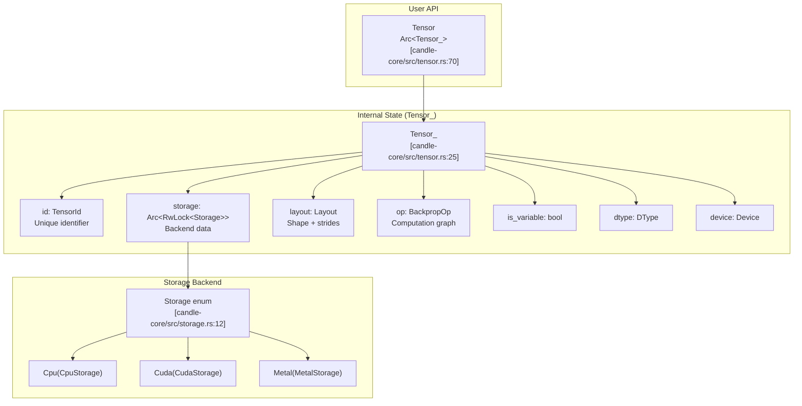
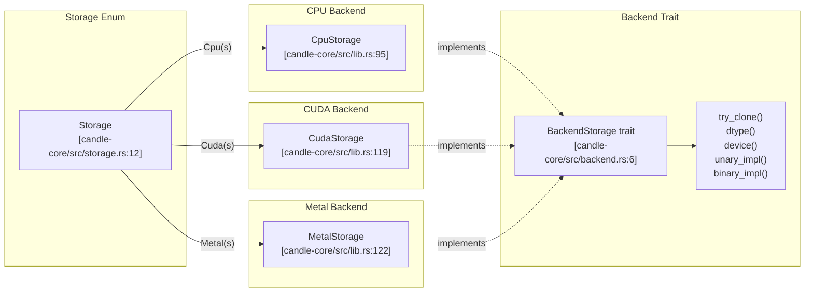
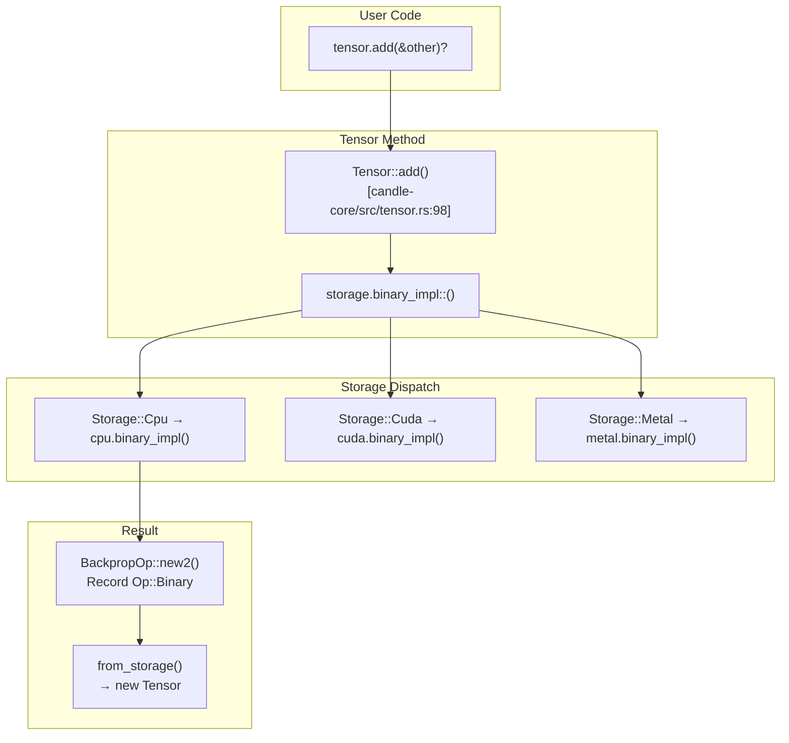

<!-- source: DeepWiki mcp.deepwiki.com · repo huggingface/candle · page 2 Core Tensor System · fetched 2026-10-26 -->

# Core Tensor System

<details>
<summary>Relevant source files</summary>

The following files were used as context for generating this wiki page:

- [candle-core/src/backend.rs](candle-core/src/backend.rs)
- [candle-core/src/backprop.rs](candle-core/src/backprop.rs)
- [candle-core/src/custom_op.rs](candle-core/src/custom_op.rs)
- [candle-core/src/device.rs](candle-core/src/device.rs)
- [candle-core/src/dummy_cuda_backend.rs](candle-core/src/dummy_cuda_backend.rs)
- [candle-core/src/dummy_metal_backend.rs](candle-core/src/dummy_metal_backend.rs)
- [candle-core/src/error.rs](candle-core/src/error.rs)
- [candle-core/src/lib.rs](candle-core/src/lib.rs)
- [candle-core/src/op.rs](candle-core/src/op.rs)
- [candle-core/src/storage.rs](candle-core/src/storage.rs)
- [candle-core/src/tensor.rs](candle-core/src/tensor.rs)
- [candle-core/src/test_utils.rs](candle-core/src/test_utils.rs)
- [candle-core/tests/custom_op_tests.rs](candle-core/tests/custom_op_tests.rs)
- [candle-core/tests/grad_tests.rs](candle-core/tests/grad_tests.rs)
- [candle-core/tests/matmul_tests.rs](candle-core/tests/matmul_tests.rs)
- [candle-core/tests/tensor_tests.rs](candle-core/tests/tensor_tests.rs)

</details>


## Purpose and Scope

This page documents the core tensor abstraction in Candle, which is the fundamental data structure for representing multi-dimensional arrays and enabling automatic differentiation. The tensor system provides:

- Multi-dimensional array representation with arbitrary shapes.
- Efficient memory management through reference counting and layout abstraction.
- Backend-agnostic storage supporting CPU, CUDA, and Metal devices.
- Computation graph construction for automatic differentiation.
- Type-safe operations across multiple data types, including low-bit quantization formats.

For details on specific tensor operations (arithmetic, reduction, indexing), see [Tensor Operations](#2.2). For the automatic differentiation mechanism, see [Automatic Differentiation](#2.3). For memory layout and shape broadcasting, see [Shape, Layout, and Memory Management](#2.4).

---

## Tensor Architecture

The tensor system uses a two-level structure: `Tensor` is a lightweight `Arc` wrapper around `Tensor_`, which contains the actual tensor state.

### Tensor Wrapper and Internal Structure



**Sources:** [candle-core/src/tensor.rs:25-45](), [candle-core/src/tensor.rs:53-70](), [candle-core/src/storage.rs:12-16]()

The `Tensor` type is defined as:

```rust
pub struct Tensor(Arc<Tensor_>);
```

This Arc-based wrapper enables cheap cloning [candle-core/src/tensor.rs:53-56](), which is essential for building computation graphs where the same tensor may be referenced multiple times. The inner `Tensor_` struct at [candle-core/src/tensor.rs:25-45]() contains:

| Field | Type | Purpose |
|-------|------|---------|
| `id` | `TensorId` | Unique identifier for the tensor instance [candle-core/src/tensor.rs:13-23]() |
| `storage` | `Arc<RwLock<Storage>>` | Backend-specific data storage with interior mutability [candle-core/src/tensor.rs:39]() |
| `layout` | `Layout` | Shape, strides, and start offset defining memory organization [candle-core/src/tensor.rs:40]() |
| `op` | `BackpropOp` | Parent tensors and operation for autodiff graph [candle-core/src/tensor.rs:41]() |
| `is_variable` | `bool` | Whether this is a trainable parameter [candle-core/src/tensor.rs:42]() |
| `dtype` | `DType` | Element data type [candle-core/src/tensor.rs:43]() |
| `device` | `Device` | Computation device (CPU/CUDA/Metal) [candle-core/src/tensor.rs:44]() |

---

## Storage Abstraction

The `Storage` enum provides backend-agnostic data storage, dispatching to device-specific implementations.

### Storage Dispatch



**Sources:** [candle-core/src/storage.rs:12-16](), [candle-core/src/backend.rs:6-139](), [candle-core/src/lib.rs:95-122]()

Each backend storage type implements the `BackendStorage` trait [candle-core/src/backend.rs:6-139](), which defines operations like element-wise operations, reductions, and linear algebra. Operations on `Storage` dispatch to the appropriate backend implementation [candle-core/src/storage.rs:21-191]().

---

## Data Type System

Candle supports a comprehensive set of numerical data types through the `DType` enum, including new low-bit formats for quantization and MX formats.

### Supported Data Types

| DType | Size | Description |
|-------|------|-------------|
| `U8`, `U32` | 1, 4 bytes | Unsigned integers [candle-core/src/lib.rs:100]() |
| `I16`, `I32`, `I64` | 2, 4, 8 bytes | Signed integers [candle-core/src/lib.rs:100]() |
| `F16`, `BF16` | 2 bytes | Half-precision floats [candle-core/src/lib.rs:100]() |
| `F32`, `F64` | 4, 8 bytes | Single and double precision [candle-core/src/lib.rs:100]() |
| `F8E4M3` | 1 byte | 8-bit float (4-bit exp, 3-bit mantissa) [candle-core/tests/tensor_tests.rs:2]() |
| `F6E2M3`, `F6E3M2` | 6 bits | 6-bit float MX formats [candle-core/src/lib.rs:101]() |
| `F4` | 4 bits | 4-bit float MX format [candle-core/src/lib.rs:101]() |
| `F8E8M0` | 1 byte | 8-bit float with 8 exponent bits [candle-core/src/lib.rs:101]() |

**Sources:** [candle-core/src/lib.rs:100-101](), [candle-core/tests/tensor_tests.rs:2-83]()

---

## Layout and Memory Organization

The `Layout` struct defines how tensor elements are organized in memory, independent of the underlying storage.

### Layout Components

A `Layout` consists of:
1. **Shape**: The dimensions of the tensor [candle-core/src/lib.rs:106]().
2. **Stride**: Number of elements to skip in each dimension to reach the next element.
3. **Start offset**: Position of the first element in the underlying storage.

**Sources:** [candle-core/src/lib.rs:104-106](), [candle-core/src/tensor.rs:40]()

---

## Tensor Creation and Initialization

Tensors can be created through various factory methods defined in `candle-core/src/tensor.rs`.

### Creation Methods
- **Constant Fills**: `zeros`, `ones`, `full` [candle-core/tests/tensor_tests.rs:4-112]().
- **Random**: `rand`, `randn` (defined via backend device methods) [candle-core/src/backend.rs:165-167]().
- **Sequences**: `arange`, `arange_step` [candle-core/tests/tensor_tests.rs:114-150]().
- **From Data**: `new` (multi-dim arrays), `from_vec`, `from_slice` [candle-core/src/device.rs:22-104]().

All creation methods ultimately call `from_storage()` at [candle-core/src/tensor.rs:161-179](), which constructs a `Tensor_` with a contiguous layout [candle-core/src/tensor.rs:172]().

---

## Computation Graph Construction

Every tensor operation records its inputs and operation type in a `BackpropOp`, building a computation graph for automatic differentiation.

### Operation Flow



**Sources:** [candle-core/src/tensor.rs:96-112](), [candle-core/src/op.rs:76-190](), [candle-core/src/backprop.rs:165-168]()

The `Op` enum at [candle-core/src/op.rs:76-190]() captures the specific operation (e.g., `Matmul`, `Conv2D`, `Reduce`) and its parent tensors. The `backward()` method at [candle-core/src/backprop.rs:165]() uses this graph to perform the backward pass by traversing `sorted_nodes()` [candle-core/src/backprop.rs:35-163]().

---

## Device Abstraction

The `Device` enum abstracts over CPU, CUDA, and Metal backends.

| Device Variant | Backend Implementation |
|----------------|------------------------|
| `Device::Cpu` | `CpuDevice` [candle-core/src/device.rs:17]() |
| `Device::Cuda` | `CudaDevice` [candle-core/src/device.rs:18]() |
| `Device::Metal` | `MetalDevice` [candle-core/src/device.rs:19]() |

**Sources:** [candle-core/src/device.rs:15-20](), [candle-core/src/lib.rs:99-125]()

Device methods create backend-specific storage, ensuring that computations stay on the correct hardware. The `DeviceLocation` enum at [candle-core/src/device.rs:7-12]() distinguishes physical hardware identifiers.

---

## Summary

The Candle tensor system provides a layered architecture:
1. **Tensor wrapper**: Lightweight `Arc<Tensor_>` for cheap cloning [candle-core/src/tensor.rs:70]().
2. **Tensor_ state**: Metadata including `Shape`, `Layout`, and `DType` [candle-core/src/tensor.rs:25]().
3. **Storage backend**: Enum dispatching to hardware-specific implementations [candle-core/src/storage.rs:12]().
4. **Autograd**: Computation graph tracking via `Op` [candle-core/src/op.rs:76]() and `BackpropOp`.

For operation details, see [Tensor Operations](#2.2). For gradient computation, see [Automatic Differentiation](#2.3). For memory layout specifics, see [Shape, Layout, and Memory Management](#2.4).

**Sources:** [candle-core/src/tensor.rs:1-179](), [candle-core/src/storage.rs:1-50](), [candle-core/src/op.rs:76-190](), [candle-core/src/lib.rs:95-111]()

---

