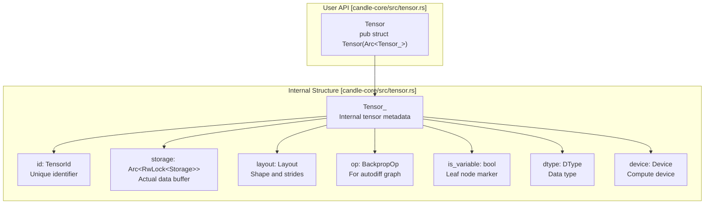
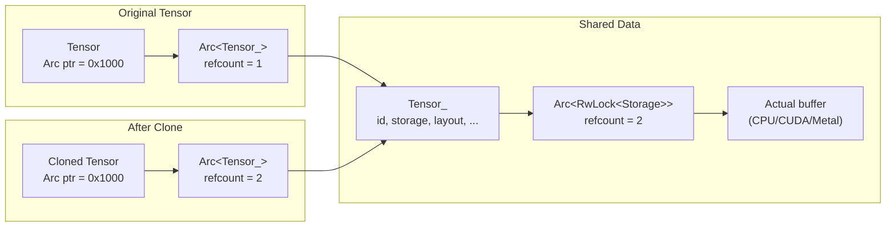
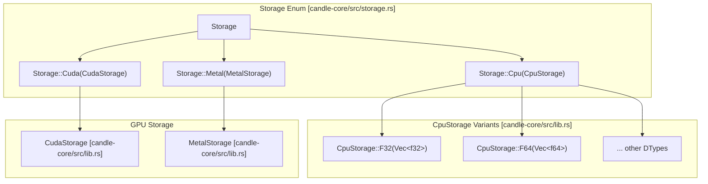
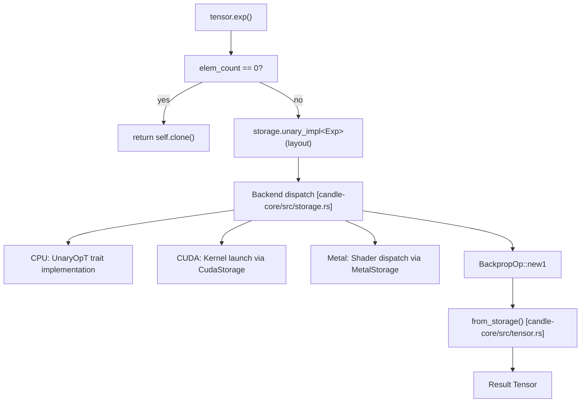

<!-- source: DeepWiki mcp.deepwiki.com · repo huggingface/candle · page 2.1 Tensor Architecture and Design · fetched 2026-10-26 -->

# Tensor Architecture and Design

<details>
<summary>Relevant source files</summary>

The following files were used as context for generating this wiki page:

- [Makefile](Makefile)
- [candle-core/src/backend.rs](candle-core/src/backend.rs)
- [candle-core/src/backprop.rs](candle-core/src/backprop.rs)
- [candle-core/src/custom_op.rs](candle-core/src/custom_op.rs)
- [candle-core/src/device.rs](candle-core/src/device.rs)
- [candle-core/src/dtype.rs](candle-core/src/dtype.rs)
- [candle-core/src/dummy_cuda_backend.rs](candle-core/src/dummy_cuda_backend.rs)
- [candle-core/src/dummy_metal_backend.rs](candle-core/src/dummy_metal_backend.rs)
- [candle-core/src/error.rs](candle-core/src/error.rs)
- [candle-core/src/lib.rs](candle-core/src/lib.rs)
- [candle-core/src/op.rs](candle-core/src/op.rs)
- [candle-core/src/storage.rs](candle-core/src/storage.rs)
- [candle-core/src/tensor.rs](candle-core/src/tensor.rs)
- [candle-core/src/test_utils.rs](candle-core/src/test_utils.rs)
- [candle-core/tests/custom_op_tests.rs](candle-core/tests/custom_op_tests.rs)
- [candle-core/tests/grad_tests.rs](candle-core/tests/grad_tests.rs)
- [candle-core/tests/matmul_tests.rs](candle-core/tests/matmul_tests.rs)
- [candle-core/tests/tensor_tests.rs](candle-core/tests/tensor_tests.rs)
- [candle-pyo3/README.md](candle-pyo3/README.md)
- [candle-pyo3/build.rs](candle-pyo3/build.rs)
- [candle-pyo3/py_src/candle/__init__.py](candle-pyo3/py_src/candle/__init__.py)
- [candle-pyo3/py_src/candle/nn/__init__.pyi](candle-pyo3/py_src/candle/nn/__init__.pyi)
- [candle-pyo3/py_src/candle/utils/__init__.py](candle-pyo3/py_src/candle/utils/__init__.py)
- [candle-pyo3/quant-llama.py](candle-pyo3/quant-llama.py)
- [candle-pyo3/src/lib.rs](candle-pyo3/src/lib.rs)
- [candle-pyo3/test.py](candle-pyo3/test.py)

</details>


This document explains Candle's tensor architecture, focusing on the core design decisions that enable efficient memory management, cheap cloning, and hardware abstraction. For tensor operations, see page 2.2. For automatic differentiation details, see page 2.3. For shape and layout management, see page 2.4.

## The Tensor/Tensor_ Split

Candle's tensor system uses a two-level structure to separate the user-facing API from internal implementation details.

**Tensor Structure Hierarchy**



### The Tensor Wrapper

The `Tensor` struct is a simple newtype wrapper around `Arc<Tensor_>` [candle-core/src/tensor.rs:70](). This design provides several benefits:
- **Cheap cloning**: Cloning a `Tensor` only increments the `Arc` reference count [candle-core/src/tensor.rs:53-56]().
- **Deref coercion**: The `Tensor` implements `Deref` to provide direct access to `Tensor_` methods [candle-core/src/tensor.rs:72-78]().
- **Type safety**: Users cannot accidentally create invalid tensor states.
- **Memory safety**: Data is automatically freed when the last reference is dropped.

### The Tensor_ Internal Structure

The `Tensor_` struct contains all tensor metadata and data references [candle-core/src/tensor.rs:25-45]():

```rust
pub struct Tensor_ {
    id: TensorId,
    storage: Arc<RwLock<Storage>>,
    layout: Layout,
    op: BackpropOp,
    is_variable: bool,
    dtype: DType,
    device: Device,
}
```

**Field Purposes**

| Field | Type | Purpose |
|-------|------|---------|
| `id` | `TensorId` | Unique identifier for graph operations and caching [candle-core/src/tensor.rs:26]() |
| `storage` | `Arc<RwLock<Storage>>` | Reference-counted access to data buffer [candle-core/src/tensor.rs:39]() |
| `layout` | `Layout` | Shape, strides, and memory layout information [candle-core/src/tensor.rs:40]() |
| `op` | `BackpropOp` | Parent operations for gradient computation [candle-core/src/tensor.rs:41]() |
| `is_variable` | `bool` | Marks tensor as a trainable parameter [candle-core/src/tensor.rs:42]() |
| `dtype` | `DType` | Element data type (f32, f64, etc.) [candle-core/src/tensor.rs:43]() |
| `device` | `Device` | Where the data is stored (CPU/CUDA/Metal) [candle-core/src/tensor.rs:44]() |

The use of `Arc<RwLock<Storage>>` provides interior mutability for in-place operations while maintaining reference-counted lifetime management [candle-core/src/tensor.rs:27-39]().

Sources: [candle-core/src/tensor.rs:25-78]()

## Arc-Based Cloning System

Candle's tensor cloning mechanism is designed for efficiency in computation graph construction, where tensors are frequently used as inputs to multiple operations.

**Cloning Mechanism**



### Clone Implementation

The `Tensor` struct derives `Clone`, which automatically implements cloning via `Arc::clone()` [candle-core/src/tensor.rs:56](). This makes cloning extremely cheap - it's just an atomic reference count increment, regardless of tensor size [candle-core/src/tensor.rs:69-70]().

### Storage Reference Counting

The storage is separately reference-counted via its own `Arc`: `storage: Arc<RwLock<Storage>>` [candle-core/src/tensor.rs:39](). This enables multiple tensors to share the same storage with different layouts (e.g., after transpose or narrow) without copying data [candle-core/src/tensor.rs:53-55]().

Sources: [candle-core/src/tensor.rs:25-78](), [candle-core/src/tensor.rs:161-179]()

## TensorId and Uniqueness

Each `Tensor_` is assigned a unique `TensorId` upon creation, which is used for graph traversal and gradient accumulation [candle-core/src/tensor.rs:170]().

The `TensorId` implementation uses an atomic counter to generate globally unique identifiers [candle-core/src/tensor.rs:12-23]():

```rust
pub struct TensorId(usize);

impl TensorId {
    fn new() -> Self {
        use std::sync::atomic;
        static COUNTER: atomic::AtomicUsize = atomic::AtomicUsize::new(1);
        Self(COUNTER.fetch_add(1, atomic::Ordering::Relaxed))
    }
}
```

This provides a hashable key for `HashMap` used in gradient storage during backpropagation [candle-core/src/backprop.rs:4-45]().

Sources: [candle-core/src/tensor.rs:12-23](), [candle-core/src/backprop.rs:35-168]()

## Storage Abstraction

The `Storage` enum provides a unified interface for tensor data across different hardware backends [candle-core/src/storage.rs:11-16]().

**Storage Type Hierarchy**



### Backend Dispatch Mechanism

The `Storage` enum implements operations by dispatching to the appropriate backend implementation [candle-core/src/storage.rs:21-192](). For example, the `device` and `dtype` methods match on the storage variant to return metadata [candle-core/src/storage.rs:36-50]().

### Device Enum Dispatch

The `Device` enum identifies where the data is physically located and handles allocation [candle-core/src/device.rs:15-20]().

```rust
pub enum Device {
    Cpu,
    Cuda(crate::CudaDevice),
    Metal(crate::MetalDevice),
}
```

It acts as a factory for creating storages, such as `new_cuda` [candle-core/src/device.rs:234-235]().

Sources: [candle-core/src/storage.rs:11-192](), [candle-core/src/device.rs:15-20](), [candle-core/src/backend.rs:1-100]()

## DType System

The `DType` enum defines the element types supported by Candle, including standard numeric types and specialized low-bit formats [candle-core/src/dtype.rs:7-38]().

**DType Enum and Size Mapping**

| Category | DType Variants | Byte Size |
|----------|----------------|-----------|
| Integers | `U8`, `U32`, `I16`, `I32`, `I64` | 1, 4, 2, 4, 8 [candle-core/src/dtype.rs:98-102]() |
| Standard Floats | `BF16`, `F16`, `F32`, `F64` | 2, 2, 4, 8 [candle-core/src/dtype.rs:103-106]() |
| Low-bit Floats | `F8E4M3`, `F8E8M0` | 1 [candle-core/src/dtype.rs:107-111]() |
| MX Formats | `F6E2M3`, `F6E3M2`, `F4` | 0 (packed/bit-level) [candle-core/src/dtype.rs:108-110]() |

### MX and Low-Bit Types
Candle supports several low-bit types for optimized inference [candle-core/src/dtype.rs:28-37]():
- **F8E4M3**: 8-bit float with 4-bit exponent and 3-bit mantissa.
- **F6E2M3 / F6E3M2**: 6-bit MX formats.
- **F4**: 4-bit MX format.
- **F8E8M0**: 8-bit exponent-only format.

These types are often handled via the `dummy_dtype` module when full backend support is not yet available for a specific device [candle-core/src/lib.rs:101]().

Sources: [candle-core/src/dtype.rs:7-144](), [candle-core/src/lib.rs:100-101]()

## Operation Macro System

Candle uses macros to generate element-wise operations, ensuring consistent behavior across all backends [candle-core/src/tensor.rs:80-158]().

- **unary_op!**: Generates methods like `exp()`, `log()`, `sin()` [candle-core/src/tensor.rs:80-94]().
- **binary_op!**: Generates same-shape operations like `add()`, `mul()` [candle-core/src/tensor.rs:96-112]().
- **broadcast_binary_op!**: Handles shape broadcasting before calling the inner operation [candle-core/src/tensor.rs:139-158]().

**Unary Operation Execution Flow**



Sources: [candle-core/src/tensor.rs:80-158](), [candle-core/src/op.rs:192-269]()

## Custom Operations and Unified Kernels

Candle provides a trait-based system for extending the framework with custom operations that work across backends [candle-core/src/custom_op.rs]().

### CustomOp Traits
- **CustomOp1/2/3**: Traits for implementing operations with 1, 2, or 3 input tensors [candle-core/src/lib.rs:98]().
- **InplaceOp1/2/3**: Traits for operations that modify storage in-place, reducing memory allocations [candle-core/src/lib.rs:98]().

### Unified Kernel Generation (UgIOp1)
For backends like CUDA and Metal, Candle can use `UgIOp1` to dispatch kernels generated from a unified SSA representation via the `candle-ug` crate [candle-core/src/lib.rs:97](). This allows writing a kernel once and having it lowered to either PTX (CUDA) or MSL (Metal).

Sources: [candle-core/src/lib.rs:97-98](), [candle-core/src/custom_op.rs:1-100]()

---

