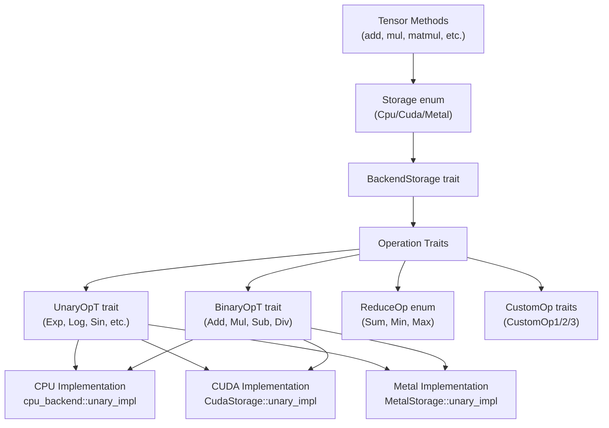
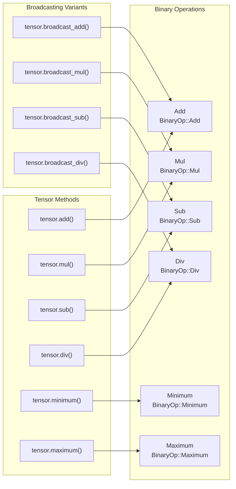
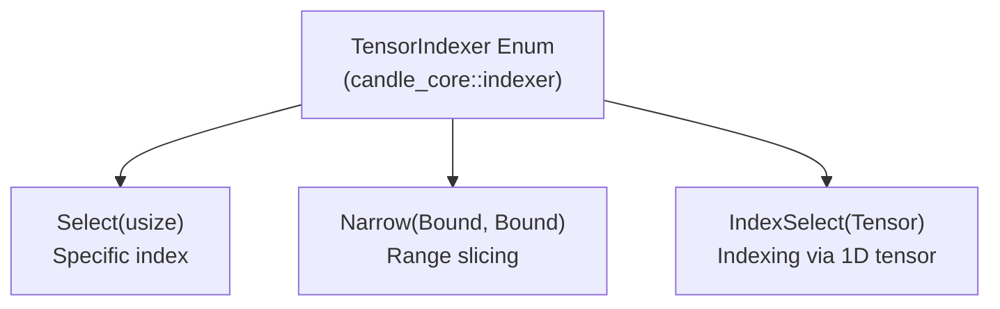

<!-- source: DeepWiki mcp.deepwiki.com · repo huggingface/candle · page 2.2 Tensor Operations · fetched 2026-10-26 -->

# Tensor Operations

<details>
<summary>Relevant source files</summary>

The following files were used as context for generating this wiki page:

- [candle-book/src/apps/desktop.md](candle-book/src/apps/desktop.md)
- [candle-core/benches/benchmarks/broadcast.rs](candle-core/benches/benchmarks/broadcast.rs)
- [candle-core/benches/benchmarks/cat.rs](candle-core/benches/benchmarks/cat.rs)
- [candle-core/benches/benchmarks/contiguous.rs](candle-core/benches/benchmarks/contiguous.rs)
- [candle-core/src/backend.rs](candle-core/src/backend.rs)
- [candle-core/src/backprop.rs](candle-core/src/backprop.rs)
- [candle-core/src/convert.rs](candle-core/src/convert.rs)
- [candle-core/src/cpu_backend/mod.rs](candle-core/src/cpu_backend/mod.rs)
- [candle-core/src/cpu_backend/utils.rs](candle-core/src/cpu_backend/utils.rs)
- [candle-core/src/device.rs](candle-core/src/device.rs)
- [candle-core/src/display.rs](candle-core/src/display.rs)
- [candle-core/src/dummy_cuda_backend.rs](candle-core/src/dummy_cuda_backend.rs)
- [candle-core/src/dummy_metal_backend.rs](candle-core/src/dummy_metal_backend.rs)
- [candle-core/src/indexer.rs](candle-core/src/indexer.rs)
- [candle-core/src/layout.rs](candle-core/src/layout.rs)
- [candle-core/src/nditer.rs](candle-core/src/nditer.rs)
- [candle-core/src/npy.rs](candle-core/src/npy.rs)
- [candle-core/src/op.rs](candle-core/src/op.rs)
- [candle-core/src/shape.rs](candle-core/src/shape.rs)
- [candle-core/src/storage.rs](candle-core/src/storage.rs)
- [candle-core/src/strided_index.rs](candle-core/src/strided_index.rs)
- [candle-core/src/tensor.rs](candle-core/src/tensor.rs)
- [candle-core/src/tensor_cat.rs](candle-core/src/tensor_cat.rs)
- [candle-core/src/test_utils.rs](candle-core/src/test_utils.rs)
- [candle-core/tests/grad_tests.rs](candle-core/tests/grad_tests.rs)
- [candle-core/tests/indexing_tests.rs](candle-core/tests/indexing_tests.rs)
- [candle-core/tests/layout_tests.rs](candle-core/tests/layout_tests.rs)
- [candle-core/tests/matmul_tests.rs](candle-core/tests/matmul_tests.rs)
- [candle-core/tests/tensor_tests.rs](candle-core/tests/tensor_tests.rs)
- [candle-examples/examples/glm4/main.rs](candle-examples/examples/glm4/main.rs)
- [candle-examples/examples/llava/main.rs](candle-examples/examples/llava/main.rs)
- [candle-examples/examples/quantized-gemma/README.md](candle-examples/examples/quantized-gemma/README.md)
- [candle-examples/examples/quantized-gemma/main.rs](candle-examples/examples/quantized-gemma/main.rs)
- [candle-examples/examples/quantized-glm4/main.rs](candle-examples/examples/quantized-glm4/main.rs)
- [candle-examples/examples/quantized-lfm2/main.rs](candle-examples/examples/quantized-lfm2/main.rs)
- [candle-examples/examples/quantized-phi/main.rs](candle-examples/examples/quantized-phi/main.rs)
- [candle-examples/examples/quantized-qwen2-instruct/main.rs](candle-examples/examples/quantized-qwen2-instruct/main.rs)
- [candle-examples/examples/quantized-qwen3-moe/main.rs](candle-examples/examples/quantized-qwen3-moe/main.rs)
- [candle-examples/examples/quantized-qwen3/main.rs](candle-examples/examples/quantized-qwen3/main.rs)
- [candle-transformers/src/models/quantized_gemma3.rs](candle-transformers/src/models/quantized_gemma3.rs)
- [candle-transformers/src/models/quantized_phi3.rs](candle-transformers/src/models/quantized_phi3.rs)
- [tensor-tools/src/main.rs](tensor-tools/src/main.rs)

</details>


This document covers the comprehensive set of operations available on tensors in Candle. Tensor operations are the fundamental building blocks for constructing neural networks and performing computations. Each operation is implemented across all supported backends (CPU, CUDA, Metal) through a unified trait system.

For information about the tensor architecture and memory layout, see [Tensor Architecture and Design](2.1). For automatic differentiation and gradient computation, see [Automatic Differentiation](2.3).

---

## Operation Categories and Dispatch

Tensor operations in Candle are organized into distinct categories, each with specific implementation traits. All operations follow a consistent dispatch pattern from high-level tensor methods to backend-specific implementations.

### Operation Type Hierarchy



**Sources:** [candle-core/src/tensor.rs:78-155](), [candle-core/src/op.rs:1-190](), [candle-core/src/storage.rs:12-50](), [candle-core/src/backend.rs:6-139]()

### Operation Dispatch Mechanism

Operations follow a consistent dispatch pattern through multiple layers. For example, a binary operation like `add` starts at the `Tensor` level, checks for shape compatibility, and then dispatches to the underlying `Storage`.

| Layer | Component | Responsibility |
|-------|-----------|----------------|
| **User API** | `Tensor` methods | High-level operation interface (e.g., `tensor.add(&other)`) |
| **Validation** | `same_shape_binary_op` | Shape and device compatibility checks |
| **Storage Enum** | `Storage::binary_impl` | Dispatch to appropriate backend (`Cpu`, `Cuda`, or `Metal`) |
| **Backend Trait** | `BackendStorage` | Device-specific implementation of the operation |
| **Graph Tracking** | `BackpropOp` | Record operation for automatic differentiation if required |

**Sources:** [candle-core/src/tensor.rs:96-112](), [candle-core/src/storage.rs:141-174](), [candle-core/src/backend.rs:32-34](), [candle-core/src/tensor.rs:41-45]()

---

## Arithmetic Operations

Arithmetic operations are implemented as binary operations that combine two tensors element-wise. All operations support automatic broadcasting and gradient computation.

### Binary Arithmetic Operations



**Sources:** [candle-core/src/tensor.rs:96-158](), [candle-core/src/op.rs:42-49]()

### Arithmetic Operation Implementation

Each arithmetic operation is defined through the `BinaryOpT` trait and generated via macros. These operations are often optimized using SIMD on CPU or specialized kernels on GPU.

| Operation | Tensor Method | Macro Definition | Backward Pass |
|-----------|---------------|------------------|---------------|
| **Add** | `add(&self, rhs)` | `binary_op!(add, Add)` | `∂L/∂lhs = grad`, `∂L/∂rhs = grad` |
| **Multiply** | `mul(&self, rhs)` | `binary_op!(mul, Mul)` | `∂L/∂lhs = grad * rhs`, `∂L/∂rhs = grad * lhs` |
| **Subtract** | `sub(&self, rhs)` | `binary_op!(sub, Sub)` | `∂L/∂lhs = grad`, `∂L/∂rhs = -grad` |
| **Divide** | `div(&self, rhs)` | `binary_op!(div, Div)` | `∂L/∂lhs = grad / rhs`, `∂L/∂rhs = -grad * lhs / rhs²` |

**Sources:** [candle-core/src/tensor.rs:96-112](), [candle-core/src/op.rs:225-238](), [candle-core/src/backprop.rs:88-99]()

---

## Unary Operations

Unary operations transform tensor elements independently. Candle provides a comprehensive set of mathematical functions, each with automatic differentiation support.

### Unary Operation Categories

```mermaid
graph TD
    UnaryOps["Unary Operations"]
    
    Transcendental["Transcendental Functions"]
    Trigonometric["Trigonometric Functions"]
    Activation["Activation Functions"]
    Rounding["Rounding Functions"]
    
    UnaryOps --> Transcendental
    UnaryOps --> Trigonometric
    UnaryOps --> Activation
    UnaryOps --> Rounding
    
    Transcendental --> Exp["exp()<br/>UnaryOp::Exp"]
    Transcendental --> Log["log()<br/>UnaryOp::Log"]
    Transcendental --> Sqrt["sqrt()<br/>UnaryOp::Sqrt"]
    Transcendental --> Recip["recip()<br/>UnaryOp::Recip"]
    
    Trigonometric --> Sin["sin()<br/>UnaryOp::Sin"]
    Trigonometric --> Cos["cos()<br/>UnaryOp::Cos"]
    Trigonometric --> Tanh["tanh()<br/>UnaryOp::Tanh"]
    
    Activation --> Relu["relu()<br/>UnaryOp::Relu"]
    Activation --> Gelu["gelu()<br/>UnaryOp::Gelu"]
    Activation --> Silu["silu()<br/>UnaryOp::Silu"]
    Activation --> Erf["erf()<br/>UnaryOp::Erf"]
    
    Rounding --> Ceil["ceil()<br/>UnaryOp::Ceil"]
    Rounding --> Floor["floor()<br/>UnaryOp::Floor"]
    Rounding --> Round["round()<br/>UnaryOp::Round"]
    Rounding --> Sign["sign()<br/>UnaryOp::Sign"]
```



**Sources:** [candle-core/src/tensor.rs:80-94](), [candle-core/src/op.rs:53-73]()

### Unary Operation Trait Implementation

Each unary operation implements the `UnaryOpT` trait with type-specific functions. This trait is used by backends to apply the operation across the entire storage.

```rust
pub trait UnaryOpT {
    const NAME: &'static str;
    const KERNEL: &'static str;
    const V: Self;
    fn bf16(v1: bf16) -> bf16;
    fn f16(v1: f16) -> f16;
    fn f32(v1: f32) -> f32;
    fn f64(v1: f64) -> f64;
    // ... other types
}
```

**Key Unary Operations:**

| Operation | Formula | Gradient | Use Case |
|-----------|---------|----------|----------|
| `exp()` | `e^x` | `grad * exp(x)` | Softmax, probability models |
| `log()` | `ln(x)` | `grad / x` | Cross-entropy loss |
| `sqrt()` | `√x` | `grad / (2 * √x)` | Normalization (LayerNorm) |
| `gelu()` | Gaussian Error Linear Unit | `0.5 * (1 + erf(x/√2)) + ...` | Transformer activations |
| `silu()` | `x * σ(x)` | `σ(x) * (1 + x * (1 - σ(x)))` | Llama/Mistral activations |

**Sources:** [candle-core/src/op.rs:192-206](), [candle-core/tests/grad_tests.rs:145-197]()

---

## Broadcasting and Reshaping

Broadcasting allows operations between tensors of different shapes by automatically expanding dimensions. Candle implements NumPy-style broadcasting rules.

### Broadcasting Rules
When operating on two tensors, Candle compares their shapes element-wise, starting from the trailing dimensions. Two dimensions are compatible if:
1. They are equal.
2. One of them is 1.

The `broadcast_shape_binary_op` function in `shape.rs` calculates the resulting shape or returns an error if incompatible.

**Sources:** [candle-core/src/shape.rs:191-225](), [candle-core/src/tensor.rs:139-158]()

### Reshaping and Views
Operations like `reshape`, `transpose`, and `narrow` create new tensor views without copying the underlying data when possible. This is achieved by modifying the `Layout` (strides and offset) while pointing to the same `Storage`.

**Sources:** [candle-core/src/tensor.rs:161-179](), [candle-core/src/layout.rs:6-34]()

---

## Indexing and Selection

Candle provides a flexible indexing system through the `indexer` module and the `i()` method.

### The Indexer Module
The `TensorIndexer` enum defines how a tensor is sliced or indexed. It supports integer indexing, ranges, and tensor-based indexing.



**Sources:** [candle-core/src/indexer.rs:64-74](), [candle-core/src/indexer.rs:134-138]()

### Indexing Syntax
Using the `IndexOp` trait, users can perform complex slicing with a syntax similar to Python/NumPy:

| Syntax | Component | Description |
|--------|-----------|-------------|
| `tensor.i(0)` | `Select` | Selects the first element along dimension 0. |
| `tensor.i(0..5)` | `Narrow` | Slices elements from index 0 to 4. |
| `tensor.i((.., 2))` | `Select` | Selects index 2 along the second dimension. |
| `tensor.i(&indices)` | `IndexSelect` | Uses a tensor of indices to gather elements. |

**Sources:** [candle-core/src/indexer.rs:9-26](), [candle-core/src/indexer.rs:212-225](), [candle-core/tests/tensor_tests.rs:93-102]()

---

## Reduction Operations

Reductions collapse one or more dimensions of a tensor into a smaller shape by aggregating values.

| Operation | ReduceOp Variant | Implementation |
|-----------|------------------|----------------|
| `sum()` | `Sum` | Sums elements along specified dimensions. |
| `min()` | `Min` | Finds the minimum value. |
| `max()` | `Max` | Finds the maximum value. |
| `argmin()` | `ArgMin` | Returns the index of the minimum value. |
| `argmax()` | `ArgMax` | Returns the index of the maximum value. |

**Sources:** [candle-core/src/op.rs:19-26](), [candle-core/src/backprop.rs:127-149](), [candle-core/src/storage.rs:176-191]()

---

## Display Utilities

Candle includes formatting logic to pretty-print tensors for debugging and logging.

### Printer Options
The `PrinterOptions` struct controls the level of detail in tensor output, including precision and summarizing large tensors.

| Option | Default | Description |
|--------|---------|-------------|
| `precision` | 4 | Number of decimal places for floating-point types. |
| `threshold` | 1000 | Total elements before the output is summarized with `...`. |
| `edge_items` | 3 | Number of elements to show at the start/end of each dimension when summarized. |
| `line_width` | 80 | Target character width for line wrapping. |

**Sources:** [candle-core/src/display.rs:81-103](), [candle-core/src/display.rs:203-238]()

### Tensor Formatting
The `TensorFormatter` trait provides logic to handle different data types and shapes, ensuring consistent output across CPU, CUDA, and Metal devices. Tensors are synchronized to CPU for printing.

**Sources:** [candle-core/src/display.rs:13-51](), [candle-core/src/display.rs:178-201]()

---

