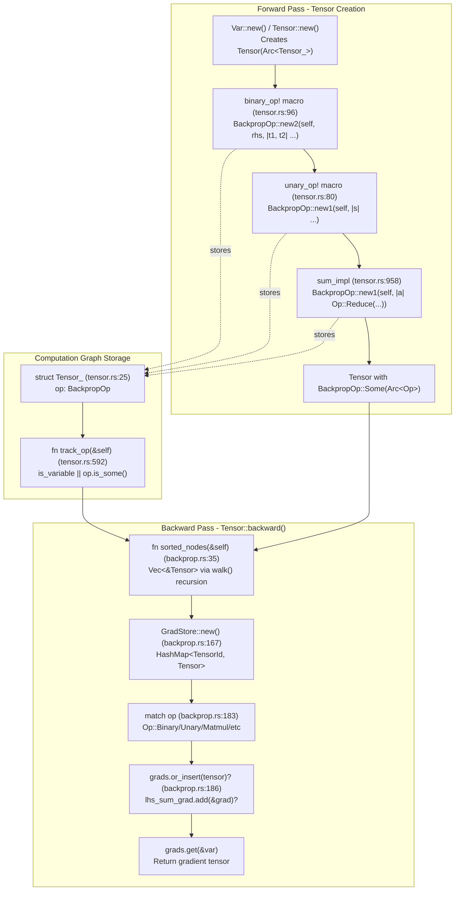
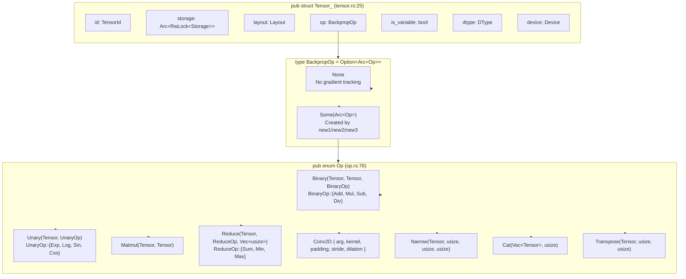
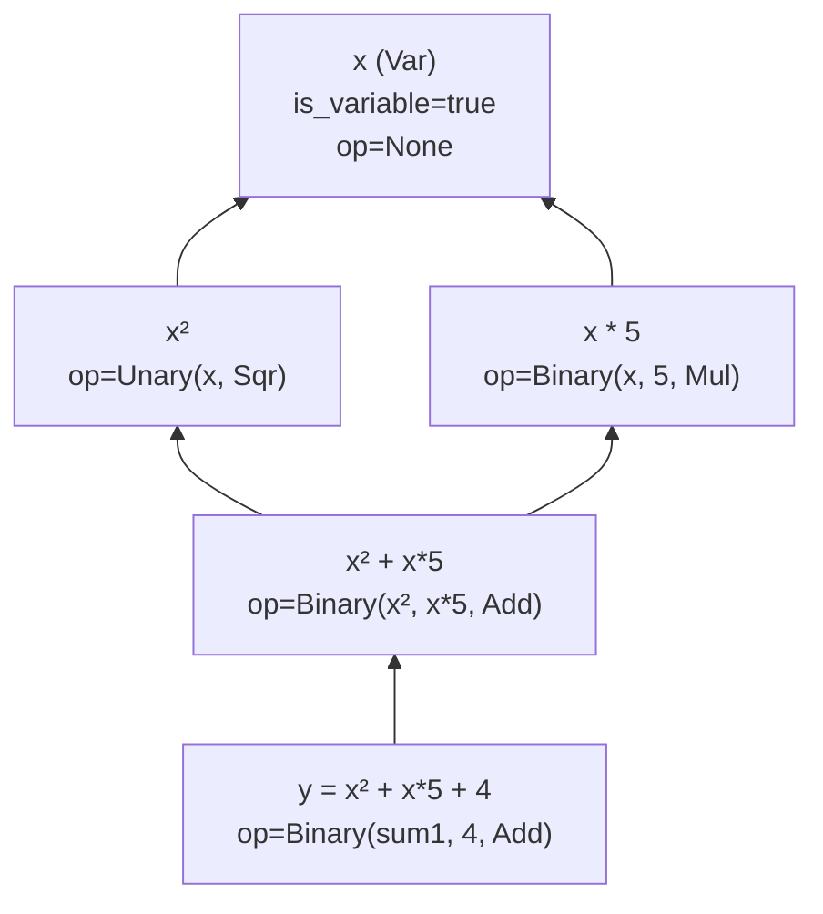
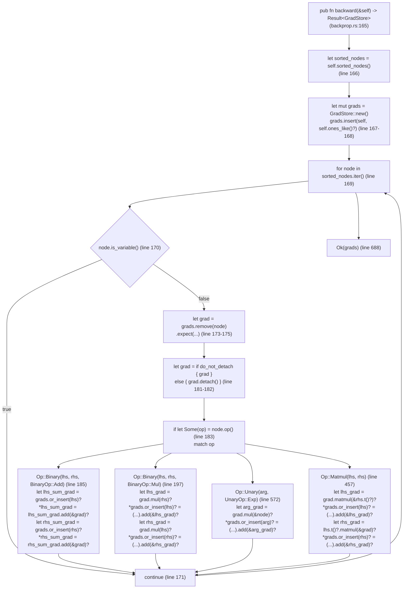
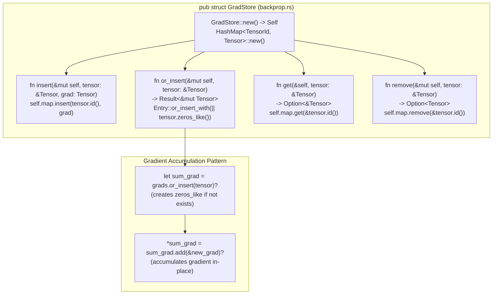
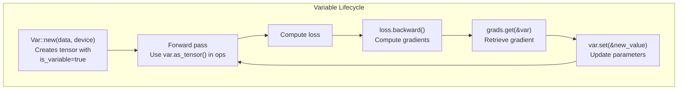
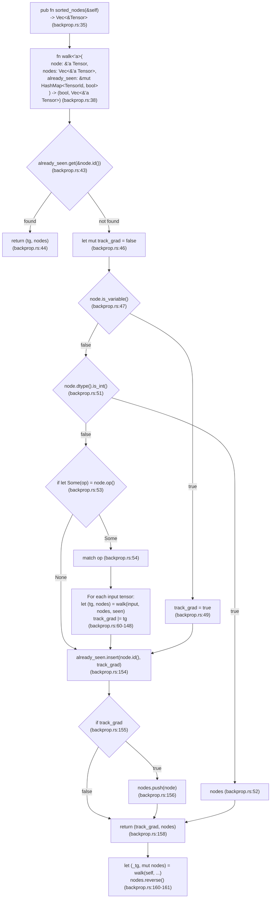

<!-- source: DeepWiki mcp.deepwiki.com · repo huggingface/candle · page 2.3 Automatic Differentiation · fetched 2026-10-26 -->

# Automatic Differentiation

<details>
<summary>Relevant source files</summary>

The following files were used as context for generating this wiki page:

- [candle-core/examples/basics.rs](candle-core/examples/basics.rs)
- [candle-core/src/backend.rs](candle-core/src/backend.rs)
- [candle-core/src/backprop.rs](candle-core/src/backprop.rs)
- [candle-core/src/device.rs](candle-core/src/device.rs)
- [candle-core/src/dummy_cuda_backend.rs](candle-core/src/dummy_cuda_backend.rs)
- [candle-core/src/dummy_metal_backend.rs](candle-core/src/dummy_metal_backend.rs)
- [candle-core/src/op.rs](candle-core/src/op.rs)
- [candle-core/src/storage.rs](candle-core/src/storage.rs)
- [candle-core/src/tensor.rs](candle-core/src/tensor.rs)
- [candle-core/src/test_utils.rs](candle-core/src/test_utils.rs)
- [candle-core/src/variable.rs](candle-core/src/variable.rs)
- [candle-core/tests/grad_tests.rs](candle-core/tests/grad_tests.rs)
- [candle-core/tests/matmul_tests.rs](candle-core/tests/matmul_tests.rs)
- [candle-core/tests/tensor_tests.rs](candle-core/tests/tensor_tests.rs)
- [candle-nn/src/batch_norm.rs](candle-nn/src/batch_norm.rs)
- [candle-nn/src/loss.rs](candle-nn/src/loss.rs)
- [candle-nn/tests/batch_norm.rs](candle-nn/tests/batch_norm.rs)
- [candle-nn/tests/group_norm.rs](candle-nn/tests/group_norm.rs)
- [candle-nn/tests/loss.rs](candle-nn/tests/loss.rs)

</details>


## Purpose and Scope

This document explains Candle's automatic differentiation (autograd) system, which enables gradient computation for neural network training. The system builds computation graphs during forward passes and computes gradients via reverse-mode differentiation (backpropagation). This page covers the `BackpropOp` graph construction, the `backward()` method, gradient accumulation in `GradStore`, and usage with `Var` for training.

For information about tensor operations themselves, see [Core Tensor System](2.2). For neural network layers built on top of autograd, see [Neural Network Building Blocks](5.1).

---

## Automatic Differentiation Architecture

Candle implements reverse-mode automatic differentiation by tracking operations during the forward pass and computing gradients during the backward pass. The system automatically builds a directed acyclic graph (DAG) of operations and computes derivatives using the chain rule.

### High-Level Flow



**Sources:** [candle-core/src/backprop.rs:35-168](), [candle-core/src/tensor.rs:25-45](), [candle-core/src/tensor.rs:80-112](), [candle-core/src/tensor.rs:592-594]()

---

## BackpropOp: Operation Tracking

Each `Tensor` contains a `BackpropOp` field that tracks how the tensor was created. This forms nodes in the computation graph used for gradient computation.

### Tensor_ Structure with BackpropOp



**Sources:** [candle-core/src/tensor.rs:25-45](), [candle-core/src/op.rs:76-190]()

### Operation Graph Construction

Operations automatically construct `BackpropOp` nodes when performed on tensors that require gradients. The macros `unary_op!`, `binary_op!`, and `binary_op_scalar!` expand to create these nodes:

| Operation Type | BackpropOp Creation Pattern | Code Location |
|---|---|---|
| Binary operations | `BackpropOp::new2(self, rhs, \|t1, t2\| Op::Binary(t1, t2, BinaryOp::$op_name))` | [candle-core/src/tensor.rs:108]() |
| Unary operations | `BackpropOp::new1(self, \|s\| Op::Unary(s, UnaryOp::$op_name))` | [candle-core/src/tensor.rs:90]() |
| Matmul | Manual construction in `Tensor::matmul()` | Implementation uses `BackpropOp::new2` |
| Reduce (sum/min/max) | `BackpropOp::new1(self, \|arg\| Op::Reduce(arg, op, dims.to_vec()))` | [candle-core/src/tensor.rs:946](), [candle-core/src/tensor.rs:967]() |
| Narrow | `BackpropOp::new1(self, \|t\| Op::Narrow(t, dim, start, len))` | [candle-core/src/tensor.rs:902]() |

The `Tensor::track_op()` method determines whether gradients should be tracked:

```rust
pub fn track_op(&self) -> bool {
    self.is_variable || self.op.is_some()
}
```

- Returns `true` if `is_variable == true` (created by `Var::new()`)
- Returns `true` if `op.is_some()` (has parent operations requiring gradients)
- Returns `false` for leaf constants or integer dtypes (e.g., [candle-core/src/backprop.rs:51]())

**Sources:** [candle-core/src/tensor.rs:592-594](), [candle-core/src/tensor.rs:80-112](), [candle-core/src/backprop.rs:47-52]()

---

## Forward Pass: Building the Computation Graph

During the forward pass, each operation creates a new tensor with a `BackpropOp` that references its input tensors. This forms a DAG where edges point from outputs to inputs.

### Example Computation Graph



This graph is built automatically. For the expression `y = (x * x + x * 5) + 4`, each intermediate tensor stores references to its parent tensors in its `BackpropOp`.

**Sources:** [candle-core/src/backprop.rs:30-163](), [candle-core/tests/grad_tests.rs:7-19]()

---

## Backward Pass: Gradient Computation

The `Tensor::backward()` method performs reverse-mode automatic differentiation by traversing the computation graph in reverse topological order and applying the chain rule.

### Backward Pass Algorithm Implementation



**Sources:** [candle-core/src/backprop.rs:165-189](), [candle-core/src/backprop.rs:457-468](), [candle-core/src/backprop.rs:572-576]()

---

## GradStore: Gradient Accumulation

The `GradStore` struct accumulates gradients for tensors during backpropagation. It uses a `HashMap<TensorId, Tensor>` to store gradients indexed by tensor ID.

### GradStore API and Usage Pattern



### Gradient Accumulation Example

During backpropagation, gradients are accumulated when a tensor appears multiple times in the computation graph. The pattern implemented in `backward()` for `Op::Binary(lhs, rhs, BinaryOp::Add)`:

```rust
// backprop.rs:185-190
Op::Binary(lhs, rhs, BinaryOp::Add) => {
    let lhs_sum_grad = grads.or_insert(lhs)?;  // Get or create zeros_like(lhs)
    *lhs_sum_grad = lhs_sum_grad.add(&grad)?;  // Accumulate: ∂L/∂lhs += ∂L/∂node
    let rhs_sum_grad = grads.or_insert(rhs)?;  // Get or create zeros_like(rhs)
    *rhs_sum_grad = rhs_sum_grad.add(&grad)?;  // Accumulate: ∂L/∂rhs += ∂L/∂node
}
```

**Sources:** [candle-core/src/backprop.rs:185-190](), [candle-core/src/backprop.rs:167-168]()

---

## Using Variables for Training

The `Var` type represents trainable parameters. It wraps a `Tensor` with `is_variable=true`, marking it as a leaf node in the computation graph.

### Variable Lifecycle



### Training Loop Pattern

| Step | Code Pattern | Description |
|---|---|---|
| 1. Initialize | `let x = Var::new(0f32, device)?` | Create trainable variable [candle-core/tests/grad_tests.rs:132]() |
| 2. Forward | `let xt = x.as_tensor();` | Perform operations [candle-core/tests/grad_tests.rs:135]() |
| 3. Loss | `let c = ((xt - 4.2)? * (xt - 4.2)?)?` | Compute scalar loss [candle-core/tests/grad_tests.rs:136]() |
| 4. Backward | `let grads = c.backward()?` | Compute all gradients [candle-core/tests/grad_tests.rs:137]() |
| 5. Retrieve | `let x_grad = grads.get(&x)?` | Get gradient for variable [candle-core/tests/grad_tests.rs:138]() |
| 6. Update | `x.set(&(xt - x_grad * learning_rate)?)?` | Update parameters [candle-core/tests/grad_tests.rs:139]() |

**Sources:** [candle-core/tests/grad_tests.rs:131-143](), [candle-core/src/tensor.rs:42]()

---

## Topological Sorting with sorted_nodes()

The `Tensor::sorted_nodes()` method performs depth-first traversal of the computation graph to produce a topologically sorted list of tensors.

### Topological Sort Implementation

The `sorted_nodes()` method [candle-core/src/backprop.rs:35-163]() uses a recursive `walk()` function:



**Sources:** [candle-core/src/backprop.rs:35-163](), [candle-core/src/backprop.rs:47-52]()

---

## Implementation Details

### Gradient Detachment

By default, Candle detaches gradients during the backward pass to prevent computing second-order derivatives:

```rust
// backprop.rs:181-182
let grad = if do_not_detach { grad }
else { grad.detach() };
```

The `CANDLE_GRAD_DO_NOT_DETACH` environment variable can enable second-order derivatives if needed [candle-core/src/backprop.rs:19-28]().

**Sources:** [candle-core/src/backprop.rs:19-28](), [candle-core/src/backprop.rs:181-182]()

### Broadcast Gradients

When operations involve broadcasting, gradients must be summed over the broadcasted dimensions using `broadcast_back` [candle-core/src/backprop.rs:8-17]().

```rust
fn broadcast_back(arg: &Tensor, node: &Tensor, reduced_dims: &[usize]) -> Result<Tensor> {
    if arg.rank() == node.rank() {
        // keepdim = true
        node.broadcast_as(arg.shape())
    } else {
        // keepdim = false
        node.reshape(reduced_dims)?.broadcast_as(arg.shape())
    }
}
```

**Sources:** [candle-core/src/backprop.rs:8-17]()

### Supported and Unsupported Operations

| Operation Category | Backward Supported | Notes |
|---|---|---|
| Arithmetic (`add`, `mul`, `div`, `sub`) | ✓ | Full support [candle-core/src/backprop.rs:185-211]() |
| Unary (`exp`, `log`, `sin`, `cos`, `sqrt`) | ✓ | Full support [candle-core/src/backprop.rs:572-595]() |
| Matmul | ✓ | Full support [candle-core/src/backprop.rs:457-464]() |
| Rounding (`ceil`, `floor`, `round`, `sign`) | ✗ | No nodes added to graph [candle-core/src/backprop.rs:114-117]() |
| Integer operations | ✗ | Not differentiable [candle-core/src/backprop.rs:51-52]() |

**Sources:** [candle-core/src/backprop.rs:51-149](), [candle-core/src/backprop.rs:185-615]()

---

## Key Files Reference

| File | Purpose |
|---|---|
| [candle-core/src/backprop.rs]() | Implements `backward()`, `sorted_nodes()`, and gradient rules |
| [candle-core/src/tensor.rs:25-45]() | Defines `Tensor_` structure with `BackpropOp` field |
| [candle-core/src/tensor.rs:592-594]() | Implements `track_op()` to determine gradient tracking |
| [candle-core/src/op.rs:76-190]() | Defines `Op` enum with all operation types |
| [candle-core/tests/grad_tests.rs]() | Contains comprehensive gradient tests and examples |

**Sources:** [candle-core/src/backprop.rs:1-688](), [candle-core/src/tensor.rs:25-594](), [candle-core/src/op.rs:76-190]()

---

