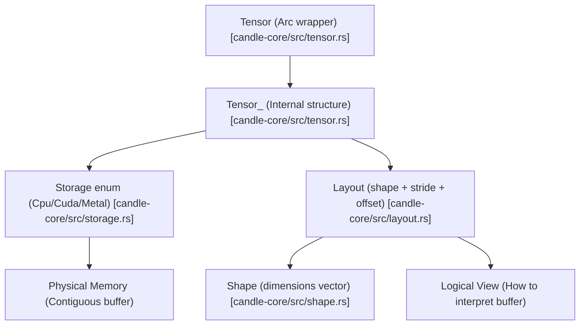
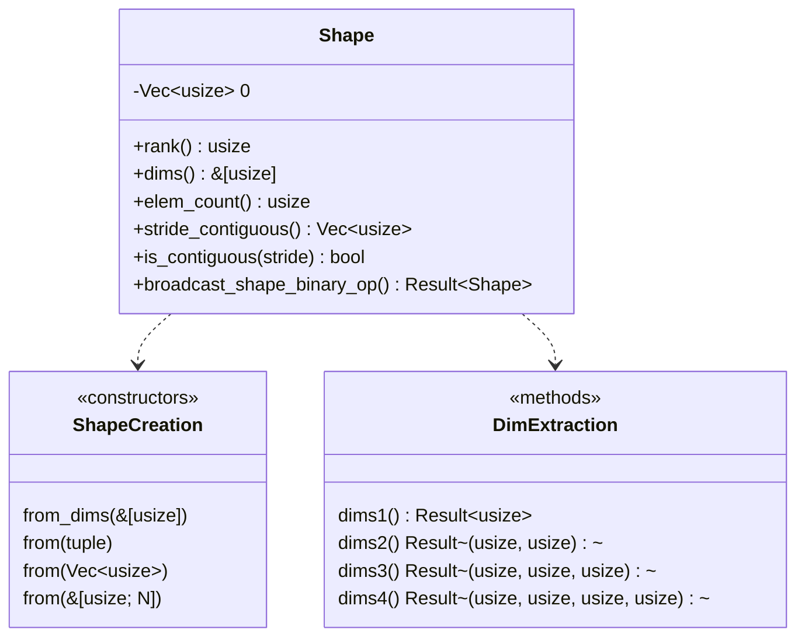
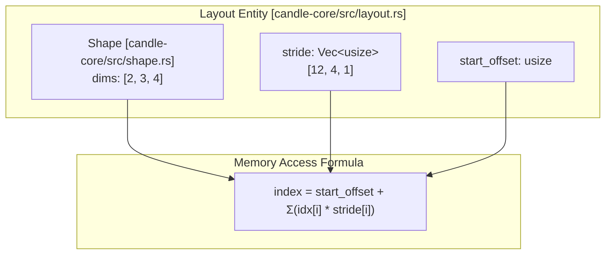

<!-- source: DeepWiki mcp.deepwiki.com · repo huggingface/candle · page 2.4 Shape, Layout, and Memory Management · fetched 2026-10-26 -->

# Shape, Layout, and Memory Management

<details>
<summary>Relevant source files</summary>

The following files were used as context for generating this wiki page:

- [candle-core/benches/benchmarks/broadcast.rs](candle-core/benches/benchmarks/broadcast.rs)
- [candle-core/benches/benchmarks/cat.rs](candle-core/benches/benchmarks/cat.rs)
- [candle-core/benches/benchmarks/contiguous.rs](candle-core/benches/benchmarks/contiguous.rs)
- [candle-core/src/convert.rs](candle-core/src/convert.rs)
- [candle-core/src/cpu/erf.rs](candle-core/src/cpu/erf.rs)
- [candle-core/src/cpu_backend/mod.rs](candle-core/src/cpu_backend/mod.rs)
- [candle-core/src/cpu_backend/utils.rs](candle-core/src/cpu_backend/utils.rs)
- [candle-core/src/display.rs](candle-core/src/display.rs)
- [candle-core/src/layout.rs](candle-core/src/layout.rs)
- [candle-core/src/nditer.rs](candle-core/src/nditer.rs)
- [candle-core/src/npy.rs](candle-core/src/npy.rs)
- [candle-core/src/pickle.rs](candle-core/src/pickle.rs)
- [candle-core/src/shape.rs](candle-core/src/shape.rs)
- [candle-core/src/strided_index.rs](candle-core/src/strided_index.rs)
- [candle-core/src/tensor_cat.rs](candle-core/src/tensor_cat.rs)
- [candle-core/tests/fortran_tensor_3d.pth](candle-core/tests/fortran_tensor_3d.pth)
- [candle-core/tests/layout_tests.rs](candle-core/tests/layout_tests.rs)
- [candle-core/tests/pth.py](candle-core/tests/pth.py)
- [candle-core/tests/pth_tests.rs](candle-core/tests/pth_tests.rs)
- [candle-core/tests/test.pt](candle-core/tests/test.pt)
- [candle-core/tests/test_with_key.pt](candle-core/tests/test_with_key.pt)
- [candle-examples/examples/glm4/main.rs](candle-examples/examples/glm4/main.rs)
- [candle-examples/examples/llava/main.rs](candle-examples/examples/llava/main.rs)
- [candle-examples/examples/quantized-gemma/README.md](candle-examples/examples/quantized-gemma/README.md)
- [candle-examples/examples/quantized-gemma/main.rs](candle-examples/examples/quantized-gemma/main.rs)
- [candle-examples/examples/quantized-glm4/main.rs](candle-examples/examples/quantized-glm4/main.rs)
- [candle-examples/examples/quantized-lfm2/main.rs](candle-examples/examples/quantized-lfm2/main.rs)
- [candle-examples/examples/quantized-phi/main.rs](candle-examples/examples/quantized-phi/main.rs)
- [candle-examples/examples/quantized-qwen2-instruct/main.rs](candle-examples/examples/quantized-qwen2-instruct/main.rs)
- [candle-examples/examples/quantized-qwen3-moe/main.rs](candle-examples/examples/quantized-qwen3-moe/main.rs)
- [candle-examples/examples/quantized-qwen3/main.rs](candle-examples/examples/quantized-qwen3/main.rs)
- [candle-transformers/src/models/quantized_gemma3.rs](candle-transformers/src/models/quantized_gemma3.rs)
- [candle-transformers/src/models/quantized_phi3.rs](candle-transformers/src/models/quantized_phi3.rs)
- [tensor-tools/src/main.rs](tensor-tools/src/main.rs)

</details>


This document explains how Candle represents tensor shapes and memory layouts to enable efficient operations with minimal data copying. Shape defines the logical dimensions of a tensor, while Layout specifies how data is physically arranged in memory using strides and offsets.

## Overview: The Three-Layer Memory Model

Candle separates the logical structure of tensors from their physical memory representation through three key abstractions:



**Sources:** [candle-core/src/layout.rs:5-11](), [candle-core/src/shape.rs:5-8]()

## Shape Representation

### The Shape Struct

The `Shape` struct wraps a `Vec<usize>` of dimension sizes and provides utilities for shape manipulation and validation.



| Method | Purpose | Implementation |
|--------|---------|----------------|
| `rank()` | Number of dimensions | `self.0.len()` [candle-core/src/shape.rs:111-113]() |
| `elem_count()` | Total elements | `self.0.iter().product()` [candle-core/src/shape.rs:131-133]() |
| `dims()` | Dimension slice | `&self.0` [candle-core/src/shape.rs:120-122]() |
| `stride_contiguous()` | C-order strides | Calculated via `.rev().scan()` [candle-core/src/shape.rs:137-150]() |

**Sources:** [candle-core/src/shape.rs:5-150](), [candle-core/src/shape.rs:69-102]()

### Shape Construction and Conversion

Shapes can be created from tuples, slices, or vectors using `From` implementations:

```rust
// From tuple [candle-core/src/shape.rs:46-62]
Shape::from((2, 3, 4))

// From slice [candle-core/src/shape.rs:22-26]
Shape::from(&[2, 3, 4][..])

// From vector [candle-core/src/shape.rs:63-67]
Shape::from(vec![2, 3, 4])

// Scalar (0-dimensional) [candle-core/src/shape.rs:8]
let s = SCALAR; 
```

The `extract_dims!` macro generates methods like `dims2()`, `dims3()`, etc., that extract dimensions into tuples with validation [candle-core/src/shape.rs:69-102]().

**Sources:** [candle-core/src/shape.rs:16-67](), [candle-core/src/shape.rs:69-102]()

## Layout: Strides and Memory Organization

### Layout Structure

`Layout` combines a `Shape` with strides and a start offset to describe how tensor elements are arranged in a flat memory buffer.



**Sources:** [candle-core/src/layout.rs:5-11](), [candle-core/src/layout.rs:14-20]()

### Contiguous vs Non-Contiguous Layouts

#### Contiguous Layout (C-order / Row-major)
For a shape `(d1, d2, d3)`, contiguous strides are `(d2*d3, d3, 1)`. The `is_contiguous()` method verifies this by checking if `stride == acc` while iterating dimensions in reverse [candle-core/src/shape.rs:153-165]().

**Sources:** [candle-core/src/shape.rs:153-165](), [candle-core/src/layout.rs:187-189]()

#### Fortran-Contiguous Layout (Column-major)
Checks if the first dimension has stride 1 and subsequent strides are products of previous dimensions [candle-core/src/shape.rs:168-180]().

**Sources:** [candle-core/src/shape.rs:168-180](), [candle-core/src/layout.rs:192-194]()

## Memory Access and Strided Indexing

### The StridedIndex Iterator
`StridedIndex` is used to iterate over the physical buffer positions for any layout. It maintains a `multi_index` (the logical coordinates) and updates the `next_storage_index` by applying strides [candle-core/src/strided_index.rs:37-70]().

**Sources:** [candle-core/src/strided_index.rs:6-12](), [candle-core/src/strided_index.rs:37-70]()

### Strided Blocks
For performance, Candle uses `StridedBlocks` to group contiguous chunks of data. If a layout is partially contiguous (e.g., the last few dimensions), it can be processed as `MultipleBlocks` where each block has a `block_len` [candle-core/src/strided_index.rs:85-100]().

**Sources:** [candle-core/src/strided_index.rs:85-100]()

## View Operations: Zero-Copy Views

Many tensor operations modify only the layout without copying data. While specific view methods like `narrow` and `transpose` are handled in `layout.rs` (via stride manipulation), the tensor-level API enables these zero-copy views.

### Narrowing and Slicing
Operations like `narrow(dim, start, len)` modify the `Layout` by updating the `start_offset` and `shape`. This is used extensively in transformer models for splitting QKV heads [candle-transformers/src/models/quantized_phi3.rs:118-124]().

**Sources:** [candle-transformers/src/models/quantized_phi3.rs:118-124](), [candle-core/src/layout.rs:10-11]()

### Transpose
`transpose(dim1, dim2)` swaps the dimensions and strides at the specified indices in the `Layout`. This is a constant-time operation that does not move data in the `Storage` [candle-transformers/src/models/quantized_phi3.rs:128-134]().

**Sources:** [candle-transformers/src/models/quantized_phi3.rs:128-134](), [candle-core/src/layout.rs:9]()

### Broadcasting
Broadcasting extends dimensions by setting the stride of the new/expanded dimension to `0`. This allows the same memory location to be read multiple times logically. The `broadcast_as` method is a common way to align masks or scalars to a tensor's shape [candle-transformers/src/models/quantized_phi3.rs:94-95]().

**Sources:** [candle-transformers/src/models/quantized_phi3.rs:94-95](), [candle-core/src/layout.rs:202]()

## Broadcasting Rules

Candle follows standard broadcasting rules for binary operations:
1. Dimensions are aligned from right to left [candle-core/src/shape.rs:200-210]().
2. Two dimensions are compatible if they are equal, or one of them is 1 [candle-core/src/shape.rs:211-224]().
3. If one tensor has fewer dimensions, it is prepended with 1s [candle-core/src/shape.rs:201-210]().

**Sources:** [candle-core/src/shape.rs:191-225]()

## Data Loading and Formats

### Pickle / PyTorch (.pth) Loading
Candle includes a custom pickle parser in `candle-core/src/pickle.rs` to read PyTorch checkpoints. It handles:
- **OpCodes:** Parsing Python's pickle stack-based machine [candle-core/src/pickle.rs:14-49]().
- **Object Representation:** Maps pickle streams to an internal `Object` enum (Int, Tuple, Dict, Class, etc.) [candle-core/src/pickle.rs:105-129]().
- **Tensor Rebuilds:** Specifically recognizes `torch._utils._rebuild_tensor_v2` and `torch._tensor._rebuild_from_type_v2` to extract layout and storage information [candle-core/src/pickle.rs:222-234]().

**Sources:** [candle-core/src/pickle.rs:14-129](), [candle-core/src/pickle.rs:222-234]()

### Numpy (.npy / .npz) Support
The `npy` module provides support for reading and writing Numpy files. It handles header parsing for `descr` (dtype), `fortran_order`, and `shape` [candle-core/src/npy.rs:64-68](). It maps Numpy type strings (e.g., `<f4`, `<i8`) to Candle `DType` variants [candle-core/src/npy.rs:164-174]().

**Sources:** [candle-core/src/npy.rs:64-68](), [candle-core/src/npy.rs:164-174]()

### Tensor-Tools Utility
The `tensor-tools` utility (found in the workspace) provides CLI commands to inspect and convert between formats like SafeTensors, GGUF, and PyTorch. It is built as a separate tool to facilitate model conversion and inspection.

**Sources:** [tensor-tools/src/main.rs:1-10]()

## Concatenation and Memory Management

When concatenating tensors via `Tensor::cat`, Candle attempts to optimize memory copies. If all tensors are contiguous or have compatible outer strides for the target dimension, it uses `cat_contiguous` [candle-core/src/tensor_cat.rs:61-66](). Otherwise, it may perform transpositions to align data for a contiguous copy [candle-core/src/tensor_cat.rs:70-76]().

**Sources:** [candle-core/src/tensor_cat.rs:21-77](), [candle-core/src/tensor_cat.rs:154-187]()

---
**Sources:**
- `candle-core/src/shape.rs`
- `candle-core/src/layout.rs`
- `candle-core/src/strided_index.rs`
- `candle-core/src/pickle.rs`
- `candle-core/src/npy.rs`
- `candle-core/src/tensor_cat.rs`
- `candle-transformers/src/models/quantized_phi3.rs`
- `tensor-tools/src/main.rs`

---

