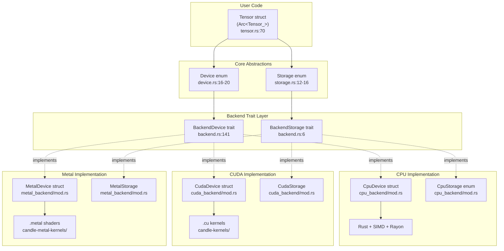
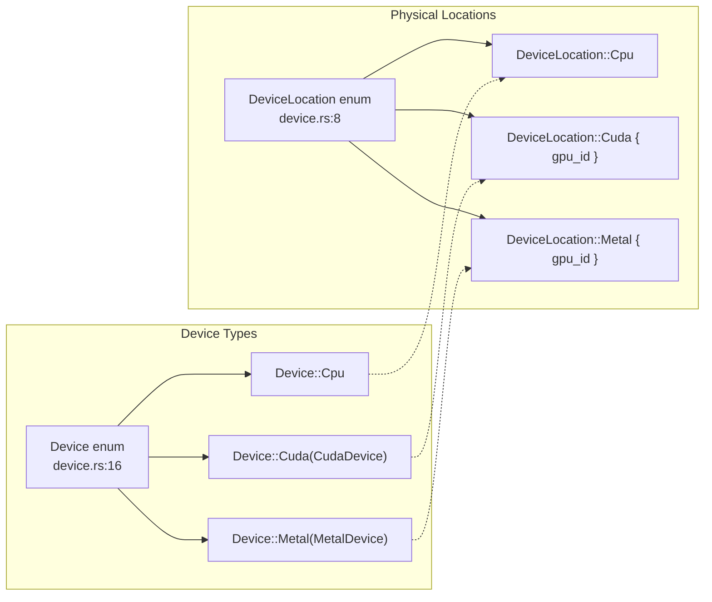
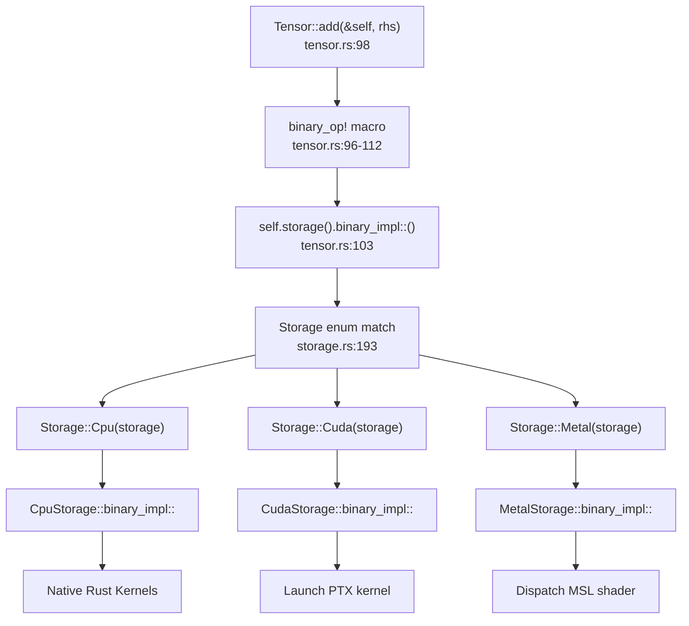
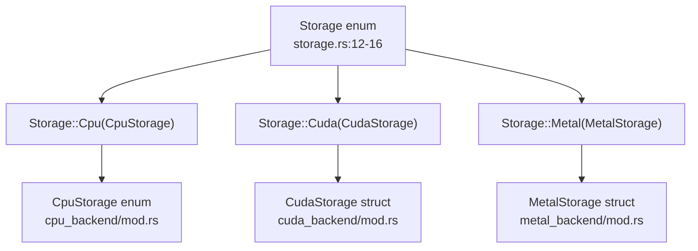

<!-- source: DeepWiki mcp.deepwiki.com · repo huggingface/candle · page 3 Device Abstraction and Backends · fetched 2026-10-26 -->

# Device Abstraction and Backends

Relevant source files

The following files were used as context for generating this wiki page:

- [candle-core/src/backend.rs](candle-core/src/backend.rs)
- [candle-core/src/backprop.rs](candle-core/src/backprop.rs)
- [candle-core/src/custom_op.rs](candle-core/src/custom_op.rs)
- [candle-core/src/device.rs](candle-core/src/device.rs)
- [candle-core/src/dummy_cuda_backend.rs](candle-core/src/dummy_cuda_backend.rs)
- [candle-core/src/dummy_metal_backend.rs](candle-core/src/dummy_metal_backend.rs)
- [candle-core/src/error.rs](candle-core/src/error.rs)
- [candle-core/src/lib.rs](candle-core/src/lib.rs)
- [candle-core/src/op.rs](candle-core/src/op.rs)
- [candle-core/src/storage.rs](candle-core/src/storage.rs)
- [candle-core/src/tensor.rs](candle-core/src/tensor.rs)
- [candle-core/src/test_utils.rs](candle-core/src/test_utils.rs)
- [candle-core/tests/custom_op_tests.rs](candle-core/tests/custom_op_tests.rs)
- [candle-core/tests/grad_tests.rs](candle-core/tests/grad_tests.rs)
- [candle-core/tests/matmul_tests.rs](candle-core/tests/matmul_tests.rs)
- [candle-core/tests/tensor_tests.rs](candle-core/tests/tensor_tests.rs)

Candle's device abstraction enables writing hardware-agnostic tensor code that automatically executes on CPU, CUDA GPUs, or Metal (Apple Silicon) without modification. This "write once, run anywhere" approach is achieved through a trait-based abstraction layer that dispatches operations to backend-specific implementations at runtime based on the tensor's device.

The abstraction consists of three key components:
- **Device enum**: Identifies where tensors reside (`Cpu`, `Cuda`, `Metal`) [candle-core/src/device.rs:16-20]()
- **BackendDevice trait**: Defines device-level operations like memory allocation and RNG [candle-core/src/backend.rs:141-174]()
- **BackendStorage trait**: Defines tensor storage operations including arithmetic and convolutions [candle-core/src/backend.rs:6-139]()

For tensor memory layouts and storage details, see [Core Tensor System](#2). For specific backend implementations, see the child pages linked below.

## Architecture Overview

Candle's device abstraction follows a layered architecture where high-level tensor operations are dispatched to backend-specific implementations based on the device type.

### Device Abstraction Layers

Diagram: Device Abstraction Architecture

Sources: [candle-core/src/device.rs:16-20](), [candle-core/src/storage.rs:12-16](), [candle-core/src/backend.rs:6-174](), [candle-core/src/tensor.rs:70]()

## Device Types and Location

### Device Enum and DeviceLocation

The `Device` enum represents the supported backend types, while `DeviceLocation` identifies physical hardware [candle-core/src/device.rs:8-20]().

Multiple `Device` instances can share the same `DeviceLocation`. For instance, in CUDA, all `CudaDevice` instances on the same GPU will use the same location, but they are tracked as distinct entities [candle-core/src/storage.rs:52-60]().

Sources: [candle-core/src/device.rs:5-20](), [candle-core/src/storage.rs:52-70]()

## Backend Trait System

### BackendDevice and BackendStorage Traits

The trait-based abstraction defines the interface all backends must implement to be compatible with the `Tensor` API.

| Trait | Purpose | Key Methods | File Reference |
|-------|---------|-------------|----------------|
| `BackendDevice` | Device management and memory allocation | `new()`, `zeros_impl()`, `alloc_uninit()`, `storage_from_slice()` | [candle-core/src/backend.rs:141-174]() |
| `BackendStorage` | Tensor storage and computation operations | `unary_impl::<B>()`, `binary_impl::<B>()`, `reduce_op()`, `matmul()`, `conv2d()`, `to_dtype()` | [candle-core/src/backend.rs:6-139]() |

The generic methods `unary_impl::<B>` and `binary_impl::<B>` allow compile-time specialization of operations (like `Add`, `Mul`, `Exp`) using the `UnaryOpT` and `BinaryOpT` traits [candle-core/src/backend.rs:30-32](), [candle-core/src/op.rs:192-269]().

### Operation Dispatch Pattern

Diagram: Binary Operation Dispatch Flow

Sources: [candle-core/src/tensor.rs:96-112](), [candle-core/src/storage.rs:193-210](), [candle-core/src/backend.rs:32-33]()

## Storage Abstraction

### Storage Enum Implementation

The `Storage` enum wraps backend-specific storage, enabling polymorphic dispatch [candle-core/src/storage.rs:12-16]().

Diagram: Storage Type Hierarchy

### Backend Comparison Summary

| Operation | CPU Implementation | CUDA Implementation | Metal Implementation |
|-----------|-------------------|-------------------|---------------------|
| Memory allocation | `Vec<T>` in Rust heap | `cudaMalloc` via driver | `device.new_buffer()` |
| Data transfer (device→host) | Direct slice access | `to_cpu_storage()` | `buffer.contents()` |
| Kernel dispatch | Rayon/SIMD | PTX via `CudaDevice` | MSL via `MetalDevice` |
| Storage cloning | `Arc` reference or `Vec::clone` | GPU memory allocation | `Arc<Buffer>` sharing |

Sources: [candle-core/src/storage.rs:12-50](), [candle-core/src/dummy_cuda_backend.rs:36-232](), [candle-core/src/backend.rs:154-164]()

## Device Initialization and Selection

### Creating Devices

Devices are typically created using specialized constructors or fallback helpers [candle-core/src/device.rs:234-250]().

- `Device::Cpu`: Always available [candle-core/src/device.rs:17]().
- `Device::new_cuda(ordinal)`: Creates a CUDA device, returns error if not compiled with CUDA [candle-core/src/device.rs:234]().
- `Device::new_metal(ordinal)`: Creates a Metal device [candle-core/src/lib.rs:70-71]().

### Device Compatibility

Tensors must reside on the same device to participate in binary operations. Candle enforces this via `same_device` checks [candle-core/src/storage.rs:52-70](). If devices mismatch, a `DeviceMismatchBinaryOp` error is returned [candle-core/src/error.rs:105-110]().

## Backend Implementation Details

The following sub-pages provide detailed information about each backend:

- **[Device Abstraction Layer](#3.1)** — Deep dive into traits, `CustomOp` implementations [candle-core/src/custom_op.rs:8-153](), and the `UgIOp1` unified kernel generation via SSA [candle-core/src/lib.rs:96-97]().
- **[CPU Backend](#3.2)** — SIMD optimizations (AVX, NEON), MKL/Accelerate integration, and Rust-native kernels [candle-core/src/lib.rs:57]().
- **[CUDA Backend](#3.3)** — GPU acceleration via custom CUDA kernels, cuBLAS/cuDNN integration, and multi-GPU NCCL support [candle-core/src/lib.rs:59]().
- **[Metal Backend](#3.4)** — Apple Silicon acceleration using MSL shaders and unified memory management [candle-core/src/lib.rs:71]().
- **[Flash Attention Acceleration](#3.5)** — Optimized attention kernels (v1/v2/v3) for high-performance transformer inference.

Sources: [candle-core/src/lib.rs:50-120](), [candle-core/src/device.rs:234-235](), [candle-core/src/storage.rs:52-70](), [candle-core/src/custom_op.rs:8-153]()

---

