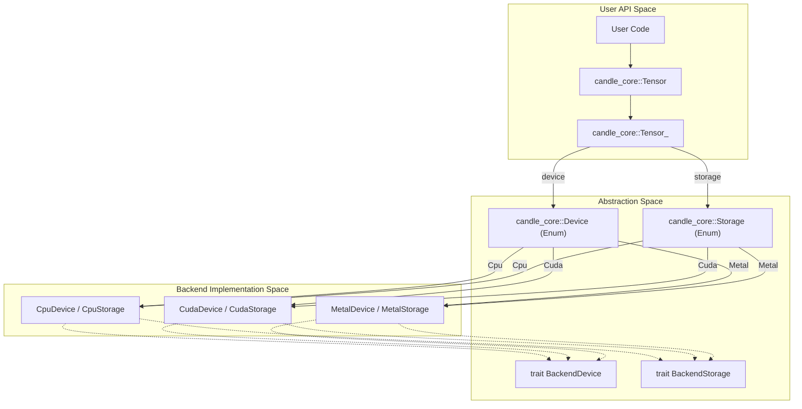
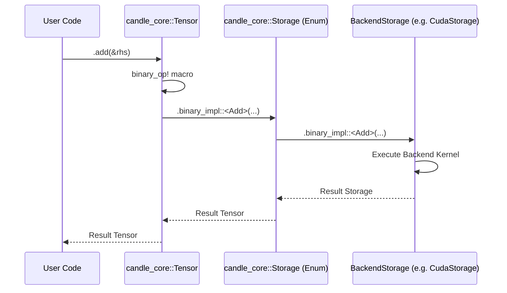

<!-- source: DeepWiki mcp.deepwiki.com · repo huggingface/candle · page 3.1 Device Abstraction Layer · fetched 2026-10-26 -->

# Device Abstraction Layer

Relevant source files

The following files were used as context for generating this wiki page:

- [candle-core/src/backend.rs](candle-core/src/backend.rs)
- [candle-core/src/backprop.rs](candle-core/src/backprop.rs)
- [candle-core/src/custom_op.rs](candle-core/src/custom_op.rs)
- [candle-core/src/device.rs](candle-core/src/device.rs)
- [candle-core/src/dummy_cuda_backend.rs](candle-core/src/dummy_cuda_backend.rs)
- [candle-core/src/dummy_metal_backend.rs](candle-core/src/dummy_metal_backend.rs)
- [candle-core/src/error.rs](candle-core/src/error.rs)
- [candle-core/src/lib.rs](candle-core/src/lib.rs)
- [candle-core/src/op.rs](candle-core/src/op.rs)
- [candle-core/src/storage.rs](candle-core/src/storage.rs)
- [candle-core/src/tensor.rs](candle-core/src/tensor.rs)
- [candle-core/src/test_utils.rs](candle-core/src/test_utils.rs)
- [candle-core/tests/custom_op_tests.rs](candle-core/tests/custom_op_tests.rs)
- [candle-core/tests/grad_tests.rs](candle-core/tests/grad_tests.rs)
- [candle-core/tests/matmul_tests.rs](candle-core/tests/matmul_tests.rs)
- [candle-core/tests/tensor_tests.rs](candle-core/tests/tensor_tests.rs)

The Device Abstraction Layer provides a unified interface for executing tensor operations across different hardware backends (CPU, CUDA GPUs, and Metal GPUs). This layer enables the same user code to run on any supported backend without modification, with the framework handling device-specific optimizations and implementations transparently.

## Overview

The device abstraction is built on a trait-based system that separates the user-facing device representation from backend-specific implementation details. The core components are the `Device` enum, which represents a physical or virtual compute device, and the `Storage` enum, which acts as a container for backend-specific tensor data.

**Sources**: [candle-core/src/tensor.rs:25-45](), [candle-core/src/device.rs:16-20](), [candle-core/src/storage.rs:12-16](), [candle-core/src/backend.rs:6-174]()

## Device Enumeration and Traits

The `Device` enum [candle-core/src/device.rs:16-20]() is the primary entry point for selecting hardware. It dispatches to types implementing backend logic via the `BackendDevice` trait [candle-core/src/backend.rs:141-174]().

### Device Locations
*   **DeviceLocation**: Represents the physical hardware. It distinguishes between the `Cpu` and specific GPU IDs for `Cuda` and `Metal` [candle-core/src/device.rs:8-12]().
*   **NdArray Trait**: Allows for creating tensors directly from Rust arrays and vectors, facilitating easy data movement from the CPU to any target `Device` [candle-core/src/device.rs:22-231]().

### Backend Storage Trait
The `BackendStorage` trait [candle-core/src/backend.rs:6-139]() defines the mandatory operations a backend must implement, including:
*   **Memory Management**: `try_clone`, `to_cpu_storage`, and `to_dtype` [candle-core/src/backend.rs:9-28]().
*   **Linear Algebra**: `matmul`, `conv2d`, and `affine` [candle-core/src/backend.rs:18-121]().
*   **Indexing**: `gather`, `scatter_set`, and `index_select` [candle-core/src/backend.rs:82-104]().

**Sources**: [candle-core/src/device.rs:8-20](), [candle-core/src/backend.rs:6-174]()

## Operation Dispatch Mechanism

Candle uses a layered dispatch mechanism. When a user calls a method like `tensor.add(&other)`, the call follows a specific path through the abstraction layers.

### Dispatch Flow
1.  **Tensor API**: High-level methods (defined via `unary_op!`, `binary_op!`, or `broadcast_binary_op!` macros) extract the internal `Storage` and verify device/shape compatibility [candle-core/src/tensor.rs:80-158]().
2.  **Storage Enum**: The `Storage` enum dispatches the call to the appropriate backend implementation (CPU, CUDA, or Metal) [candle-core/src/storage.rs:21-191]().
3.  **Backend Implementation**: The concrete implementation (e.g., `CudaStorage`) executes the kernel or library call (e.g., cuBLAS) [candle-core/src/dummy_cuda_backend.rs:36-232]().

**Sources**: [candle-core/src/tensor.rs:96-112](), [candle-core/src/storage.rs:150-174](), [candle-core/src/backend.rs:32-32]()

## Custom and Unified Operations

Candle provides traits for extending functionality without modifying the core library.

### CustomOp Traits
Users can implement `CustomOp1`, `CustomOp2`, or `CustomOp3` to define new operations with optional autograd support [candle-core/src/custom_op.rs:8-153]().
*   **Backend Hooks**: The traits require a `cpu_fwd` implementation and provide optional `cuda_fwd` and `metal_fwd` hooks [candle-core/src/custom_op.rs:14-34]().
*   **Backward Pass**: The `bwd` method allows defining the gradient computation for the custom operation [candle-core/src/custom_op.rs:39-41]().
*   **Inplace Operations**: `InplaceOp1`, `InplaceOp2`, and `InplaceOp3` allow for memory-efficient modifications directly on the storage [candle-core/src/lib.rs:98]().

### Unified Kernel Generation (UgIOp1)
For backends supporting the `ug` feature, the `UgIOp1` trait [candle-core/src/lib.rs:97]() enables unified kernel generation via the `candle-ug` crate. This allows defining a kernel once in a high-level SSA (Static Single Assignment) form and having it compiled for specific backends [candle-core/src/error.rs:177-179]().

**Sources**: [candle-core/src/custom_op.rs:8-153](), [candle-core/src/lib.rs:96-98](), [candle-core/src/error.rs:177-179]()

## Error Handling

Candle uses a centralized `Error` enum [candle-core/src/error.rs:22-230]() to handle device and operation failures.

### Key Error Categories
*   **Device Mismatch**: `DeviceMismatchBinaryOp` occurs when attempting operations on tensors located on different physical devices [candle-core/src/error.rs:105-110]().
*   **Backend Support**: `NotCompiledWithCudaSupport` or `NotCompiledWithMetalSupport` are returned when a backend is requested but the framework was not built with the corresponding feature flag [candle-core/src/error.rs:161-165]().
*   **Backend-Specific Errors**: Errors from hardware APIs are wrapped, such as `MetalError` [candle-core/src/error.rs:175]() or boxed `Cuda` errors [candle-core/src/error.rs:172]().
*   **MatMul Striding**: Specialized `MatMulUnexpectedStriding` error for cases where the tensor layout is incompatible with backend-specific GEMM kernels [candle-core/src/error.rs:7-12]().

**Sources**: [candle-core/src/error.rs:7-230](), [candle-core/src/dummy_cuda_backend.rs:14-16]()

## Summary of Device Types

| Feature | CPU | CUDA | Metal |
| :--- | :--- | :--- | :--- |
| **Storage Type** | `CpuStorage` [candle-core/src/lib.rs:95]() | `CudaStorage` [candle-core/src/lib.rs:119]() | `MetalStorage` [candle-core/src/lib.rs:122]() |
| **Backend Implementation** | `cpu_backend` | `cuda_backend` | `metal_backend` |
| **Fallbacks** | N/A | `dummy_cuda_backend` [candle-core/src/dummy_cuda_backend.rs:11]() | `dummy_metal_backend` [candle-core/src/lib.rs:125]() |
| **Dispatch Logic** | Rust / MKL / Accelerate | PTX / cuBLAS / cuDNN | MSL / Compute Shaders |

**Sources**: [candle-core/src/lib.rs:95-125](), [candle-core/src/dummy_cuda_backend.rs:1-11](), [candle-core/src/device.rs:16-20]()

---

