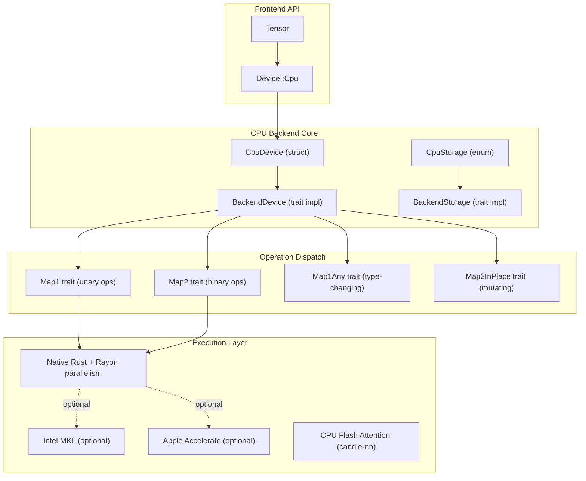
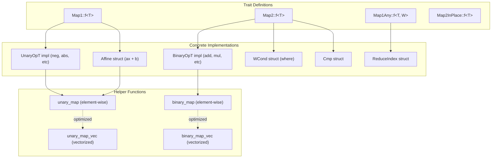

<!-- source: DeepWiki mcp.deepwiki.com · repo huggingface/candle · page 3.2 CPU Backend · fetched 2026-10-26 -->

# CPU Backend

<details>
<summary>Relevant source files</summary>

The following files were used as context for generating this wiki page:

- [candle-core/benches/bench_main.rs](candle-core/benches/bench_main.rs)
- [candle-core/benches/benchmarks/broadcast.rs](candle-core/benches/benchmarks/broadcast.rs)
- [candle-core/benches/benchmarks/cat.rs](candle-core/benches/benchmarks/cat.rs)
- [candle-core/benches/benchmarks/contiguous.rs](candle-core/benches/benchmarks/contiguous.rs)
- [candle-core/benches/benchmarks/mod.rs](candle-core/benches/benchmarks/mod.rs)
- [candle-core/benches/benchmarks/vec_dot.rs](candle-core/benches/benchmarks/vec_dot.rs)
- [candle-core/examples/cuda_basics.rs](candle-core/examples/cuda_basics.rs)
- [candle-core/examples/cuda_sum_benchmark.rs](candle-core/examples/cuda_sum_benchmark.rs)
- [candle-core/src/accelerate.rs](candle-core/src/accelerate.rs)
- [candle-core/src/conv.rs](candle-core/src/conv.rs)
- [candle-core/src/cpu/avx.rs](candle-core/src/cpu/avx.rs)
- [candle-core/src/cpu/kernels.rs](candle-core/src/cpu/kernels.rs)
- [candle-core/src/cpu/mod.rs](candle-core/src/cpu/mod.rs)
- [candle-core/src/cpu/neon.rs](candle-core/src/cpu/neon.rs)
- [candle-core/src/cpu/simd128.rs](candle-core/src/cpu/simd128.rs)
- [candle-core/src/cpu_backend/conv2d.rs](candle-core/src/cpu_backend/conv2d.rs)
- [candle-core/src/cpu_backend/mod.rs](candle-core/src/cpu_backend/mod.rs)
- [candle-core/src/cpu_backend/utils.rs](candle-core/src/cpu_backend/utils.rs)
- [candle-core/src/layout.rs](candle-core/src/layout.rs)
- [candle-core/src/mkl.rs](candle-core/src/mkl.rs)
- [candle-core/src/nditer.rs](candle-core/src/nditer.rs)
- [candle-core/src/strided_index.rs](candle-core/src/strided_index.rs)
- [candle-core/src/tensor_cat.rs](candle-core/src/tensor_cat.rs)
- [candle-core/tests/conv_tests.rs](candle-core/tests/conv_tests.rs)
- [candle-core/tests/layout_tests.rs](candle-core/tests/layout_tests.rs)
- [candle-core/tests/pool_tests.rs](candle-core/tests/pool_tests.rs)
- [candle-examples/examples/qwen/README.md](candle-examples/examples/qwen/README.md)
- [candle-examples/examples/qwen/main.rs](candle-examples/examples/qwen/main.rs)
- [candle-kernels/src/conv.cu](candle-kernels/src/conv.cu)
- [candle-nn/src/attention/cpu_flash/causal.rs](candle-nn/src/attention/cpu_flash/causal.rs)
- [candle-nn/src/attention/cpu_flash/mod.rs](candle-nn/src/attention/cpu_flash/mod.rs)
- [candle-nn/src/attention/cpu_flash/online_softmax.rs](candle-nn/src/attention/cpu_flash/online_softmax.rs)
- [candle-nn/src/attention/cpu_flash/standard.rs](candle-nn/src/attention/cpu_flash/standard.rs)
- [candle-nn/src/attention/cpu_flash/varlen.rs](candle-nn/src/attention/cpu_flash/varlen.rs)
- [candle-nn/src/cpu_flash_attention.rs](candle-nn/src/cpu_flash_attention.rs)
- [candle-nn/src/kv_cache.rs](candle-nn/src/kv_cache.rs)
- [candle-transformers/src/models/quantized_qwen3.rs](candle-transformers/src/models/quantized_qwen3.rs)
- [candle-transformers/src/models/qwen3.rs](candle-transformers/src/models/qwen3.rs)

</details>


## Purpose and Scope

The CPU Backend provides native CPU-based implementations of tensor operations in Candle. It serves as the default backend for CPU-only deployments and serverless environments where minimizing binary size is critical. The CPU backend implements the `BackendDevice` and `BackendStorage` traits to provide a consistent interface for tensor operations, with optional accelerations through Intel MKL and Apple Accelerate libraries via FFI bindings.

**Sources**: [candle-core/src/cpu_backend/mod.rs:1-60](), [candle-core/src/cpu_backend/mod.rs:2380-2385]()

## Architecture Overview

The CPU backend is organized around three main components: storage representation (`CpuStorage`), device management (`CpuDevice`), and operation dispatch through trait-based patterns. Operations are parallelized using Rayon and can optionally leverage BLAS implementations for matrix operations.



**Diagram: CPU Backend Architecture**

**Sources**: [candle-core/src/cpu_backend/mod.rs:1-60](), [candle-core/src/cpu_backend/utils.rs:1-30]()

## Storage Type System

### CpuStorage Enum
`CpuStorage` is an enum that holds typed vectors for each supported data type. Each variant contains a `Vec<T>` where `T` is the corresponding Rust type. This design allows type-safe storage while enabling runtime polymorphism through enum dispatch.

The storage enum includes variants for all supported data types, including low-bit formats:
*   **Standard**: `U8`, `U32`, `I16`, `I32`, `I64`, `BF16`, `F16`, `F32`, `F64` [candle-core/src/cpu_backend/mod.rs:23-31]()
*   **Low-bit/Quantized**: `F8E4M3`, `F6E2M3`, `F6E3M2`, `F4`, `F8E8M0` [candle-core/src/cpu_backend/mod.rs:32-37]()

**Sources**: [candle-core/src/cpu_backend/mod.rs:21-38]()

### CpuDevice Struct
`CpuDevice` is a zero-sized marker type that implements the `BackendDevice` trait. It provides factory methods for creating tensors and managing device-specific state. [candle-core/src/cpu_backend/mod.rs:59-60]()

**Sources**: [candle-core/src/cpu_backend/mod.rs:59-60]()

## Operation Dispatch System

The CPU backend uses a trait-based dispatch system to implement tensor operations. Each operation category has a corresponding trait that defines how to execute the operation on typed data.



**Diagram: Operation Dispatch Pattern**

### Map1 Trait Pattern
The `Map1` trait defines unary operations that transform a single input tensor into an output tensor of the same type. Implementations provide a generic method `f<T>` that operates on typed slices. [candle-core/src/cpu_backend/utils.rs:11-12]()

### Map2 Trait Pattern
The `Map2` trait defines binary operations that combine two input tensors into an output tensor. Both inputs must have the same dtype. [candle-core/src/cpu_backend/utils.rs:54-78]()

### Map1Any Trait Pattern
`Map1Any` allows operations that can change the output type (e.g., reductions that return indices as `u32`). The wrap function converts the result to the appropriate `CpuStorage` variant. [candle-core/src/cpu_backend/utils.rs:30-52]()

**Sources**: [candle-core/src/cpu_backend/utils.rs:6-131](), [candle-core/src/cpu_backend/mod.rs:62-120]()

## Optional Acceleration Libraries

Candle supports high-performance CPU backends through FFI bindings to industry-standard libraries. These are enabled via feature flags.

### Intel MKL Integration
When the `mkl` feature is enabled, Candle links against Intel MKL for optimized BLAS operations.
*   **Module**: `candle-core/src/mkl.rs`
*   **Key Functions**: `sgemm`, `dgemm`, `hgemm` for matrix multiplication [candle-core/src/mkl.rs:83-181](), and vector math functions like `vs_exp`, `vs_sin` [candle-core/src/mkl.rs:184-250]().
*   **Dependency**: External `mkl` library via `ffi` block [candle-core/src/mkl.rs:4-79]().

### Apple Accelerate Integration
On macOS, the `accelerate` feature enables Apple's Accelerate framework. This provides highly optimized implementations of BLAS and vector math operations tuned for Apple Silicon.
*   **Module**: `candle-core/src/accelerate.rs`
*   **Key Functions**: `sgemm`, `dgemm` via FFI bindings [candle-core/src/accelerate.rs:10-164]().

**Sources**: [candle-core/src/mkl.rs:4-79](), [candle-core/src/accelerate.rs:4-165](), [candle-examples/examples/qwen/main.rs:1-5]()

## Convolution Implementations

CPU convolutions are handled via the `conv.rs` abstraction, which dispatches to backend-specific logic.

### 1D Convolution
For 1D convolutions, the CPU backend can use an `im2col` approach or direct implementation. This is controlled by internal constants:
*   `USE_IM2COL_CONV1D`: If true, transforms the input into a matrix format for efficient multiplication. [candle-core/src/cpu_backend/mod.rs:16]()
*   `USE_COL2IM_CONV1D_TR`: Used for transposed convolutions. [candle-core/src/cpu_backend/mod.rs:17]()

### 2D Convolution
2D convolutions are implemented in `candle-core/src/cpu_backend/conv2d.rs`. The `Conv2D` struct manages the implementation of the forward pass, handling padding, strides, and dilations. It includes specializations for 1x1 convolutions (`conv2d_1x1`) and a tiled implementation (`conv2d_tiled`) to optimize memory access. [candle-core/src/cpu_backend/conv2d.rs:12-51](), [candle-core/src/cpu_backend/conv2d.rs:56-121]()

**Sources**: [candle-core/src/conv.rs:132-145](), [candle-core/src/cpu_backend/mod.rs:13-18](), [candle-core/src/cpu_backend/conv2d.rs:1-121]()

## CPU Flash Attention

The `candle-nn` crate provides a CPU-specific implementation of Scaled Dot-Product Attention (SDPA) inspired by Flash Attention, located in `candle-nn/src/attention/`.

### Dispatcher and Masking
The `flash_attn` function acts as a dispatcher, selecting the appropriate implementation based on input shapes and requirements. It supports causal masking via `AttnMask`. [candle-nn/src/attention/mod.rs](), [candle-transformers/src/models/qwen3.rs:13]()

### Implementation Variants
*   **Standard**: General implementation for SDPA on CPU. [candle-nn/src/attention/cpu_flash/standard.rs]()
*   **Causal**: Optimized path for causal attention, common in autoregressive LLMs. [candle-nn/src/attention/cpu_flash/causal.rs]()
*   **Fused Decode**: For quantized models like Qwen3, `causal_decode_f32_interleaved` provides a zero-allocation path for single-token generation. [candle-transformers/src/models/quantized_qwen3.rs:13-15]()
*   **VarLen**: Support for variable length sequences within a single batch, avoiding padding overhead. [candle-nn/src/attention/cpu_flash/varlen.rs]()

**Sources**: [candle-nn/src/attention/mod.rs](), [candle-nn/src/attention/cpu_flash/mod.rs](), [candle-transformers/src/models/quantized_qwen3.rs:13-15]()

## SIMD and Optimization

### SIMD Detection
Candle detects CPU features at compile-time and run-time to enable optimized paths:
*   **AVX**: Implementations in `candle-core/src/cpu/avx.rs`.
*   **NEON**: Implementations in `candle-core/src/cpu/neon.rs`.
*   **WASM SIMD128**: Implementations in `candle-core/src/cpu/simd128.rs`.

### Vectorized Maps
The CPU backend provides `unary_map_vec` and `binary_map_vec` which are designed to leverage SIMD optimizations where available. These functions take both a scalar closure and a vectorized implementation. [candle-core/src/cpu_backend/utils.rs:11-12]()

### Layout Handling
CPU operations must handle both contiguous and strided tensor layouts. The backend uses `contiguous_offsets()` to detect fast paths.
*   **Fast Path**: Direct slice iteration when data is contiguous. [candle-core/src/cpu_backend/mod.rs:129-137]()
*   **Strided Path**: Uses `NdIter` and `strided_index()` to compute offsets for non-contiguous tensors. [candle-core/src/cpu_backend/mod.rs:148-188]()

### Parallelization with Rayon
The CPU backend leverages the Rayon library for data parallelism across multiple CPU cores. Rayon's parallel iterators are used to split workloads for large tensors. [candle-core/src/cpu_backend/mod.rs:7]()

**Sources**: [candle-core/src/cpu_backend/utils.rs:11-12](), [candle-core/src/cpu_backend/mod.rs:129-188](), [candle-core/src/layout.rs:175-189]()

## Key Implementation Examples

### Reduction with Index
The `ReduceIndex` struct implements operations like `argmax` or `argmin`. It iterates through the specified reduction dimension and tracks the accumulator index.

```rust
struct ReduceIndex {
    reduce_dim_index: usize,
    use_min: bool,
    return_index: bool,
}
```

**Sources**: [candle-core/src/cpu_backend/mod.rs:194-201]()

### Comparison Logic
Comparisons are implemented via the `Cmp` struct, which uses `binary_map` to evaluate predicates like `Eq`, `Gt`, etc., and returns a `u8` mask. [candle-core/src/cpu_backend/mod.rs:62-83]()

### Conditional Selection (Where)
The `WCond` struct implements the `where` operation (triadic: condition, true_tensor, false_tensor). It uses the condition tensor's values to select elements from the true or false branches. [candle-core/src/cpu_backend/mod.rs:85-120]()

**Sources**: [candle-core/src/cpu_backend/mod.rs:62-120]()

---

