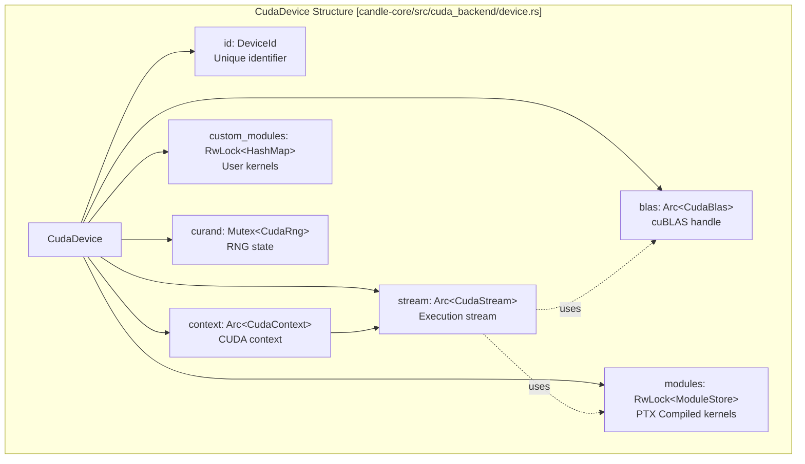
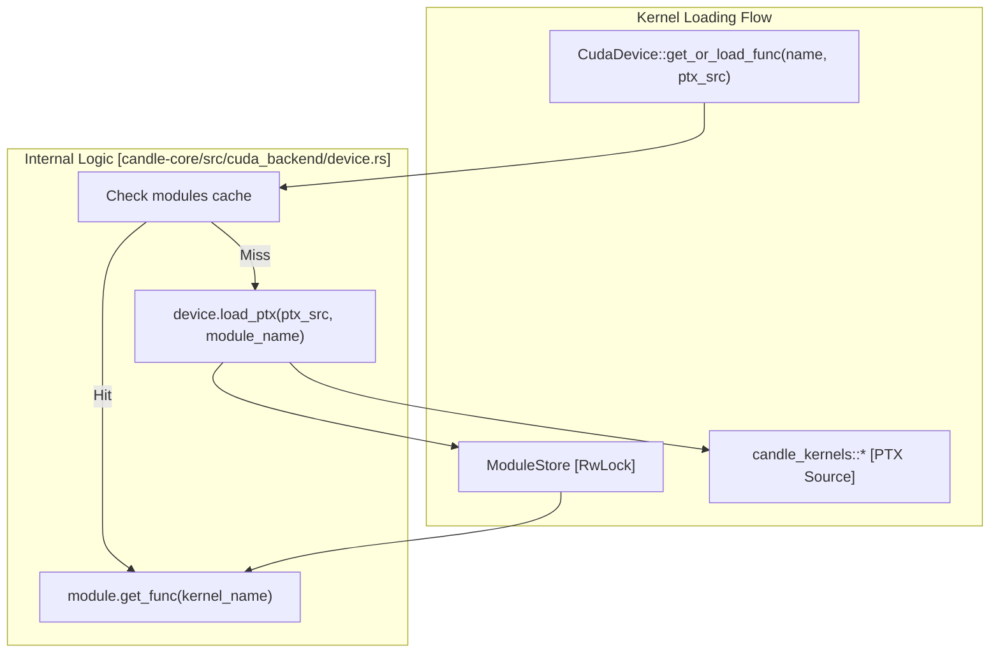

<!-- source: DeepWiki mcp.deepwiki.com · repo huggingface/candle · page 3.3 CUDA Backend · fetched 2026-10-26 -->

# CUDA Backend

<details>
<summary>Relevant source files</summary>

The following files were used as context for generating this wiki page:

- [candle-core/src/cuda_backend/cudnn.rs](candle-core/src/cuda_backend/cudnn.rs)
- [candle-core/src/cuda_backend/device.rs](candle-core/src/cuda_backend/device.rs)
- [candle-core/src/cuda_backend/mod.rs](candle-core/src/cuda_backend/mod.rs)
- [candle-core/src/quantized/cuda.rs](candle-core/src/quantized/cuda.rs)
- [candle-core/src/quantized/dummy_cuda.rs](candle-core/src/quantized/dummy_cuda.rs)
- [candle-core/src/quantized/dummy_metal.rs](candle-core/src/quantized/dummy_metal.rs)
- [candle-core/src/quantized/fast_mmq.rs](candle-core/src/quantized/fast_mmq.rs)
- [candle-core/src/quantized/fast_mmvq.rs](candle-core/src/quantized/fast_mmvq.rs)
- [candle-core/src/quantized/metal.rs](candle-core/src/quantized/metal.rs)
- [candle-examples/build.rs](candle-examples/build.rs)
- [candle-examples/buildtime_downloader.rs](candle-examples/buildtime_downloader.rs)
- [candle-examples/examples/custom-ops/cuda_kernels.rs](candle-examples/examples/custom-ops/cuda_kernels.rs)
- [candle-examples/examples/custom-ops/kernels/layernorm_kernels.cu](candle-examples/examples/custom-ops/kernels/layernorm_kernels.cu)
- [candle-examples/examples/custom-ops/kernels/reduction_utils.cuh](candle-examples/examples/custom-ops/kernels/reduction_utils.cuh)
- [candle-examples/examples/custom-ops/main.rs](candle-examples/examples/custom-ops/main.rs)
- [candle-examples/examples/gemma4/main.rs](candle-examples/examples/gemma4/main.rs)
- [candle-flash-attn/build.rs](candle-flash-attn/build.rs)
- [candle-kernels/README.md](candle-kernels/README.md)
- [candle-kernels/build.rs](candle-kernels/build.rs)
- [candle-kernels/src/affine.cu](candle-kernels/src/affine.cu)
- [candle-kernels/src/binary.cu](candle-kernels/src/binary.cu)
- [candle-kernels/src/cast.cu](candle-kernels/src/cast.cu)
- [candle-kernels/src/compatibility.cuh](candle-kernels/src/compatibility.cuh)
- [candle-kernels/src/cuda_utils.cuh](candle-kernels/src/cuda_utils.cuh)
- [candle-kernels/src/ffi.rs](candle-kernels/src/ffi.rs)
- [candle-kernels/src/indexing.cu](candle-kernels/src/indexing.cu)
- [candle-kernels/src/lib.rs](candle-kernels/src/lib.rs)
- [candle-kernels/src/mmvq_gguf.cu](candle-kernels/src/mmvq_gguf.cu)
- [candle-kernels/src/moe/moe_wmma.cu](candle-kernels/src/moe/moe_wmma.cu)
- [candle-kernels/src/quantized.cu](candle-kernels/src/quantized.cu)
- [candle-kernels/src/ternary.cu](candle-kernels/src/ternary.cu)
- [candle-kernels/src/unary.cu](candle-kernels/src/unary.cu)
- [candle-metal-kernels/src/kernels/mod.rs](candle-metal-kernels/src/kernels/mod.rs)
- [candle-metal-kernels/src/kernels/quantized.rs](candle-metal-kernels/src/kernels/quantized.rs)
- [candle-transformers/src/models/gemma4/audio.rs](candle-transformers/src/models/gemma4/audio.rs)
- [candle-transformers/src/models/gemma4/config.rs](candle-transformers/src/models/gemma4/config.rs)
- [candle-transformers/src/models/gemma4/mod.rs](candle-transformers/src/models/gemma4/mod.rs)
- [candle-transformers/src/models/gemma4/text.rs](candle-transformers/src/models/gemma4/text.rs)
- [candle-transformers/src/models/gemma4/vision.rs](candle-transformers/src/models/gemma4/vision.rs)

</details>


## Purpose and Scope

This page documents Candle's CUDA backend implementation, which enables GPU-accelerated tensor operations on NVIDIA hardware. The CUDA backend implements the `BackendDevice` and `BackendStorage` traits to provide GPU execution of tensor operations through custom CUDA kernels, cuBLAS for linear algebra, and optional cuDNN for optimized convolutions. It also includes support for multi-GPU communication via NCCL, specialized fast paths for GGUF quantized matrix multiplication, and a `ModuleStore` for PTX kernel management.

Sources: [candle-core/src/cuda_backend/mod.rs:1-21](), [candle-core/src/cuda_backend/device.rs:1-10]()

## CudaDevice Architecture

### Core Components

The `CudaDevice` struct manages the CUDA context, streams, and computational resources for a specific GPU. Each device maintains its own kernel cache, BLAS handles, and random number generators.



**Diagram: CudaDevice Internal Structure**

Sources: [candle-core/src/cuda_backend/device.rs:59-68](), [candle-core/src/cuda_backend/device.rs:16-25]()

### ModuleStore and PTX Caching

Candle uses a `ModuleStore` to manage compiled CUDA kernels. Built-in kernels are sourced from the `candle-kernels` crate and lazily loaded into the device. The `get_or_load_func` method handles the lookup and loading logic.



**Diagram: ModuleStore and Kernel Retrieval**

Sources: [candle-core/src/cuda_backend/device.rs:54-56](), [candle-core/src/cuda_backend/mod.rs:6-11]()

## Storage and Data Flow

### CudaStorage and Memory Layout

`CudaStorage` manages physical memory on the GPU. It uses `CudaStorageSlice` to handle different data types, including support for low-precision formats like `F8E4M3` and quantized types.

| Variant | Data Type | Implementation |
| :--- | :--- | :--- |
| `U8`, `U32` | Unsigned Integers | `CudaSlice<u8>`, `CudaSlice<u32>` |
| `I16`, `I32`, `I64` | Signed Integers | `CudaSlice<i16>`, etc. |
| `BF16`, `F16` | Half Precision | `CudaSlice<bf16>`, `CudaSlice<f16>` |
| `F32`, `F64` | Floating Point | `CudaSlice<f32>`, `CudaSlice<f64>` |
| `F8E4M3` | 8-bit Float | `CudaSlice<float8::F8E4M3>` |
| `F4`, `F6E2M3` | Raw Byte Dummies | `CudaSlice<u8>` |

Sources: [candle-core/src/cuda_backend/mod.rs:100-116](), [candle-core/src/cuda_backend/mod.rs:29-43]()

### Layout-Aware Kernel Arguments

The `SlicePtrOrNull` utility is used to pass tensor layouts to CUDA kernels. If a tensor is contiguous, the stride/dimension parameters are passed as `Null` to allow kernels to use optimized contiguous paths via the `is_contiguous` check in C++ headers.

Sources: [candle-core/src/cuda_backend/mod.rs:90-97](), [candle-kernels/src/unary.cu:16-29]()

## Custom CUDA Kernels

### Specialized Kernel Implementation

Candle implements a wide range of custom kernels in `candle-kernels` to handle operations not covered by standard libraries. These are compiled to PTX at build time using `KernelBuilder`.

*   **Unary Operations**: Implemented using `UNARY_OP` macros in `unary.cu` to generate type-specific variants like `ucopy_f32` or `usilu_bf16`. [candle-kernels/src/unary.cu:6-29]()
*   **Binary Operations**: Dispatched via `Map2` traits to kernels in `binary.cu`. [candle-core/src/cuda_backend/mod.rs:23]()
*   **Reductions**: Kernels for sum, mean, and argmax use warp-level primitives like `warp_reduce_sum`. [candle-kernels/src/quantized.cu:30-36]()
*   **Cast**: Specialized casting kernels including `fp8_e4m3` support via `__nv_cvt_fp8_to_halfraw`. [candle-kernels/src/cast.cu:27-50]()
*   **Indexing**: Support for `index_select`, `gather`, and `scatter_add` operations. [candle-kernels/src/indexing.cu:41-69]()
*   **Quantized Support**: CUDA kernels for dequantizing GGUF formats (Q4_0, Q4_K, etc.) to F32/F16. [candle-core/src/quantized/cuda.rs:105-135]()

### GGUF Fast Paths: fast_mmvq and fast_mmq

For quantized GGUF models, Candle provides two distinct CUDA paths optimized for different batch sizes. These kernels are statically compiled into a library (`libmoe.a`) rather than loaded as PTX.

1.  **fast_mmvq (DMMV)**: Optimized for small batch sizes (typically 1-8). It utilizes the `mmvq_gguf.cu` kernels for efficient vector-matrix multiplication. [candle-core/src/quantized/cuda.rs:22-27](), [candle-kernels/src/mmvq_gguf.cu:1-20]()
2.  **fast_mmq (MMQ)**: Optimized for larger batch sizes (>8), providing better throughput for parallel inference. It uses tensor cores when available (Ampere and later). [candle-kernels/src/quantized.cu:103-111](), [candle-core/src/quantized/fast_mmq.rs:1-20]()

Sources: [candle-kernels/build.rs:24-41](), [candle-core/src/quantized/cuda.rs:30-38]()

### Map Traits for Dispatch

Operation dispatch is handled by internal traits like `Map1`, `Map2`, and `Map3`, which abstract the boilerplate of launching a kernel via `cudarc`.

```rust
// Example: Elu implementation using Map1
struct Elu(f64);
impl Map1 for Elu {
    fn f<T: DeviceRepr + WithDType>(
        &self,
        src: &CudaSlice<T>,
        dev: &CudaDevice,
        layout: &Layout,
    ) -> Result<CudaSlice<T>> {
        let func = dev.get_or_load_func(&kernel_name::<T>("uelu"), &kernels::UNARY)?;
        // ... build args and launch ...
    }
}
```

Sources: [candle-core/src/cuda_backend/mod.rs:166-194](), [candle-core/src/cuda_backend/mod.rs:23]()

## Integration with Libraries

### cuBLAS for Linear Algebra

Matrix multiplications are dispatched to cuBLAS via `cudarc`. The backend handles standard GEMM and `StridedBatched` configurations.

Sources: [candle-core/src/cuda_backend/mod.rs:8-11](), [candle-core/src/cuda_backend/device.rs:65]()

### cuDNN for Convolutions

When the `cudnn` feature is enabled, Candle uses cuDNN for optimized convolutions. The integration is managed via `candle-core/src/cuda_backend/cudnn.rs`.

Sources: [candle-core/src/cuda_backend/mod.rs:16-17](), [candle-core/src/cuda_backend/cudnn.rs:1-10]()

### NCCL for Multi-GPU

Multi-GPU execution is supported through NCCL integration. This allows for collective operations (All-Reduce, Broadcast) across multiple GPUs, which is essential for distributed training and inference.

Sources: [candle-core/src/cuda_backend/device.rs:1-10]()

## Performance Features

### PTX Caching and Build System
PTX code is generated during the build of `candle-kernels`. The `KernelBuilder` scans `.cu` files and generates a Rust module containing the PTX strings, while excluding specialized GGUF kernels that require static compilation.

Sources: [candle-kernels/build.rs:11-22]()

### CUDA Graph and Parameter Caching
To optimize performance during CUDA graph capture, Candle implements a parameter cache (`CUDA_PARAM_CACHE`) for host-to-device transfers. This avoids illegal memory copies during graph playback.

Sources: [candle-core/src/cuda_backend/mod.rs:25-27](), [candle-core/src/cuda_backend/mod.rs:64-88]()

### Custom Ops and Extension
Users can implement their own CUDA kernels and load them into a `CudaDevice` using `get_or_load_custom_func`. This is demonstrated in the `custom-ops` example where a specialized `LayerNorm` kernel is integrated.

Sources: [candle-examples/examples/custom-ops/main.rs:55-90](), [candle-examples/build.rs:33-40]()

---

