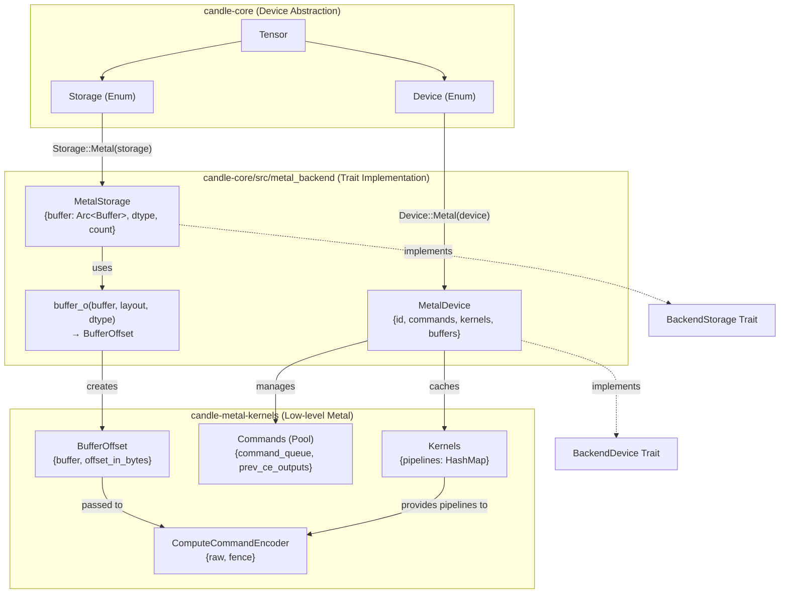
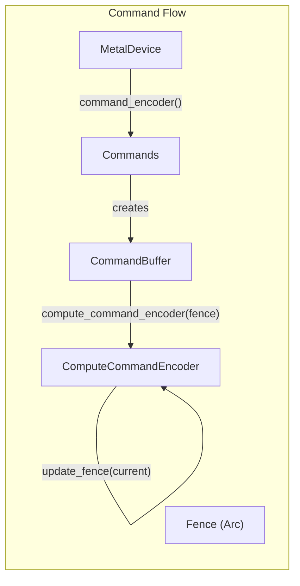

<!-- source: DeepWiki mcp.deepwiki.com · repo huggingface/candle · page 3.4 Metal Backend · fetched 2026-10-26 -->

# Metal Backend

Relevant source files

The following files were used as context for generating this wiki page:

- [candle-core/benches/benchmarks/binary.rs](candle-core/benches/benchmarks/binary.rs)
- [candle-core/benches/benchmarks/matmul.rs](candle-core/benches/benchmarks/matmul.rs)
- [candle-core/benches/benchmarks/qmatmul.rs](candle-core/benches/benchmarks/qmatmul.rs)
- [candle-core/benches/benchmarks/unary.rs](candle-core/benches/benchmarks/unary.rs)
- [candle-core/src/metal_backend/device.rs](candle-core/src/metal_backend/device.rs)
- [candle-core/src/metal_backend/mod.rs](candle-core/src/metal_backend/mod.rs)
- [candle-core/tests/metal_concurrent_tests.rs](candle-core/tests/metal_concurrent_tests.rs)
- [candle-metal-kernels/examples/metal_benchmarks.rs](candle-metal-kernels/examples/metal_benchmarks.rs)
- [candle-metal-kernels/src/err.rs](candle-metal-kernels/src/err.rs)
- [candle-metal-kernels/src/kernel.rs](candle-metal-kernels/src/kernel.rs)
- [candle-metal-kernels/src/kernels/affine.rs](candle-metal-kernels/src/kernels/affine.rs)
- [candle-metal-kernels/src/kernels/binary.rs](candle-metal-kernels/src/kernels/binary.rs)
- [candle-metal-kernels/src/kernels/cast.rs](candle-metal-kernels/src/kernels/cast.rs)
- [candle-metal-kernels/src/kernels/convolution.rs](candle-metal-kernels/src/kernels/convolution.rs)
- [candle-metal-kernels/src/kernels/macros.rs](candle-metal-kernels/src/kernels/macros.rs)
- [candle-metal-kernels/src/kernels/mlx_gemm.rs](candle-metal-kernels/src/kernels/mlx_gemm.rs)
- [candle-metal-kernels/src/kernels/reduce.rs](candle-metal-kernels/src/kernels/reduce.rs)
- [candle-metal-kernels/src/kernels/sdpa.rs](candle-metal-kernels/src/kernels/sdpa.rs)
- [candle-metal-kernels/src/kernels/sort.rs](candle-metal-kernels/src/kernels/sort.rs)
- [candle-metal-kernels/src/kernels/unary.rs](candle-metal-kernels/src/kernels/unary.rs)
- [candle-metal-kernels/src/lib.rs](candle-metal-kernels/src/lib.rs)
- [candle-metal-kernels/src/metal/buffer.rs](candle-metal-kernels/src/metal/buffer.rs)
- [candle-metal-kernels/src/metal/command_buffer.rs](candle-metal-kernels/src/metal/command_buffer.rs)
- [candle-metal-kernels/src/metal/commands.rs](candle-metal-kernels/src/metal/commands.rs)
- [candle-metal-kernels/src/metal/compute_pipeline.rs](candle-metal-kernels/src/metal/compute_pipeline.rs)
- [candle-metal-kernels/src/metal/device.rs](candle-metal-kernels/src/metal/device.rs)
- [candle-metal-kernels/src/metal/encoder.rs](candle-metal-kernels/src/metal/encoder.rs)
- [candle-metal-kernels/src/metal/library.rs](candle-metal-kernels/src/metal/library.rs)
- [candle-metal-kernels/src/metal_src/affine.metal](candle-metal-kernels/src/metal_src/affine.metal)
- [candle-metal-kernels/src/metal_src/binary.metal](candle-metal-kernels/src/metal_src/binary.metal)
- [candle-metal-kernels/src/metal_src/cast.metal](candle-metal-kernels/src/metal_src/cast.metal)
- [candle-metal-kernels/src/metal_src/conv.metal](candle-metal-kernels/src/metal_src/conv.metal)
- [candle-metal-kernels/src/metal_src/mlx_gemm.metal](candle-metal-kernels/src/metal_src/mlx_gemm.metal)
- [candle-metal-kernels/src/metal_src/reduce.metal](candle-metal-kernels/src/metal_src/reduce.metal)
- [candle-metal-kernels/src/metal_src/scaled_dot_product_attention.metal](candle-metal-kernels/src/metal_src/scaled_dot_product_attention.metal)
- [candle-metal-kernels/src/metal_src/unary.metal](candle-metal-kernels/src/metal_src/unary.metal)
- [candle-metal-kernels/src/tests.rs](candle-metal-kernels/src/tests.rs)
- [candle-metal-kernels/src/utils.rs](candle-metal-kernels/src/utils.rs)
- [candle-nn/benches/bench_main.rs](candle-nn/benches/bench_main.rs)
- [candle-nn/benches/benchmarks/mod.rs](candle-nn/benches/benchmarks/mod.rs)
- [candle-nn/benches/benchmarks/norm.rs](candle-nn/benches/benchmarks/norm.rs)
- [candle-nn/tests/sdpa.rs](candle-nn/tests/sdpa.rs)

## Purpose and Scope

The Metal backend provides GPU acceleration for Candle on Apple platforms (macOS, iOS) using Apple's Metal API. This backend implements the `BackendStorage` and `BackendDevice` traits defined in [candle-core/src/backend.rs:6-139]() to enable tensor operations on Apple Silicon and AMD GPUs.

The Metal backend is split across two main crates:
- **candle-core/src/metal_backend**: Implements `MetalStorage` and `MetalDevice` backend traits [candle-core/src/metal_backend/mod.rs:1-8]().
- **candle-metal-kernels**: Provides MSL (Metal Shading Language) compute kernels, kernel compilation, and low-level execution utilities [candle-metal-kernels/src/lib.rs:1-6]().

Key characteristics:
- **Unified Memory**: Uses `MTLResourceOptions::StorageModeShared` by default for zero-copy access between CPU and GPU [candle-metal-kernels/src/lib.rs:24-26]().
- **Private Storage**: Supports `StorageModePrivate` for intermediate buffers to avoid coherency overhead on macOS [candle-core/src/metal_backend/device.rs:77-83]().
- **Hazard Tracking**: Uses `HazardTrackingModeUntracked` combined with manual `Fence` synchronization to manage Read-After-Write (RAW) hazards [candle-metal-kernels/src/metal/commands.rs:170-185]().
- **Kernel Caching**: Lazy compilation and reuse of MSL pipelines via the `Kernels` struct [candle-metal-kernels/src/kernel.rs:65-68]().

Sources: [candle-core/src/metal_backend/mod.rs:1-87](), [candle-metal-kernels/src/lib.rs:1-49](), [candle-core/src/metal_backend/device.rs:32-83](), [candle-metal-kernels/src/metal/commands.rs:115-184]()

---

## Architecture Overview

**Diagram: Metal Backend Architecture and Code Entities**

The `MetalStorage` struct [candle-core/src/metal_backend/mod.rs:77-87]() holds the actual `Arc<Buffer>` containing the data. The `MetalDevice` [candle-core/src/metal_backend/device.rs:32-71]() manages the command queue and kernel cache. Operation dispatch typically involves calculating a `BufferOffset` [candle-core/src/metal_backend/mod.rs:23-28]() which encapsulates the Metal buffer and the starting byte offset determined by the tensor's `Layout`.

Sources: [candle-core/src/metal_backend/mod.rs:20-87](), [candle-core/src/metal_backend/device.rs:32-71](), [candle-metal-kernels/src/utils.rs:124-127]()

---

## Core Components

### MetalStorage and Buffer Management

`MetalStorage` represents tensor data in Metal memory. It is untyped at the Metal level but tracks `DType` for proper byte-offset calculations [candle-core/src/metal_backend/mod.rs:85-86]().

- **Buffer Pooling**: `MetalDevice` maintains a `BufferMap` to reuse buffers. When an `Arc<Buffer>` strong count reaches 1, it is considered unused and can be reclaimed [candle-core/src/metal_backend/device.rs:48-56]().
- **Residency Sets**: To minimize overhead, buffers are added to a `ResidencySet` which is registered with the command queue [candle-core/src/metal_backend/device.rs:69-70]().
- **Memory Modes**: 
    - `StorageModeShared`: Default for buffers that require CPU access (e.g., loading weights) [candle-metal-kernels/src/lib.rs:24-26]().
    - `StorageModePrivate`: Used for intermediate compute results on macOS to optimize GPU performance [candle-core/src/metal_backend/device.rs:77-83]().

Sources: [candle-core/src/metal_backend/mod.rs:77-87](), [candle-core/src/metal_backend/device.rs:43-83](), [candle-metal-kernels/src/lib.rs:24-26]()

### Command Dispatch and Synchronization

Candle uses a sophisticated command management system to handle the asynchronous nature of Metal.

**Diagram: Metal Synchronization and Encoder Flow**

- **Encoder Pooling**: The `Commands` struct [candle-metal-kernels/src/metal/commands.rs:115-126]() batches multiple compute encoders into a single command buffer to reduce submission overhead. The limit is controlled by `CANDLE_METAL_COMPUTE_PER_BUFFER` (default: 50) [candle-metal-kernels/src/metal/commands.rs:136-141]().
- **Hazard Management**: Since `HazardTrackingModeUntracked` is used, the system manually tracks the last encoder that wrote to a buffer using `prev_ce_outputs` [candle-metal-kernels/src/metal/commands.rs:125](). Before a new encoder executes, it calls `wait_for_fence` on any prior fences associated with its input buffers [candle-metal-kernels/src/metal/commands.rs:175-185]().

Sources: [candle-metal-kernels/src/metal/commands.rs:115-190](), [candle-metal-kernels/src/metal/command_buffer.rs:21-27]()

---

## MSL Kernels and Shaders

### Shader Patterns

MSL kernels are located in `candle-metal-kernels/src/metal_src/`. They are implemented using templates to support various `DType` variants.

- **Indexing**: The `indexer_t` and `strided_indexer` structs in MSL handle the conversion from a linear thread index to a multi-dimensional strided index [candle-metal-kernels/src/metal_src/reduce.metal:50-139]().
- **Linear Split**: The `linear_split` utility [candle-metal-kernels/src/utils.rs:30-46]() calculates the grid size. It typically uses the maximum threads per threadgroup allowed by the pipeline and divides the total element count accordingly.
- **Tiling**: For data types like `f32`, `f16`, or `u8`, kernels often use tiling (processing multiple elements per thread) to maximize memory bandwidth [candle-metal-kernels/src/utils.rs:89-91]().

### Key Operations

| Operation | Implementation Strategy | MSL File |
| :--- | :--- | :--- |
| **Unary/Binary** | Contiguous and Strided variants | `unary.metal`, `binary.metal` |
| **Reduction** | Tree-based reduction using `simd_shuffle_down` | `reduce.metal` |
| **Convolution** | `im2col` transformation followed by GEMM | `conv.metal` |
| **SDPA** | Flash-attention style tiled kernels for Query/Key/Value | `scaled_dot_product_attention.metal` |
| **GEMM** | Integration with optimized MLX GEMM kernels | `mlx_gemm.metal` |

Sources: [candle-metal-kernels/src/metal_src/reduce.metal:50-139](), [candle-metal-kernels/src/utils.rs:30-91](), [candle-metal-kernels/src/lib.rs:10-14]()

---

## Custom Operations

The Metal backend supports user-defined operations via the `CustomOp1`, `CustomOp2`, and `CustomOp3` traits [candle-core/src/custom_op.rs:7-152]().

To implement a custom Metal operation:
1. Implement the `metal_fwd` method in your custom op struct [candle-core/src/custom_op.rs:25-33]().
2. Access the underlying Metal resources via the `MetalStorage` argument.
3. Use the `MetalDevice` to get a `command_encoder()` [candle-core/src/metal_backend/device.rs:157-160]().
4. Dispatch your custom MSL kernel.

If the `ug` feature is enabled, `MetalDevice` can also compile kernels from a `candle_ug` SSA representation at runtime [candle-core/src/metal_backend/device.rs:100-121]().

Sources: [candle-core/src/custom_op.rs:7-152](), [candle-core/src/metal_backend/device.rs:100-160]()

---

## Performance and Optimization

### Device Classification
The backend identifies Apple Silicon generations (Phone, BasePro, Max, Ultra) by parsing the Metal architecture name [candle-metal-kernels/src/metal/device.rs:18-30](). This allows for future device-specific tuning of threadgroup sizes and tiling factors.

### SDPA (Scaled Dot Product Attention)
The Metal backend provides a specialized SDPA kernel via `call_sdpa_full` [candle-metal-kernels/src/kernels/sdpa.rs:22-45](). It supports:
- **Vector Kernel**: Optimized for `q_seq = 1` (inference/decoding) [candle-nn/tests/sdpa.rs:52-79]().
- **Full Kernel**: Optimized for `q_seq > 8` (training/prefill) [candle-nn/tests/sdpa.rs:21-49]().
- **Softcapping**: Supported in the vector kernel path for models like Gemma 2 [candle-nn/tests/sdpa.rs:122-156]().
- **Head Size Support**: Supports head dimensions [32, 64, 72, 80, 96, 128, 256, 512] [candle-metal-kernels/src/kernels/sdpa.rs:77-83]().

Sources: [candle-metal-kernels/src/metal/device.rs:18-30](), [candle-nn/tests/sdpa.rs:21-156](), [candle-metal-kernels/src/kernels/sdpa.rs:77-83]()

---

