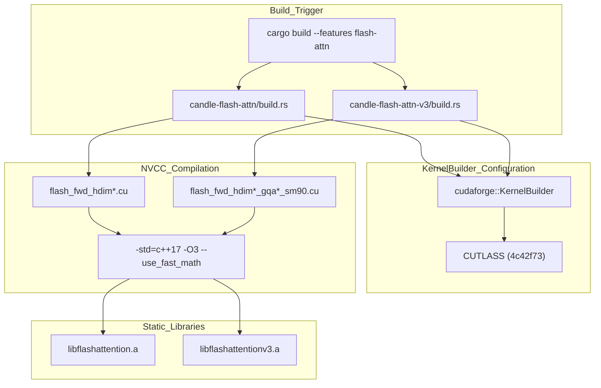
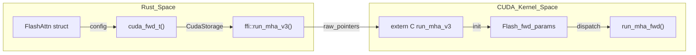

<!-- source: DeepWiki mcp.deepwiki.com · repo huggingface/candle · page 3.5 Flash Attention Acceleration · fetched 2026-10-26 -->

# Flash Attention Acceleration

Relevant source files

The following files were used as context for generating this wiki page:

- [candle-core/tests/metal_concurrent_tests.rs](candle-core/tests/metal_concurrent_tests.rs)
- [candle-flash-attn-v3/build.rs](candle-flash-attn-v3/build.rs)
- [candle-flash-attn-v3/hkernel/flash_api.cu](candle-flash-attn-v3/hkernel/flash_api.cu)
- [candle-flash-attn-v3/src/ffi.rs](candle-flash-attn-v3/src/ffi.rs)
- [candle-flash-attn-v3/src/lib.rs](candle-flash-attn-v3/src/lib.rs)
- [candle-flash-attn/kernels/flash.h](candle-flash-attn/kernels/flash.h)
- [candle-flash-attn/kernels/flash_api.cu](candle-flash-attn/kernels/flash_api.cu)
- [candle-flash-attn/kernels/flash_fwd_hdim32_fp16_sm80.cu](candle-flash-attn/kernels/flash_fwd_hdim32_fp16_sm80.cu)
- [candle-flash-attn/kernels/flash_fwd_kernel.h](candle-flash-attn/kernels/flash_fwd_kernel.h)
- [candle-flash-attn/kernels/mask.h](candle-flash-attn/kernels/mask.h)
- [candle-flash-attn/src/ffi.rs](candle-flash-attn/src/ffi.rs)
- [candle-flash-attn/src/lib.rs](candle-flash-attn/src/lib.rs)
- [candle-flash-attn/tests/flash_attn_tests.rs](candle-flash-attn/tests/flash_attn_tests.rs)
- [candle-metal-kernels/examples/metal_benchmarks.rs](candle-metal-kernels/examples/metal_benchmarks.rs)
- [candle-metal-kernels/src/kernels/sdpa.rs](candle-metal-kernels/src/kernels/sdpa.rs)
- [candle-metal-kernels/src/kernels/sort.rs](candle-metal-kernels/src/kernels/sort.rs)
- [candle-metal-kernels/src/metal/buffer.rs](candle-metal-kernels/src/metal/buffer.rs)
- [candle-metal-kernels/src/metal/command_buffer.rs](candle-metal-kernels/src/metal/command_buffer.rs)
- [candle-metal-kernels/src/metal/commands.rs](candle-metal-kernels/src/metal/commands.rs)
- [candle-metal-kernels/src/metal/encoder.rs](candle-metal-kernels/src/metal/encoder.rs)
- [candle-metal-kernels/src/metal_src/scaled_dot_product_attention.metal](candle-metal-kernels/src/metal_src/scaled_dot_product_attention.metal)
- [candle-nn/tests/sdpa.rs](candle-nn/tests/sdpa.rs)

Flash Attention is a high-performance attention kernel implementation that provides significant memory and speed improvements for transformer models by reducing memory wall bottlenecks. Candle integrates Flash Attention through specialized crates that compile optimized CUDA kernels using the CUTLASS library and provides a high-performance Metal implementation for Apple Silicon.

## Overview

Candle supports multiple Flash Attention implementations tailored to specific hardware:

*   **candle-flash-attn**: Flash Attention v1/v2 for NVIDIA Ampere (SM80) and Ada Lovelace (SM89) architectures.
*   **candle-flash-attn-v3**: Flash Attention v3 for NVIDIA Hopper (SM90) architectures, featuring enhanced Grouped Query Attention (GQA) support.
*   **Metal SDPA**: A specialized Scaled Dot Product Attention kernel for Apple Silicon, integrated directly into the Metal backend.

Both CUDA implementations are separate crates excluded from the main workspace and compiled only when the `flash-attn` feature flag is enabled.

Sources: [candle-flash-attn/src/lib.rs:8-14](), [candle-flash-attn-v3/src/lib.rs:21-27]()

## Flash Attention Variants

### Flash Attention v1/v2 (CUDA)
The v1/v2 implementation targets compute capability 80+ devices. It supports standard and causal attention across various head dimensions (up to 512) and data types (F16, BF16). It includes support for Alibi slopes and windowed attention. The kernel expects input tensors of rank 4 and requires the last dimension to be contiguous.

Sources: [candle-flash-attn/src/lib.rs:8-14](), [candle-flash-attn/src/lib.rs:55-68](), [candle-flash-attn/src/lib.rs:79-81]()

### Flash Attention v3 (CUDA)
Targeting Hopper (SM90) architecture, v3 introduces specialized GQA packing kernels. It supports head dimensions of 64, 128, 256, and 512. The build process explicitly enforces SM90+ requirements. It uses a different set of kernels specifically optimized for the Hopper architecture's Tensor Cores, utilizing CUTLASS for collective operations.

Sources: [candle-flash-attn-v3/src/lib.rs:21-27](), [candle-flash-attn-v3/src/lib.rs:90-99](), [candle-flash-attn-v3/build.rs:163-164]()

### Metal SDPA
The Metal backend implements Scaled Dot Product Attention (SDPA) using two distinct kernel paths:
1.  **Vector Kernel**: Optimized for `q_seqlen == 1` (common in autoregressive decoding). This path supports softcapping.
2.  **Full Kernel**: A tiled implementation ("Steel Attention") for larger sequences, supporting head dimensions up to 512. It uses `bq` (query tile) and `bk` (key tile) dimensions to process the attention matrix in blocks.

Sources: [candle-metal-kernels/src/kernels/sdpa.rs:22-45](), [candle-metal-kernels/src/kernels/sdpa.rs:86-98](), [candle-nn/tests/sdpa.rs:21-49](), [candle-nn/tests/sdpa.rs:82-86]()

## Build System and CUTLASS Integration

The CUDA implementations use the `cudaforge` crate to orchestrate compilation. A key feature is the automatic fetching of the CUTLASS library from GitHub during the build process to provide the necessary primitives for efficient matrix multiplications and collective operations.

### Compilation Data Flow

Title: Flash Attention CUDA Compilation Pipeline

Sources: [candle-flash-attn-v3/build.rs:132-157](), [candle-flash-attn-v3/build.rs:96-96](), [candle-flash-attn-v3/build.rs:19-94]()

## Implementation Details

### Host-Device Interface (FFI)
The Rust wrapper interacts with the CUDA kernels via an `extern "C"` function `run_mha` (v1/v2) or `run_mha_v3` (v3). This function accepts raw device pointers to Query, Key, Value, and Output buffers, along with strides and attention metadata. On the C++ side, these are packed into a `Flash_fwd_params` struct.

Title: Flash Attention FFI Mapping

Sources: [candle-flash-attn/src/ffi.rs:4-61](), [candle-flash-attn-v3/src/ffi.rs:13-65](), [candle-flash-attn/kernels/flash_api.cu:28-85](), [candle-flash-attn/src/lib.rs:169-175]()

### Parameter Handling
The `FlashAttn` struct manages high-level attention configuration:
*   `softmax_scale`: Scaling factor for the dot product.
*   `alibi_slopes`: Optional tensor for ALiBi positional embeddings.
*   `window_size_left`/`right`: Constraints for local/sliding window attention.
*   `softcap`: Logit soft-capping value (v1/v2).
*   `use_gqa_packing`: Flag to enable optimized GQA kernels (v3).

Sources: [candle-flash-attn/src/lib.rs:8-14](), [candle-flash-attn-v3/src/lib.rs:21-27]()

### Metal SDPA Implementation
The Metal SDPA implementation (`call_sdpa_full`) uses a tiled approach. It dynamically selects tile sizes (`bq`, `bk`) and threadgroup counts based on the head dimension (`bd`). 

*   For `bd == 512`, it uses reduced tiles (8x8) to fit within the 32KB threadgroup memory limit of Apple Silicon and is restricted to F16/BF16.
*   Lower head dimensions use larger tiles (e.g., `bq=32`, `bk=32` for `bd < 128`).
*   The implementation uses `MTLDispatchType::Concurrent` via the `CommandBuffer` to maximize GPU utilization.

Sources: [candle-metal-kernels/src/kernels/sdpa.rs:86-98](), [candle-metal-kernels/src/kernels/sdpa.rs:77-83](), [candle-metal-kernels/src/metal/commands.rs:170-187](), [candle-metal-kernels/src/metal_src/scaled_dot_product_attention.metal:1-10]()

## Usage in Transformer Models

Flash Attention is integrated into model forward passes to replace standard attention when compatible hardware and features are available.

### Integration Requirements
*   **Rank**: Tensors must be rank 4 (Batch, SeqLen, Heads, HeadDim).
*   **Contiguity**: The last dimension (HeadDim) must be contiguous (stride 1).
*   **Alignment**: Head dimensions must be multiples of 8.
*   **GQA**: For Flash v3, the number of Q heads must be a multiple of KV heads. Packing is supported for ratios of 2, 4, 8, 16, and 32.

Sources: [candle-flash-attn/src/lib.rs:55-68](), [candle-flash-attn/src/lib.rs:82-85](), [candle-flash-attn-v3/src/lib.rs:102-108]()

### Testing and Validation
Correctness is verified by comparing Flash Attention output against a "ground truth" implementation. The ground truth typically uses `matmul` and `softmax` on F32 data to minimize accumulation errors.

Sources: [candle-nn/tests/sdpa.rs:35-41](), [candle-nn/tests/sdpa.rs:100-108]()

## Summary of Capabilities

| Feature | Flash v1/v2 (CUDA) | Flash v3 (CUDA) | Metal SDPA |
| :--- | :--- | :--- | :--- |
| **Architecture** | Ampere/Ada (SM80+) | Hopper (SM90) | Apple Silicon |
| **Data Types** | F16, BF16 | F16, BF16 | F16, BF16, F32 |
| **Max Head Dim** | 512 | 512 | 512 |
| **GQA Support** | Standard | Optimized Packing | Vector/Tiled |
| **Soft-capping** | Yes | No | Vector path only |
| **ALiBi** | Yes | Yes | No |

Sources: [candle-flash-attn/src/lib.rs:79-81](), [candle-flash-attn-v3/src/lib.rs:90-99](), [candle-metal-kernels/src/kernels/sdpa.rs:77-83](), [candle-nn/tests/sdpa.rs:82-86]()

---

