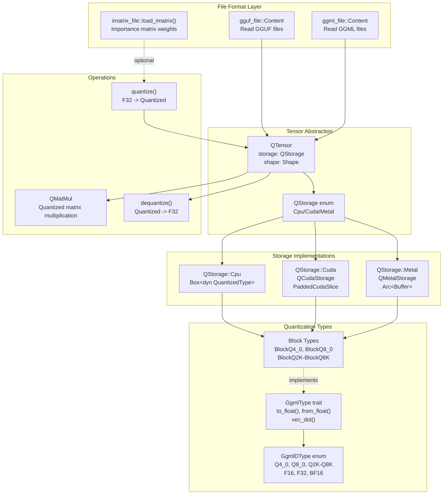
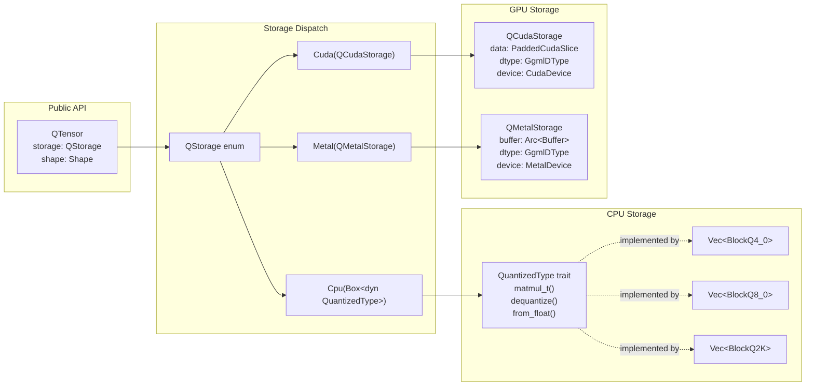
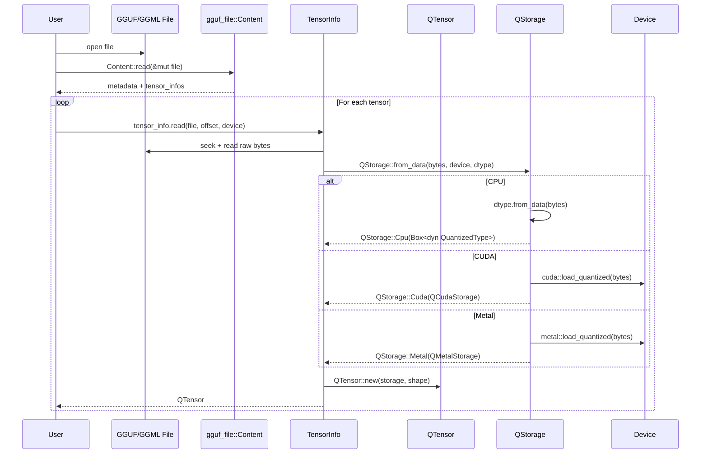
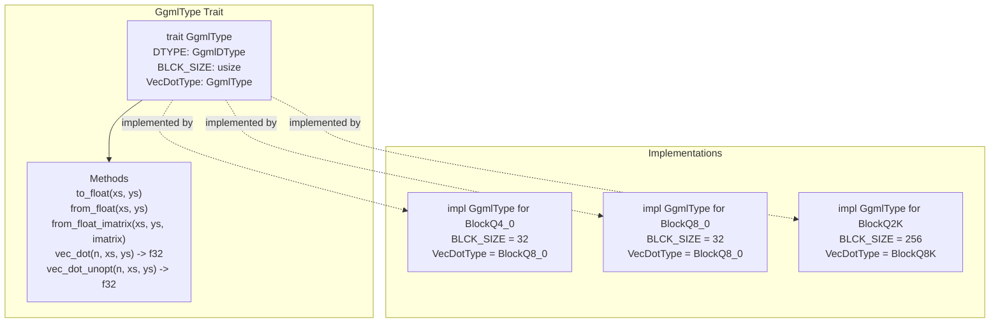

<!-- source: DeepWiki mcp.deepwiki.com · repo huggingface/candle · page 4 Quantization System · fetched 2026-10-26 -->

# Quantization System

Relevant source files

The following files were used as context for generating this wiki page:

- [candle-core/src/cuda_backend/cudnn.rs](candle-core/src/cuda_backend/cudnn.rs)
- [candle-core/src/cuda_backend/device.rs](candle-core/src/cuda_backend/device.rs)
- [candle-core/src/cuda_backend/mod.rs](candle-core/src/cuda_backend/mod.rs)
- [candle-core/src/quantized/avx.rs](candle-core/src/quantized/avx.rs)
- [candle-core/src/quantized/cuda.rs](candle-core/src/quantized/cuda.rs)
- [candle-core/src/quantized/dummy_cuda.rs](candle-core/src/quantized/dummy_cuda.rs)
- [candle-core/src/quantized/dummy_metal.rs](candle-core/src/quantized/dummy_metal.rs)
- [candle-core/src/quantized/ggml_file.rs](candle-core/src/quantized/ggml_file.rs)
- [candle-core/src/quantized/gguf_file.rs](candle-core/src/quantized/gguf_file.rs)
- [candle-core/src/quantized/k_quants.rs](candle-core/src/quantized/k_quants.rs)
- [candle-core/src/quantized/metal.rs](candle-core/src/quantized/metal.rs)
- [candle-core/src/quantized/mod.rs](candle-core/src/quantized/mod.rs)
- [candle-core/src/quantized/neon.rs](candle-core/src/quantized/neon.rs)
- [candle-core/src/quantized/simd128.rs](candle-core/src/quantized/simd128.rs)
- [candle-core/src/quantized/utils.rs](candle-core/src/quantized/utils.rs)
- [candle-core/src/utils.rs](candle-core/src/utils.rs)
- [candle-core/tests/gguf_tests.rs](candle-core/tests/gguf_tests.rs)
- [candle-core/tests/quantized_tests.rs](candle-core/tests/quantized_tests.rs)
- [candle-kernels/src/quantized.cu](candle-kernels/src/quantized.cu)
- [candle-metal-kernels/src/kernels/mod.rs](candle-metal-kernels/src/kernels/mod.rs)
- [candle-metal-kernels/src/kernels/quantized.rs](candle-metal-kernels/src/kernels/quantized.rs)
- [candle-nn/examples/cpu_benchmarks.rs](candle-nn/examples/cpu_benchmarks.rs)
- [candle-wasm-tests/tests/quantized_tests.rs](candle-wasm-tests/tests/quantized_tests.rs)

The quantization system in Candle enables memory-efficient model inference by storing weights in reduced-precision formats (2-8 bits per weight) while performing computations in higher precision. This reduces memory usage by 4-16x compared to float32 models with minimal accuracy loss. The system supports loading quantized models from GGUF and GGML file formats and provides device-specific optimizations for CPU (SIMD), CUDA, and Metal backends.

For model implementations using quantization, see [Using Quantized Models](#4.3). For the format specifications and quantization type details, see [Quantization Formats and Types](#4.1). For the optimized operations, see [Quantized Operations](#4.2).

## Architecture Overview

The quantization system consists of four main layers: file format loaders, storage abstraction, quantization types, and device-specific operations.

**Sources:** [candle-core/src/quantized/mod.rs:59-91](), [candle-core/src/quantized/k_quants.rs:22-75](), [candle-core/src/quantized/gguf_file.rs:81-128]()

## QTensor and QStorage System

The `QTensor` type is the primary abstraction for quantized tensors, wrapping a `QStorage` enum that dispatches to device-specific implementations.

### QTensor Structure

**Sources:** [candle-core/src/quantized/mod.rs:59-91](), [candle-core/src/quantized/cuda.rs:16-20](), [candle-core/src/quantized/metal.rs:7-11]()

### QStorage Operations

The `QStorage` enum provides the following key operations:

| Operation | Purpose | CPU | CUDA | Metal |
|-----------|---------|-----|------|-------|
| `from_data()` | Load from raw bytes | ✓ | ✓ | ✓ |
| `quantize()` | Convert F32 tensor to quantized | ✓ | ✓ | ✓ |
| `quantize_imatrix()` | Quantize with importance matrix | ✓ | ✓ | ✓ |
| `dequantize()` | Convert quantized to F32 | ✓ | ✓ | ✓ |
| `size_in_bytes()` | Get raw storage size | ✓ | ✓ | ✓ |
| `device()` | Get associated Device | ✓ | ✓ | ✓ |

**Sources:** [candle-core/src/quantized/mod.rs:93-171]()

### Creating QTensor from Files

**Sources:** [candle-core/src/quantized/gguf_file.rs:88-128](), [candle-core/src/quantized/mod.rs:94-133]()

## Block Quantization Types

Block-based quantization divides tensors into fixed-size blocks, with each block storing quantized values and a scaling factor. Candle implements various formats including standard `Q4_0`, `Q8_0` and the more complex "K-Quants" (`Q2K` through `Q6K`).

### Block Structure Overview

| Type | Block Size | Components | Size (Bytes) |
|------|------------|------------|--------------|
| `BlockQ4_0` | 32 | `d: f16`, `qs: [u8; 16]` | 18 |
| `BlockQ4_1` | 32 | `d: f16`, `m: f16`, `qs: [u8; 16]` | 20 |
| `BlockQ8_0` | 32 | `d: f16`, `qs: [i8; 32]` | 34 |
| `BlockQ2K` | 256 | `scales: [u8; 16]`, `qs: [u8; 64]`, `d: f16`, `dmin: f16` | 84 |
| `BlockQ6K` | 256 | `ql: [u8; 128]`, `qh: [u8; 64]`, `scales: [i8; 16]`, `d: f16` | 210 |
| `BlockQ8K` | 256 | `d: f32`, `qs: [i8; 256]`, `bsums: [i16; 16]` | 292 |

**Sources:** [candle-core/src/quantized/k_quants.rs:79-190]()

### GgmlType Trait

The `GgmlType` trait defines the interface for all quantization block types:

**Sources:** [candle-core/src/quantized/k_quants.rs:22-75]()

## Optimized Operations

### CPU (SIMD)
Candle provides handwritten SIMD implementations for major architectures:
- **AVX2**: Optimized `vec_dot` routines for x86_64 using instructions like `_mm256_maddubs_epi16`. [candle-core/src/quantized/avx.rs:50-87]()
- **NEON**: Optimized `vec_dot` routines for ARM Aarch64, utilizing `sdot` instructions where available. [candle-core/src/quantized/neon.rs:125-197]()
- **SIMD128**: Optimized `vec_dot` routines for WebAssembly. [candle-core/src/quantized/mod.rs:37]()

### CUDA Fast Paths
For CUDA, Candle includes high-performance kernels for GGUF tiled matrix multiplication:
- **fast_mmvq**: Optimized for small batch sizes (typically 1-8). [candle-core/src/quantized/mod.rs:28]()
- **fast_mmq**: Optimized for larger batch sizes (> 8). [candle-core/src/quantized/mod.rs:26]()
- **DMMV/MMQ**: Standard GGML-style kernels for various compute capabilities (Pascal, Ampere, etc.). [candle-core/src/quantized/cuda.rs:30-34](), [candle-kernels/src/quantized.cu:97-225]()

### Metal Kernels
The Metal backend supports dequantization and matrix-vector products directly in MSL shaders, with a fallback to CPU dequantization for certain paths. [candle-core/src/quantized/metal.rs:40-132]()

## Using Quantized Models

Quantized models are typically loaded using the `quantized_var_builder` which handles GGUF/GGML file parsing and mapping weights to `QTensor` objects. The `QMatMul` struct provides a high-level `Module` implementation for quantized linear layers.

For details on format specifications, see [Quantization Formats and Types](#4.1).
For operation details, see [Quantized Operations](#4.2).
For loading examples (LLaMA, Mistral, etc.), see [Using Quantized Models](#4.3).

**Sources:** [candle-core/src/quantized/gguf_file.rs:1-128](), [candle-core/src/quantized/mod.rs:11-14](), [candle-core/tests/quantized_tests.rs:19-54]()

---

