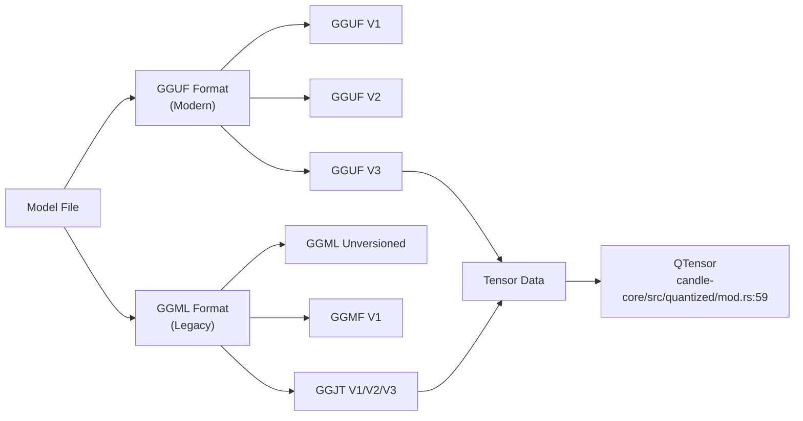
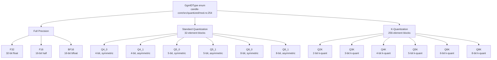
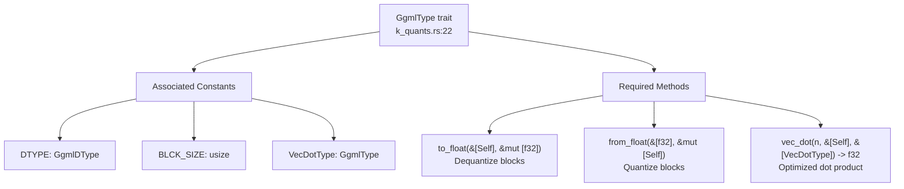
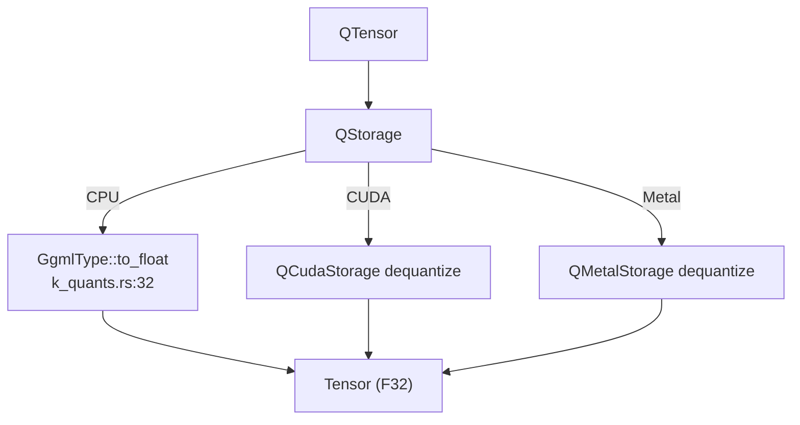

<!-- source: DeepWiki mcp.deepwiki.com · repo huggingface/candle · page 4.1 Quantization Formats and Types · fetched 2026-10-26 -->

# Quantization Formats and Types

<details>
<summary>Relevant source files</summary>

The following files were used as context for generating this wiki page:

- [candle-core/src/quantized/avx.rs](candle-core/src/quantized/avx.rs)
- [candle-core/src/quantized/ggml_file.rs](candle-core/src/quantized/ggml_file.rs)
- [candle-core/src/quantized/gguf_file.rs](candle-core/src/quantized/gguf_file.rs)
- [candle-core/src/quantized/k_quants.rs](candle-core/src/quantized/k_quants.rs)
- [candle-core/src/quantized/mod.rs](candle-core/src/quantized/mod.rs)
- [candle-core/src/quantized/neon.rs](candle-core/src/quantized/neon.rs)
- [candle-core/src/quantized/simd128.rs](candle-core/src/quantized/simd128.rs)
- [candle-core/src/quantized/tokenizer.rs](candle-core/src/quantized/tokenizer.rs)
- [candle-core/src/quantized/utils.rs](candle-core/src/quantized/utils.rs)
- [candle-core/src/utils.rs](candle-core/src/utils.rs)
- [candle-core/tests/gguf_tests.rs](candle-core/tests/gguf_tests.rs)
- [candle-core/tests/quantized_tests.rs](candle-core/tests/quantized_tests.rs)
- [candle-examples/examples/gguf-tokenizer.rs](candle-examples/examples/gguf-tokenizer.rs)
- [candle-nn/examples/cpu_benchmarks.rs](candle-nn/examples/cpu_benchmarks.rs)
- [candle-wasm-tests/tests/quantized_tests.rs](candle-wasm-tests/tests/quantized_tests.rs)

</details>


## Purpose and Scope

This document describes the quantization formats and data types supported by Candle for memory-efficient model storage and inference. It covers the `GgmlDType` enumeration, block-based quantization structures (e.g., `BlockQ4_0`, `BlockQ6K`), and the GGUF/GGML file formats. For details on quantized matrix multiplication and SIMD optimizations, see [Quantized Operations](4.2).

---

## Overview of Quantization in Candle

Candle implements quantization based on the GGML library standards, supporting both the legacy GGML format and the modern GGUF (GGML Unified Format). Quantization reduces model memory footprint by representing weights with fewer bits per parameter (typically 2 to 8 bits) while maintaining acceptable accuracy through block-based scaling.

### Supported File Formats



**GGUF Format** ([candle-core/src/quantized/gguf_file.rs:1-90]()): The modern unified format includes extensible metadata, tensor information, and binary tensor data with configurable alignment (default 32 bytes [candle-core/src/quantized/gguf_file.rs:10]()). It supports versioning via `VersionedMagic` ([candle-core/src/quantized/gguf_file.rs:52-78]()).

**GGML Format** ([candle-core/src/quantized/ggml_file.rs:1-66]()): The legacy format supports multiple magic numbers (GGJT, GGLA, GGMF, GGML, GGSN) with varying alignment requirements ([candle-core/src/quantized/ggml_file.rs:9-31]()).

**Sources**: [candle-core/src/quantized/gguf_file.rs:1-90](), [candle-core/src/quantized/ggml_file.rs:1-66](), [candle-core/src/quantized/mod.rs:59-66]()

---

## The GgmlDType Enumeration

The `GgmlDType` enum defines all supported quantization types in Candle:



The enumeration provides methods for metadata retrieval and storage allocation.

| Method | Purpose | Location |
|--------|---------|----------|
| `block_size(&self)` | Elements per quantization block | [candle-core/src/quantized/mod.rs:135-141]() |
| `type_size(&self)` | Bytes per quantization block | [candle-core/src/quantized/gguf_file.rs:101]() |
| `qzeros(&self, n, dtype)` | Allocate zero-initialized storage | [candle-core/src/quantized/mod.rs:69-85]() |

**Sources**: [candle-core/src/quantized/mod.rs:69-141](), [candle-core/src/quantized/gguf_file.rs:94-101]()

---

## Block-Based Quantization Structures

Quantization in Candle operates on fixed-size blocks of elements. Each block contains compressed values and metadata (scales/offsets) required for dequantization.

### Block Size Constants

Defined in [candle-core/src/quantized/k_quants.rs:12-21]():

| Constant | Value | Used By |
|----------|-------|---------|
| `QK_K` | 256 | K-Quants (Q2K, Q3K, Q4K, Q5K, Q6K, Q8K) |
| `QK4_0`, `QK4_1` | 32 | Standard 4-bit types |
| `QK8_0`, `QK8_1` | 32 | Standard 8-bit types |

### Standard Quantization Types (32-element blocks)

These types use simple scaling schemes. For example, `BlockQ4_0` ([candle-core/src/quantized/k_quants.rs:79-82]()) uses a single `f16` scale and 16 bytes for 32 nibbles. `BlockQ4_1` ([candle-core/src/quantized/k_quants.rs:87-91]()) adds an `f16` minimum value for asymmetric quantization.

```rust
pub struct BlockQ4_0 {
    pub(crate) d: f16,           // scale
    pub(crate) qs: [u8; QK4_0 / 2], // 32 nibbles
}

pub struct BlockQ8_0 {
    pub(crate) d: f16,           // scale
    pub(crate) qs: [i8; QK8_0],  // 32 signed bytes
}
```

### K-Quantization Types (256-element blocks)

K-quants use "super-blocks" of 256 elements, further divided into smaller groups with their own scales.

**Q6K Structure** ([candle-core/src/quantized/k_quants.rs:175-180]()):
- `ql: [u8; 128]` - 256 low 4-bit nibbles.
- `qh: [u8; 64]` - 256 high 2-bit values.
- `scales: [i8; 16]` - 16 scales (one for every 16 elements).
- `d: f16` - Global scale for the super-block.

**Q2K Structure** ([candle-core/src/quantized/k_quants.rs:132-137]()):
- `scales: [u8; 16]` - Packed scales and mins.
- `qs: [u8; 64]` - 256 2-bit values.
- `d: f16`, `dmin: f16` - Global super-block scale and minimum.

**Sources**: [candle-core/src/quantized/k_quants.rs:12-190]()

---

## The GgmlType Trait

The `GgmlType` trait ([candle-core/src/quantized/k_quants.rs:22-75]()) is the core abstraction for quantized data types. It defines how blocks are converted to/from floats and how dot products are computed.



Standard implementations like `BlockQ4_0` provide optimized `vec_dot` implementations for different architectures, such as AVX ([candle-core/src/quantized/avx.rs:50]()), NEON ([candle-core/src/quantized/neon.rs:125]()), and SIMD128 ([candle-core/src/quantized/simd128.rs:8]()).

**Sources**: [candle-core/src/quantized/k_quants.rs:22-75](), [candle-core/src/quantized/avx.rs:50-68](), [candle-core/src/quantized/neon.rs:125-164](), [candle-core/src/quantized/simd128.rs:8-51]()

---

## Importance Matrices (imatrix)

Importance matrices (`imatrix`) allow for non-uniform quantization where certain channels or weights are prioritized based on their contribution to the model's output variance or activation magnitude.

### IMatrix File Format
The `imatrix` file format ([candle-core/src/quantized/imatrix_file.rs:1-13]()) stores importance weights calculated during a calibration phase. These weights are applied during quantization via the `from_float_imatrix` method ([candle-core/src/quantized/k_quants.rs:34-44]()).

### Application in Quantization
Quantization logic in `utils.rs` ([candle-core/src/quantized/utils.rs:62-187]()) implements RMSE-based optimization using weights (`qw`) to minimize quantization error. The `make_qx_quants` function performs iterative refinement of scales and quantized values to achieve better fidelity.

**Sources**: [candle-core/src/quantized/imatrix_file.rs:1-13](), [candle-core/src/quantized/k_quants.rs:34-44](), [candle-core/src/quantized/utils.rs:62-187]()

---

## Device-Specific Storage

Quantized data is stored in a `QStorage` enum ([candle-core/src/quantized/mod.rs:87-91]()), which abstracts away the physical location of the quantized blocks.

- **CPU**: `Box<dyn QuantizedType>` stores the raw block structures in system memory.
- **CUDA**: `QCudaStorage` uses GPU memory and supports loading via `cuda::load_quantized` ([candle-core/src/quantized/mod.rs:115-131]()).
- **Metal**: `QMetalStorage` manages blocks in Metal buffers via `metal::load_quantized` ([candle-core/src/quantized/mod.rs:98-114]()).

### Dequantization Flow

When a quantized tensor needs to be converted back to a standard `Tensor`, the storage dispatches to device-specific dequantization:



**Sources**: [candle-core/src/quantized/mod.rs:87-133](), [candle-core/src/quantized/k_quants.rs:32-33]()

---

## Summary of Quantization Types

| Type | Bits/Weight | Block Size | Structure | Use Case |
| :--- | :--- | :--- | :--- | :--- |
| **Q4_0** | 4.5 | 32 | `BlockQ4_0` | Standard fast 4-bit inference |
| **Q8_0** | 8.5 | 32 | `BlockQ8_0` | High precision, used for activations |
| **Q2K** | 2.56 | 256 | `BlockQ2K` | Extreme compression |
| **Q4K** | 4.5 | 256 | `BlockQ4K` | Balanced quality/speed K-quant |
| **Q6K** | 6.56 | 256 | `BlockQ6K` | Near-lossless compression |

**Sources**: [candle-core/src/quantized/k_quants.rs:79-190](), [candle-core/src/quantized/mod.rs:101-112]()

---

