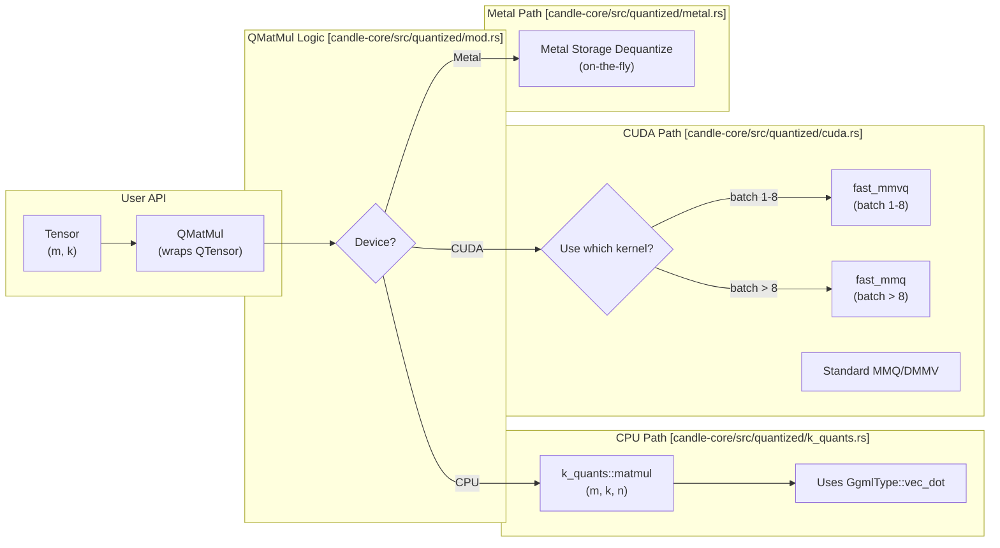

<!-- source: DeepWiki mcp.deepwiki.com · repo huggingface/candle · page 4.2 Quantized Operations · fetched 2026-10-26 -->

# Quantized Operations

Relevant source files

The following files were used as context for generating this wiki page:

- [candle-core/src/cuda_backend/cudnn.rs](candle-core/src/cuda_backend/cudnn.rs)
- [candle-core/src/cuda_backend/device.rs](candle-core/src/cuda_backend/device.rs)
- [candle-core/src/cuda_backend/mod.rs](candle-core/src/cuda_backend/mod.rs)
- [candle-core/src/quantized/avx.rs](candle-core/src/quantized/avx.rs)
- [candle-core/src/quantized/cuda.rs](candle-core/src/quantized/cuda.rs)
- [candle-core/src/quantized/dummy_cuda.rs](candle-core/src/quantized/dummy_cuda.rs)
- [candle-core/src/quantized/dummy_metal.rs](candle-core/src/quantized/dummy_metal.rs)
- [candle-core/src/quantized/fast_mmq.rs](candle-core/src/quantized/fast_mmq.rs)
- [candle-core/src/quantized/fast_mmvq.rs](candle-core/src/quantized/fast_mmvq.rs)
- [candle-core/src/quantized/ggml_file.rs](candle-core/src/quantized/ggml_file.rs)
- [candle-core/src/quantized/gguf_file.rs](candle-core/src/quantized/gguf_file.rs)
- [candle-core/src/quantized/k_quants.rs](candle-core/src/quantized/k_quants.rs)
- [candle-core/src/quantized/metal.rs](candle-core/src/quantized/metal.rs)
- [candle-core/src/quantized/mod.rs](candle-core/src/quantized/mod.rs)
- [candle-core/src/quantized/neon.rs](candle-core/src/quantized/neon.rs)
- [candle-core/src/quantized/simd128.rs](candle-core/src/quantized/simd128.rs)
- [candle-core/src/quantized/utils.rs](candle-core/src/quantized/utils.rs)
- [candle-core/src/utils.rs](candle-core/src/utils.rs)
- [candle-core/tests/gguf_tests.rs](candle-core/tests/gguf_tests.rs)
- [candle-core/tests/quantized_tests.rs](candle-core/tests/quantized_tests.rs)
- [candle-examples/examples/gemma4/main.rs](candle-examples/examples/gemma4/main.rs)
- [candle-kernels/src/ffi.rs](candle-kernels/src/ffi.rs)
- [candle-kernels/src/mmvq_gguf.cu](candle-kernels/src/mmvq_gguf.cu)
- [candle-kernels/src/quantized.cu](candle-kernels/src/quantized.cu)
- [candle-metal-kernels/src/kernels/mod.rs](candle-metal-kernels/src/kernels/mod.rs)
- [candle-metal-kernels/src/kernels/quantized.rs](candle-metal-kernels/src/kernels/quantized.rs)
- [candle-nn/examples/cpu_benchmarks.rs](candle-nn/examples/cpu_benchmarks.rs)
- [candle-transformers/src/models/gemma4/audio.rs](candle-transformers/src/models/gemma4/audio.rs)
- [candle-transformers/src/models/gemma4/config.rs](candle-transformers/src/models/gemma4/config.rs)
- [candle-transformers/src/models/gemma4/mod.rs](candle-transformers/src/models/gemma4/mod.rs)
- [candle-transformers/src/models/gemma4/text.rs](candle-transformers/src/models/gemma4/text.rs)
- [candle-transformers/src/models/gemma4/vision.rs](candle-transformers/src/models/gemma4/vision.rs)
- [candle-wasm-tests/tests/quantized_tests.rs](candle-wasm-tests/tests/quantized_tests.rs)

This page documents the quantized tensor operations in Candle, focusing on the computational kernels and device-specific implementations that enable efficient inference with quantized models. For information about quantization formats and data types, see [4.1](). For practical usage of quantized models, see [4.3]().

## Overview

Quantized operations in Candle are built around block-wise quantized matrix multiplication, with specialized implementations for CPU (SIMD-optimized), CUDA, and Metal backends. The core abstraction is the `GgmlType` trait, which defines how to dequantize blocks and compute dot products between quantized vectors. All quantized operations are optimized to avoid full dequantization, instead computing results directly from quantized representations through specialized kernels.

## Core Abstraction: GgmlType Trait

The `GgmlType` trait defines the interface for all quantized block types, providing methods for quantization, dequantization, and efficient dot product computation.

### Code-to-System Mapping: GgmlType Implementations

```mermaid
graph TB
    subgraph "GgmlType Trait [candle-core/src/quantized/k_quants.rs]"
        Trait["GgmlType"]
        Trait --> DTYPE["const DTYPE: GgmlDType"]
        Trait --> BLCK_SIZE["const BLCK_SIZE: usize"]
        Trait --> VecDotType["type VecDotType: GgmlType"]
        Trait --> to_float["fn to_float(xs: &[Self], ys: &mut [f32])"]
        Trait --> from_float["fn from_float(xs: &[f32], ys: &mut [Self])"]
        Trait --> vec_dot["fn vec_dot(n: usize, xs: &[Self], ys: &[Self::VecDotType]) -> f32"]
    end
    
    subgraph "Block Implementations [candle-core/src/quantized/k_quants.rs]"
        BlockQ4_0["BlockQ4_0<br/>BLCK_SIZE=32<br/>VecDotType=BlockQ8_0"]
        BlockQ4_1["BlockQ4_1<br/>BLCK_SIZE=32<br/>VecDotType=BlockQ8_1"]
        BlockQ2K["BlockQ2K<br/>BLCK_SIZE=256<br/>VecDotType=BlockQ8K"]
        BlockQ4K["BlockQ4K<br/>BLCK_SIZE=256<br/>VecDotType=BlockQ8K"]
        BlockQ8_0["BlockQ8_0<br/>BLCK_SIZE=32<br/>VecDotType=BlockQ8_0"]
    end
    
    Trait -.implements.-> BlockQ4_0
    Trait -.implements.-> BlockQ4_1
    Trait -.implements.-> BlockQ2K
    Trait -.implements.-> BlockQ4K
    Trait -.implements.-> BlockQ8_0
    
    subgraph "SIMD Dispatch [candle-core/src/quantized/mod.rs]"
        vec_dot --> AVX2["#[cfg(target_feature = avx2)]<br/>avx::vec_dot_*"]
        vec_dot --> NEON["#[cfg(target_feature = neon)]<br/>neon::vec_dot_*"]
        vec_dot --> SIMD128["#[cfg(target_feature = simd128)]<br/>simd128::vec_dot_*"]
        vec_dot --> Fallback["vec_dot_unopt<br/>(generic implementation)"]
    end
```

**Sources:** [candle-core/src/quantized/k_quants.rs:22-75](), [candle-core/src/quantized/mod.rs:7-38]()

### Key Methods

*   **`vec_dot`**: The critical method for quantized operations, computing the dot product between `n` elements of two quantized vectors [candle-core/src/quantized/k_quants.rs:50-50]().
*   **`vec_dot_2` / `vec_dot_4`**: Optimized versions that share one LHS load to compute multiple dot products simultaneously [candle-core/src/quantized/k_quants.rs:54-71]().
*   **`to_float`**: Dequantizes blocks back to `f32` values [candle-core/src/quantized/k_quants.rs:32-32]().
*   **`from_float`**: Quantizes `f32` values into quantized blocks [candle-core/src/quantized/k_quants.rs:33-33](). Supports optional importance matrix weighting via `from_float_imatrix` [candle-core/src/quantized/k_quants.rs:34-44]().

**Sources:** [candle-core/src/quantized/k_quants.rs:22-75]()

## Quantized Matrix Multiplication Architecture

Quantized matrix multiplication in Candle uses specialized wrappers and device-specific dispatch to handle various quantization formats (GGUF/GGML).

### QMatMul Data Flow and Dispatch

**Sources:** [candle-core/src/quantized/mod.rs:59-91](), [candle-core/src/quantized/cuda.rs:16-20](), [candle-core/src/quantized/metal.rs:7-11]()

### CPU Matrix Multiplication
CPU quantized matmul relies on the `matmul` function which iterates over the output matrix dimensions and calls the optimized `vec_dot` implementation of the corresponding `GgmlType` [candle-core/tests/quantized_tests.rs:100-100]().

**Sources:** [candle-core/tests/quantized_tests.rs:92-107](), [candle-core/src/quantized/k_quants.rs:213-217]()

## Vec Dot Product Implementations

### SIMD Optimizations
Candle provides highly optimized `vec_dot` kernels for different CPU architectures:
*   **AVX2 (x86_64)**: Uses `_mm256_maddubs_epi16` and `_mm256_fmadd_ps` for high-throughput dot products [candle-core/src/quantized/avx.rs:20-23](), [candle-core/src/quantized/avx.rs:50-68]().
*   **NEON (ARM/AArch64)**: Leverages `vdotq_s32` (with optional `dotprod` feature) or `vmull_s8` fallback to perform vector multiplications [candle-core/src/quantized/neon.rs:17-36]().
*   **SIMD128 (Wasm)**: Implements quantized dot products for browser-based inference [candle-core/src/quantized/mod.rs:36-37]().

**Sources:** [candle-core/src/quantized/avx.rs:7-10](), [candle-core/src/quantized/neon.rs:1-15](), [candle-core/src/quantized/mod.rs:7-37]()

## CUDA Quantized Operations

The CUDA backend implements several strategies for quantized matmul, primarily focused on GGUF compatibility.

### Fast Path Kernels (MMVQ/MMQ)
For GGUF tiled matrix multiplication, Candle provides two distinct fast paths:
*   **`fast_mmvq`**: Optimized for batch sizes 1 to 8. This is typically used for the auto-regressive decoding phase of LLMs [candle-core/src/quantized/fast_mmvq.rs]().
*   **`fast_mmq`**: Optimized for batch sizes greater than 8. This path is utilized during the prefill/prompt-processing phase [candle-core/src/quantized/fast_mmq.rs]().

**Sources:** [candle-core/src/quantized/mod.rs:26-28](), [candle-kernels/src/mmvq_gguf.cu]()

### DMMV and MMQ Kernels
Standard quantized kernels include:
*   **DMMV (Dequantize-Mul-Mat-Vec)**: Handles matrix-vector multiplication by dequantizing on the fly within the kernel [candle-core/src/quantized/cuda.rs:22-23]().
*   **Dynamic Quantization**: For certain operations, the source tensor is quantized to `Q8_1` on the fly to use optimized integer kernels [candle-core/src/quantized/cuda.rs:48-103]().

**Sources:** [candle-core/src/quantized/cuda.rs:22-103](), [candle-kernels/src/quantized.cu:19-22]()

## Metal Quantized Operations

The Metal backend handles quantized tensors via `QMetalStorage`.

*   **Dequantization**: Metal supports dequantizing buffers back to `f32` by reading blocks and applying `GgmlType::to_float` logic [candle-core/src/quantized/metal.rs:40-132]().
*   **Quantization**: Currently, quantization for Metal storage is performed by transferring data to the CPU, quantizing it using CPU kernels, and then uploading the result back to a Metal buffer [candle-core/src/quantized/metal.rs:134-149]().
*   **Importance Matrix**: Supports `quantize_imatrix` which uses weights to guide the quantization process for better accuracy [candle-core/src/quantized/metal.rs:151-171]().

**Sources:** [candle-core/src/quantized/metal.rs:7-11](), [candle-core/src/quantized/metal.rs:40-171]()

## GGUF/GGML Integration

Quantized operations are tightly integrated with the GGUF file format. `TensorInfo` structures in GGUF files contain the `GgmlDType` and offset, which are used to construct `QTensor` objects [candle-core/src/quantized/gguf_file.rs:81-85](). The data is read directly into the appropriate `Block` structures (e.g., `BlockQ4_0`) and dispatched to the hardware-specific storage (`QStorage`) [candle-core/src/quantized/gguf_file.rs:87-120]().

**Sources:** [candle-core/src/quantized/gguf_file.rs:81-120](), [candle-core/src/quantized/mod.rs:93-133]()

---

