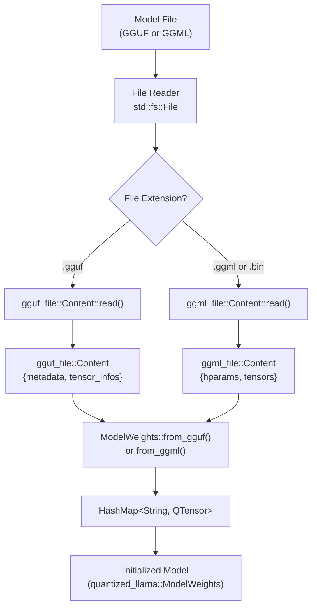
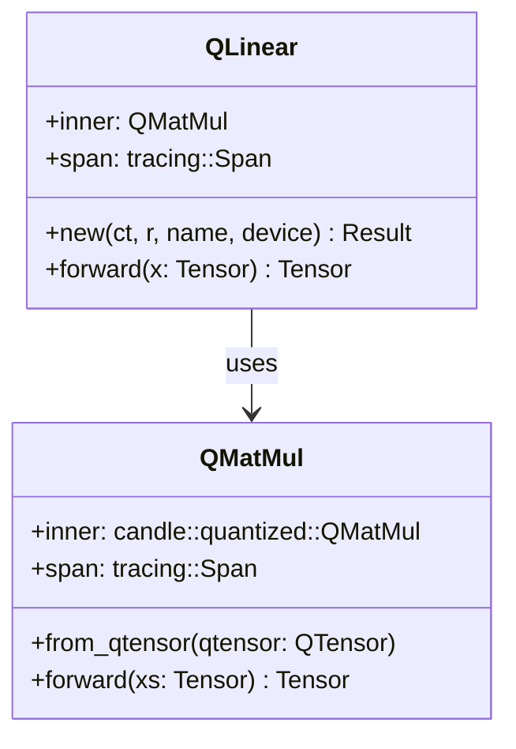
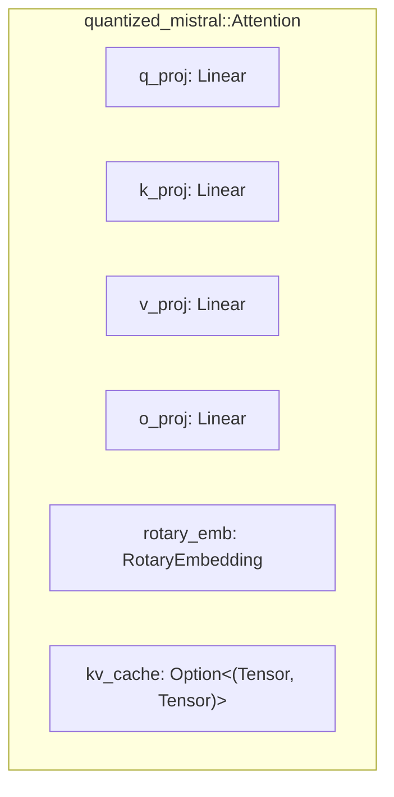
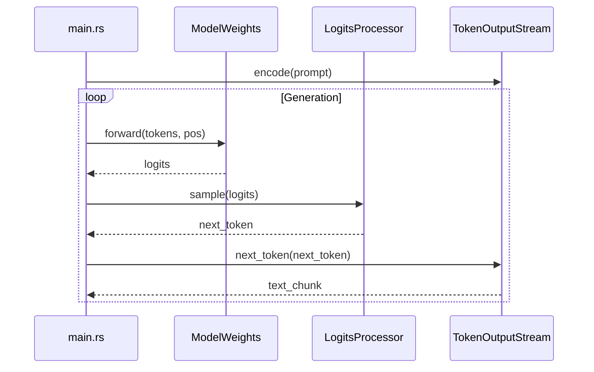

<!-- source: DeepWiki mcp.deepwiki.com · repo huggingface/candle · page 4.3 Using Quantized Models · fetched 2026-10-26 -->

# Using Quantized Models

Relevant source files

The following files were used as context for generating this wiki page:

- [candle-core/src/shape.rs](candle-core/src/shape.rs)
- [candle-examples/examples/bert/README.md](candle-examples/examples/bert/README.md)
- [candle-examples/examples/bigcode/README.md](candle-examples/examples/bigcode/README.md)
- [candle-examples/examples/dinov2/README.md](candle-examples/examples/dinov2/README.md)
- [candle-examples/examples/falcon/README.md](candle-examples/examples/falcon/README.md)
- [candle-examples/examples/glm4/main.rs](candle-examples/examples/glm4/main.rs)
- [candle-examples/examples/helium/README.md](candle-examples/examples/helium/README.md)
- [candle-examples/examples/helium/main.rs](candle-examples/examples/helium/main.rs)
- [candle-examples/examples/llama2-c/main.rs](candle-examples/examples/llama2-c/main.rs)
- [candle-examples/examples/llama2-c/training.rs](candle-examples/examples/llama2-c/training.rs)
- [candle-examples/examples/llava/main.rs](candle-examples/examples/llava/main.rs)
- [candle-examples/examples/mistral/main.rs](candle-examples/examples/mistral/main.rs)
- [candle-examples/examples/mixtral/README.md](candle-examples/examples/mixtral/README.md)
- [candle-examples/examples/mixtral/main.rs](candle-examples/examples/mixtral/main.rs)
- [candle-examples/examples/quantized-gemma/README.md](candle-examples/examples/quantized-gemma/README.md)
- [candle-examples/examples/quantized-gemma/main.rs](candle-examples/examples/quantized-gemma/main.rs)
- [candle-examples/examples/quantized-glm4/main.rs](candle-examples/examples/quantized-glm4/main.rs)
- [candle-examples/examples/quantized-lfm2/README.md](candle-examples/examples/quantized-lfm2/README.md)
- [candle-examples/examples/quantized-lfm2/main.rs](candle-examples/examples/quantized-lfm2/main.rs)
- [candle-examples/examples/quantized-phi/main.rs](candle-examples/examples/quantized-phi/main.rs)
- [candle-examples/examples/quantized-qwen2-instruct/main.rs](candle-examples/examples/quantized-qwen2-instruct/main.rs)
- [candle-examples/examples/quantized-qwen3-moe/main.rs](candle-examples/examples/quantized-qwen3-moe/main.rs)
- [candle-examples/examples/quantized-qwen3/main.rs](candle-examples/examples/quantized-qwen3/main.rs)
- [candle-examples/examples/quantized/README.md](candle-examples/examples/quantized/README.md)
- [candle-examples/examples/quantized/assets/aoc.gif](candle-examples/examples/quantized/assets/aoc.gif)
- [candle-examples/examples/quantized/main.rs](candle-examples/examples/quantized/main.rs)
- [candle-examples/examples/replit-code/README.md](candle-examples/examples/replit-code/README.md)
- [candle-examples/examples/replit-code/main.rs](candle-examples/examples/replit-code/main.rs)
- [candle-examples/examples/whisper/README.md](candle-examples/examples/whisper/README.md)
- [candle-nn/src/sampling.rs](candle-nn/src/sampling.rs)
- [candle-transformers/src/generation/mod.rs](candle-transformers/src/generation/mod.rs)
- [candle-transformers/src/models/granite.rs](candle-transformers/src/models/granite.rs)
- [candle-transformers/src/models/granitemoehybrid.rs](candle-transformers/src/models/granitemoehybrid.rs)
- [candle-transformers/src/models/helium.rs](candle-transformers/src/models/helium.rs)
- [candle-transformers/src/models/llama2_c.rs](candle-transformers/src/models/llama2_c.rs)
- [candle-transformers/src/models/mistral.rs](candle-transformers/src/models/mistral.rs)
- [candle-transformers/src/models/mixtral.rs](candle-transformers/src/models/mixtral.rs)
- [candle-transformers/src/models/mpt.rs](candle-transformers/src/models/mpt.rs)
- [candle-transformers/src/models/quantized_gemma3.rs](candle-transformers/src/models/quantized_gemma3.rs)
- [candle-transformers/src/models/quantized_lfm2.rs](candle-transformers/src/models/quantized_lfm2.rs)
- [candle-transformers/src/models/quantized_llama.rs](candle-transformers/src/models/quantized_llama.rs)
- [candle-transformers/src/models/quantized_llama2_c.rs](candle-transformers/src/models/quantized_llama2_c.rs)
- [candle-transformers/src/models/quantized_mistral.rs](candle-transformers/src/models/quantized_mistral.rs)
- [candle-transformers/src/models/quantized_mpt.rs](candle-transformers/src/models/quantized_mpt.rs)
- [candle-transformers/src/models/quantized_phi.rs](candle-transformers/src/models/quantized_phi.rs)
- [candle-transformers/src/models/quantized_phi3.rs](candle-transformers/src/models/quantized_phi3.rs)
- [candle-transformers/src/models/quantized_qwen2.rs](candle-transformers/src/models/quantized_qwen2.rs)
- [candle-transformers/src/quantized_nn.rs](candle-transformers/src/quantized_nn.rs)
- [candle-transformers/tests/generation_tests.rs](candle-transformers/tests/generation_tests.rs)
- [tensor-tools/src/main.rs](tensor-tools/src/main.rs)

This page provides a practical guide to loading and running quantized models in Candle. It covers model file loading, initialization, and inference execution across various architectures including LLaMA, Mistral, Phi, Qwen, Gemma, and GLM. For details on quantization formats and data types, see [Quantization Formats and Types](#4.1).

## Overview

Quantized models in Candle use compressed weight representations (GGUF/GGML) to reduce memory usage while maintaining model quality. The framework provides specialized building blocks in `quantized_nn` and a dedicated `VarBuilder` for GGUF loading.

**Typical workflow:**
1. Load quantized weights from a GGUF or GGML file using `candle::quantized::gguf_file` or `ggml_file`.
2. Initialize model architecture using `quantized_nn` components like `QMatMul` and `RmsNorm`.
3. Run inference using optimized quantized matrix multiplication kernels.

Sources: [candle-examples/examples/quantized/main.rs:11-17](), [candle-transformers/src/quantized_nn.rs:1-11]()

## Model File Loading Pipeline

The loading process transforms a binary file into an executable model by parsing metadata and mapping quantized tensors to model layers. The `gguf_file::Content` struct serves as the primary container for GGUF data.

Sources: [candle-examples/examples/quantized-phi/main.rs:202-214](), [candle-transformers/src/models/quantized_phi3.rs:30-40](), [candle-transformers/src/models/quantized_llama.rs:22-23]()

## Quantized Neural Network Blocks

Candle provides a set of quantized layers in `candle-transformers/src/quantized_nn.rs` that mirror standard `candle-nn` modules but operate on `QTensor` data.

### QMatMul and QLinear
The core of quantized inference is the `QMatMul` structure, which wraps the low-level quantized matrix multiplication logic. In Phi-3, `QLinear` is often used as a wrapper around `QMatMul` to provide a `Module` interface.

Sources: [candle-transformers/src/quantized_nn.rs:39-63](), [candle-transformers/src/models/quantized_phi3.rs:24-48](), [candle-transformers/src/models/quantized_llama.rs:31-47]()

### Quantized Variable Builder
The `quantized_var_builder::VarBuilder` is a specialized version of `VarBuilder` designed to load weights directly from GGUF content. It handles the mapping of GGUF tensor names to model layer paths and manages dequantization for layers like `RmsNorm` or `Embedding`.

| Method | Description |
|--------|-------------|
| `get` | Retrieves a `QTensor` and often dequantizes it to the target device. |
| `pp` | Returns a new builder with a prefixed path for sub-modules. |
| `device` | Returns the current backend device (CPU, CUDA, or Metal). |

Sources: [candle-transformers/src/quantized_var_builder.rs:1-21](), [candle-transformers/src/models/quantized_mistral.rs:18-20](), [candle-transformers/src/models/quantized_mistral.rs:81-83]()

## Model Implementations

### LLaMA and Mistral
Quantized LLaMA and Mistral models share a similar architecture using `RmsNorm` and `QMatMul`. They support a wide range of GGUF types (Q4_0, Q4_K_M, etc.). The LLaMA implementation supports both standard MLP and Mixture-of-Experts (MoE) variants.

Sources: [candle-transformers/src/models/quantized_mistral.rs:102-114](), [candle-transformers/src/models/quantized_llama.rs:66-73](), [candle-transformers/src/models/quantized_llama.rs:146-169]()

### Phi-3
The Phi-3 implementation (`quantized_phi3.rs`) utilizes a fused `attn_qkv` projection and specialized `Mlp` structures. It also incorporates `KvCache` for efficient token generation.

| Component | Implementation Detail |
|-----------|-----------------------|
| **Attention** | Uses `attn_qkv` for combined Query, Key, Value projection. |
| **RoPE** | Applied via `candle_nn::rotary_emb::rope`. |
| **KV Cache** | Managed by `candle_nn::kv_cache::KvCache`. |

Sources: [candle-transformers/src/models/quantized_phi3.rs:74-90](), [candle-transformers/src/models/quantized_phi3.rs:104-104](), [candle-transformers/src/models/quantized_phi3.rs:139-142]()

### GLM4
GLM4 models come in two versions (`GLM4Old` and `GLM4New`). The `GLM4New` implementation supports a `pos` parameter in its `forward` pass to handle KV caching correctly during autoregressive generation.

Sources: [candle-examples/examples/glm4/main.rs:10-22](), [candle-examples/examples/glm4/main.rs:90-98]()

## Running Inference

### Text Generation Loop
The generation loop follows an autoregressive pattern, processing one token at a time. The `LogitsProcessor` handles sampling strategies like Top-P, Top-K, and Temperature.

Sources: [candle-examples/examples/mistral/main.rs:95-126](), [candle-transformers/src/generation/mod.rs:20-23](), [candle-transformers/src/generation/mod.rs:117-119]()

### KV Cache Management
To optimize inference, quantized models use a cache to store previous Key and Value tensors.
- **Mistral**: The cache is an `Option<(Tensor, Tensor)>` updated in the `Attention` block.
- **Phi-3**: It uses the `KvCache` struct from `candle-nn`.
- **Llama2-c**: Managed via a `Cache` struct containing a `Vec<Option<(Tensor, Tensor)>>`.

Sources: [candle-transformers/src/models/quantized_mistral.rs:113-113](), [candle-transformers/src/models/quantized_phi3.rs:86-86](), [candle-transformers/src/models/llama2_c.rs:81-88](), [candle-transformers/src/models/llama2_c.rs:187-193]()

## Supported Architectures Reference

| Architecture | Example Path | Quantized Implementation |
|--------------|--------------|--------------------------|
| **LLaMA 2/3** | `examples/quantized` | `models/quantized_llama.rs` |
| **Mistral/Mixtral** | `examples/mistral` | `models/quantized_mistral.rs` |
| **Phi-2/3/4** | `examples/quantized-phi` | `models/quantized_phi.rs` / `phi3.rs` |
| **Qwen 2/3** | `examples/quantized-qwen2` | `models/quantized_qwen2.rs` |
| **Gemma 3** | `examples/quantized-gemma` | `models/quantized_gemma3.rs` |
| **GLM4** | `examples/quantized-glm4` | `models/glm4_new.rs` |

Sources: [candle-examples/examples/quantized/main.rs:28-80](), [candle-examples/examples/quantized-phi/main.rs:22-33](), [candle-examples/examples/glm4/main.rs:24-30]()

---

