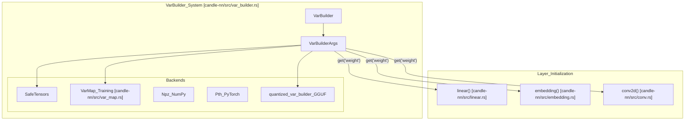
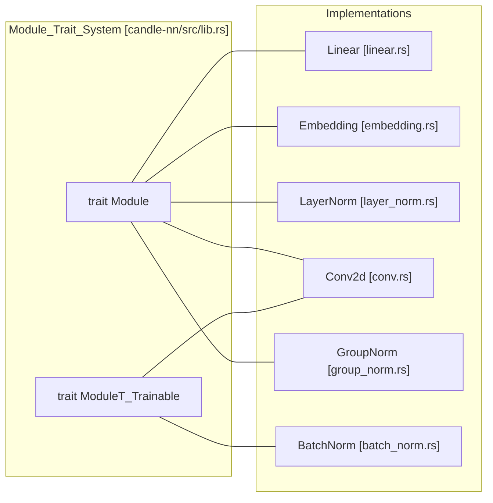

<!-- source: DeepWiki mcp.deepwiki.com · repo huggingface/candle · page 5 Neural Network Building Blocks · fetched 2026-10-26 -->

# Neural Network Building Blocks

Relevant source files

The following files were used as context for generating this wiki page:

- [candle-core/src/sort.rs](candle-core/src/sort.rs)
- [candle-kernels/src/reduce.cu](candle-kernels/src/reduce.cu)
- [candle-kernels/src/sort.cu](candle-kernels/src/sort.cu)
- [candle-nn/src/activation.rs](candle-nn/src/activation.rs)
- [candle-nn/src/conv.rs](candle-nn/src/conv.rs)
- [candle-nn/src/embedding.rs](candle-nn/src/embedding.rs)
- [candle-nn/src/group_norm.rs](candle-nn/src/group_norm.rs)
- [candle-nn/src/layer_norm.rs](candle-nn/src/layer_norm.rs)
- [candle-nn/src/lib.rs](candle-nn/src/lib.rs)
- [candle-nn/src/linear.rs](candle-nn/src/linear.rs)
- [candle-nn/src/ops.rs](candle-nn/src/ops.rs)
- [candle-nn/src/rotary_emb.rs](candle-nn/src/rotary_emb.rs)
- [candle-nn/tests/layer_norm.rs](candle-nn/tests/layer_norm.rs)
- [candle-nn/tests/ops.rs](candle-nn/tests/ops.rs)

The `candle-nn` crate provides the fundamental building blocks for constructing neural networks in Candle. It includes standard layers (Linear, Embedding, convolutions), normalization operations, activation functions, and the `VarBuilder` system for weight management and initialization. This module serves as the bridge between raw tensor operations and high-level model architectures.

**Scope**: This page covers the layer implementations, the `Module` trait interface, and the weight management infrastructure. For details on specific subsystems, see the child pages:
- [Core Layers and Modules](#5.1) — Linear, Embedding, and Normalization.
- [Convolution and Pooling Operations](#5.2) — Vision-related layers.
- [Activation Functions and Loss](#5.3) — Non-linearities and training objectives.
- [Variable Management with VarBuilder](#5.4) — Weight loading and management.
- [Optimizers, KV Cache, and Training Utilities](#5.5) — Training and autoregressive inference.

## VarBuilder and Weight Management

The `VarBuilder` is the central abstraction for retrieving and managing model weights. It provides a unified interface for loading weights from various sources (safetensors files, GGUF, numpy arrays, or in-memory tensors) while maintaining a hierarchical naming scheme.

### VarBuilder Architecture

**Sources**: [candle-nn/src/var_builder.rs:39-65](), [candle-nn/src/var_map.rs:1-66](), [candle-nn/src/linear.rs:84-94](), [candle-nn/src/embedding.rs:39-49]()

For details on the loading mechanics and memory-mapping, see [Variable Management with VarBuilder](#5.4).

## Core Layers and the Module Trait

All neural network components in Candle implement the `Module` or `ModuleT` (for training-aware layers like Dropout or BatchNorm) traits. These traits define a `forward` method that takes an input `Tensor` and returns a `Result<Tensor>`.

### Common Layer Implementations

| Layer | Struct | File | Description |
|-------|--------|------|-------------|
| **Linear** | `Linear` | [candle-nn/src/linear.rs:23-26]() | Standard `y = xW^T + b` transformation. |
| **Embedding** | `Embedding` | [candle-nn/src/embedding.rs:5-8]() | Lookup table for discrete tokens. |
| **LayerNorm** | `LayerNorm` | [candle-nn/src/layer_norm.rs:64-69]() | Normalization across the feature dimension. |
| **RmsNorm** | `RmsNorm` | [candle-nn/src/layer_norm.rs:177-177]() | Root Mean Square normalization, common in LLMs. |
| **GroupNorm** | `GroupNorm` | [candle-nn/src/group_norm.rs:8-14]() | Normalization over groups of channels. |
| **BatchNorm** | `BatchNorm` | [candle-nn/src/batch_norm.rs:47-47]() | Batch normalization with running statistics. |

### Module Trait Hierarchy

**Sources**: [candle-nn/src/lib.rs:68-68](), [candle-nn/src/linear.rs:42-43](), [candle-nn/src/layer_norm.rs:116-116](), [candle-nn/src/group_norm.rs:8-14](), [candle-nn/src/batch_norm.rs:47-47]()

For detailed documentation on linear and normalization layers, see [Core Layers and Modules](#5.1).

## Convolutions and Vision Operations

The `candle-nn` crate supports 1D and 2D convolutions, including transposed variants for generative models. These operations are abstracted in `conv.rs` and dispatched to optimized backend kernels.

| Operation | Configuration | Implementation |
|-----------|---------------|----------------|
| **Conv1d** | `Conv1dConfig` | [candle-nn/src/conv.rs:27-31]() |
| **Conv2d** | `Conv2d` | [candle-nn/src/conv.rs:169-173]() |
| **ConvTranspose1d** | `ConvTranspose1d` | [candle-nn/src/conv.rs:98-102]() |
| **ConvTranspose2d** | `ConvTranspose2d` | [candle-nn/src/conv.rs:259-263]() |

The `Conv2d` implementation includes utilities like `absorb_bn` [candle-nn/src/conv.rs:196-215]() to fuse batch normalization layers into convolutions for optimized inference.

For details on strides, padding, and backend-specific optimizations, see [Convolution and Pooling Operations](#5.2).

## Activations and Loss Functions

Activation functions are provided both as standalone functions in the `ops` module and as a serializable `Activation` enum. This allows model configurations to specify non-linearities dynamically.

- **Activations**: ReLU, GELU, SiLU (Swish), Softmax, Sigmoid, and PReLU. [candle-nn/src/activation.rs:7-27](), [candle-nn/src/ops.rs:22-49]()
- **Losses**: Mean Squared Error (MSE), Cross Entropy, and Negative Log-Likelihood (NLL). [candle-nn/src/loss.rs:31-31]()

Specialized operations like `rotary_emb` (RoPE) are implemented as custom operations to support efficient transformer inference. [candle-nn/src/rotary_emb.rs:14-17]()

For the mathematical definitions and specialized kernels (like SwiGLU), see [Activation Functions and Loss](#5.3).

## Training and Inference Utilities

Beyond static layers, `candle-nn` provides the infrastructure for dynamic execution and model serving:

- **Optimizers**: Implementations of `SGD` and `AdamW` for updating weights via the `Optimizer` trait. [candle-nn/src/optim.rs:62-62]()
- **KV Cache**: `KvCache` and `Cache` structs for efficient autoregressive decoding in transformers. [candle-nn/src/kv_cache.rs:28-28]()
- **Attention**: Specialized attention modules including `varlen` support and CPU flash attention dispatchers. [candle-nn/src/attention.rs:19-44]()
- **Sampling**: `LogitsProcessor` and `Sampling` enum for text generation strategies. [candle-nn/src/sampling.rs:23]()
- **RNNs**: Support for `GRU` and `LSTM` layers with their respective configurations. [candle-nn/src/rnn.rs:63-63]()

For details on training loops and inference caching, see [Optimizers, KV Cache, and Training Utilities](#5.5).

---

### Sources:
- [candle-nn/src/lib.rs:18-68]() (Module structure and exports)
- [candle-nn/src/var_builder.rs:39-65]() (VarBuilder architecture)
- [candle-nn/src/linear.rs:23-114]() (Linear layer implementation and VarBuilder integration)
- [candle-nn/src/embedding.rs:5-49]() (Embedding struct and constructor)
- [candle-nn/src/activation.rs:7-50]() (Activation enum and forward logic)
- [candle-nn/src/ops.rs:22-187]() (High-level tensor ops like softmax and sigmoid)
- [candle-nn/src/conv.rs:27-263]() (Convolutional layer structs and BatchNorm absorption)
- [candle-nn/src/layer_norm.rs:64-219]() (LayerNorm and RmsNorm implementation)
- [candle-nn/src/group_norm.rs:8-55]() (GroupNorm implementation)
- [candle-nn/src/rotary_emb.rs:1-17]() (Rotary Embedding custom ops)
- [candle-nn/src/optim.rs:62-62]() (Optimizer exports)
- [candle-nn/src/rnn.rs:63-63]() (RNN/LSTM/GRU exports)

---

