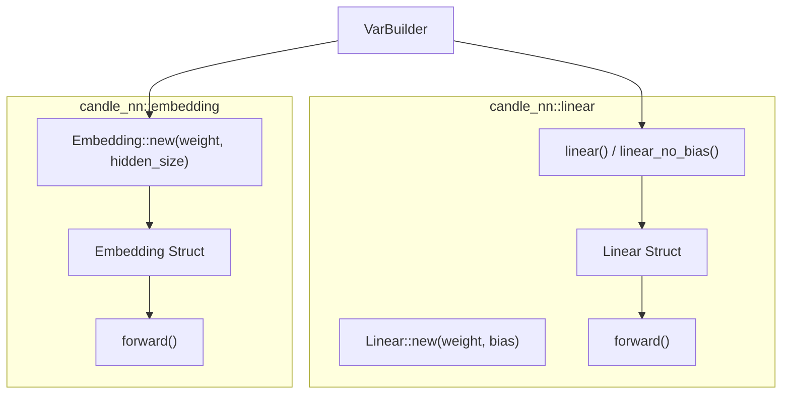
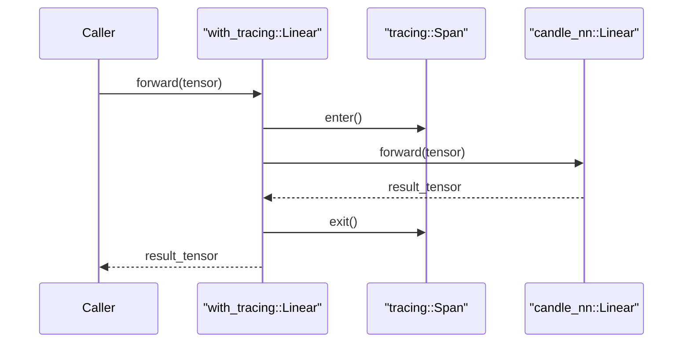

<!-- source: DeepWiki mcp.deepwiki.com · repo huggingface/candle · page 5.1 Core Layers and Modules · fetched 2026-10-26 -->

# Core Layers and Modules

Relevant source files

The following files were used as context for generating this wiki page:

- [candle-core/examples/metal_basics.rs](candle-core/examples/metal_basics.rs)
- [candle-core/src/variable.rs](candle-core/src/variable.rs)
- [candle-examples/examples/blip/README.md](candle-examples/examples/blip/README.md)
- [candle-examples/examples/blip/main.rs](candle-examples/examples/blip/main.rs)
- [candle-examples/examples/resnet/export_models.py](candle-examples/examples/resnet/export_models.py)
- [candle-examples/examples/resnet/main.rs](candle-examples/examples/resnet/main.rs)
- [candle-nn/src/batch_norm.rs](candle-nn/src/batch_norm.rs)
- [candle-nn/src/conv.rs](candle-nn/src/conv.rs)
- [candle-nn/src/embedding.rs](candle-nn/src/embedding.rs)
- [candle-nn/src/func.rs](candle-nn/src/func.rs)
- [candle-nn/src/group_norm.rs](candle-nn/src/group_norm.rs)
- [candle-nn/src/layer_norm.rs](candle-nn/src/layer_norm.rs)
- [candle-nn/src/lib.rs](candle-nn/src/lib.rs)
- [candle-nn/src/linear.rs](candle-nn/src/linear.rs)
- [candle-nn/src/loss.rs](candle-nn/src/loss.rs)
- [candle-nn/src/sequential.rs](candle-nn/src/sequential.rs)
- [candle-nn/tests/batch_norm.rs](candle-nn/tests/batch_norm.rs)
- [candle-nn/tests/group_norm.rs](candle-nn/tests/group_norm.rs)
- [candle-nn/tests/layer_norm.rs](candle-nn/tests/layer_norm.rs)
- [candle-nn/tests/loss.rs](candle-nn/tests/loss.rs)
- [candle-transformers/src/models/blip.rs](candle-transformers/src/models/blip.rs)
- [candle-transformers/src/models/blip_text.rs](candle-transformers/src/models/blip_text.rs)
- [candle-transformers/src/models/convmixer.rs](candle-transformers/src/models/convmixer.rs)
- [candle-transformers/src/models/efficientnet.rs](candle-transformers/src/models/efficientnet.rs)
- [candle-transformers/src/models/quantized_blip.rs](candle-transformers/src/models/quantized_blip.rs)
- [candle-transformers/src/models/quantized_blip_text.rs](candle-transformers/src/models/quantized_blip_text.rs)
- [candle-transformers/src/models/resnet.rs](candle-transformers/src/models/resnet.rs)
- [candle-transformers/src/models/segment_anything/tiny_vit.rs](candle-transformers/src/models/segment_anything/tiny_vit.rs)
- [candle-transformers/src/models/with_tracing.rs](candle-transformers/src/models/with_tracing.rs)
- [candle-wasm-examples/blip/README.md](candle-wasm-examples/blip/README.md)
- [candle-wasm-examples/blip/blipWorker.js](candle-wasm-examples/blip/blipWorker.js)
- [candle-wasm-examples/blip/build-lib.sh](candle-wasm-examples/blip/build-lib.sh)
- [candle-wasm-examples/blip/index.html](candle-wasm-examples/blip/index.html)
- [candle-wasm-examples/blip/src/bin/m.rs](candle-wasm-examples/blip/src/bin/m.rs)
- [candle-wasm-examples/blip/src/lib.rs](candle-wasm-examples/blip/src/lib.rs)

This page documents the fundamental neural network building blocks provided by the `candle-nn` crate. These include linear transformations, embedding layers, normalization layers (LayerNorm, RmsNorm, BatchNorm, GroupNorm), activation functions, and utility modules like `Sequential` and `with_tracing`. These components form the foundation for constructing neural networks in Candle, particularly for transformer and vision architectures.

## Module and ModuleT Traits

The core of the `candle-nn` ecosystem is the `Module` trait, which defines a standard interface for the forward pass of a neural network layer.

*   **`Module`**: Defines `forward(&self, xs: &Tensor) -> Result<Tensor>`. It is implemented by most layers like `Linear`, `Embedding`, and `LayerNorm` [candle-nn/src/lib.rs:68-68]().
*   **`ModuleT`**: An extension of `Module` that includes a training flag: `forward_t(&self, xs: &Tensor, train: bool) -> Result<Tensor>`. This is used for layers whose behavior changes during training, such as `Dropout` and `BatchNorm` [candle-nn/src/lib.rs:68-68]().

Sources: [candle-nn/src/lib.rs:1-68]()

## Linear and Embedding Layers

### Linear Layer
The `Linear` struct implements a standard fully connected transformation: $y = xW^T + b$ [candle-nn/src/linear.rs:3-6](). It supports optional biases and provides optimized execution paths for batched inputs to avoid slower broadcasted matrix multiplications when possible [candle-nn/src/linear.rs:43-73](). It is typically initialized using Kaiming Normal for weights [candle-nn/src/linear.rs:85-86]().

### Embedding Layer
The `Embedding` struct provides a lookup table that maps integer indices to dense vectors. It handles arbitrary input shapes by flattening the input, performing the lookup via `index_select`, and reshaping the output to $[..., \text{hidden\_size}]$ [candle-nn/src/embedding.rs:28-37]().

**Entity Relationship: Linear and Embedding**

Sources: [candle-nn/src/linear.rs:23-114](), [candle-nn/src/embedding.rs:4-49]()

## Normalization Layers

Candle provides several normalization strategies essential for stabilizing deep network training.

| Layer | Struct | Description |
| :--- | :--- | :--- |
| **LayerNorm** | `LayerNorm` | Normalizes across the last dimension. Supports optional affine weights and biases. Includes a specialized `remove_mean` flag [candle-nn/src/layer_norm.rs:64-144](). |
| **RmsNorm** | `RmsNorm` | A variant of LayerNorm that scales by the root mean square without subtracting the mean. Uses optimized `candle_nn::ops::rms_norm` kernels for contiguous tensors [candle-nn/src/layer_norm.rs:177-210](). |
| **BatchNorm** | `BatchNorm` | Normalizes across the batch and spatial dimensions. Tracks `running_mean` and `running_var`. Note that the implementation is primarily for inference but supports a `forward_train` method for updating stats [candle-nn/src/batch_norm.rs:6-7](), [candle-nn/src/batch_norm.rs:195-230](). |
| **GroupNorm** | `GroupNorm` | Normalizes groups of channels, often used in vision models like Stable Diffusion [candle-nn/src/lib.rs:55-55](). |

### Convolutional Layers
While detailed in section 5.2, `candle-nn` provides standard convolution primitives:
*   **`Conv1d` / `Conv2d`**: Standard spatial convolutions [candle-nn/src/conv.rs:27-31](), [candle-nn/src/conv.rs:169-173]().
*   **`ConvTranspose1d` / `ConvTranspose2d`**: Deconvolutional layers for upsampling [candle-nn/src/conv.rs:98-102](), [candle-nn/src/conv.rs:259-263]().
*   **`absorb_bn`**: `Conv2d` supports fusing a `BatchNorm` layer into its weights and biases for faster inference [candle-nn/src/conv.rs:196-215]().

Sources: [candle-nn/src/layer_norm.rs:1-219](), [candle-nn/src/batch_norm.rs:1-230](), [candle-nn/src/lib.rs:47-60](), [candle-nn/src/conv.rs:1-264]()

## Activation Functions and Loss

### Activation Functions
Activation functions are available both as an `enum Activation` (which implements `Module`) and as standalone functions.

*   **Enum Variants**: Includes common functions like `Gelu`, `Relu`, `Silu`, and `Softmax` [candle-nn/src/lib.rs:18-18]().
*   **Specialized Ops**: `softmax_last_dim` is implemented in `candle_nn::ops` for numerical stability and is used extensively in attention mechanisms [candle-transformers/src/models/blip.rs:158-158]().

### Loss Functions
The `loss` module provides standard objectives for training:
*   **`nll`**: Negative Log Likelihood loss for classification [candle-nn/src/loss.rs:14-30]().
*   **`cross_entropy`**: Combines `log_softmax` and `nll` [candle-nn/src/loss.rs:41-47]().
*   **`mse`**: Mean Squared Error loss [candle-nn/src/loss.rs:50-52]().
*   **`binary_cross_entropy_with_logit`**: BCE with internal sigmoid for stability [candle-nn/src/loss.rs:64-74]().
*   **`huber`**: Robust loss combining MAE and MSE [candle-nn/src/loss.rs:89-104]().

Sources: [candle-nn/src/lib.rs:18-46](), [candle-nn/src/loss.rs:1-104](), [candle-transformers/src/models/blip.rs:158-168]()

## Utilities and Tracing

### Sequential and Func
*   **`Sequential`**: A container to chain multiple `Module` instances together [candle-nn/src/lib.rs:64-64]().
*   **`Func` / `FuncT`**: Wrappers that allow using a closure as a `Module`. This is useful for inserting stateless operations (like `reshape`) into a model pipeline [candle-nn/src/lib.rs:54-54]().

### Encoding Utilities
The `encoding` module provides utilities like `one_hot` for converting label indices into one-hot encoded tensors [candle-nn/src/lib.rs:24-24]().

### with_tracing Module
Located in `candle-transformers`, this module provides wrappers for standard layers (`Linear`, `Embedding`, `Conv2d`, `LayerNorm`, `RmsNorm`, `QMatMul`) that include `tracing::Span` instrumentation [candle-transformers/src/models/with_tracing.rs:5-195](). This allows developers to profile and debug the execution flow of complex transformer models [candle-transformers/src/models/with_tracing.rs:31-33]().

**Data Flow: Traced Forward Pass**

Sources: [candle-transformers/src/models/with_tracing.rs:1-195](), [candle-nn/src/lib.rs:54-64]()

## Summary Table of Construction Functions

| Function | Return Type | Default Initialization |
| :--- | :--- | :--- |
| `linear(in, out, vb)` | `Linear` | Kaiming Normal (weights), Uniform (bias) [candle-nn/src/linear.rs:84-94]() |
| `embedding(v, h, vb)` | `Embedding` | Randn(mean=0, stdev=1) [candle-nn/src/embedding.rs:39-49]() |
| `layer_norm(sz, cfg, vb)` | `LayerNorm` | Constant 1 (weights), Constant 0 (bias) [candle-nn/src/layer_norm.rs:146-164]() |
| `rms_norm(sz, eps, vb)` | `RmsNorm` | Constant 1 (weights) [candle-nn/src/layer_norm.rs:212-219]() |

Sources: [candle-nn/src/linear.rs:84-94](), [candle-nn/src/embedding.rs:39-49](), [candle-nn/src/layer_norm.rs:146-164](), [candle-nn/src/layer_norm.rs:212-219]()

---

