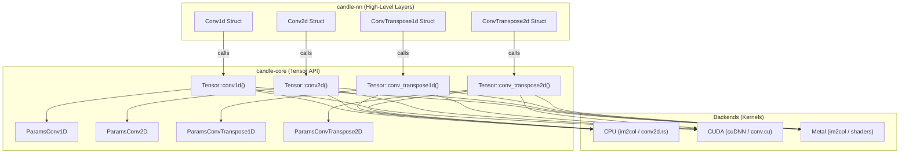
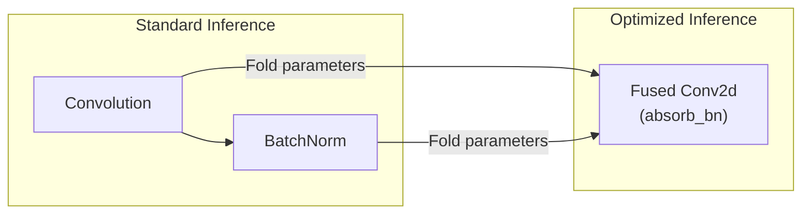
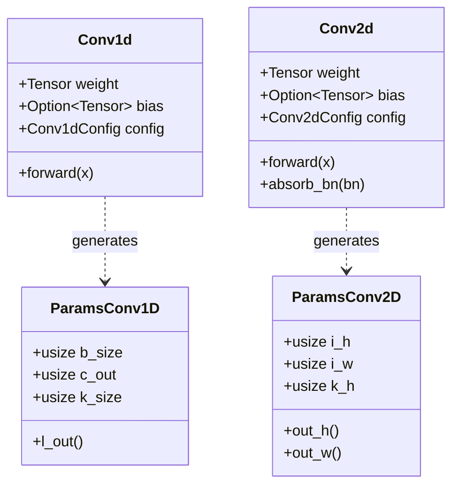

<!-- source: DeepWiki mcp.deepwiki.com · repo huggingface/candle · page 5.2 Convolution and Pooling Operations · fetched 2026-10-26 -->

# Convolution and Pooling Operations

<details>
<summary>Relevant source files</summary>

The following files were used as context for generating this wiki page:

- [candle-core/examples/cuda_basics.rs](candle-core/examples/cuda_basics.rs)
- [candle-core/examples/cuda_sum_benchmark.rs](candle-core/examples/cuda_sum_benchmark.rs)
- [candle-core/src/conv.rs](candle-core/src/conv.rs)
- [candle-core/src/cpu_backend/conv2d.rs](candle-core/src/cpu_backend/conv2d.rs)
- [candle-core/tests/conv_tests.rs](candle-core/tests/conv_tests.rs)
- [candle-core/tests/pool_tests.rs](candle-core/tests/pool_tests.rs)
- [candle-kernels/src/conv.cu](candle-kernels/src/conv.cu)
- [candle-nn/src/conv.rs](candle-nn/src/conv.rs)
- [candle-nn/src/embedding.rs](candle-nn/src/embedding.rs)
- [candle-nn/src/group_norm.rs](candle-nn/src/group_norm.rs)
- [candle-nn/src/layer_norm.rs](candle-nn/src/layer_norm.rs)
- [candle-nn/src/lib.rs](candle-nn/src/lib.rs)
- [candle-nn/src/linear.rs](candle-nn/src/linear.rs)
- [candle-nn/tests/layer_norm.rs](candle-nn/tests/layer_norm.rs)

</details>


## Purpose and Scope

This document details the implementation and usage of convolution and pooling operations within the Candle framework. These operations are the primary building blocks for Convolutional Neural Networks (CNNs), enabling spatial and temporal feature extraction.

Candle provides high-level abstractions in `candle-nn` for model building, while the core logic resides in `candle-core` with optimized backends for CPU, CUDA, and Metal.

---

## Convolution Operations

### Architecture and Data Flow

Convolution operations in Candle follow a layered approach: high-level `Module` implementations in `candle-nn` wrap low-level `Tensor` methods in `candle-core`, which then dispatch to backend-specific kernels.


**Sources**: [candle-nn/src/conv.rs:27-31](), [candle-nn/src/conv.rs:169-173](), [candle-nn/src/conv.rs:98-102](), [candle-nn/src/conv.rs:259-263](), [candle-core/src/conv.rs:148-157](), [candle-core/src/conv.rs:281-290](), [candle-core/src/conv.rs:231-239](), [candle-core/src/conv.rs:324-332]()

### Configuration and Parameters

Convolution behavior is controlled by specific configuration structs that define stride, padding, dilation, and groups.

| Struct | Purpose | Key Fields |
| :--- | :--- | :--- |
| `Conv1dConfig` | 1D Conv settings | `padding`, `stride`, `dilation`, `groups`, `cudnn_fwd_algo` |
| `Conv2dConfig` | 2D Conv settings | `padding`, `stride`, `dilation`, `groups`, `cudnn_fwd_algo` |
| `ConvTranspose1dConfig` | 1D Transposed Conv settings | `padding`, `output_padding`, `stride`, `dilation`, `groups` |
| `ConvTranspose2dConfig` | 2D Transposed Conv settings | `padding`, `output_padding`, `stride`, `dilation` |
| `ParamsConv1D` | Internal 1D Conv parameters | `b_size`, `l_in`, `c_out`, `c_in`, `k_size`, `padding`, `stride`, `dilation`, `cudnn_fwd_algo` |
| `ParamsConvTranspose1D` | Internal 1D Transposed Conv parameters | `b_size`, `l_in`, `c_out`, `c_in`, `k_size`, `padding`, `output_padding`, `stride`, `dilation` |
| `ParamsConv2D` | Internal 2D Conv parameters | `b_size`, `i_h`, `i_w`, `k_h`, `k_w`, `c_out`, `c_in`, `padding`, `stride`, `dilation`, `cudnn_fwd_algo` |
| `ParamsConvTranspose2D` | Internal 2D Transposed Conv parameters | `b_size`, `i_h`, `i_w`, `k_h`, `k_w`, `c_out`, `c_in`, `padding`, `output_padding`, `stride`, `dilation` |

**Sources**: [candle-nn/src/conv.rs:6-12](), [candle-nn/src/conv.rs:77-83](), [candle-nn/src/conv.rs:148-154](), [candle-nn/src/conv.rs:238-245](), [candle-core/src/conv.rs:6-18](), [candle-core/src/conv.rs:32-42](), [candle-core/src/conv.rs:72-84](), [candle-core/src/conv.rs:101-113]()

### Transposed Convolutions

Transposed convolutions (often used for upsampling) are supported for both 1D and 2D. They include an `output_padding` parameter to resolve shape ambiguities.
- **1D**: `ConvTranspose1d` [candle-nn/src/conv.rs:98-102]() calls `Tensor::conv_transpose1d` [candle-core/src/conv.rs:231-239]().
- **2D**: `ConvTranspose2d` [candle-nn/src/conv.rs:259-263]() calls `Tensor::conv_transpose2d` [candle-core/src/conv.rs:324-332]().

---

## Backend Implementations

### CPU Backend
The CPU implementation utilizes a mix of direct spatial convolution and `im2col` (image-to-column) transformations. 
- **1x1 Convolutions**: Optimized via `conv2d_1x1` which reshapes the operation into a standard matrix multiplication: `[c_out, c_in] @ [c_in, b*h*w]` [candle-core/src/cpu_backend/conv2d.rs:56-62]().
- **General 2D Convolution**: Managed by the `Conv2D` struct [candle-core/src/cpu_backend/conv2d.rs:12](). It supports three implementations: `TiledIm2Col` (default), `FullIm2Col`, and `Direct` [candle-core/src/cpu_backend/conv2d.rs:15-21]().
- **Tiled im2col**: Instead of materializing the full `im2col` matrix, it processes input/output in tiles in parallel to improve cache locality and parallelism [candle-core/src/cpu_backend/conv2d.rs:126-132]().

**Sources**: [candle-core/src/cpu_backend/conv2d.rs:12-21](), [candle-core/src/cpu_backend/conv2d.rs:56-62](), [candle-core/src/cpu_backend/conv2d.rs:126-132]()

### CUDA Backend
The CUDA backend provides two paths:
1.  **cuDNN**: If the `cudnn` feature is enabled, Candle uses NVIDIA's highly optimized cuDNN library. Users can specify a `CudnnFwdAlgo` such as `ImplicitGemm`, `Gemm`, `Winograd`, or `Fft` [candle-core/src/conv.rs:59-69]().
2.  **Custom Kernels**: For environments without cuDNN, Candle uses custom CUDA kernels.
    - `im2col1d` and `im2col` kernels transform input tensors into a format suitable for matrix multiplication [candle-kernels/src/conv.cu:55-98](), [candle-kernels/src/conv.cu:145-206]().
    - `col2im1d` kernel is used for 1D transposed convolutions [candle-kernels/src/conv.cu:100-142]().
    - A naive `conv1d` and `conv2d` implementation is also provided for fallback [candle-kernels/src/conv.cu:6-52](), [candle-kernels/src/conv.cu:209-226]().

**Sources**: [candle-core/src/conv.rs:59-69](), [candle-kernels/src/conv.cu:55-98](), [candle-kernels/src/conv.cu:100-142](), [candle-kernels/src/conv.cu:145-206]()

### Metal Backend
The Metal backend (for macOS/iOS) utilizes MSL kernels. Similar to CUDA, it often employs an `im2col` strategy to leverage optimized Metal matrix multiplication shaders.

---

## Pooling Operations

Pooling operations reduce spatial dimensions. Candle supports Max Pooling and Average Pooling.

### Max Pooling
- `max_pool2d(kernel_size)`: Performs 2D max pooling where the stride defaults to the kernel size [candle-core/tests/pool_tests.rs:21-34]().
- Implementation involves finding the maximum value in a sliding window across the `H` and `W` dimensions.

### Average Pooling
- `avg_pool2d(kernel_size)`: Computes the mean of values within the pooling window [candle-core/tests/pool_tests.rs:4-19]().
- Used extensively in models like ResNet or Inception for global feature aggregation.

### Upsampling
Candle provides `upsample_nearest2d(target_h, target_w)`, which performs nearest-neighbor interpolation to increase spatial resolution [candle-core/tests/pool_tests.rs:85-102]().

**Sources**: [candle-core/tests/pool_tests.rs:4-34](), [candle-core/tests/pool_tests.rs:85-102]()

---

## Usage in Vision Models

### Neural Network Layers
In `candle-nn`, convolutions are instantiated using `VarBuilder`, which handles weight and bias initialization.

```rust
// Example: Creating a Conv2d layer
let config = Conv2dConfig { padding: 1, ..Default::default() };
let conv = candle_nn::conv2d(in_channels, out_channels, k_size, config, vb)?;
```
**Sources**: [candle-nn/src/conv.rs:148-154](), [candle-nn/src/lib.rs:48-52]()

### Fusing Batch Normalization
A unique utility in Candle is `absorb_bn`, which allows a `Conv2d` layer to absorb the parameters of a subsequent `BatchNorm` layer. This optimization folds normalization constants into the convolution weights and biases, reducing the computational graph during inference [candle-nn/src/conv.rs:196-215]().


**Sources**: [candle-nn/src/conv.rs:196-205]()

### Code Entity Association

The following diagram maps high-level `candle-nn` structures to the low-level `candle-core` parameter objects they generate.


**Sources**: [candle-nn/src/conv.rs:27-31](), [candle-nn/src/conv.rs:169-173](), [candle-core/src/conv.rs:6-29](), [candle-core/src/conv.rs:72-98]()

---

## Summary of Key Entities

| Code Entity | File Path | Role |
| :--- | :--- | :--- |
| `Conv1d` | `candle-nn/src/conv.rs` | High-level 1D convolution layer [candle-nn/src/conv.rs:27-31]() |
| `Conv2d` | `candle-nn/src/conv.rs` | High-level 2D convolution layer [candle-nn/src/conv.rs:169-173]() |
| `ConvTranspose1d` | `candle-nn/src/conv.rs` | High-level 1D transposed convolution layer [candle-nn/src/conv.rs:98-102]() |
| `ConvTranspose2d` | `candle-nn/src/conv.rs` | High-level 2D transposed convolution layer [candle-nn/src/conv.rs:259-263]() |
| `ParamsConv1D` | `candle-core/src/conv.rs` | Internal parameters for 1D convolution [candle-core/src/conv.rs:6-18]() |
| `ParamsConv2D` | `candle-core/src/conv.rs` | Internal parameters for 2D convolution [candle-core/src/conv.rs:72-84]() |
| `im2col` (CUDA) | `candle-kernels/src/conv.cu` | CUDA kernel for image-to-column transformation [candle-kernels/src/conv.cu:145-157]() |
| `col2im1d` (CUDA) | `candle-kernels/src/conv.cu` | CUDA kernel for column-to-image transformation [candle-kernels/src/conv.cu:100-110]() |
| `conv2d_1x1` (CPU) | `candle-core/src/cpu_backend/conv2d.rs` | Optimized CPU path for 1x1 convolutions [candle-core/src/cpu_backend/conv2d.rs:56-62]() |
| `absorb_bn` | `candle-nn/src/conv.rs` | Optimization for fusing Conv and BatchNorm [candle-nn/src/conv.rs:196-215]() |

**Sources**: [candle-nn/src/conv.rs:27-263](), [candle-core/src/conv.rs:6-113](), [candle-kernels/src/conv.cu:100-157](), [candle-core/src/cpu_backend/conv2d.rs:56-62]()

---

