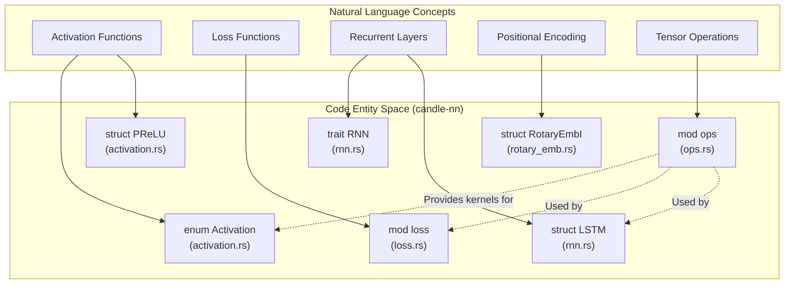
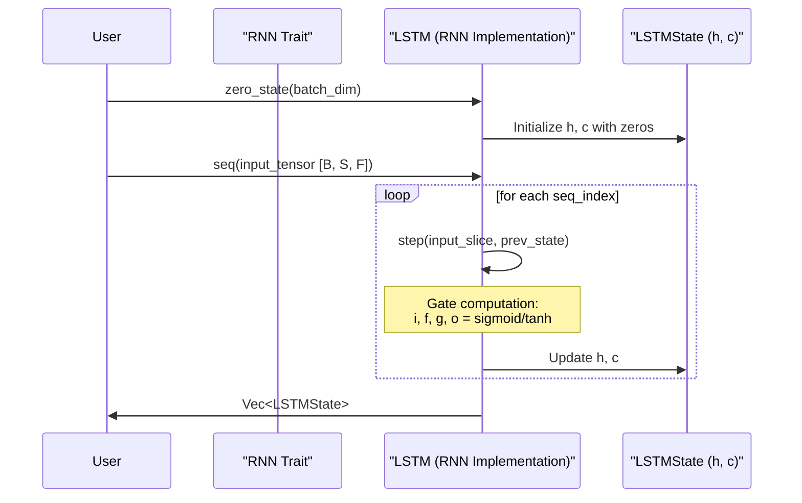

<!-- source: DeepWiki mcp.deepwiki.com · repo huggingface/candle · page 5.3 Activation Functions and Loss · fetched 2026-10-26 -->

# Activation Functions and Loss

<details>
<summary>Relevant source files</summary>

The following files were used as context for generating this wiki page:

- [candle-core/src/sort.rs](candle-core/src/sort.rs)
- [candle-core/src/variable.rs](candle-core/src/variable.rs)
- [candle-examples/examples/encodec/README.md](candle-examples/examples/encodec/README.md)
- [candle-examples/examples/encodec/audio_io.rs](candle-examples/examples/encodec/audio_io.rs)
- [candle-examples/examples/encodec/jfk-codes.safetensors](candle-examples/examples/encodec/jfk-codes.safetensors)
- [candle-examples/examples/encodec/main.rs](candle-examples/examples/encodec/main.rs)
- [candle-examples/examples/mimi/audio_io.rs](candle-examples/examples/mimi/audio_io.rs)
- [candle-examples/src/bs1770.rs](candle-examples/src/bs1770.rs)
- [candle-examples/src/wav.rs](candle-examples/src/wav.rs)
- [candle-kernels/src/reduce.cu](candle-kernels/src/reduce.cu)
- [candle-kernels/src/sort.cu](candle-kernels/src/sort.cu)
- [candle-nn/src/activation.rs](candle-nn/src/activation.rs)
- [candle-nn/src/batch_norm.rs](candle-nn/src/batch_norm.rs)
- [candle-nn/src/loss.rs](candle-nn/src/loss.rs)
- [candle-nn/src/ops.rs](candle-nn/src/ops.rs)
- [candle-nn/src/rnn.rs](candle-nn/src/rnn.rs)
- [candle-nn/src/rotary_emb.rs](candle-nn/src/rotary_emb.rs)
- [candle-nn/tests/batch_norm.rs](candle-nn/tests/batch_norm.rs)
- [candle-nn/tests/group_norm.rs](candle-nn/tests/group_norm.rs)
- [candle-nn/tests/loss.rs](candle-nn/tests/loss.rs)
- [candle-nn/tests/ops.rs](candle-nn/tests/ops.rs)
- [candle-nn/tests/rnn.rs](candle-nn/tests/rnn.rs)
- [candle-transformers/src/models/segment_anything/mask_decoder.rs](candle-transformers/src/models/segment_anything/mask_decoder.rs)
- [candle-transformers/src/models/segment_anything/prompt_encoder.rs](candle-transformers/src/models/segment_anything/prompt_encoder.rs)

</details>


This page documents the activation functions, loss functions, and specialized neural network operations available in the `candle-nn` crate. These components form the mathematical foundation for non-linear transformations and training objectives in the Candle framework.

## Overview and Architecture

Candle provides these utilities through several modules in `candle-nn`:
1.  **`activation` module**: Provides the `Activation` enum for stateless functions and the `PReLU` struct for learnable activations. [candle-nn/src/activation.rs:5-27](), [candle-nn/src/activation.rs:53-70]()
2.  **`loss` module**: Implements standard training objectives like Cross-Entropy, MSE, and Huber loss. [candle-nn/src/loss.rs:1-3]()
3.  **`ops` module**: Contains low-level tensor operations including Softmax, Log-Softmax, and specialized kernels like SwiGLU and Sigmoid. [candle-nn/src/ops.rs:1-4]()
4.  **`rotary_emb` module**: Implements Rotary Positional Embeddings (RoPE) used in modern transformer architectures. [candle-nn/src/rotary_emb.rs:1-3]()
5.  **`rnn` module**: Provides implementations for Recurrent Neural Networks, specifically the `RNN` trait and `LSTM` layer. [candle-nn/src/rnn.rs:1-2]()

### Natural Language to Code Entity Mapping


**Sources:** [candle-nn/src/activation.rs:5-27](), [candle-nn/src/activation.rs:53-70](), [candle-nn/src/loss.rs:1-3](), [candle-nn/src/ops.rs:1-4](), [candle-nn/src/rotary_emb.rs:1-3](), [candle-nn/src/rnn.rs:1-2]()

---

## Activation Functions

Activations are non-linear transformations. In Candle, they are typically used via the `Activation` enum which implements the `Module` trait, allowing them to be plugged into `Sequential` models. [candle-nn/src/activation.rs:29-31]()

### The Activation Enum
The `Activation` enum supports common functions and is serializable for model configuration compatibility. [candle-nn/src/activation.rs:5-27]()

| Variant | Implementation | Implementation Detail |
| :--- | :--- | :--- |
| `Gelu` | `xs.gelu_erf()` | Gaussian Error Linear Unit (standard) [candle-nn/src/activation.rs:32-32]() |
| `NewGelu` | `xs.gelu()` | Tanh-based approximation [candle-nn/src/activation.rs:34-34]() |
| `Relu` | `xs.relu()` | Rectified Linear Unit [candle-nn/src/activation.rs:35-35]() |
| `Relu2` | `xs.relu()?.sqr()` | Squared ReLU [candle-nn/src/activation.rs:36-36]() |
| `Relu6` | `xs.clamp(0f32, 6f32)` | Clamped ReLU [candle-nn/src/activation.rs:37-37]() |
| `Silu` | `xs.silu()` | Sigmoid Linear Unit (Swish) [candle-nn/src/activation.rs:38-38]() |
| `Sigmoid` | `crate::ops::sigmoid(xs)` | Logistic sigmoid via custom op [candle-nn/src/activation.rs:39-39]() |
| `HardSigmoid` | `crate::ops::hard_sigmoid(xs)` | Hard Sigmoid [candle-nn/src/activation.rs:40-40]() |
| `Swiglu` | `crate::ops::swiglu(xs)` | Gated linear unit using SiLU [candle-nn/src/activation.rs:41-41]() |
| `Swish` | `xs * crate::ops::sigmoid(xs)?` | Swish activation [candle-nn/src/activation.rs:42-42]() |
| `Mish` | `crate::ops::mish(xs)` | Mish activation [candle-nn/src/activation.rs:44-44]() |
| `HardSwish` | `xs * crate::ops::hard_sigmoid(xs)?` | Hard Swish activation [candle-nn/src/activation.rs:43-43]() |
| `Elu(alpha)` | `xs.elu(alpha)` | Exponential Linear Unit [candle-nn/src/activation.rs:45-45]() |
| `LeakyRelu(negative_slope)` | `crate::ops::leaky_relu(xs, negative_slope)` | Leaky Rectified Linear Unit [candle-nn/src/activation.rs:46-46]() |
| `GeluPytorchTanh` | `xs.gelu()` | PyTorch's Tanh-based GELU approximation [candle-nn/src/activation.rs:47-47]() |

**Sources:** [candle-nn/src/activation.rs:5-50]()

### PReLU (Parametric ReLU)
`PReLU` provides a learnable slope for negative values. It can be initialized as a single scalar or per-channel weights. [candle-nn/src/activation.rs:53-70]()

*   **Initialization**: `prelu(num_channels, vs)` creates weights initialized to a constant 0.25. [candle-nn/src/activation.rs:104-109]()
*   **Forward Pass**: Computes `max(0, x) + weight * min(0, x)`. It handles broadcasting based on whether weights are scalar or channel-wise. [candle-nn/src/activation.rs:73-92]()

---

## Loss Functions

Loss functions evaluate the difference between model predictions and ground truth labels. [candle-nn/src/loss.rs:1-3]()

### Common Loss Objectives

| Function | Signature | Description |
| :--- | :--- | :--- |
| `nll` | `(inp, target)` | Negative Log Likelihood. Expects log-probabilities. [candle-nn/src/loss.rs:14-14]() |
| `cross_entropy` | `(inp, target)` | Combines `log_softmax` and `nll`. Expects raw logits. [candle-nn/src/loss.rs:41-41]() |
| `mse` | `(inp, target)` | Mean Squared Error: `(inp - target)^2.mean()`. [candle-nn/src/loss.rs:50-50]() |
| `binary_cross_entropy_with_logit` | `(inp, target)` | Binary Cross-Entropy with logits. [candle-nn/src/loss.rs:64-64]() |
| `huber` | `(inp, target, delta)` | Robust loss combining MAE and MSE based on `delta`. [candle-nn/src/loss.rs:89-89]() |

**Sources:** [candle-nn/src/loss.rs:14-104]()

---

## Recurrent Neural Networks (RNN/LSTM)

Candle provides a trait-based abstraction for recurrent networks in `rnn.rs`. [candle-nn/src/rnn.rs:1-6]()

### RNN Trait and LSTM
The `RNN` trait defines the interface for stateful sequence processing. [candle-nn/src/rnn.rs:6-47]()


**Sources:** [candle-nn/src/rnn.rs:21-43](), [candle-nn/src/rnn.rs:210-235]()

*   **`LSTMState`**: Holds the hidden state `h` and cell state `c`. [candle-nn/src/rnn.rs:52-55]()
*   **`LSTM`**: Implements the standard LSTM architecture with weights for input-to-hidden (`w_ih`) and hidden-to-hidden (`w_hh`) transformations. [candle-nn/src/rnn.rs:121-130]()
    *   `LSTMConfig` allows customization of weight initialization (e.g., Kaiming Uniform) and bias presence. [candle-nn/src/rnn.rs:80-101]()
    *   The `lstm` function is a constructor for the `LSTM` struct. [candle-nn/src/rnn.rs:189-196]()

---

## Specialized Operations and Positional Embeddings

### Softmax and Log-Softmax
Implemented in `ops.rs`, these are numerically stabilized by subtracting the maximum value before exponentiation. [candle-nn/src/ops.rs:22-38]()

```rust
pub fn softmax<D: candle::shape::Dim>(xs: &Tensor, dim: D) -> Result<Tensor> {
    let dim = dim.to_index(xs.shape(), "softmax")?;
    let max = xs.max_keepdim(dim)?;
    let diff = xs.broadcast_sub(&max)?; // Stabilization
    let num = diff.exp()?;
    let den = num.sum_keepdim(dim)?;
    num.broadcast_div(&den)
}
```
**Sources:** [candle-nn/src/ops.rs:22-29]()

### Rotary Positional Embeddings (RoPE)
RoPE encodes positional information by rotating pairs of features in the embedding space. [candle-nn/src/rotary_emb.rs:1-10]()

*   **`RotaryEmbI`**: A custom operation (`CustomOp3`) for interleaved rotary embeddings. [candle-nn/src/rotary_emb.rs:12-12]()
    *   It provides CPU, CUDA, and Metal backend implementations for efficiency. [candle-nn/src/rotary_emb.rs:19-103](), [candle-nn/src/rotary_emb.rs:106-170]()
*   **Sorting**: The framework also provides optimized sorting via `ArgSort`, which implements `CustomOp1` to support CPU and CUDA backends. [candle-core/src/sort.rs:5-112]()

---

## Normalization Layers

Normalization layers rescale inputs based on statistical properties to stabilize training.

*   **`BatchNorm`**: Normalizes across the batch dimension. It tracks `running_mean` and `running_var` using an exponential moving average. [candle-nn/src/batch_norm.rs:48-55]()
    *   `BatchNormConfig` defines `eps` (default 1e-5) and `momentum` (default 0.1). [candle-nn/src/batch_norm.rs:13-36]()
    *   `forward_train` performs spatial normalization and updates the running stats. [candle-nn/src/batch_norm.rs:195-218]()
*   **`LayerNorm` and `RmsNorm`**: Used extensively in Transformers. Candle includes fused CUDA kernels for these operations to optimize performance. [candle-kernels/src/reduce.cu:126-186]()

**Sources:** [candle-nn/src/batch_norm.rs:13-55](), [candle-nn/src/batch_norm.rs:195-218](), [candle-kernels/src/reduce.cu:126-186]()

---

