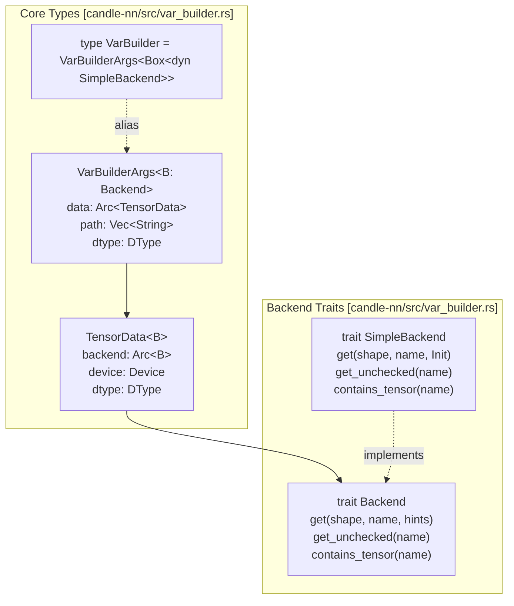
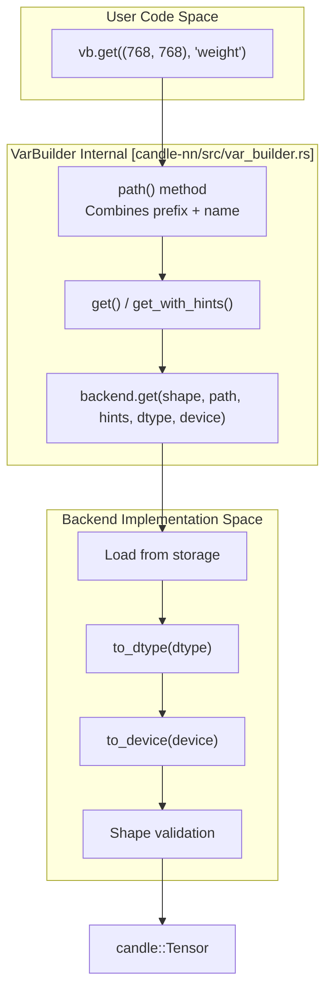
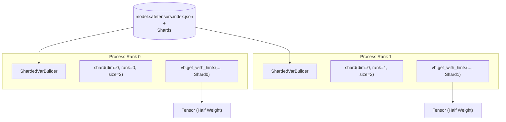

<!-- source: DeepWiki mcp.deepwiki.com · repo huggingface/candle · page 5.4 Variable Management with VarBuilder · fetched 2026-10-26 -->

# Variable Management with VarBuilder

<details>
<summary>Relevant source files</summary>

The following files were used as context for generating this wiki page:

- [candle-core/src/safetensors.rs](candle-core/src/safetensors.rs)
- [candle-examples/examples/llama_multiprocess/main.rs](candle-examples/examples/llama_multiprocess/main.rs)
- [candle-examples/examples/llama_multiprocess/model.rs](candle-examples/examples/llama_multiprocess/model.rs)
- [candle-examples/examples/mamba-minimal/README.md](candle-examples/examples/mamba-minimal/README.md)
- [candle-examples/examples/mamba-minimal/main.rs](candle-examples/examples/mamba-minimal/main.rs)
- [candle-examples/examples/mamba-minimal/model.rs](candle-examples/examples/mamba-minimal/model.rs)
- [candle-examples/examples/mamba/main.rs](candle-examples/examples/mamba/main.rs)
- [candle-examples/examples/quantized-t5/README.md](candle-examples/examples/quantized-t5/README.md)
- [candle-examples/examples/quantized-t5/main.rs](candle-examples/examples/quantized-t5/main.rs)
- [candle-examples/examples/t5/README.md](candle-examples/examples/t5/README.md)
- [candle-examples/examples/t5/main.rs](candle-examples/examples/t5/main.rs)
- [candle-examples/examples/yolo-v8/assets/bike.pp.jpg](candle-examples/examples/yolo-v8/assets/bike.pp.jpg)
- [candle-nn/examples/basic_optimizer.rs](candle-nn/examples/basic_optimizer.rs)
- [candle-nn/src/optim.rs](candle-nn/src/optim.rs)
- [candle-nn/src/var_builder.rs](candle-nn/src/var_builder.rs)
- [candle-nn/src/var_map.rs](candle-nn/src/var_map.rs)
- [candle-nn/tests/optim.rs](candle-nn/tests/optim.rs)
- [candle-transformers/src/lib.rs](candle-transformers/src/lib.rs)
- [candle-transformers/src/models/mamba.rs](candle-transformers/src/models/mamba.rs)
- [candle-transformers/src/models/quantized_rwkv_v5.rs](candle-transformers/src/models/quantized_rwkv_v5.rs)
- [candle-transformers/src/models/quantized_t5.rs](candle-transformers/src/models/quantized_t5.rs)
- [candle-transformers/src/models/rwkv_v5.rs](candle-transformers/src/models/rwkv_v5.rs)
- [candle-transformers/src/models/t5.rs](candle-transformers/src/models/t5.rs)
- [candle-transformers/src/quantized_var_builder.rs](candle-transformers/src/quantized_var_builder.rs)
- [candle-wasm-examples/llama2-c/src/model.rs](candle-wasm-examples/llama2-c/src/model.rs)
- [tensor-tools/Cargo.toml](tensor-tools/Cargo.toml)

</details>


`VarBuilder` is Candle's system for loading and managing model weights. It provides a unified interface for retrieving tensors from various storage formats (SafeTensors, PyTorch checkpoints, NPZ files, GGUF) while handling device placement, data type conversion, hierarchical parameter organization, and distributed tensor sharding. VarBuilder is used throughout model implementations to load pre-trained weights and initialize model parameters.

This page covers VarBuilder's architecture, the Backend trait system, supported file formats including memory-mapped loading, sharded tensor loading for distributed systems, and practical usage patterns.

Sources: [candle-nn/src/var_builder.rs:1-11]()

## Core Architecture

VarBuilder uses a trait-based backend system to abstract tensor loading from different storage formats. The main type is `VarBuilderArgs<'a, B: Backend>`, with `VarBuilder<'a>` as a type alias for the common case using `Box<dyn SimpleBackend + 'a>`.

**VarBuilder Entity Relationships**

Title: VarBuilder Entity Relationships


Sources: [candle-nn/src/var_builder.rs:16-36](), [candle-nn/src/var_builder.rs:44-68](), [candle-nn/src/var_builder.rs:69-106]()

Key implementation details:
- `VarBuilderArgs` stores an `Arc<TensorData>` for cheap cloning when navigating model hierarchies [candle-nn/src/var_builder.rs:23-32]().
- `path` field tracks the current prefix for hierarchical parameter access (e.g., `["model", "layers", "0"]`) [candle-nn/src/var_builder.rs:18-21]().
- `dtype` field specifies the default data type for loaded tensors [candle-nn/src/var_builder.rs:19-19]().
- `Backend` trait defines the interface; `SimpleBackend` is a simplified version for most use cases [candle-nn/src/var_builder.rs:50-84]().

## Tensor Retrieval Methods

VarBuilder provides several methods for retrieving tensors, varying in shape validation and initialization hints:

| Method | Parameters | Shape Validation | Source |
|--------|------------|------------------|--------|
| `get(shape, name)` | Required shape | Yes | [candle-nn/src/var_builder.rs:213-215]() |
| `get_with_hints(shape, name, hints)` | Shape + hints | Yes | [candle-nn/src/var_builder.rs:203-211]() |
| `get_unchecked(name)` | Name only | No | [candle-nn/src/var_builder.rs:218-220]() |

**Tensor Loading Flow**

Title: VarBuilder Data Retrieval Pipeline


Sources: [candle-nn/src/var_builder.rs:186-192](), [candle-nn/src/var_builder.rs:203-228]()

## SafeTensors and Memory Mapping

SafeTensors is the primary format for loading pre-trained models. Candle uses `MmapedSafetensors` to avoid full memory allocation by mapping files directly.

### Multi-file Loading
For models split across multiple files (shards), VarBuilder builds a routing table mapping tensor names to specific file indices. This is often initialized via `VarBuilder::from_mmaped_safetensors`.

Sources: [candle-core/src/safetensors.rs:423-516](), [candle-nn/src/var_builder.rs:642-649]()

### DType Handling
SafeTensors defines its own `st::Dtype` which Candle maps to its internal `DType` system.

| Candle DType | SafeTensors Dtype |
|--------------|-------------------|
| `F32` | `st::Dtype::F32` |
| `BF16` | `st::Dtype::BF16` |
| `F8E4M3` | `st::Dtype::F8_E4M3` |
| `F4` | `st::Dtype::F4` |

Sources: [candle-core/src/safetensors.rs:22-64]()

## Training with VarMap

For training, Candle uses `VarMap`, which holds mutable `Var` objects. `VarBuilder::from_varmap` creates a backend that either retrieves an existing variable or initializes a new one if it's missing from the map.

- `VarMap::new()`: Creates an empty store [candle-nn/src/var_map.rs:19-22]().
- `VarMap::get()`: Retrieves or initializes a `Var` based on a provided `Init` strategy [candle-nn/src/var_map.rs:95-116]().
- `VarMap::save()` / `VarMap::load()`: Serializes variables to/from SafeTensors files [candle-nn/src/var_map.rs:32-37](), [candle-nn/src/var_map.rs:43-54]().

Optimizers like `AdamW` or `SGD` consume the variables from a `VarMap` to perform gradient updates.
Sources: [candle-nn/src/var_map.rs:1-121](), [candle-nn/src/optim.rs:35-52](), [candle-nn/src/optim.rs:117-142]()

## Distributed and Sharded Loading

For multi-GPU setups (e.g., Tensor Parallelism), Candle provides `ShardedSafeTensors`. This allows loading only specific slices of tensors to different devices.

- `ShardedSafeTensors::var_builder()`: Creates a VarBuilder for sharded loading [candle-nn/src/var_builder.rs:821-829]().
- `shard(dim, rank, world_size)`: Defines how a tensor should be partitioned [candle-examples/examples/llama_multiprocess/model.rs:102-108]().

Title: Multi-GPU Sharded Loading with ShardedSafeTensors


Sources: [candle-examples/examples/llama_multiprocess/main.rs:183-186](), [candle-examples/examples/llama_multiprocess/model.rs:110-128]()

## Quantized VarBuilder (GGUF)

For inference using GGUF files, a specialized `VarBuilder` is provided in `candle-transformers`. Unlike the standard VarBuilder which returns `Tensor`, this one handles GGUF's specific metadata and block-quantized formats.

- `VarBuilder::from_gguf(path, device)`: Loads quantized weights from a GGUF file [candle-transformers/src/quantized_var_builder.rs:104]().
- `get(shape, name)`: Retrieves a tensor, which may be dequantized on the fly or used directly by quantized layers [candle-transformers/src/models/quantized_t5.rs:125-125]().

GGUF loading is integrated with `quantized_nn` modules to build efficient inference pipelines.

Sources: [candle-transformers/src/quantized_var_builder.rs:1-20](), [candle-transformers/src/models/quantized_t5.rs:21-21]()

## Weight Management Patterns

### Hierarchical Path Navigation
Models use `pp()` (push prefix) to navigate the weight tree. This allows modules to be self-contained and only care about their local parameter names.

```rust
// Example from T5 implementation
let wi = QMatMul::new(cfg.d_model, cfg.d_ff, vb.pp("wi"))?;
let wo = QMatMul::new(cfg.d_ff, cfg.d_model, vb.pp("wo"))?;
```

Sources: [candle-nn/src/var_builder.rs:150-164](), [candle-transformers/src/models/quantized_t5.rs:158-159]()

### DType Overrides
A VarBuilder can be cloned with a different default DType using `to_dtype()`. This is useful when a model needs to load specific layers in a different precision than the rest of the network.

Sources: [candle-nn/src/var_builder.rs:177-184]()

### Parameter Renaming and Mapping
The `Renamer` backend allows mapping names from a checkpoint (e.g., from PyTorch) to the names expected by a Candle model implementation. This is essential for cross-framework compatibility.

Sources: [candle-nn/src/var_builder.rs:722-766]()

---

