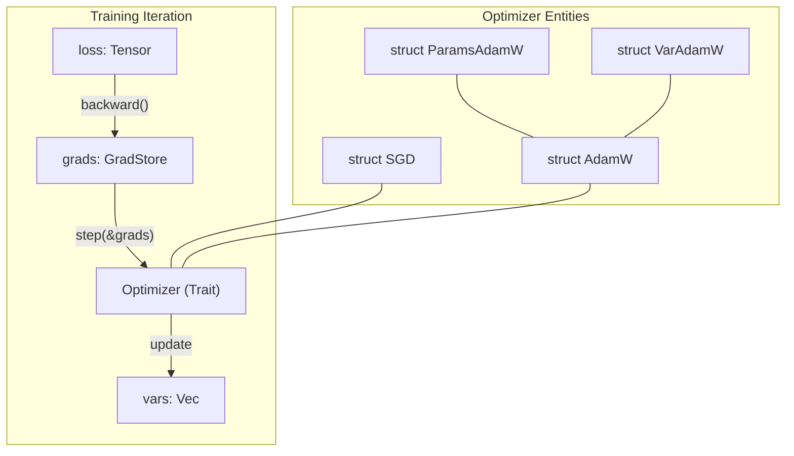
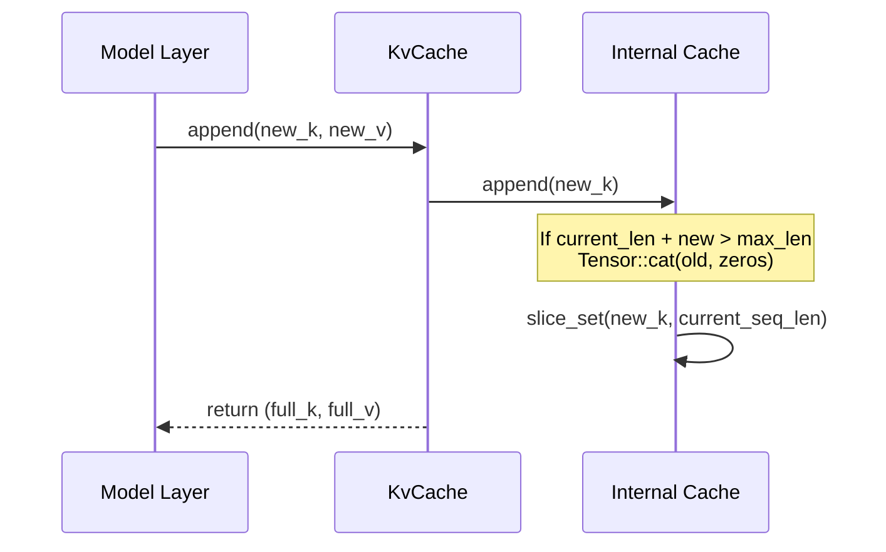
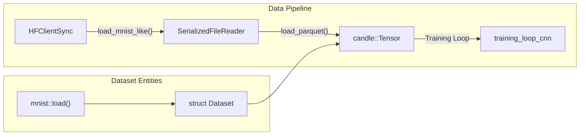

<!-- source: DeepWiki mcp.deepwiki.com · repo huggingface/candle · page 5.5 Optimizers, KV Cache, and Training Utilities · fetched 2026-10-26 -->

# Optimizers, KV Cache, and Training Utilities

Relevant source files

The following files were used as context for generating this wiki page:

- [candle-book/src/training/mnist.md](candle-book/src/training/mnist.md)
- [candle-datasets/src/batcher.rs](candle-datasets/src/batcher.rs)
- [candle-datasets/src/hub.rs](candle-datasets/src/hub.rs)
- [candle-datasets/src/lib.rs](candle-datasets/src/lib.rs)
- [candle-datasets/src/nlp/mod.rs](candle-datasets/src/nlp/mod.rs)
- [candle-datasets/src/vision/cifar.rs](candle-datasets/src/vision/cifar.rs)
- [candle-datasets/src/vision/fashion_mnist.rs](candle-datasets/src/vision/fashion_mnist.rs)
- [candle-datasets/src/vision/mnist.rs](candle-datasets/src/vision/mnist.rs)
- [candle-datasets/src/vision/mod.rs](candle-datasets/src/vision/mod.rs)
- [candle-examples/examples/helium/README.md](candle-examples/examples/helium/README.md)
- [candle-examples/examples/helium/main.rs](candle-examples/examples/helium/main.rs)
- [candle-examples/examples/mamba-minimal/README.md](candle-examples/examples/mamba-minimal/README.md)
- [candle-examples/examples/mamba-minimal/main.rs](candle-examples/examples/mamba-minimal/main.rs)
- [candle-examples/examples/mamba-minimal/model.rs](candle-examples/examples/mamba-minimal/model.rs)
- [candle-examples/examples/mamba/main.rs](candle-examples/examples/mamba/main.rs)
- [candle-examples/examples/mimi/README.md](candle-examples/examples/mimi/README.md)
- [candle-examples/examples/mimi/main.rs](candle-examples/examples/mimi/main.rs)
- [candle-examples/examples/mnist-training/main.rs](candle-examples/examples/mnist-training/main.rs)
- [candle-examples/examples/quantized/main.rs](candle-examples/examples/quantized/main.rs)
- [candle-examples/examples/qwen/README.md](candle-examples/examples/qwen/README.md)
- [candle-examples/examples/qwen/main.rs](candle-examples/examples/qwen/main.rs)
- [candle-examples/examples/yolo-v8/assets/bike.pp.jpg](candle-examples/examples/yolo-v8/assets/bike.pp.jpg)
- [candle-nn/examples/basic_optimizer.rs](candle-nn/examples/basic_optimizer.rs)
- [candle-nn/src/attention/cpu_flash/causal.rs](candle-nn/src/attention/cpu_flash/causal.rs)
- [candle-nn/src/attention/cpu_flash/mod.rs](candle-nn/src/attention/cpu_flash/mod.rs)
- [candle-nn/src/attention/cpu_flash/online_softmax.rs](candle-nn/src/attention/cpu_flash/online_softmax.rs)
- [candle-nn/src/attention/cpu_flash/standard.rs](candle-nn/src/attention/cpu_flash/standard.rs)
- [candle-nn/src/attention/cpu_flash/varlen.rs](candle-nn/src/attention/cpu_flash/varlen.rs)
- [candle-nn/src/cpu_flash_attention.rs](candle-nn/src/cpu_flash_attention.rs)
- [candle-nn/src/kv_cache.rs](candle-nn/src/kv_cache.rs)
- [candle-nn/src/optim.rs](candle-nn/src/optim.rs)
- [candle-nn/src/sampling.rs](candle-nn/src/sampling.rs)
- [candle-nn/src/var_map.rs](candle-nn/src/var_map.rs)
- [candle-nn/tests/kv_cache.rs](candle-nn/tests/kv_cache.rs)
- [candle-nn/tests/optim.rs](candle-nn/tests/optim.rs)
- [candle-transformers/src/generation/mod.rs](candle-transformers/src/generation/mod.rs)
- [candle-transformers/src/models/helium.rs](candle-transformers/src/models/helium.rs)
- [candle-transformers/src/models/mamba.rs](candle-transformers/src/models/mamba.rs)
- [candle-transformers/src/models/mimi/encodec.rs](candle-transformers/src/models/mimi/encodec.rs)
- [candle-transformers/src/models/mimi/mod.rs](candle-transformers/src/models/mimi/mod.rs)
- [candle-transformers/src/models/mimi/quantization.rs](candle-transformers/src/models/mimi/quantization.rs)
- [candle-transformers/src/models/mimi/seanet.rs](candle-transformers/src/models/mimi/seanet.rs)
- [candle-transformers/src/models/mimi/transformer.rs](candle-transformers/src/models/mimi/transformer.rs)
- [candle-transformers/src/models/quantized_qwen3.rs](candle-transformers/src/models/quantized_qwen3.rs)
- [candle-transformers/src/models/quantized_rwkv_v5.rs](candle-transformers/src/models/quantized_rwkv_v5.rs)
- [candle-transformers/src/models/qwen3.rs](candle-transformers/src/models/qwen3.rs)
- [candle-transformers/src/models/rwkv_v5.rs](candle-transformers/src/models/rwkv_v5.rs)
- [candle-transformers/tests/generation_tests.rs](candle-transformers/tests/generation_tests.rs)

This section documents the essential components for training and efficient inference within the Candle ecosystem. It covers the optimization algorithms in `candle-nn`, the caching mechanisms for autoregressive models, the attention utilities, and the data loading utilities provided by `candle-datasets`.

## Optimizers

The `candle-nn` crate provides a trait-based optimization system defined in `candle-nn/src/optim.rs`. All optimizers implement the `Optimizer` trait, which defines the standard interface for updating model parameters using computed gradients [candle-nn/src/optim.rs:5-29]().

### Supported Algorithms

| Optimizer | Description | Configuration |
| :--- | :--- | :--- |
| `SGD` | Stochastic Gradient Descent. Basic descent without momentum support [candle-nn/src/optim.rs:31-38](). | `learning_rate: f64` [candle-nn/src/optim.rs:41-42]() |
| `AdamW` | Adam with Weight Decay. Implements the standard decoupled weight decay algorithm [candle-nn/src/optim.rs:111-115](). | `ParamsAdamW` struct [candle-nn/src/optim.rs:83-89]() |

### The Optimization Loop
Optimizers interact with a `VarMap` to retrieve all trainable variables and a `GradStore` produced by the `backward()` call on a loss tensor [candle-nn/src/optim.rs:20-23](). Training loops typically shuffle batch indices and perform `backward_step` on the optimizer instance [candle-examples/examples/mnist-training/main.rs:140-151]().

**Optimizer Architecture**

Sources: [candle-nn/src/optim.rs:5-183](), [candle-examples/examples/mnist-training/main.rs:131-151](), [candle-nn/src/var_map.rs:12-29]()

## KV Cache and Efficient Inference

For autoregressive models, recomputing hidden states for previous tokens is inefficient. Candle provides specialized cache structures in `candle-nn/src/kv_cache.rs` to manage these states.

### Cache Types
1.  **`Cache`**: Manages a single `Option<Tensor>`. It supports dynamic growth using `grow_by` and tracks `current_seq_len` [candle-nn/src/kv_cache.rs:6-16]().
2.  **`KvCache`**: A wrapper containing two `Cache` instances for Keys and Values [candle-nn/src/kv_cache.rs:83-86]().
3.  **`RotatingCache`**: Implements a sliding window using a fixed-size rotating buffer and an `offset` index [candle-nn/src/kv_cache.rs:154-164]().
4.  **`ConcatKvCache`**: Often used in GPU paths to concatenate along the sequence dimension (e.g., `dim=2`) [candle-transformers/src/models/qwen3.rs:168]().
5.  **Specialized CPU Caches**: Models like Qwen3 utilize `InterleavedKvCache` and `RawInterleavedKvCache` for optimized CPU flash attention paths [candle-transformers/src/models/quantized_qwen3.rs:15-16]().

### Data Flow in Inference
During the forward pass, the `append` method concatenates new K/V tensors with the existing cache.

Sources: [candle-nn/src/kv_cache.rs:58-79](), [candle-nn/src/kv_cache.rs:119-141](), [candle-transformers/src/models/qwen3.rs:223-224]()

## Attention Module Utilities

Candle-nn includes a dedicated attention module to unify CPU and GPU acceleration paths.

*   **`AttnMask`**: Provides an abstraction for attention masks, such as causal masks [candle-transformers/src/models/quantized_qwen3.rs:14]().
*   **`flash_attn` Dispatcher**: Handles standard attention or optimized paths like `causal_decode_f32_interleaved` for inference [candle-transformers/src/models/quantized_qwen3.rs:13-14]().
*   **CPU Flash Attention**: Implemented in `candle-nn/src/attention/cpu_flash/`, featuring specialized kernels for single-batch causal attention [candle-nn/src/attention/cpu_flash/causal.rs:49-62]() and fused softmax [candle-nn/src/attention/cpu_flash/standard.rs:13-21]().
*   **Variable Length Support**: The `varlen` module in `candle-nn/src/attention/cpu_flash/varlen.rs` supports sequences of different lengths within a single batch using `flash_attn_varlen_cpu`, which operates on packed, padding-free sequences [candle-nn/src/attention/cpu_flash/varlen.rs:17-40]().

Sources: [candle-nn/src/attention/cpu_flash/causal.rs:1-62](), [candle-nn/src/attention/cpu_flash/standard.rs:1-137](), [candle-nn/src/attention/cpu_flash/varlen.rs:1-114]()

## Sampling Strategies

The `candle-transformers` crate provides `LogitsProcessor` to sample token IDs from model outputs.

### Sampling Enum
The `Sampling` enum defines strategies for token selection [candle-transformers/src/generation/mod.rs:10-18]():
*   **`ArgMax`**: Selects the token with the highest logit [candle-transformers/src/generation/mod.rs:46-48]().
*   **`All { temperature }`**: Multinomial sampling from the full distribution [candle-transformers/src/generation/mod.rs:136-139]().
*   **`TopK` / `TopP`**: Filtering strategies to limit sampling to the most likely tokens [candle-transformers/src/generation/mod.rs:61-95]().
*   **`GumbelSoftmax`**: Uses `candle_nn::sampling::gumbel_softmax` for differentiable sampling [candle-transformers/src/generation/mod.rs:50-53]().

Sources: [candle-transformers/src/generation/mod.rs:1-161](), [candle-examples/examples/qwen/main.rs:61-70]()

## Training and Dataset Utilities

### Mixture-of-Experts (MoE)
MoE architectures use routing logic to select "experts". Candle provides:
*   **MoE Forwarding**: Logic for selecting experts and performing weighted summation of expert outputs, as seen in Qwen MoE variants [candle-examples/examples/qwen/main.rs:24-37]().
*   **MoE GEMM**: Optimized matrix multiplication utilities for MoE layers.

### Dataset Loading
The `candle-datasets` crate handles fetching and formatting data.

*   **Vision**: Standard loaders for MNIST [candle-datasets/src/vision/mnist.rs:119-126]() and other vision datasets.
*   **HF Hub**: `load_mnist_like` loads `.parquet` files directly from Hugging Face using `HFClientSync` [candle-datasets/src/vision/mnist.rs:89-117]().
*   **Data Conversion**: Images are converted to tensors and normalized (e.g., dividing by 255.0 for MNIST) [candle-datasets/src/vision/mnist.rs:45-47]().

**Data Loading Pipeline**

Sources: [candle-datasets/src/vision/mnist.rs:49-126](), [candle-examples/examples/mnist-training/main.rs:110-124]()

---

