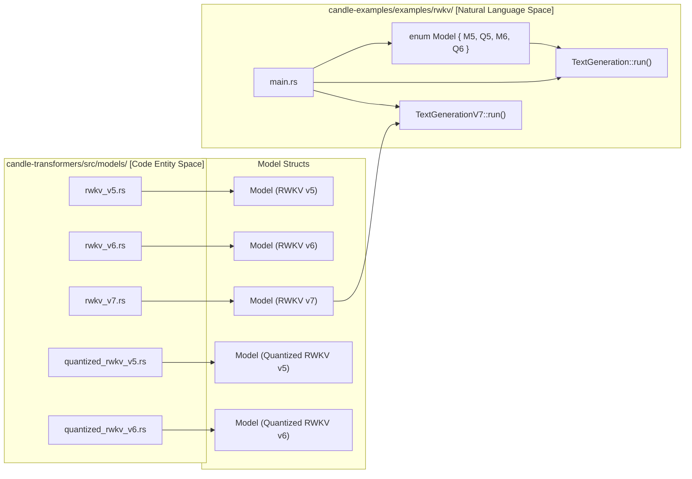

<!-- source: DeepWiki mcp.deepwiki.com · repo huggingface/candle · page 6 Model Implementations and Examples · fetched 2026-10-26 -->

# Model Implementations and Examples

<details>
<summary>Relevant source files</summary>

The following files were used as context for generating this wiki page:

- [README.md](README.md)
- [candle-core/Cargo.toml](candle-core/Cargo.toml)
- [candle-datasets/Cargo.toml](candle-datasets/Cargo.toml)
- [candle-examples/Cargo.toml](candle-examples/Cargo.toml)
- [candle-examples/examples/rwkv/README.md](candle-examples/examples/rwkv/README.md)
- [candle-examples/examples/rwkv/main.rs](candle-examples/examples/rwkv/main.rs)
- [candle-nn/Cargo.toml](candle-nn/Cargo.toml)
- [candle-pyo3/Cargo.toml](candle-pyo3/Cargo.toml)
- [candle-transformers/Cargo.toml](candle-transformers/Cargo.toml)
- [candle-transformers/src/models/mod.rs](candle-transformers/src/models/mod.rs)
- [candle-transformers/src/models/quantized_rwkv_v6.rs](candle-transformers/src/models/quantized_rwkv_v6.rs)
- [candle-transformers/src/models/rwkv_v6.rs](candle-transformers/src/models/rwkv_v6.rs)
- [candle-transformers/src/models/rwkv_v7.rs](candle-transformers/src/models/rwkv_v7.rs)
- [candle-wasm-examples/llama2-c/Cargo.toml](candle-wasm-examples/llama2-c/Cargo.toml)
- [candle-wasm-examples/whisper/Cargo.toml](candle-wasm-examples/whisper/Cargo.toml)
- [candle-wasm-examples/yolo/Cargo.toml](candle-wasm-examples/yolo/Cargo.toml)

</details>


This page provides an overview of the 50+ pre-implemented models in `candle-transformers` and the example applications in `candle-examples` that demonstrate their usage across various domains including Large Language Models (LLMs), speech, vision, and multimodal tasks.

## Examples Structure

The `candle-examples` crate contains standalone command-line applications. These examples serve as reference implementations for loading weights, configuring architectures, and running inference loops.

```mermaid
graph TB
    subgraph "candle-examples/ [Crate Root]"
        ExamplesDir["examples/ [Binary Entry Points]"]
        
        subgraph "LLM Examples"
            LlamaEx["llama/main.rs [Llama::load, autoregressive loop]"]
            MistralEx["mistral/main.rs [Model::forward, KV cache]"]
            PhiEx["phi/main.rs [TextGeneration pipeline]"]
            QwenEx["qwen/main.rs [Model::Base, Model::Moe]"]
            QuantEx["quantized/main.rs [GGUF loading, Q4/Q8 models]"]
            RWKVEx["rwkv/main.rs [RWKV v5/v6/v7 models]"]
        end
        
        subgraph "Audio Examples"
            WhisperEx["whisper/main.rs [Decoder with timestamp rules]"]
            EncodecEx["encodec/main.rs [Audio compression]"]
            MetaVoiceEx["metavoice/main.rs [Text-to-speech]"]
            ParlerTTSEx["parler_tts/main.rs [Text-to-speech]"]
            VoxtralEx["voxtral/main.rs [Symphonia decoding]"]
        end
        
        subgraph "Vision Examples"
            YoloEx["yolo-v8/main.rs [Object detection]"]
            SAMEx["segment-anything/main.rs [Image segmentation]"]
            DepthEx["depth_anything_v2/main.rs [Depth estimation]"]
            DINOv2Ex["dinov2/main.rs [Self-supervised vision]"]
        end
        
        subgraph "Generative Image Examples"
            SDEx["stable-diffusion/main.rs [Text-to-image generation]"]
            WuerstchenEx["wuerstchen/main.rs [Text-to-image generation]"]
        end

        subgraph "Multimodal Examples"
            BLIPEx["blip/main.rs [Image captioning]"]
            ColPaliEx["colpali/main.rs [PDF-to-image]"]
            Qwen3VLEx["qwen3-vl/main.rs [Multimodal LLM]"]
        end
    end
    
    CargoToml["Cargo.toml [Feature flags: cuda, metal, mkl, flash-attn]"]
    Models["candle-transformers/src/models/ [Model logic]"]
    
    ExamplesDir --> LlamaEx
    ExamplesDir --> QwenEx
    ExamplesDir --> WhisperEx
    ExamplesDir --> YoloEx
    ExamplesDir --> RWKVEx
    ExamplesDir --> MetaVoiceEx
    ExamplesDir --> ParlerTTSEx
    ExamplesDir --> DINOv2Ex
    ExamplesDir --> WuerstchenEx
    ExamplesDir --> Qwen3VLEx
    
    CargoToml --> ExamplesDir
    Models --> LlamaEx
    Models --> QwenEx
    Models --> WhisperEx
    Models --> RWKVEx
    Models --> MetaVoiceEx
    Models --> ParlerTTSEx
    Models --> DINOv2Ex
    Models --> WuerstchenEx
    Models --> Qwen3VLEx
```



**Examples Directory Structure**

Sources: [candle-transformers/src/models/mod.rs:1-140](), [README.md:50-140](), [candle-examples/Cargo.toml:100-166]()

## Model Organization

Models are implemented in `candle-transformers/src/models/`. The framework separates the core model logic (in `candle-transformers`) from the application-level logic (in `candle-examples`).

| Component | Purpose | Example |
|-----------|---------|---------|
| `Config` struct | Hyperparameters for the architecture | `Config` (RWKV v5) [candle-transformers/src/models/rwkv_v5.rs:1-1]() |
| Main model struct | Forward pass and layer composition | `Model` (RWKV v5) [candle-transformers/src/models/rwkv_v5.rs:1-1]() |
| Quantized variants | Low-precision implementations | `quantized_llama` [candle-transformers/src/models/quantized_llama.rs:1-1]() |
| Multi-GPU | Distributed inference support | `llama_multiprocess` [candle-examples/Cargo.toml:100-102]() |



**Association of Model Entities to Example Logic**

Sources: [candle-transformers/src/models/mod.rs:118-120](), [candle-transformers/src/models/mod.rs:106-107](), [candle-examples/examples/rwkv/main.rs:25-41](), [candle-examples/examples/rwkv/main.rs:132-143]()

---

## Domain Overview

### Large Language Models
For details, see [Large Language Models](#6.1).
Candle supports a vast array of LLMs including LLaMA (v1-v3), Mistral, Mixtral, Phi (1/2/3), Qwen (2/3/MoE), Gemma (1/2/3/4 text), Falcon, Granite, GraniteMoeHybrid, StableLM, DeepSeek2, GLM4, Helium, SmolLM3, RWKV (v5/v6/v7), and Mamba (v1/v2). These implementations typically include support for Rotary Positional Embeddings (RoPE), Grouped-Query Attention (GQA), and efficient KV caching for autoregressive inference.

Sources: [README.md:64-95](), [candle-transformers/src/models/mod.rs:5-6](), [candle-examples/examples/rwkv/main.rs:10-16]()

### Speech Recognition and Audio
For details, see [Speech Recognition and Audio Models](#6.2).
Audio support includes the Whisper model for multilingual speech-to-text, MetaVoice TTS, EnCodec for high-quality audio compression, Mimi, SNAC, Parler-TTS, MusicGen, Voxtral (multimodal speech+LLM), CSM (Conversational Speech Model), and Orpheus TTS. The framework provides utilities for PCM decoding and Mel spectrogram generation.

Sources: [README.md:120-127](), [candle-transformers/src/models/mod.rs:9-9](), [candle-examples/Cargo.toml:121-128]()

### Computer Vision Models
For details, see [Computer Vision Models](#6.3).
Vision implementations range from classic architectures like ResNet and VGG to modern Transformer-based models like ViT and DINOv2. Other models include YOLO (v3/v8), CLIP, SigLIP, Segment Anything (SAM), depth estimation (DepthAnythingV2), and image classification models like ConvNeXt, FastViT, and MobileNet.

Sources: [README.md:109-119](), [candle-transformers/src/models/mod.rs:10-10](), [candle-examples/Cargo.toml:149-150]()

### Generative Image Models
For details, see [Generative Image Models](#6.4).
Text-to-image capabilities are provided via Stable Diffusion (v1/v2/XL), Stable Diffusion 3 (MMDiT), Flux, and Wuerstchen. These examples demonstrate complex pipelines involving VAEs, UNets, CLIP text encoders, and various schedulers.

Sources: [README.md:99-107](), [candle-transformers/src/models/mod.rs:8-8](), [candle-transformers/src/models/mod.rs:44-44]()

### Multimodal Models
For details, see [Multimodal Models](#6.5).
Candle supports multimodal models that combine vision, audio, and language, such as Gemma4 (text+vision+audio), Voxtral (speech+LLM), LLaVA, PaliGemma, Pixtral, Qwen3-VL, BLIP, Moondream, ColPali, and PaddleOCR-VL. These models often involve multimodal embedding and cross-modal attention mechanisms.

Sources: [candle-transformers/src/models/mod.rs:7-7](), [candle-transformers/src/models/mod.rs:48-48](), [candle-transformers/src/models/mod.rs:133-134](), [candle-examples/Cargo.toml:157-162]()

---

## Common Implementation Patterns

Most examples follow a standardized lifecycle for inference:

1.  **Device Setup**: Selection of `Device::Cpu`, `Device::Cuda`, or `Device::Metal`. [README.md:27-46]()
2.  **Weight Loading**: Utilizing `VarBuilder` to load weights from `safetensors` or `GGUF` files. [candle-examples/examples/rwkv/main.rs:20-20]()
3.  **Tokenization**: Using the `tokenizers` crate to convert text to input IDs. [candle-examples/examples/rwkv/main.rs:80-80]()
4.  **Generation Loop**: Autoregressive sampling using `LogitsProcessor`. [candle-examples/examples/rwkv/main.rs:66-66](), [candle-examples/examples/rwkv/main.rs:109-109]()

### WASM Support
Candle models can be deployed to the browser using WebAssembly. Online demos include Whisper, LLaMA2, T5, YOLO, and Segment Anything.

Sources: [README.md:9-15](), [README.md:52-61](), [candle-wasm-examples/whisper/Cargo.toml:1-35]()

---

## Example Command Reference

Examples are typically executed via `cargo run --example`:

```bash
# LLM Inference (LLaMA)
cargo run --example llama --release

# Vision Inference (YOLO v8)
cargo run --example yolo-v8 --release -- --images input.jpg

# Audio Inference (Whisper)
cargo run --example whisper --release -- --input audio.wav

# Multi-process LLM (Requires CUDA and NCCL)
cargo run --example llama_multiprocess --features cuda,nccl,flash-attn
```

Sources: [README.md:64-120](), [candle-examples/Cargo.toml:100-102]()

---

