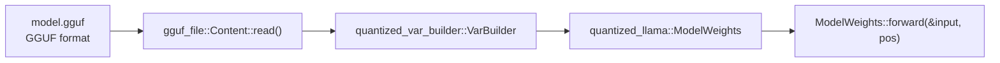
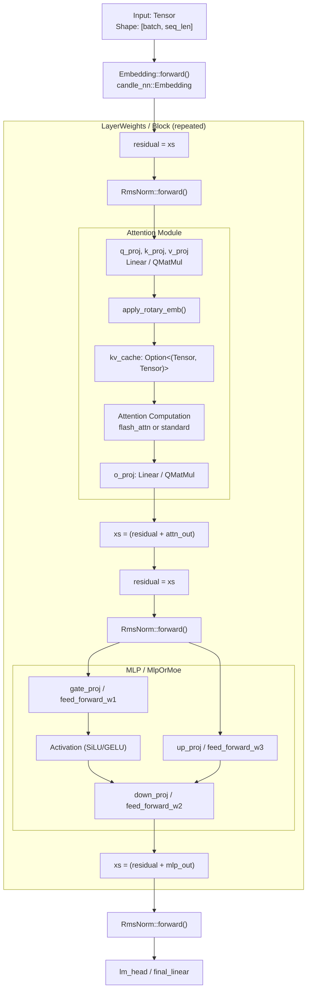

<!-- source: DeepWiki mcp.deepwiki.com · repo huggingface/candle · page 6.1 Large Language Models · fetched 2026-10-26 -->

# Large Language Models

<details>
<summary>Relevant source files</summary>

The following files were used as context for generating this wiki page:

- [README.md](README.md)
- [candle-examples/examples/chatglm/main.rs](candle-examples/examples/chatglm/main.rs)
- [candle-examples/examples/codegeex4-9b/README.org](candle-examples/examples/codegeex4-9b/README.org)
- [candle-examples/examples/codegeex4-9b/main.rs](candle-examples/examples/codegeex4-9b/main.rs)
- [candle-examples/examples/colpali/README.md](candle-examples/examples/colpali/README.md)
- [candle-examples/examples/colpali/main.rs](candle-examples/examples/colpali/main.rs)
- [candle-examples/examples/deepseekv2/README.md](candle-examples/examples/deepseekv2/README.md)
- [candle-examples/examples/deepseekv2/main.rs](candle-examples/examples/deepseekv2/main.rs)
- [candle-examples/examples/gemma/README.md](candle-examples/examples/gemma/README.md)
- [candle-examples/examples/gemma/main.rs](candle-examples/examples/gemma/main.rs)
- [candle-examples/examples/glm4/README.md](candle-examples/examples/glm4/README.md)
- [candle-examples/examples/gte-qwen/README.md](candle-examples/examples/gte-qwen/README.md)
- [candle-examples/examples/gte-qwen/main.rs](candle-examples/examples/gte-qwen/main.rs)
- [candle-examples/examples/jina-bert/README.md](candle-examples/examples/jina-bert/README.md)
- [candle-examples/examples/jina-bert/main.rs](candle-examples/examples/jina-bert/main.rs)
- [candle-examples/examples/llama2-c/main.rs](candle-examples/examples/llama2-c/main.rs)
- [candle-examples/examples/llama2-c/training.rs](candle-examples/examples/llama2-c/training.rs)
- [candle-examples/examples/mamba-minimal/README.md](candle-examples/examples/mamba-minimal/README.md)
- [candle-examples/examples/mamba-minimal/main.rs](candle-examples/examples/mamba-minimal/main.rs)
- [candle-examples/examples/mamba-minimal/model.rs](candle-examples/examples/mamba-minimal/model.rs)
- [candle-examples/examples/mamba/main.rs](candle-examples/examples/mamba/main.rs)
- [candle-examples/examples/mistral/main.rs](candle-examples/examples/mistral/main.rs)
- [candle-examples/examples/mixtral/README.md](candle-examples/examples/mixtral/README.md)
- [candle-examples/examples/mixtral/main.rs](candle-examples/examples/mixtral/main.rs)
- [candle-examples/examples/moondream/main.rs](candle-examples/examples/moondream/main.rs)
- [candle-examples/examples/olmo/README.md](candle-examples/examples/olmo/README.md)
- [candle-examples/examples/olmo/main.rs](candle-examples/examples/olmo/main.rs)
- [candle-examples/examples/paligemma/README.md](candle-examples/examples/paligemma/README.md)
- [candle-examples/examples/paligemma/main.rs](candle-examples/examples/paligemma/main.rs)
- [candle-examples/examples/phi/README.md](candle-examples/examples/phi/README.md)
- [candle-examples/examples/phi/main.rs](candle-examples/examples/phi/main.rs)
- [candle-examples/examples/quantized-glm4/README.md](candle-examples/examples/quantized-glm4/README.md)
- [candle-examples/examples/quantized-lfm2/README.md](candle-examples/examples/quantized-lfm2/README.md)
- [candle-examples/examples/qwen/README.md](candle-examples/examples/qwen/README.md)
- [candle-examples/examples/qwen/main.rs](candle-examples/examples/qwen/main.rs)
- [candle-examples/examples/replit-code/README.md](candle-examples/examples/replit-code/README.md)
- [candle-examples/examples/replit-code/main.rs](candle-examples/examples/replit-code/main.rs)
- [candle-examples/examples/rwkv/README.md](candle-examples/examples/rwkv/README.md)
- [candle-examples/examples/rwkv/main.rs](candle-examples/examples/rwkv/main.rs)
- [candle-examples/examples/smollm3/main.rs](candle-examples/examples/smollm3/main.rs)
- [candle-examples/examples/stable-lm/README.md](candle-examples/examples/stable-lm/README.md)
- [candle-examples/examples/stable-lm/main.rs](candle-examples/examples/stable-lm/main.rs)
- [candle-examples/examples/starcoder2/main.rs](candle-examples/examples/starcoder2/main.rs)
- [candle-examples/examples/yi/main.rs](candle-examples/examples/yi/main.rs)
- [candle-examples/examples/yolo-v8/assets/bike.pp.jpg](candle-examples/examples/yolo-v8/assets/bike.pp.jpg)
- [candle-examples/src/token_output_stream.rs](candle-examples/src/token_output_stream.rs)
- [candle-flash-attn/kernels/flash_fwd_launch_template.h](candle-flash-attn/kernels/flash_fwd_launch_template.h)
- [candle-nn/examples/basic_optimizer.rs](candle-nn/examples/basic_optimizer.rs)
- [candle-nn/src/attention/cpu_flash/causal.rs](candle-nn/src/attention/cpu_flash/causal.rs)
- [candle-nn/src/attention/cpu_flash/mod.rs](candle-nn/src/attention/cpu_flash/mod.rs)
- [candle-nn/src/attention/cpu_flash/online_softmax.rs](candle-nn/src/attention/cpu_flash/online_softmax.rs)
- [candle-nn/src/attention/cpu_flash/standard.rs](candle-nn/src/attention/cpu_flash/standard.rs)
- [candle-nn/src/attention/cpu_flash/varlen.rs](candle-nn/src/attention/cpu_flash/varlen.rs)
- [candle-nn/src/attention/mod.rs](candle-nn/src/attention/mod.rs)
- [candle-nn/src/attention/varlen.rs](candle-nn/src/attention/varlen.rs)
- [candle-nn/src/cpu_flash_attention.rs](candle-nn/src/cpu_flash_attention.rs)
- [candle-nn/src/kv_cache.rs](candle-nn/src/kv_cache.rs)
- [candle-nn/src/optim.rs](candle-nn/src/optim.rs)
- [candle-nn/src/var_map.rs](candle-nn/src/var_map.rs)
- [candle-nn/tests/optim.rs](candle-nn/tests/optim.rs)
- [candle-transformers/src/models/bert.rs](candle-transformers/src/models/bert.rs)
- [candle-transformers/src/models/bigcode.rs](candle-transformers/src/models/bigcode.rs)
- [candle-transformers/src/models/chatglm.rs](candle-transformers/src/models/chatglm.rs)
- [candle-transformers/src/models/codegeex4_9b.rs](candle-transformers/src/models/codegeex4_9b.rs)
- [candle-transformers/src/models/colpali.rs](candle-transformers/src/models/colpali.rs)
- [candle-transformers/src/models/deepseek2.rs](candle-transformers/src/models/deepseek2.rs)
- [candle-transformers/src/models/falcon.rs](candle-transformers/src/models/falcon.rs)
- [candle-transformers/src/models/gemma.rs](candle-transformers/src/models/gemma.rs)
- [candle-transformers/src/models/gemma2.rs](candle-transformers/src/models/gemma2.rs)
- [candle-transformers/src/models/gemma3.rs](candle-transformers/src/models/gemma3.rs)
- [candle-transformers/src/models/glm4.rs](candle-transformers/src/models/glm4.rs)
- [candle-transformers/src/models/glm4_new.rs](candle-transformers/src/models/glm4_new.rs)
- [candle-transformers/src/models/granite.rs](candle-transformers/src/models/granite.rs)
- [candle-transformers/src/models/granitemoehybrid.rs](candle-transformers/src/models/granitemoehybrid.rs)
- [candle-transformers/src/models/jina_bert.rs](candle-transformers/src/models/jina_bert.rs)
- [candle-transformers/src/models/llama.rs](candle-transformers/src/models/llama.rs)
- [candle-transformers/src/models/llama2_c.rs](candle-transformers/src/models/llama2_c.rs)
- [candle-transformers/src/models/mamba.rs](candle-transformers/src/models/mamba.rs)
- [candle-transformers/src/models/mistral.rs](candle-transformers/src/models/mistral.rs)
- [candle-transformers/src/models/mixformer.rs](candle-transformers/src/models/mixformer.rs)
- [candle-transformers/src/models/mixtral.rs](candle-transformers/src/models/mixtral.rs)
- [candle-transformers/src/models/mod.rs](candle-transformers/src/models/mod.rs)
- [candle-transformers/src/models/moondream.rs](candle-transformers/src/models/moondream.rs)
- [candle-transformers/src/models/mpt.rs](candle-transformers/src/models/mpt.rs)
- [candle-transformers/src/models/olmo.rs](candle-transformers/src/models/olmo.rs)
- [candle-transformers/src/models/olmo2.rs](candle-transformers/src/models/olmo2.rs)
- [candle-transformers/src/models/paligemma.rs](candle-transformers/src/models/paligemma.rs)
- [candle-transformers/src/models/phi.rs](candle-transformers/src/models/phi.rs)
- [candle-transformers/src/models/phi3.rs](candle-transformers/src/models/phi3.rs)
- [candle-transformers/src/models/quantized_glm4.rs](candle-transformers/src/models/quantized_glm4.rs)
- [candle-transformers/src/models/quantized_lfm2.rs](candle-transformers/src/models/quantized_lfm2.rs)
- [candle-transformers/src/models/quantized_llama.rs](candle-transformers/src/models/quantized_llama.rs)
- [candle-transformers/src/models/quantized_llama2_c.rs](candle-transformers/src/models/quantized_llama2_c.rs)
- [candle-transformers/src/models/quantized_mistral.rs](candle-transformers/src/models/quantized_mistral.rs)
- [candle-transformers/src/models/quantized_mixformer.rs](candle-transformers/src/models/quantized_mixformer.rs)
- [candle-transformers/src/models/quantized_moondream.rs](candle-transformers/src/models/quantized_moondream.rs)
- [candle-transformers/src/models/quantized_mpt.rs](candle-transformers/src/models/quantized_mpt.rs)
- [candle-transformers/src/models/quantized_phi.rs](candle-transformers/src/models/quantized_phi.rs)
- [candle-transformers/src/models/quantized_qwen2.rs](candle-transformers/src/models/quantized_qwen2.rs)
- [candle-transformers/src/models/quantized_qwen3.rs](candle-transformers/src/models/quantized_qwen3.rs)
- [candle-transformers/src/models/quantized_qwen3_moe.rs](candle-transformers/src/models/quantized_qwen3_moe.rs)
- [candle-transformers/src/models/quantized_rwkv_v5.rs](candle-transformers/src/models/quantized_rwkv_v5.rs)
- [candle-transformers/src/models/quantized_rwkv_v6.rs](candle-transformers/src/models/quantized_rwkv_v6.rs)
- [candle-transformers/src/models/quantized_stable_lm.rs](candle-transformers/src/models/quantized_stable_lm.rs)
- [candle-transformers/src/models/qwen2.rs](candle-transformers/src/models/qwen2.rs)
- [candle-transformers/src/models/qwen2_moe.rs](candle-transformers/src/models/qwen2_moe.rs)
- [candle-transformers/src/models/qwen3.rs](candle-transformers/src/models/qwen3.rs)
- [candle-transformers/src/models/qwen3_moe.rs](candle-transformers/src/models/qwen3_moe.rs)
- [candle-transformers/src/models/rwkv_v5.rs](candle-transformers/src/models/rwkv_v5.rs)
- [candle-transformers/src/models/rwkv_v6.rs](candle-transformers/src/models/rwkv_v6.rs)
- [candle-transformers/src/models/rwkv_v7.rs](candle-transformers/src/models/rwkv_v7.rs)
- [candle-transformers/src/models/segformer.rs](candle-transformers/src/models/segformer.rs)
- [candle-transformers/src/models/smol/quantized_smollm3.rs](candle-transformers/src/models/smol/quantized_smollm3.rs)
- [candle-transformers/src/models/smol/smollm3.rs](candle-transformers/src/models/smol/smollm3.rs)
- [candle-transformers/src/models/stable_lm.rs](candle-transformers/src/models/stable_lm.rs)
- [candle-transformers/src/models/starcoder2.rs](candle-transformers/src/models/starcoder2.rs)
- [candle-transformers/src/models/whisper/model.rs](candle-transformers/src/models/whisper/model.rs)
- [candle-transformers/src/models/whisper/quantized_model.rs](candle-transformers/src/models/whisper/quantized_model.rs)
- [candle-transformers/src/models/yi.rs](candle-transformers/src/models/yi.rs)
- [candle-transformers/src/models/z_image/text_encoder.rs](candle-transformers/src/models/z_image/text_encoder.rs)
- [candle-transformers/src/quantized_nn.rs](candle-transformers/src/quantized_nn.rs)
- [candle-transformers/src/utils.rs](candle-transformers/src/utils.rs)
- [candle-wasm-examples/moondream/src/bin/m.rs](candle-wasm-examples/moondream/src/bin/m.rs)

</details>


This page documents Candle's implementations of Large Language Models (LLMs) for autoregressive text generation. The framework provides 30+ pre-implemented decoder-only transformer architectures with support for both full-precision and quantized inference.

**Related Pages:**
- For quantization techniques and formats, see page 4 (Quantization System)
- For speech models, see page 6.2 (Speech Recognition and Audio Models)
- For computer vision models, see page 6.3 (Computer Vision Models)

**Key Implementation Features:**
- **RoPE (Rotary Position Embeddings)**: For relative positional encoding.
- **GQA (Grouped Query Attention)**: For efficient attention computation by sharing KV heads.
- **KV Caching**: For fast autoregressive generation by caching past keys and values.
- **Sliding Window Attention**: For long context processing (e.g., Mistral).
- **Mixture of Experts (MoE)**: Sparse architectures like Mixtral, Qwen-MoE, and DeepSeek2.
- **State Space Models**: Non-transformer architectures like Mamba.

Sources: [candle-transformers/src/models/llama.rs:1-13](), [candle-transformers/src/models/mistral.rs:1-11]()

## Available LLM Implementations

Candle provides implementations across multiple model families, available in both standard and quantized variants.

**Implemented Models by Category**

| Model Family | Module Path | Quantized Variant | Key Characteristics |
|--------------|-------------|-------------------|---------------------|
| LLaMA (v1-v3.2) | `models::llama` | `quantized_llama` | RMSNorm, RoPE, GQA, 1B-70B [candle-transformers/src/models/llama.rs:105-143]() |
| Mistral 7B | `models::mistral` | `quantized_mistral` | Sliding window, GQA [candle-transformers/src/models/mistral.rs:41-43]() |
| Mixtral 8x7B | `models::mixtral` | ✗ | Sparse MoE, 8 experts, top-2 routing [candle-transformers/src/models/mixtral.rs:1-5]() |
| Phi (1/1.5/2) | `models::phi` | `quantized_phi` | MixFormer architecture, parallel blocks [candle-transformers/src/models/phi.rs:1-10]() |
| Phi-3 / 4-mini | `models::phi3` | `quantized_phi3` | LongRoPE, SuMMER attention [candle-transformers/src/models/phi3.rs:1-15]() |
| Qwen (1.5/2/3) | `models::qwen2` / `qwen3` | `quantized_qwen2` / `qwen3` | Bilingual, RoPE scaling [candle-transformers/src/models/qwen2.rs:1-10](), [candle-transformers/src/models/qwen3.rs:1-10]() |
| Qwen MoE | `models::qwen2_moe` / `qwen3_moe` | `quantized_qwen3_moe` | Hybrid dense/sparse MoE [candle-transformers/src/models/qwen3_moe.rs:1-15]() |
| Gemma (1/2/3/4) | `models::gemma` | `quantized_gemma3` | Soft-capping, logit scaling [candle-transformers/src/models/gemma.rs:1-10]() |
| Mamba / Mamba2 | `models::mamba` | ✗ | State Space Model (SSM) [candle-transformers/src/models/mamba.rs:1-10]() |
| RWKV (v5/v6/v7) | `models::rwkv_v5` | `quantized_rwkv_v5` | Linear attention RNN [candle-transformers/src/models/rwkv_v5.rs:1-10]() |
| StableLM | `models::stable_lm` | `quantized_stable_lm` | Parallel attention/MLP [candle-transformers/src/models/stable_lm.rs:1-10]() |
| DeepSeek2 | `models::deepseek2` | ✗ | Multi-head Latent Attention (MLA) [candle-transformers/src/models/deepseek2.rs:1-10]() |
| Granite | `models::granite` | ✗ | IBM Granite series, includes MoE variants [candle-transformers/src/models/granite.rs:1-10]() |
| Helium | `models::helium` | ✗ | Small efficient LLM [candle-transformers/src/models/helium.rs:1-10]() |
| SmolLM3 | `models::smol` | ✗ | Lightweight specialized models [candle-transformers/src/models/smol.rs:1-10]() |

**Quantized Model Loading Logic:**



Sources: [candle-transformers/src/models/quantized_llama.rs:17-25](), [candle-transformers/src/models/mod.rs:12-12]()

## Common LLM Architecture Pattern

Most LLMs in Candle follow the decoder-only transformer pattern with variations in normalization and attention.

**Canonical Decoder Layer Structure:**



Sources: [candle-transformers/src/models/quantized_llama.rs:146-175](), [candle-transformers/src/models/mistral.rs:203-212](), [candle-transformers/src/models/qwen3.rs:100-118]()

## Key Architectural Techniques

### Rotary Position Embeddings (RoPE)

RoPE encodes position by rotating query and key vectors. Candle implements this via precomputed sine/cosine tables or on-the-fly computation.

**Implementation Flow:**
1. **Initialization**: `RotaryEmbedding::new()` calculates inverse frequencies based on `rope_theta` and generates `sin`/`cos` tensors [candle-transformers/src/models/mistral.rs:112-136]().
2. **Application**: `apply_rotary_emb_qkv()` slices the tables based on the `seqlen_offset` and applies rotation via `candle_nn::rotary_emb::rope` [candle-transformers/src/models/mistral.rs:138-150]().
3. **Convention**: Some models use "NEOX" (non-interleaved) vs "NORM" (interleaved) conventions, which must match the model architecture [candle-transformers/src/models/quantized_llama.rs:157-161]().

Sources: [candle-transformers/src/models/mistral.rs:112-151](), [candle-transformers/src/models/llama.rs:164-205](), [candle-transformers/src/models/qwen3.rs:36-70]()

### Grouped Query Attention (GQA)

GQA reduces memory overhead by having multiple query heads share a single key-value head pair.

**Logic:**
- `num_attention_heads` (Q) is a multiple of `num_key_value_heads` (KV).
- The ratio `num_kv_groups = num_heads / num_kv_heads` determines the grouping [candle-transformers/src/models/mistral.rs:210-210]().
- During inference, KV tensors are repeated or broadcast to match Q dimensions before attention [candle-transformers/src/models/qwen3.rs:133-133]().

Sources: [candle-transformers/src/models/llama.rs:57-60](), [candle-transformers/src/models/mistral.rs:203-212](), [candle-transformers/src/models/qwen3.rs:121-185]()

### KV Caching

To enable $O(1)$ token generation per step, past keys and values are stored in a cache.

**KV Cache Implementations:**
- **Static Cache**: Managed via `Vec<Option<(Tensor, Tensor)>>` in `llama.rs` [candle-transformers/src/models/llama.rs:149-149]().
- **Concat Cache**: `ConcatKvCache` concatenates new keys/values along the sequence dimension [candle-nn/src/kv_cache.rs:1-10]().
- **Standard Cache**: `candle_transformers::models::llama2_c::Cache` [candle-transformers/src/models/llama2_c.rs:22-22]().

Sources: [candle-transformers/src/models/llama.rs:146-205](), [candle-nn/src/kv_cache.rs:1-10](), [candle-transformers/src/models/qwen3.rs:168-168]()

## Model Specific Implementations

### Mixture of Experts (MoE)

Models like Mixtral 8x7B and Qwen-MoE use sparse layers where a router selects `top-k` experts.

**Routing Logic in `MlpOrMoe`:**
1. Input `xs` is passed to `feed_forward_gate_inp` to get router logits [candle-transformers/src/models/quantized_llama.rs:85-85]().
2. `softmax` is applied to get routing weights [candle-transformers/src/models/quantized_llama.rs:86-86]().
3. The top `n_expert_used` experts are selected per token via `top-k` logic [candle-transformers/src/models/quantized_llama.rs:94-111]().
4. Tokens are indexed and processed by their respective expert layers, then combined via `index_add` [candle-transformers/src/models/quantized_llama.rs:117-134]().

Sources: [candle-transformers/src/models/quantized_llama.rs:66-143](), [candle-transformers/src/models/qwen2_moe.rs:1-50]()

### BERT (Encoder-only)

While most documented LLMs are decoders, BERT is supported for embeddings and similarity tasks.

**Architecture:**
- Uses `BertEmbeddings` combining word, position, and token-type embeddings [candle-transformers/src/models/bert.rs:145-152]().
- Uses `BertLayer` blocks containing `BertAttention` and `BertIntermediate`/`BertOutput` [candle-transformers/src/models/bert.rs:57-76]().
- Implements `Absolute` position embeddings by default [candle-transformers/src/models/bert.rs:48-53]().

Sources: [candle-transformers/src/models/bert.rs:1-25](), [candle-transformers/src/models/bert.rs:186-197]()

## Usage Examples

### Running Phi-3 Inference

The `phi` example demonstrates switching between different versions (1, 1.5, 2, 3) using a central `Model` enum.

```rust
// From candle-examples/examples/phi/main.rs
let logits = match &mut self.model {
    Model::MixFormer(m) => m.forward(&input)?,
    Model::Phi(m) => m.forward(&input)?,
    Model::Quantized(m) => m.forward(&input)?,
    Model::Phi3(m) => m.forward(&input, pos)?.i((.., 0, ..))?,
};
```

Sources: [candle-examples/examples/phi/main.rs:95-100](), [candle-examples/examples/phi/main.rs:22-27]()

### Text Generation Loop

Inference is performed autoregressively using a `LogitsProcessor` for sampling.

```rust
// From candle-examples/examples/mistral/main.rs
for index in 0..sample_len {
    let context_size = if index > 0 { 1 } else { tokens.len() };
    let start_pos = tokens.len().saturating_sub(context_size);
    let ctxt = &tokens[start_pos..];
    let input = Tensor::new(ctxt, &self.device)?.unsqueeze(0)?;
    
    let logits = match &mut self.model {
        Model::Mistral(m) => m.forward(&input, start_pos)?,
        Model::Quantized(m) => m.forward(&input, start_pos)?,
    };
    let logits = logits.squeeze(0)?.squeeze(0)?.to_dtype(DType::F32)?;
    let next_token = self.logits_processor.sample(&logits)?;
    
    tokens.push(next_token);
    if next_token == eos_token { break; }
}
```

Sources: [candle-examples/examples/mistral/main.rs:95-126](), [candle-examples/examples/qwen/main.rs:99-127]()

## Summary of Configuration Parameters

| Parameter | Type | Description |
|-----------|------|-------------|
| `hidden_size` | `usize` | Dimensionality of the encoder layers and pooler layer [candle-transformers/src/models/llama.rs:89-89](). |
| `num_hidden_layers` | `usize` | Number of hidden layers in the Transformer decoder [candle-transformers/src/models/llama.rs:92-92](). |
| `num_attention_heads` | `usize` | Number of attention heads for each attention layer [candle-transformers/src/models/llama.rs:93-93](). |
| `intermediate_size` | `usize` | Dimensionality of the "intermediate" (feed-forward) layer [candle-transformers/src/models/llama.rs:90-90](). |
| `rms_norm_eps` | `f64` | The epsilon used by the RMSNorm layers [candle-transformers/src/models/llama.rs:96-96](). |
| `rope_theta` | `f32` | The base period of the RoPE embeddings [candle-transformers/src/models/llama.rs:97-97](). |
| `use_flash_attn` | `bool` | Whether to use Flash Attention kernels for speedup [candle-transformers/src/models/llama.rs:95-95](). |

Sources: [candle-transformers/src/models/llama.rs:88-103](), [candle-transformers/src/models/mistral.rs:27-44](), [candle-transformers/src/models/qwen3.rs:16-33]()

---

