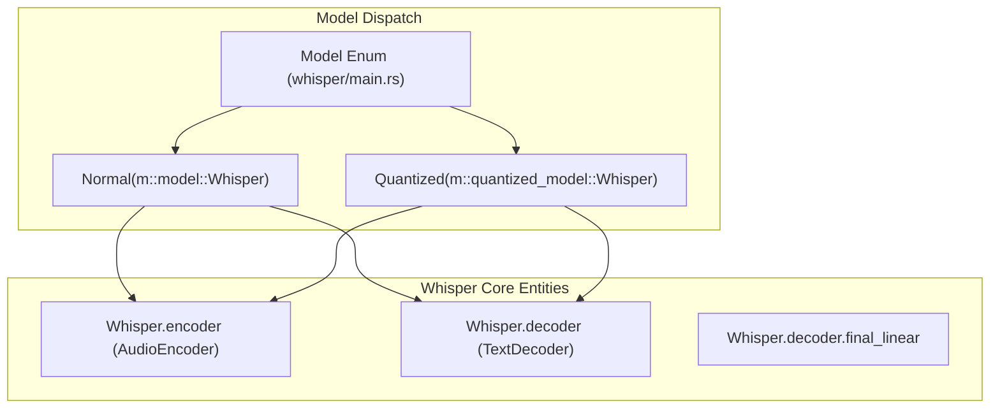
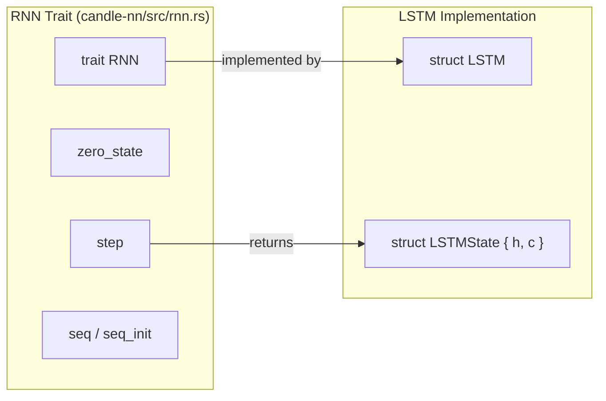

<!-- source: DeepWiki mcp.deepwiki.com · repo huggingface/candle · page 6.2 Speech Recognition and Audio Models · fetched 2026-10-26 -->

# Speech Recognition and Audio Models

Relevant source files

The following files were used as context for generating this wiki page:

- [candle-examples/examples/bert/main.rs](candle-examples/examples/bert/main.rs)
- [candle-examples/examples/bigcode/main.rs](candle-examples/examples/bigcode/main.rs)
- [candle-examples/examples/encodec/README.md](candle-examples/examples/encodec/README.md)
- [candle-examples/examples/encodec/audio_io.rs](candle-examples/examples/encodec/audio_io.rs)
- [candle-examples/examples/encodec/jfk-codes.safetensors](candle-examples/examples/encodec/jfk-codes.safetensors)
- [candle-examples/examples/encodec/main.rs](candle-examples/examples/encodec/main.rs)
- [candle-examples/examples/falcon/main.rs](candle-examples/examples/falcon/main.rs)
- [candle-examples/examples/llama/main.rs](candle-examples/examples/llama/main.rs)
- [candle-examples/examples/metavoice/main.rs](candle-examples/examples/metavoice/main.rs)
- [candle-examples/examples/mimi/README.md](candle-examples/examples/mimi/README.md)
- [candle-examples/examples/mimi/audio_io.rs](candle-examples/examples/mimi/audio_io.rs)
- [candle-examples/examples/mimi/main.rs](candle-examples/examples/mimi/main.rs)
- [candle-examples/examples/musicgen/main.rs](candle-examples/examples/musicgen/main.rs)
- [candle-examples/examples/musicgen/musicgen_model.rs](candle-examples/examples/musicgen/musicgen_model.rs)
- [candle-examples/examples/orpheus/README.md](candle-examples/examples/orpheus/README.md)
- [candle-examples/examples/orpheus/main.rs](candle-examples/examples/orpheus/main.rs)
- [candle-examples/examples/parler-tts/main.rs](candle-examples/examples/parler-tts/main.rs)
- [candle-examples/examples/snac/audio_io.rs](candle-examples/examples/snac/audio_io.rs)
- [candle-examples/examples/snac/main.rs](candle-examples/examples/snac/main.rs)
- [candle-examples/examples/stella-en-v5/README.md](candle-examples/examples/stella-en-v5/README.md)
- [candle-examples/examples/stella-en-v5/main.rs](candle-examples/examples/stella-en-v5/main.rs)
- [candle-examples/examples/voxtral/README.md](candle-examples/examples/voxtral/README.md)
- [candle-examples/examples/voxtral/download.rs](candle-examples/examples/voxtral/download.rs)
- [candle-examples/examples/voxtral/main.rs](candle-examples/examples/voxtral/main.rs)
- [candle-examples/examples/voxtral/melfilters128.bytes](candle-examples/examples/voxtral/melfilters128.bytes)
- [candle-examples/examples/voxtral/model.rs](candle-examples/examples/voxtral/model.rs)
- [candle-examples/examples/whisper-microphone/main.rs](candle-examples/examples/whisper-microphone/main.rs)
- [candle-examples/examples/whisper-microphone/multilingual.rs](candle-examples/examples/whisper-microphone/multilingual.rs)
- [candle-examples/examples/whisper/main.rs](candle-examples/examples/whisper/main.rs)
- [candle-examples/examples/whisper/multilingual.rs](candle-examples/examples/whisper/multilingual.rs)
- [candle-examples/examples/yolo-v3/darknet.rs](candle-examples/examples/yolo-v3/darknet.rs)
- [candle-examples/src/audio.rs](candle-examples/src/audio.rs)
- [candle-examples/src/bs1770.rs](candle-examples/src/bs1770.rs)
- [candle-examples/src/wav.rs](candle-examples/src/wav.rs)
- [candle-nn/src/encoding.rs](candle-nn/src/encoding.rs)
- [candle-nn/src/rnn.rs](candle-nn/src/rnn.rs)
- [candle-nn/tests/kv_cache.rs](candle-nn/tests/kv_cache.rs)
- [candle-nn/tests/one_hot.rs](candle-nn/tests/one_hot.rs)
- [candle-nn/tests/rnn.rs](candle-nn/tests/rnn.rs)
- [candle-transformers/src/models/dac.rs](candle-transformers/src/models/dac.rs)
- [candle-transformers/src/models/encodec.rs](candle-transformers/src/models/encodec.rs)
- [candle-transformers/src/models/metavoice.rs](candle-transformers/src/models/metavoice.rs)
- [candle-transformers/src/models/mimi/encodec.rs](candle-transformers/src/models/mimi/encodec.rs)
- [candle-transformers/src/models/mimi/mod.rs](candle-transformers/src/models/mimi/mod.rs)
- [candle-transformers/src/models/mimi/quantization.rs](candle-transformers/src/models/mimi/quantization.rs)
- [candle-transformers/src/models/mimi/seanet.rs](candle-transformers/src/models/mimi/seanet.rs)
- [candle-transformers/src/models/mimi/transformer.rs](candle-transformers/src/models/mimi/transformer.rs)
- [candle-transformers/src/models/parler_tts.rs](candle-transformers/src/models/parler_tts.rs)
- [candle-transformers/src/models/quantized_metavoice.rs](candle-transformers/src/models/quantized_metavoice.rs)
- [candle-transformers/src/models/segment_anything/mask_decoder.rs](candle-transformers/src/models/segment_anything/mask_decoder.rs)
- [candle-transformers/src/models/segment_anything/prompt_encoder.rs](candle-transformers/src/models/segment_anything/prompt_encoder.rs)
- [candle-transformers/src/models/snac.rs](candle-transformers/src/models/snac.rs)
- [candle-transformers/src/models/stella_en_v5.rs](candle-transformers/src/models/stella_en_v5.rs)
- [candle-transformers/src/models/whisper/audio.rs](candle-transformers/src/models/whisper/audio.rs)
- [candle-transformers/src/models/whisper/mod.rs](candle-transformers/src/models/whisper/mod.rs)
- [candle-wasm-examples/whisper/src/audio.rs](candle-wasm-examples/whisper/src/audio.rs)

This page details the implementation of speech recognition, text-to-speech (TTS), and audio processing models within the Candle framework. It covers the Whisper ASR system, MetaVoice TTS, audio codecs like EnCodec and Mimi, and specialized audio generation models.

## Whisper: Automatic Speech Recognition

Whisper is OpenAI's multi-task speech recognition model. In Candle, it is implemented to support multilingual transcription, translation, and timestamp generation using both standard and quantized weights.

### Model Architecture and Loading

Whisper uses a unified `Model` enum to dispatch calls between standard `f32`/`f16` implementations and quantized variants.

- **Model Wrapper**: The `Model` enum provides `encoder_forward`, `decoder_forward`, and `decoder_final_linear` methods that dispatch to the underlying implementation [candle-examples/examples/whisper/main.rs:29-68]().
- **Quantization**: Quantized models are loaded via `VarBuilder::from_gguf` [candle-examples/examples/metavoice/main.rs:151-152]().
- **Multilingual Detection**: The `detect_language` function runs a single forward pass of the decoder with the `<|startoftranscript|>` token and identifies the language by checking logits at specific language token indices [candle-examples/examples/whisper/multilingual.rs:107-139]().

### Audio Processing Pipeline

Whisper processes audio in the frequency domain using Mel spectrograms.

- **PCM Decoding**: Audio is typically decoded from WAV files into `Vec<f32>` at a 16kHz sample rate [candle-examples/examples/whisper/main.rs:721-724]().
- **Mel Spectrogram**: The `log_mel_spectrogram_` function converts PCM samples into a Mel spectrogram using FFT and pre-computed filter banks [candle-transformers/src/models/whisper/audio.rs:170-226]().
- **FFT Implementation**: A custom Fast Fourier Transform is used to process audio windows, applying a Hanning window before transformation [candle-transformers/src/models/whisper/audio.rs:17-60]().

**Sources:** [candle-examples/examples/whisper/main.rs:29-68](), [candle-transformers/src/models/whisper/audio.rs:17-60](), [candle-transformers/src/models/whisper/audio.rs:170-226](), [candle-examples/examples/whisper/multilingual.rs:107-139]()

## MetaVoice TTS

MetaVoice is a text-to-speech model capable of high-quality voice cloning. The Candle implementation supports a two-stage generation process.

### Generation Stages

1.  **First Stage (Transformer)**: Generates the initial audio tokens from text and a speaker embedding. It supports both normal and quantized execution via the `Transformer` enum [candle-examples/examples/metavoice/main.rs:30-33]().
2.  **Second Stage (GPT)**: Refines the tokens to produce high-fidelity audio codes [candle-examples/examples/metavoice/main.rs:166-169]().
3.  **Codec (EnCodec)**: Decodes the resulting tokens into a waveform [candle-examples/examples/metavoice/main.rs:176-179]().

### Speaker Encoding

MetaVoice uses a `speaker_encoder` to create embeddings from reference audio.
- **Architecture**: Uses a multi-layer LSTM to process Mel spectrograms of the reference voice [candle-transformers/src/models/metavoice.rs:47-71]().
- **Embedding**: The `embed_utterance` function slices the reference audio, computes Mel spectrograms, and averages the LSTM outputs to form a normalized speaker embedding [candle-transformers/src/models/metavoice.rs:120-157]().

**Sources:** [candle-examples/examples/metavoice/main.rs:30-33](), [candle-examples/examples/metavoice/main.rs:166-179](), [candle-transformers/src/models/metavoice.rs:47-71](), [candle-transformers/src/models/metavoice.rs:120-157]()

## Audio Codecs: EnCodec, Mimi, and SNAC

Candle implements several neural audio codecs used for compression and as backends for generative models.

### EnCodec

EnCodec is a high-fidelity neural audio compressor.
- **Structure**: Configurable through `Config` including parameters for `target_bandwidths`, `sampling_rate`, and `upsampling_ratios` [candle-transformers/src/models/encodec.rs:28-52]().
- **Weight Norm**: Implements `conv1d_weight_norm` for inference, which recomputes weights from `weight_g` and `weight_v` parameters [candle-transformers/src/models/encodec.rs:129-142]().
- **Quantization**: Uses a Residual Vector Quantizer (RVQ) to map continuous embeddings to discrete codebook indices [candle-transformers/src/models/encodec.rs:178-202]().

### Mimi and SNAC

- **Mimi**: An evolved version of EnCodec used in models like Moshi. The implementation includes `transformer`, `quantization`, `seanet`, and `encodec` components [candle-transformers/src/models/mimi/mod.rs]().
- **SNAC**: A multi-scale neural audio codec that handles different frequency bands at different temporal resolutions [candle-transformers/src/models/snac.rs]().

**Sources:** [candle-transformers/src/models/encodec.rs:28-52](), [candle-transformers/src/models/encodec.rs:129-142](), [candle-transformers/src/models/encodec.rs:178-202](), [candle-transformers/src/models/snac.rs]()

## Generative Audio Models

### MusicGen

MusicGen generates music from text prompts using a Transformer-based decoder.
- **Conditioning**: Uses a T5 text encoder to process prompts [candle-examples/examples/musicgen/musicgen_model.rs:6]().
- **Positional Embeddings**: Implements `MusicgenSinusoidalPositionalEmbedding` to provide temporal context [candle-examples/examples/musicgen/musicgen_model.rs:107-132]().
- **Attention**: Custom `MusicgenAttention` module handles query, key, and value projections with optional cross-attention [candle-examples/examples/musicgen/musicgen_model.rs:135-200]().

### Parler-TTS, Voxtral, and Orpheus

- **Parler-TTS**: A high-quality TTS model based on the Parler architecture [candle-transformers/src/models/parler_tts.rs]().
- **Voxtral**: An experimental multimodal speech-to-text and text-to-speech architecture, combining speech processing with LLMs [candle-examples/examples/voxtral/model.rs]().
- **Orpheus**: A text-to-speech model implementation [candle-examples/examples/orpheus/main.rs]().

**Sources:** [candle-examples/examples/musicgen/musicgen_model.rs:107-132](), [candle-examples/examples/musicgen/musicgen_model.rs:135-200](), [candle-transformers/src/models/parler_tts.rs](), [candle-examples/examples/voxtral/model.rs]()

## Audio Utilities

### Audio I/O and Processing

Candle provides utilities for handling audio files and preparing them for model consumption.
- **Loudness**: The `bs1770` module provides EBU R128 loudness normalization, critical for consistent TTS output [candle-examples/src/bs1770.rs]().
- **Audio Utilities**: General audio helpers are located in `candle-examples/src/audio.rs` [candle-examples/src/audio.rs]().

### Recurrent Neural Networks (RNN)

Many audio models rely on LSTMs. Candle provides a generic `RNN` trait and a standard `LSTM` implementation.

- **LSTM Implementation**: Computes input, forget, cell, and output gates using `matmul` and `sigmoid`/`tanh` activations [candle-nn/src/rnn.rs:210-221]().
- **State Management**: The `LSTMState` holds the hidden (`h`) and cell (`c`) tensors [candle-nn/src/rnn.rs:52-55]().
- **Sequence Processing**: The `seq` and `seq_init` methods handle multi-step recurrence over input tensors [candle-nn/src/rnn.rs:21-43]().

**Sources:** [candle-nn/src/rnn.rs:21-43](), [candle-nn/src/rnn.rs:52-55](), [candle-nn/src/rnn.rs:210-221](), [candle-examples/src/bs1770.rs]()

---

