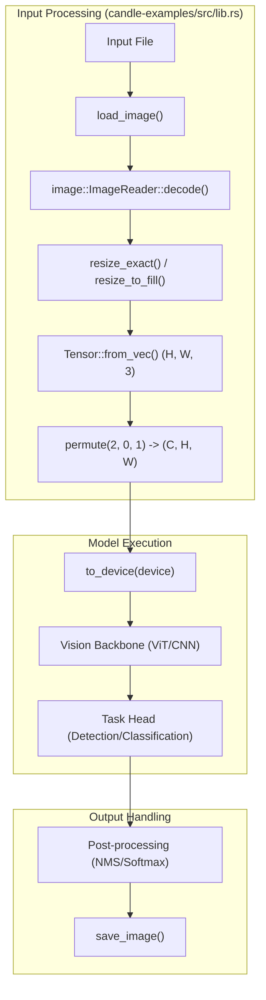
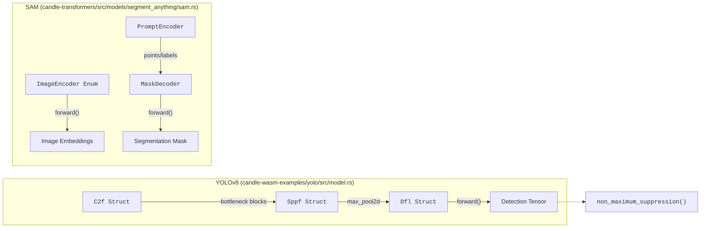

<!-- source: DeepWiki mcp.deepwiki.com · repo huggingface/candle · page 6.3 Computer Vision Models · fetched 2026-10-26 -->

# Computer Vision Models

Relevant source files

The following files were used as context for generating this wiki page:

- [.gitignore](.gitignore)
- [candle-book/src/inference/hub.md](candle-book/src/inference/hub.md)
- [candle-examples/examples/beit/README.md](candle-examples/examples/beit/README.md)
- [candle-examples/examples/beit/main.rs](candle-examples/examples/beit/main.rs)
- [candle-examples/examples/clip/README.md](candle-examples/examples/clip/README.md)
- [candle-examples/examples/clip/main.rs](candle-examples/examples/clip/main.rs)
- [candle-examples/examples/convmixer/main.rs](candle-examples/examples/convmixer/main.rs)
- [candle-examples/examples/convnext/README.md](candle-examples/examples/convnext/README.md)
- [candle-examples/examples/convnext/main.rs](candle-examples/examples/convnext/main.rs)
- [candle-examples/examples/dinov2/main.rs](candle-examples/examples/dinov2/main.rs)
- [candle-examples/examples/distilbert/README.md](candle-examples/examples/distilbert/README.md)
- [candle-examples/examples/distilbert/main.rs](candle-examples/examples/distilbert/main.rs)
- [candle-examples/examples/efficientnet/main.rs](candle-examples/examples/efficientnet/main.rs)
- [candle-examples/examples/efficientvit/main.rs](candle-examples/examples/efficientvit/main.rs)
- [candle-examples/examples/eva2/README.md](candle-examples/examples/eva2/README.md)
- [candle-examples/examples/eva2/main.rs](candle-examples/examples/eva2/main.rs)
- [candle-examples/examples/fastvit/README.md](candle-examples/examples/fastvit/README.md)
- [candle-examples/examples/fastvit/main.rs](candle-examples/examples/fastvit/main.rs)
- [candle-examples/examples/mobileclip/README.md](candle-examples/examples/mobileclip/README.md)
- [candle-examples/examples/mobileclip/main.rs](candle-examples/examples/mobileclip/main.rs)
- [candle-examples/examples/mobilenetv4/README.md](candle-examples/examples/mobilenetv4/README.md)
- [candle-examples/examples/mobilenetv4/main.rs](candle-examples/examples/mobilenetv4/main.rs)
- [candle-examples/examples/mobileone/README.md](candle-examples/examples/mobileone/README.md)
- [candle-examples/examples/mobileone/main.rs](candle-examples/examples/mobileone/main.rs)
- [candle-examples/examples/paddleocr-vl/README.md](candle-examples/examples/paddleocr-vl/README.md)
- [candle-examples/examples/paddleocr-vl/main.rs](candle-examples/examples/paddleocr-vl/main.rs)
- [candle-examples/examples/paddleocr-vl/test_chart.png](candle-examples/examples/paddleocr-vl/test_chart.png)
- [candle-examples/examples/paddleocr-vl/test_formula.png](candle-examples/examples/paddleocr-vl/test_formula.png)
- [candle-examples/examples/paddleocr-vl/test_ocr.png](candle-examples/examples/paddleocr-vl/test_ocr.png)
- [candle-examples/examples/paddleocr-vl/test_ocr_page2.png](candle-examples/examples/paddleocr-vl/test_ocr_page2.png)
- [candle-examples/examples/paddleocr-vl/test_table.png](candle-examples/examples/paddleocr-vl/test_table.png)
- [candle-examples/examples/paddleocr-vl/test_video.mp4](candle-examples/examples/paddleocr-vl/test_video.mp4)
- [candle-examples/examples/repvgg/README.md](candle-examples/examples/repvgg/README.md)
- [candle-examples/examples/repvgg/main.rs](candle-examples/examples/repvgg/main.rs)
- [candle-examples/examples/resnet/export_models.py](candle-examples/examples/resnet/export_models.py)
- [candle-examples/examples/resnet/main.rs](candle-examples/examples/resnet/main.rs)
- [candle-examples/examples/segformer/main.rs](candle-examples/examples/segformer/main.rs)
- [candle-examples/examples/segment-anything/README.md](candle-examples/examples/segment-anything/README.md)
- [candle-examples/examples/segment-anything/assets/sam_merged.jpg](candle-examples/examples/segment-anything/assets/sam_merged.jpg)
- [candle-examples/examples/segment-anything/assets/single_pt_prompt.jpg](candle-examples/examples/segment-anything/assets/single_pt_prompt.jpg)
- [candle-examples/examples/segment-anything/assets/two_pt_prompt.jpg](candle-examples/examples/segment-anything/assets/two_pt_prompt.jpg)
- [candle-examples/examples/segment-anything/main.rs](candle-examples/examples/segment-anything/main.rs)
- [candle-examples/examples/siglip/README.md](candle-examples/examples/siglip/README.md)
- [candle-examples/examples/siglip/main.rs](candle-examples/examples/siglip/main.rs)
- [candle-examples/examples/trocr/assets/noto.png](candle-examples/examples/trocr/assets/noto.png)
- [candle-examples/examples/trocr/assets/trocr.png](candle-examples/examples/trocr/assets/trocr.png)
- [candle-examples/examples/trocr/main.rs](candle-examples/examples/trocr/main.rs)
- [candle-examples/examples/trocr/readme.md](candle-examples/examples/trocr/readme.md)
- [candle-examples/examples/vit/main.rs](candle-examples/examples/vit/main.rs)
- [candle-examples/examples/yolo-v3/main.rs](candle-examples/examples/yolo-v3/main.rs)
- [candle-examples/examples/yolo-v8/main.rs](candle-examples/examples/yolo-v8/main.rs)
- [candle-examples/examples/yolo-v8/model.rs](candle-examples/examples/yolo-v8/model.rs)
- [candle-examples/src/imagenet.rs](candle-examples/src/imagenet.rs)
- [candle-examples/src/lib.rs](candle-examples/src/lib.rs)
- [candle-nn/src/func.rs](candle-nn/src/func.rs)
- [candle-nn/src/sequential.rs](candle-nn/src/sequential.rs)
- [candle-transformers/src/models/beit.rs](candle-transformers/src/models/beit.rs)
- [candle-transformers/src/models/clip/mod.rs](candle-transformers/src/models/clip/mod.rs)
- [candle-transformers/src/models/clip/text_model.rs](candle-transformers/src/models/clip/text_model.rs)
- [candle-transformers/src/models/clip/vision_model.rs](candle-transformers/src/models/clip/vision_model.rs)
- [candle-transformers/src/models/convmixer.rs](candle-transformers/src/models/convmixer.rs)
- [candle-transformers/src/models/convnext.rs](candle-transformers/src/models/convnext.rs)
- [candle-transformers/src/models/dinov2.rs](candle-transformers/src/models/dinov2.rs)
- [candle-transformers/src/models/dinov2reg4.rs](candle-transformers/src/models/dinov2reg4.rs)
- [candle-transformers/src/models/distilbert.rs](candle-transformers/src/models/distilbert.rs)
- [candle-transformers/src/models/efficientnet.rs](candle-transformers/src/models/efficientnet.rs)
- [candle-transformers/src/models/efficientvit.rs](candle-transformers/src/models/efficientvit.rs)
- [candle-transformers/src/models/eva2.rs](candle-transformers/src/models/eva2.rs)
- [candle-transformers/src/models/fastvit.rs](candle-transformers/src/models/fastvit.rs)
- [candle-transformers/src/models/mobileclip.rs](candle-transformers/src/models/mobileclip.rs)
- [candle-transformers/src/models/mobilenetv4.rs](candle-transformers/src/models/mobilenetv4.rs)
- [candle-transformers/src/models/mobileone.rs](candle-transformers/src/models/mobileone.rs)
- [candle-transformers/src/models/openclip/mod.rs](candle-transformers/src/models/openclip/mod.rs)
- [candle-transformers/src/models/openclip/text_model.rs](candle-transformers/src/models/openclip/text_model.rs)
- [candle-transformers/src/models/paddleocr_vl/config.rs](candle-transformers/src/models/paddleocr_vl/config.rs)
- [candle-transformers/src/models/paddleocr_vl/mod.rs](candle-transformers/src/models/paddleocr_vl/mod.rs)
- [candle-transformers/src/models/repvgg.rs](candle-transformers/src/models/repvgg.rs)
- [candle-transformers/src/models/resnet.rs](candle-transformers/src/models/resnet.rs)
- [candle-transformers/src/models/segment_anything/mod.rs](candle-transformers/src/models/segment_anything/mod.rs)
- [candle-transformers/src/models/segment_anything/sam.rs](candle-transformers/src/models/segment_anything/sam.rs)
- [candle-transformers/src/models/segment_anything/tiny_vit.rs](candle-transformers/src/models/segment_anything/tiny_vit.rs)
- [candle-transformers/src/models/siglip.rs](candle-transformers/src/models/siglip.rs)
- [candle-transformers/src/models/trocr.rs](candle-transformers/src/models/trocr.rs)
- [candle-transformers/src/models/vit.rs](candle-transformers/src/models/vit.rs)
- [candle-wasm-examples/segment-anything/README.md](candle-wasm-examples/segment-anything/README.md)
- [candle-wasm-examples/segment-anything/lib-example.html](candle-wasm-examples/segment-anything/lib-example.html)
- [candle-wasm-examples/segment-anything/samWorker.js](candle-wasm-examples/segment-anything/samWorker.js)
- [candle-wasm-examples/segment-anything/src/bin/m.rs](candle-wasm-examples/segment-anything/src/bin/m.rs)
- [candle-wasm-examples/yolo/build-lib.sh](candle-wasm-examples/yolo/build-lib.sh)
- [candle-wasm-examples/yolo/index.html](candle-wasm-examples/yolo/index.html)
- [candle-wasm-examples/yolo/src/bin/m.rs](candle-wasm-examples/yolo/src/bin/m.rs)
- [candle-wasm-examples/yolo/src/lib.rs](candle-wasm-examples/yolo/src/lib.rs)
- [candle-wasm-examples/yolo/src/model.rs](candle-wasm-examples/yolo/src/model.rs)
- [candle-wasm-examples/yolo/src/worker.rs](candle-wasm-examples/yolo/src/worker.rs)

This document covers computer vision model implementations in Candle, including image classification, object detection, depth estimation, and multimodal vision-language models. These models are available as native Candle implementations, supporting CPU, CUDA, and Metal backends, as well as WebAssembly for browser deployment.

## Overview

Candle provides a wide array of computer vision architectures ranging from classic CNNs to modern Vision Transformers (ViT) and multimodal models.

**Native Candle Implementations**:
- **Object Detection**: YOLO (v3/v8), Segment Anything (SAM). [candle-examples/examples/yolo-v8/main.rs:8-12](), [candle-examples/examples/segment-anything/main.rs:12-12]()
- **Image Classification**: ResNet, EfficientNet, ConvNeXt, FastViT, MobileNet, VGG, ViT, BEiT, DINOv2. [candle-transformers/src/models/convnext.rs:1-10](), [candle-transformers/src/models/fastvit.rs:1-12](), [candle-transformers/src/models/beit.rs:1-10](), [candle-transformers/src/models/dinov2.rs:1-10]()
- **Multimodal (Vision-Language)**: BLIP, Moondream, LLaVA, PaliGemma, Pixtral, Qwen3-VL, PaddleOCR-VL, NV-Embed-v2, SigLIP. [candle-transformers/src/models/blip.rs:1-15](), [candle-transformers/src/models/qwen3_vl/mod.rs:1-20](), [candle-transformers/src/models/siglip.rs:1-10]()
- **Depth Estimation**: Depth Anything V2. [candle-transformers/src/models/efficientnet.rs:1-10]() (Note: DepthAnythingV2 often shares backbones like DINOv2/ViT).

**Sources**: [candle-examples/examples/yolo-v8/main.rs:1-12](), [candle-transformers/src/models/dinov2.rs:1-10](), [candle-transformers/src/models/fastvit.rs:1-7](), [candle-transformers/src/models/segment_anything/sam.rs:1-12]()

## Architecture and Data Flow

The standard vision pipeline in Candle involves loading raw image bytes, decoding via the `image` crate, and transforming the data into a `(C, H, W)` tensor format.

**Sources**: [candle-examples/src/lib.rs:34-62](), [candle-examples/src/lib.rs:64-80](), [candle-examples/src/lib.rs:84-99]()

## Object Detection and Segmentation

### YOLO (v3/v8)
YOLO implementations in Candle utilize a Darknet or CSPDarknet backbone. The model outputs a tensor containing bounding box coordinates, objectness scores, and class probabilities. [candle-examples/examples/yolo-v8/main.rs:55-63]()

- **YOLOv3**: Uses a `Darknet` structure parsed from `.cfg` files. It handles detection through `Yolo` blocks with specific anchors. [candle-examples/examples/yolo-v3/main.rs:150-153]()
- **YOLOv8**: Implements `C2f` (Cross Stage Partial Bottleneck with two convolutions) and `Sppf` (Spatial Pyramid Pooling - Fast) modules. [candle-wasm-examples/yolo/src/model.rs:146-180](), [candle-wasm-examples/yolo/src/model.rs:183-216]()
- **Non-Maximum Suppression (NMS)**: Post-processing is handled by `non_maximum_suppression` to filter overlapping boxes based on an `nms_threshold`. [candle-transformers/src/object_detection/mod.rs:7-12]()
- **Pose Estimation**: YOLOv8-Pose is supported, outputting 17 keypoints (e.g., Nose, Eyes, Shoulders) via the `report_pose` function. [candle-examples/examples/yolo-v8/main.rs:34-51](), [candle-examples/examples/yolo-v8/main.rs:150-186]()

### Segment Anything (SAM)
SAM is used for promptable segmentation. It consists of an image encoder (ViT), a prompt encoder, and a mask decoder. [candle-transformers/src/models/segment_anything/sam.rs:34-40]()

- **Tiny SAM**: Support for MobileSAM using a `TinyViT` backbone for edge efficiency, instantiated via `Sam::new_tiny`. [candle-transformers/src/models/segment_anything/sam.rs:94-123]()
- **Prompt Encoding**: Supports points (x, y, boolean label) where `true` indicates a foreground point. [candle-transformers/src/models/segment_anything/sam.rs:158-186]()
- **WASM Support**: The `Model` struct in `candle-wasm-examples` manages image embeddings and point-based mask generation in the browser. [candle-wasm-examples/segment-anything/src/bin/m.rs:15-36](), [candle-wasm-examples/segment-anything/src/bin/m.rs:76-120]()

**Sources**: [candle-examples/examples/yolo-v8/main.rs:55-186](), [candle-transformers/src/models/segment_anything/sam.rs:34-123](), [candle-wasm-examples/yolo/src/model.rs:146-240]()

## Image Classification and Feature Extraction

### Vision Transformers (ViT) and DINOv2
- **ViT**: Standard transformer architecture applied to image patches. [candle-transformers/src/models/vit.rs:1-10]()
- **DINOv2**: Self-supervised ViT models used as robust feature extractors. Examples use `vit_small` for ImageNet-style classification. [candle-examples/examples/dinov2/main.rs:46-48](), [candle-transformers/src/models/dinov2.rs:1-10]()
- **SigLIP**: A vision-language model (similar to CLIP) using a sigmoid loss. [candle-transformers/src/models/siglip.rs:1-10]()

### Convolutional Architectures
- **FastViT**: A hybrid vision transformer that uses structural reparameterization. The `mobileone_block` is a key component that fuses convolutional kernels and batchnorm layers during inference for speed. [candle-transformers/src/models/fastvit.rs:1-6](), [candle-transformers/src/models/fastvit.rs:191-235]()
- **ConvNeXt**: Modernized CNN that mimics transformer behaviors (e.g., large kernels, LayerNorm). [candle-transformers/src/models/convnext.rs:1-10]()
- **EfficientNet**: Implements MBConv blocks with Squeeze-and-Excitation. [candle-transformers/src/models/efficientnet.rs:1-10]()

**Sources**: [candle-transformers/src/models/fastvit.rs:191-235](), [candle-examples/examples/dinov2/main.rs:37-61](), [candle-transformers/src/models/vit.rs:1-10]()

## Code Entity Space: Object Detection Mapping

The following diagram maps the logical object detection flow to specific code entities in the YOLOv8 and SAM implementations.

**Sources**: [candle-wasm-examples/yolo/src/model.rs:146-240](), [candle-transformers/src/models/segment_anything/sam.rs:34-40](), [candle-transformers/src/object_detection/mod.rs:12-12]()

## Multimodal Vision-Language Models

These models integrate vision backbones with text decoders via projection layers.

| Model | Vision Component | Text Component | Key Feature |
| :--- | :--- | :--- | :--- |
| **Moondream** | ViT | Phi-2 | Parameter efficient multimodal. [candle-transformers/src/models/moondream.rs:4-11]() |
| **BLIP** | ViT | BERT-style Decoder | Cross-attention for image captioning. [candle-transformers/src/models/blip.rs:1-15]() |
| **Qwen3-VL** | ViT | Qwen2/3 | 3D Temporal Convs for video support. [candle-transformers/src/models/qwen3_vl/mod.rs:9-11]() |
| **Pixtral** | Vision Transformer | Mistral/Llama | High-resolution image processing. |

**Vision-Text Projection**: Models like Moondream use a projector to map vision embeddings to the text embedding dimension. In Moondream, this is handled by a `LinearPatchEmbedding`. [candle-transformers/src/models/moondream.rs:95-104]()

**Sources**: [candle-transformers/src/models/moondream.rs:1-110](), [candle-transformers/src/models/blip.rs:1-121](), [candle-transformers/src/models/qwen3_vl/mod.rs:1-20]()

## Implementation Details: Preprocessing and Post-processing

Vision tasks require specific utility functions for image manipulation and result interpretation.

- **Image Loading**: `load_image` and `load_image_and_resize` in `candle-examples` handle the conversion from `image::DynamicImage` to `candle::Tensor`. [candle-examples/src/lib.rs:34-80]()
- **Batch Normalization Fusion**: In `FastViT`, the `fuse_conv_bn` function mathematically combines `BatchNorm` parameters into a `Conv2d` weight and bias tensor to reduce compute during inference. [candle-transformers/src/models/fastvit.rs:180-189]()
- **Softmax/IOU**: Classification models use `candle_nn::ops::softmax` on logits [candle-examples/examples/dinov2/main.rs:49-51](), while SAM computes IOU predictions to rank mask quality. [candle-transformers/src/models/segment_anything/sam.rs:146-151]()

**Sources**: [candle-examples/src/lib.rs:34-80](), [candle-transformers/src/models/fastvit.rs:180-189](), [candle-examples/examples/dinov2/main.rs:49-51]()

---

