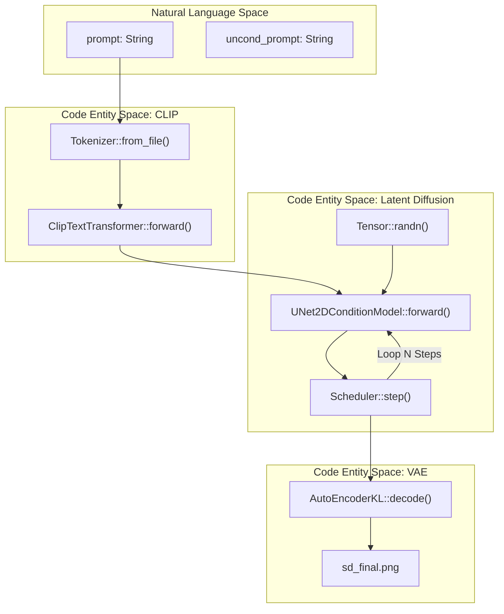
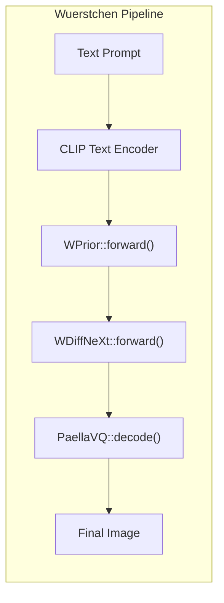
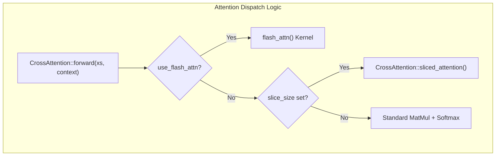

<!-- source: DeepWiki mcp.deepwiki.com · repo huggingface/candle · page 6.4 Generative Image Models · fetched 2026-10-26 -->

# Generative Image Models

Relevant source files

The following files were used as context for generating this wiki page:

- [candle-examples/examples/flux/README.md](candle-examples/examples/flux/README.md)
- [candle-examples/examples/flux/assets/flux-robot.jpg](candle-examples/examples/flux/assets/flux-robot.jpg)
- [candle-examples/examples/flux/main.rs](candle-examples/examples/flux/main.rs)
- [candle-examples/examples/stable-diffusion-3/README.md](candle-examples/examples/stable-diffusion-3/README.md)
- [candle-examples/examples/stable-diffusion-3/assets/stable-diffusion-3.jpg](candle-examples/examples/stable-diffusion-3/assets/stable-diffusion-3.jpg)
- [candle-examples/examples/stable-diffusion-3/clip.rs](candle-examples/examples/stable-diffusion-3/clip.rs)
- [candle-examples/examples/stable-diffusion-3/main.rs](candle-examples/examples/stable-diffusion-3/main.rs)
- [candle-examples/examples/stable-diffusion-3/sampling.rs](candle-examples/examples/stable-diffusion-3/sampling.rs)
- [candle-examples/examples/stable-diffusion-3/vae.rs](candle-examples/examples/stable-diffusion-3/vae.rs)
- [candle-examples/examples/stable-diffusion/README.md](candle-examples/examples/stable-diffusion/README.md)
- [candle-examples/examples/stable-diffusion/assets/stable-diffusion-xl.jpg](candle-examples/examples/stable-diffusion/assets/stable-diffusion-xl.jpg)
- [candle-examples/examples/stable-diffusion/main.rs](candle-examples/examples/stable-diffusion/main.rs)
- [candle-examples/examples/wuerstchen/main.rs](candle-examples/examples/wuerstchen/main.rs)
- [candle-transformers/src/models/flux/autoencoder.rs](candle-transformers/src/models/flux/autoencoder.rs)
- [candle-transformers/src/models/flux/mod.rs](candle-transformers/src/models/flux/mod.rs)
- [candle-transformers/src/models/flux/model.rs](candle-transformers/src/models/flux/model.rs)
- [candle-transformers/src/models/flux/quantized_model.rs](candle-transformers/src/models/flux/quantized_model.rs)
- [candle-transformers/src/models/flux/sampling.rs](candle-transformers/src/models/flux/sampling.rs)
- [candle-transformers/src/models/mmdit/blocks.rs](candle-transformers/src/models/mmdit/blocks.rs)
- [candle-transformers/src/models/mmdit/model.rs](candle-transformers/src/models/mmdit/model.rs)
- [candle-transformers/src/models/mmdit/projections.rs](candle-transformers/src/models/mmdit/projections.rs)
- [candle-transformers/src/models/stable_diffusion/attention.rs](candle-transformers/src/models/stable_diffusion/attention.rs)
- [candle-transformers/src/models/stable_diffusion/clip.rs](candle-transformers/src/models/stable_diffusion/clip.rs)
- [candle-transformers/src/models/stable_diffusion/ddim.rs](candle-transformers/src/models/stable_diffusion/ddim.rs)
- [candle-transformers/src/models/stable_diffusion/ddpm.rs](candle-transformers/src/models/stable_diffusion/ddpm.rs)
- [candle-transformers/src/models/stable_diffusion/embeddings.rs](candle-transformers/src/models/stable_diffusion/embeddings.rs)
- [candle-transformers/src/models/stable_diffusion/euler_ancestral_discrete.rs](candle-transformers/src/models/stable_diffusion/euler_ancestral_discrete.rs)
- [candle-transformers/src/models/stable_diffusion/mod.rs](candle-transformers/src/models/stable_diffusion/mod.rs)
- [candle-transformers/src/models/stable_diffusion/resnet.rs](candle-transformers/src/models/stable_diffusion/resnet.rs)
- [candle-transformers/src/models/stable_diffusion/schedulers.rs](candle-transformers/src/models/stable_diffusion/schedulers.rs)
- [candle-transformers/src/models/stable_diffusion/unet_2d.rs](candle-transformers/src/models/stable_diffusion/unet_2d.rs)
- [candle-transformers/src/models/stable_diffusion/unet_2d_blocks.rs](candle-transformers/src/models/stable_diffusion/unet_2d_blocks.rs)
- [candle-transformers/src/models/stable_diffusion/utils.rs](candle-transformers/src/models/stable_diffusion/utils.rs)
- [candle-transformers/src/models/stable_diffusion/vae.rs](candle-transformers/src/models/stable_diffusion/vae.rs)
- [candle-transformers/src/models/wuerstchen/attention_processor.rs](candle-transformers/src/models/wuerstchen/attention_processor.rs)
- [candle-transformers/src/models/wuerstchen/common.rs](candle-transformers/src/models/wuerstchen/common.rs)
- [candle-transformers/src/models/wuerstchen/ddpm.rs](candle-transformers/src/models/wuerstchen/ddpm.rs)
- [candle-transformers/src/models/wuerstchen/diffnext.rs](candle-transformers/src/models/wuerstchen/diffnext.rs)
- [candle-transformers/src/models/wuerstchen/mod.rs](candle-transformers/src/models/wuerstchen/mod.rs)
- [candle-transformers/src/models/wuerstchen/paella_vq.rs](candle-transformers/src/models/wuerstchen/paella_vq.rs)
- [candle-transformers/src/models/wuerstchen/prior.rs](candle-transformers/src/models/wuerstchen/prior.rs)

Generative image models in Candle encompass a variety of architectures including Latent Diffusion Models (Stable Diffusion), Flow-matching models (Flux), and multi-stage hierarchical models (Wuerstchen). These models typically combine a text encoder (CLIP/T5) to process prompts, a generative core (UNet/MMDiT) to operate in latent space, and a Variational Autoencoder (VAE) to decode latents into pixel-space images.

## Stable Diffusion (v1.5, v2.1, XL)

Stable Diffusion implementations in Candle follow the standard pipeline of denoising latents using a UNet conditioned on text embeddings.

### Architecture and Components
*   **CLIP Text Encoder**: Processes natural language into embeddings. Different versions use different configurations: v1.5 uses `Config::v1_5()`, v2.1 uses `Config::v2_1()`, and XL uses two encoders `sdxl()` and `sdxl2()` [candle-transformers/src/models/stable_diffusion/clip.rs:46-103]().
*   **UNet2DConditionModel**: The core denoising engine. It consists of `DownBlock2D`, `UpBlock2D`, and `UNetMidBlock2D` containing ResNet blocks and Cross-Attention layers [candle-transformers/src/models/stable_diffusion/unet_2d.rs:84-102]().
*   **AutoEncoderKL (VAE)**: Responsible for compressing images into latents and decompressing them back. It uses a `Decoder` with `ResnetBlock2D` and `Attention` modules [candle-transformers/src/models/stable_diffusion/vae.rs:103-110]().

### Data Flow: Text-to-Image Pipeline
The generation process is iterative, guided by a scheduler that determines the noise levels (sigmas) at each step.

**Sources:** [candle-examples/examples/stable-diffusion/main.rs:17-123](), [candle-transformers/src/models/stable_diffusion/mod.rs:62-70]()

## Stable Diffusion 3 & Flux (MMDiT)

Stable Diffusion 3 and Flux utilize a Multi-Modal Diffusion Transformer (MMDiT) architecture. Unlike the traditional UNet, MMDiT treats text and image latents as sequences of tokens that interact via joint attention.

### Key Features
*   **MMDiT Core**: Implemented in `candle-transformers::models::mmdit`. It uses `JointBlock` structures where text and image sequences are processed together [candle-transformers/src/models/mmdit/model.rs:6-10]().
*   **Triple Clip**: SD3 uses three text encoders: CLIP-L, CLIP-G, and T5XXL to capture complex prompt semantics. These are managed via `StableDiffusion3TripleClipWithTokenizer` [candle-examples/examples/stable-diffusion-3/main.rs:182-187]().
*   **Flux Schedule**: Flux supports different schedules like `schnell` (4 steps) and `dev` (50 steps) using a flow-matching approach [candle-transformers/src/models/flux/sampling.rs:119](). Flux can also run in a `quantized` mode using GGUF weights [candle-examples/examples/flux/main.rs:182-185]().

**Sources:** [candle-examples/examples/stable-diffusion-3/main.rs:141-188](), [candle-transformers/src/models/flux/model.rs:1-10](), [candle-examples/examples/flux/main.rs:160-182]()

## Wuerstchen

Wuerstchen is a highly efficient architecture that uses a three-stage process (Stage A, B, and C). Stage C (the "Prior") works on a very small latent space (e.g., 24x24), which is then upscaled by Stage B and decoded by Stage A (VQGAN).

### Model Components
*   **WPrior (Stage C)**: Generates low-resolution latents from text embeddings using a series of `ResBlock`, `TimestepBlock`, and `AttnBlock` [candle-transformers/src/models/wuerstchen/prior.rs:13-21]().
*   **WDiffNeXt (Stage B)**: A diffusion model that upscales the latents produced by the Prior. It uses `DownBlock` and `UpBlock` containing `ResBlockStageB` [candle-transformers/src/models/wuerstchen/diffnext.rs:76-88]().
*   **PaellaVQ (Stage A)**: A VQGAN-style decoder that maps Stage B latents back to high-resolution pixels using `MixingResidualBlock` [candle-transformers/src/models/wuerstchen/paella_vq.rs:65-73]().

**Sources:** [candle-examples/examples/wuerstchen/main.rs:152-198](), [candle-transformers/src/models/wuerstchen/mod.rs:1-10](), [candle-transformers/src/models/wuerstchen/diffnext.rs:6-33](), [candle-transformers/src/models/wuerstchen/paella_vq.rs:191-193]()

## Schedulers

Schedulers define the denoising trajectory. Candle implements several common algorithms via the `Scheduler` trait.

| Scheduler | Code Entity | Description |
| :--- | :--- | :--- |
| **DDIM** | `DDIMScheduler` | Denoising Diffusion Implicit Models; allows for faster sampling with fewer steps [candle-transformers/src/models/stable_diffusion/ddim.rs:42-50](). |
| **DDPM** | `DDPMScheduler` | Denoising Diffusion Probabilistic Models; the foundational diffusion algorithm [candle-transformers/src/models/stable_diffusion/ddpm.rs:43-50](). |
| **Euler** | `EulerAncestralDiscreteScheduler` | Often used for SDXL Turbo and Flux for high-quality few-step generation [candle-transformers/src/models/stable_diffusion/euler_ancestral_discrete.rs:45-50](). |

### Scheduler Trait Interface
Schedulers must implement the `Scheduler` trait, which defines how to transition from $x_t$ to $x_{t-1}$.
*   `scale_model_input`: Prepares the latent sample for the UNet [candle-transformers/src/models/stable_diffusion/schedulers.rs:20]().
*   `step`: Computes the previous noisy sample based on the model output [candle-transformers/src/models/stable_diffusion/schedulers.rs:22]().

**Sources:** [candle-transformers/src/models/stable_diffusion/schedulers.rs:18-23]()

## Cross-Attention and Flash Attention

The interaction between text and images is handled by `CrossAttention`. Candle supports standard attention and optimized Flash Attention.

### Implementation Details
*   **Slicing**: To save memory on large images, `CrossAttention` can slice the query tensor and compute attention in chunks via `sliced_attention` [candle-transformers/src/models/stable_diffusion/attention.rs:145-171]().
*   **Flash Attention**: If the `flash-attn` feature is enabled, the model dispatches to optimized CUDA kernels [candle-transformers/src/models/stable_diffusion/attention.rs:64-73]().

**Sources:** [candle-transformers/src/models/stable_diffusion/attention.rs:81-129](), [candle-transformers/src/models/stable_diffusion/attention.rs:173-195](), [candle-transformers/src/models/stable_diffusion/attention.rs:64-73]()

---

