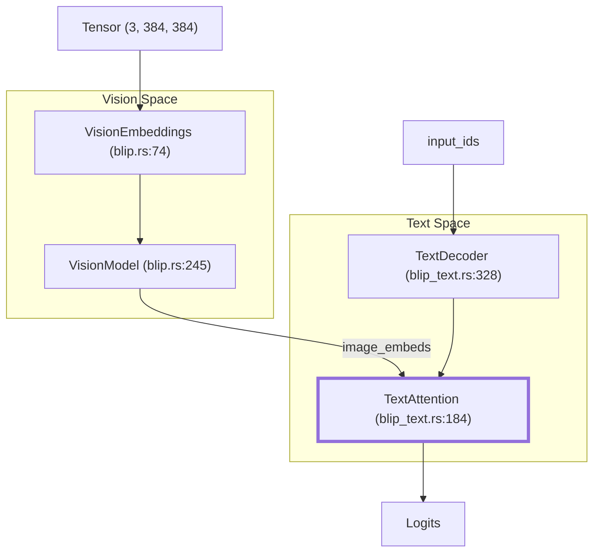
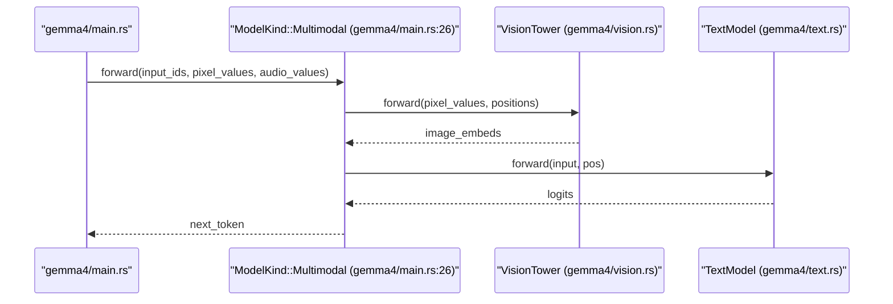

<!-- source: DeepWiki mcp.deepwiki.com · repo huggingface/candle · page 6.5 Multimodal Models · fetched 2026-10-26 -->

# Multimodal Models

Relevant source files

The following files were used as context for generating this wiki page:

- [candle-core/examples/metal_basics.rs](candle-core/examples/metal_basics.rs)
- [candle-core/src/quantized/fast_mmq.rs](candle-core/src/quantized/fast_mmq.rs)
- [candle-core/src/quantized/fast_mmvq.rs](candle-core/src/quantized/fast_mmvq.rs)
- [candle-examples/examples/blip/README.md](candle-examples/examples/blip/README.md)
- [candle-examples/examples/blip/main.rs](candle-examples/examples/blip/main.rs)
- [candle-examples/examples/gemma4/main.rs](candle-examples/examples/gemma4/main.rs)
- [candle-examples/examples/moondream/main.rs](candle-examples/examples/moondream/main.rs)
- [candle-examples/examples/phi/README.md](candle-examples/examples/phi/README.md)
- [candle-examples/examples/phi/main.rs](candle-examples/examples/phi/main.rs)
- [candle-examples/examples/pixtral/README.md](candle-examples/examples/pixtral/README.md)
- [candle-examples/examples/pixtral/main.rs](candle-examples/examples/pixtral/main.rs)
- [candle-examples/examples/snac/audio_io.rs](candle-examples/examples/snac/audio_io.rs)
- [candle-examples/examples/snac/main.rs](candle-examples/examples/snac/main.rs)
- [candle-examples/examples/voxtral/README.md](candle-examples/examples/voxtral/README.md)
- [candle-examples/examples/voxtral/download.rs](candle-examples/examples/voxtral/download.rs)
- [candle-examples/examples/voxtral/main.rs](candle-examples/examples/voxtral/main.rs)
- [candle-examples/examples/voxtral/melfilters128.bytes](candle-examples/examples/voxtral/melfilters128.bytes)
- [candle-examples/examples/voxtral/model.rs](candle-examples/examples/voxtral/model.rs)
- [candle-examples/src/audio.rs](candle-examples/src/audio.rs)
- [candle-kernels/src/ffi.rs](candle-kernels/src/ffi.rs)
- [candle-kernels/src/mmvq_gguf.cu](candle-kernels/src/mmvq_gguf.cu)
- [candle-transformers/src/models/blip.rs](candle-transformers/src/models/blip.rs)
- [candle-transformers/src/models/blip_text.rs](candle-transformers/src/models/blip_text.rs)
- [candle-transformers/src/models/gemma4/audio.rs](candle-transformers/src/models/gemma4/audio.rs)
- [candle-transformers/src/models/gemma4/config.rs](candle-transformers/src/models/gemma4/config.rs)
- [candle-transformers/src/models/gemma4/mod.rs](candle-transformers/src/models/gemma4/mod.rs)
- [candle-transformers/src/models/gemma4/text.rs](candle-transformers/src/models/gemma4/text.rs)
- [candle-transformers/src/models/gemma4/vision.rs](candle-transformers/src/models/gemma4/vision.rs)
- [candle-transformers/src/models/llava/mod.rs](candle-transformers/src/models/llava/mod.rs)
- [candle-transformers/src/models/mixformer.rs](candle-transformers/src/models/mixformer.rs)
- [candle-transformers/src/models/moondream.rs](candle-transformers/src/models/moondream.rs)
- [candle-transformers/src/models/phi3.rs](candle-transformers/src/models/phi3.rs)
- [candle-transformers/src/models/pixtral/llava.rs](candle-transformers/src/models/pixtral/llava.rs)
- [candle-transformers/src/models/pixtral/mod.rs](candle-transformers/src/models/pixtral/mod.rs)
- [candle-transformers/src/models/pixtral/vision_model.rs](candle-transformers/src/models/pixtral/vision_model.rs)
- [candle-transformers/src/models/quantized_blip.rs](candle-transformers/src/models/quantized_blip.rs)
- [candle-transformers/src/models/quantized_blip_text.rs](candle-transformers/src/models/quantized_blip_text.rs)
- [candle-transformers/src/models/quantized_mixformer.rs](candle-transformers/src/models/quantized_mixformer.rs)
- [candle-transformers/src/models/quantized_moondream.rs](candle-transformers/src/models/quantized_moondream.rs)
- [candle-transformers/src/models/qwen3_vl/config.rs](candle-transformers/src/models/qwen3_vl/config.rs)
- [candle-transformers/src/models/qwen3_vl/conv3d_temporal_2.rs](candle-transformers/src/models/qwen3_vl/conv3d_temporal_2.rs)
- [candle-transformers/src/models/qwen3_vl/mod.rs](candle-transformers/src/models/qwen3_vl/mod.rs)
- [candle-transformers/src/models/qwen3_vl/text.rs](candle-transformers/src/models/qwen3_vl/text.rs)
- [candle-transformers/src/models/qwen3_vl/vision.rs](candle-transformers/src/models/qwen3_vl/vision.rs)
- [candle-transformers/src/models/segformer.rs](candle-transformers/src/models/segformer.rs)
- [candle-transformers/src/models/with_tracing.rs](candle-transformers/src/models/with_tracing.rs)
- [candle-wasm-examples/blip/README.md](candle-wasm-examples/blip/README.md)
- [candle-wasm-examples/blip/blipWorker.js](candle-wasm-examples/blip/blipWorker.js)
- [candle-wasm-examples/blip/build-lib.sh](candle-wasm-examples/blip/build-lib.sh)
- [candle-wasm-examples/blip/index.html](candle-wasm-examples/blip/index.html)
- [candle-wasm-examples/blip/src/bin/m.rs](candle-wasm-examples/blip/src/bin/m.rs)
- [candle-wasm-examples/blip/src/lib.rs](candle-wasm-examples/blip/src/lib.rs)
- [candle-wasm-examples/moondream/src/bin/m.rs](candle-wasm-examples/moondream/src/bin/m.rs)

This section documents the implementation and inference pipelines for multimodal models within the Candle framework. These models integrate multiple data modalities—typically vision, audio, and language—into a unified transformer architecture, enabling tasks such as image captioning, visual question answering (VQA), and speech-to-text with LLM reasoning.

## Overview of Multimodal Architectures

Multimodal models in Candle generally follow a modular design consisting of specialized encoders (Vision or Audio) and a central text-based decoder (LLM). The bridge between these modalities is often a projection layer or a cross-attention mechanism that aligns the embeddings into the same latent space.

### Key Components

*   **Vision Encoders**: Usually ViT-style (Vision Transformer) architectures that process images as patches [candle-transformers/src/models/moondream.rs:9-9]().
*   **Audio Encoders**: Process mel-spectrograms or raw audio into temporal embeddings [candle-transformers/src/models/gemma4/audio.rs:1-20]().
*   **Projection Modules**: Align non-text embeddings with the LLM's hidden dimension [candle-transformers/src/models/moondream.rs:11-11]().
*   **Cross-Modal Attention**: Mechanisms that allow the text decoder to attend to visual or audio features [candle-transformers/src/models/blip_text.rs:79-101]().

Sources: [candle-transformers/src/models/moondream.rs:9-11](), [candle-transformers/src/models/gemma4/audio.rs:1-20](), [candle-transformers/src/models/blip_text.rs:79-101]()

## Implementation Details: Vision-Language Models

### Moondream
Moondream is a lightweight (1.6B parameter) model combining a ViT vision encoder with a Phi-based text decoder [candle-transformers/src/models/moondream.rs:1-11]().

**Data Flow in Moondream:**
1.  **Image Processing**: The image is resized (e.g., 378x378) and converted to a tensor [candle-examples/examples/moondream/main.rs:208-209]().
2.  **Vision Encoding**: The `VisionTransformer` processes patches through `VitBlock` layers [candle-transformers/src/models/moondream.rs:192-212]().
3.  **Inference Loop**: The first forward pass uses `forward_with_img` to inject image embeddings alongside the BOS token [candle-examples/examples/moondream/main.rs:95-107](). Subsequent tokens are generated using standard text-only forward passes [candle-examples/examples/moondream/main.rs:89-93]().

### BLIP (Bootstrapping Language-Image Pre-training)
BLIP supports image captioning and visual reasoning by using a dedicated vision model and a text decoder with cross-attention [candle-transformers/src/models/blip.rs:1-8]().

**Entity Mapping: BLIP Architecture**

*Sources: [candle-transformers/src/models/blip.rs:74-121](), [candle-transformers/src/models/blip_text.rs:184-189]()*

### Qwen3-VL
Qwen3-VL extends multimodal capabilities to video and high-resolution images using temporal convolutions and dynamic grid structures [candle-transformers/src/models/qwen3_vl/mod.rs:17-20]().

*   **Temporal Processing**: Uses `Conv3dTemporal2` for video sequences [candle-transformers/src/models/qwen3_vl/conv3d_temporal_2.rs:1-9]().
*   **Continuous Padding**: Implements `continuous_img_pad` and `continuous_vid_pad` to handle variable-length visual tokens within a text sequence [candle-transformers/src/models/qwen3_vl/mod.rs:123-138]().

Sources: [candle-transformers/src/models/moondream.rs:1-11](), [candle-examples/examples/moondream/main.rs:89-107](), [candle-transformers/src/models/blip.rs:1-8](), [candle-transformers/src/models/qwen3_vl/mod.rs:17-138]()

## Multimodal Embedding and Attention

### 2D Rotary Positional Embeddings (RoPE)
Models like Gemma 4 Vision use 2D RoPE to maintain spatial relationships in visual patches [candle-transformers/src/models/gemma4/vision.rs:55-87]().

### Cross-Attention Implementation
The cross-attention mechanism allows the text decoder to query the vision encoder's output. In `blip_text.rs`, this is handled by `TextSelfAttention` when `encoder_hidden_states` are provided [candle-transformers/src/models/blip_text.rs:127-148]().

**Cross-Modal Data Flow:**
1.  **Query**: Derived from text embeddings via `transpose_for_scores` [candle-transformers/src/models/blip_text.rs:103-112]().
2.  **Key/Value**: Derived from `encoder_hidden_states` (the vision output) [candle-transformers/src/models/blip_text.rs:143-147]().
3.  **Interaction**: The text tokens attend to all visual tokens via matrix multiplication of text-queries and vision-keys [candle-transformers/src/models/blip_text.rs:151-152]().

Sources: [candle-transformers/src/models/gemma4/vision.rs:55-87](), [candle-transformers/src/models/blip_text.rs:103-152]()

## Inference Pipelines

Multimodal inference requires a "prefill" phase where the non-text modality is processed once, followed by autoregressive generation.

**System Flow: Gemma4 Multimodal Inference**

*Sources: [candle-examples/examples/gemma4/main.rs:104-107](), [candle-transformers/src/models/gemma4/mod.rs:17-27]()*

### Quantized Multimodal Inference
Candle supports quantized multimodal models (e.g., GGUF format) to reduce memory footprint on edge devices.
*   **Quantized Moondream**: Uses `quantized_moondream::Model` which mirrors the standard architecture but uses `QMatMul` for linear layers [candle-examples/examples/moondream/main.rs:18-21](), [candle-transformers/src/models/with_tracing.rs:103-132]().
*   **GGUF Acceleration**: Utilizes `fast_mmvq` and `fast_mmq` kernels for efficient quantized matrix-vector multiplication during the autoregressive phase [candle-core/src/quantized/fast_mmvq.rs:1-10](), [candle-core/src/quantized/fast_mmq.rs:1-10]().

Sources: [candle-examples/examples/gemma4/main.rs:104-107](), [candle-examples/examples/moondream/main.rs:18-21](), [candle-core/src/quantized/fast_mmvq.rs:1-10](), [candle-core/src/quantized/fast_mmq.rs:1-10]()

## Model Support Matrix

| Model | Modalities | Primary Components | Key Files |
| :--- | :--- | :--- | :--- |
| **Gemma 4** | Text, Vision, Audio | VisionTower, AudioEncoder, TextModel | `gemma4/mod.rs`, `gemma4/vision.rs`, `gemma4/audio.rs` |
| **Voxtral** | Text, Audio | Speech Encoder + LLM | `examples/voxtral/model.rs` |
| **Moondream** | Text, Vision | ViT, Phi-1.5 | `moondream.rs`, `quantized_moondream.rs` |
| **BLIP** | Text, Vision | ViT, BERT-like Decoder | `blip.rs`, `blip_text.rs` |
| **Qwen3-VL** | Text, Vision, Video | VisionModel, Qwen3Text | `qwen3_vl/mod.rs`, `qwen3_vl/vision.rs` |
| **Pixtral** | Text, Vision | LLaVA-style Vision, Pixtral LLM | `pixtral/mod.rs`, `pixtral/vision_model.rs` |

Sources:
*   `candle-transformers/src/models/moondream.rs`
*   `candle-transformers/src/models/blip.rs`
*   `candle-transformers/src/models/blip_text.rs`
*   `candle-transformers/src/models/gemma4/mod.rs`
*   `candle-transformers/src/models/qwen3_vl/mod.rs`
*   `candle-examples/examples/moondream/main.rs`
*   `candle-examples/examples/gemma4/main.rs`
*   `candle-examples/examples/voxtral/model.rs`
*   `candle-transformers/src/models/pixtral/mod.rs`

---

