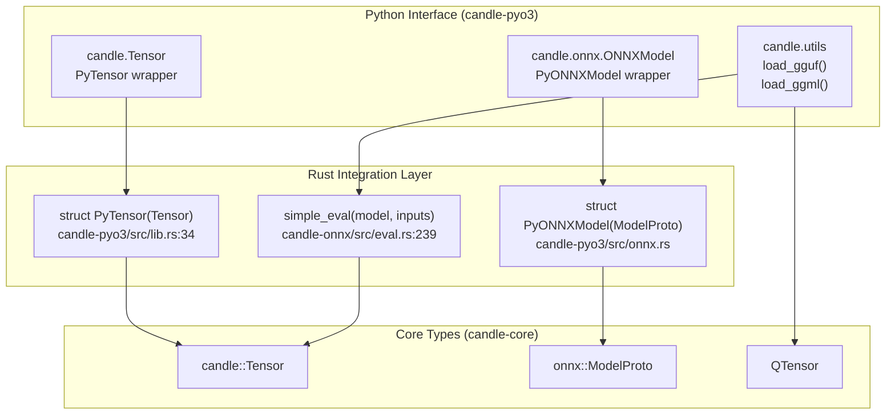
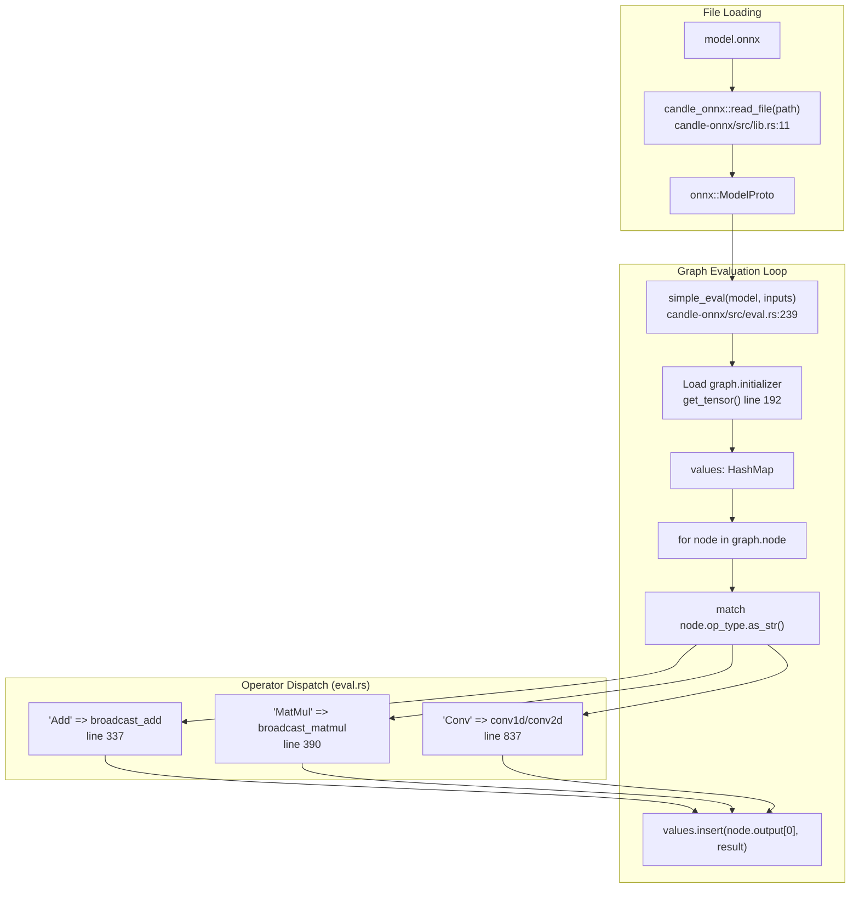
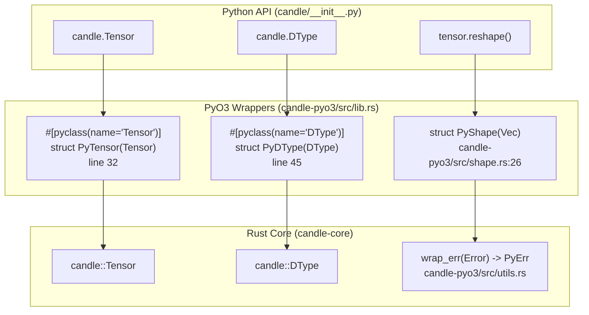

<!-- source: DeepWiki mcp.deepwiki.com · repo huggingface/candle · page 7 Integrations and Interoperability · fetched 2026-10-26 -->

# Integrations and Interoperability

Relevant source files

The following files were used as context for generating this wiki page:

- [Makefile](Makefile)
- [candle-core/src/dtype.rs](candle-core/src/dtype.rs)
- [candle-examples/examples/onnx-llm/README.md](candle-examples/examples/onnx-llm/README.md)
- [candle-examples/examples/onnx-llm/main.rs](candle-examples/examples/onnx-llm/main.rs)
- [candle-examples/examples/onnx/README.md](candle-examples/examples/onnx/README.md)
- [candle-examples/examples/onnx/main.rs](candle-examples/examples/onnx/main.rs)
- [candle-onnx/src/eval.rs](candle-onnx/src/eval.rs)
- [candle-onnx/src/lib.rs](candle-onnx/src/lib.rs)
- [candle-onnx/tests/ops.rs](candle-onnx/tests/ops.rs)
- [candle-pyo3/README.md](candle-pyo3/README.md)
- [candle-pyo3/build.rs](candle-pyo3/build.rs)
- [candle-pyo3/py_src/candle/__init__.py](candle-pyo3/py_src/candle/__init__.py)
- [candle-pyo3/py_src/candle/nn/__init__.pyi](candle-pyo3/py_src/candle/nn/__init__.pyi)
- [candle-pyo3/py_src/candle/onnx/__init__.py](candle-pyo3/py_src/candle/onnx/__init__.py)
- [candle-pyo3/py_src/candle/utils/__init__.py](candle-pyo3/py_src/candle/utils/__init__.py)
- [candle-pyo3/quant-llama.py](candle-pyo3/quant-llama.py)
- [candle-pyo3/src/lib.rs](candle-pyo3/src/lib.rs)
- [candle-pyo3/src/utils.rs](candle-pyo3/src/utils.rs)
- [candle-pyo3/test.py](candle-pyo3/test.py)

This page covers how Candle integrates with external ecosystems and supports diverse model formats. It provides a high-level overview of the ONNX runtime implementation, the Python bindings via PyO3, and the variety of model serialization formats supported by the framework.

## Integration Architecture Overview

Candle acts as a bridge between high-level interfaces (Python, ONNX) and low-level hardware acceleration (CUDA, Metal, CPU).

#### Integration Points and Key Code Entities

Sources: [candle-pyo3/src/lib.rs:32-42](), [candle-onnx/src/eval.rs:239-248](), [candle-pyo3/src/lib.rs:20-20](), [candle-pyo3/quant-llama.py:34-54]()

## ONNX Model Support

The `candle-onnx` crate enables loading and executing ONNX models. It uses a `prost`-based parser to decode ONNX protobufs into a `ModelProto` [candle-onnx/src/lib.rs:11-14]() and provides an evaluation pipeline that maps ONNX operators to Candle tensor operations.

### ONNX Evaluation Pipeline

The core evaluation logic resides in `simple_eval` [candle-onnx/src/eval.rs:239-258](), which traverses the ONNX graph and executes nodes sequentially. It maps ONNX `DataType` [candle-onnx/src/eval.rs:11-22]() to Candle `DType` [candle-core/src/dtype.rs:9-38]() and extracts attributes like integers, floats, and tensors [candle-onnx/src/eval.rs:34-125]() to configure operators.

#### ONNX Simple Evaluator Flow

For details on operator implementations and examples like `onnx-llm` or `silero-vad`, see [ONNX Model Support](#7.1).

Sources: [candle-onnx/src/eval.rs:11-22](), [candle-onnx/src/eval.rs:192-210](), [candle-onnx/src/eval.rs:239-258](), [candle-onnx/src/lib.rs:11-14](), [candle-examples/examples/onnx/main.rs:67-71]()

## Model Format Support

Candle provides native support for several industry-standard model formats, focusing on memory efficiency and ease of use.

| Format | Key Feature | Implementation |
| :--- | :--- | :--- |
| **SafeTensors** | Zero-copy memory mapping | `candle-core/src/safetensors.rs` |
| **GGUF / GGML** | Block-based quantization support | `candle-pyo3/src/lib.rs` (via `utils`) |
| **NPZ** | Compatibility with NumPy exports | `candle-core` |
| **Pickle / PTH** | Loading legacy PyTorch model weights | `candle-core/src/pickle.rs` |

The `VarBuilder` system serves as the primary abstraction for loading these formats, supporting both memory-mapped `SafeTensors` and sharded weights for multi-GPU setups. The `tensor-tools` utility provides a CLI for inspecting and converting between these formats.

For detailed documentation on format-specific loading patterns and zero-copy mapping, see [Model Format Support](#7.2).

Sources: [candle-pyo3/quant-llama.py:34-54](), [candle-pyo3/src/lib.rs:20-20](), [candle-onnx/src/eval.rs:192-210]()

## Python Bindings

The `candle-pyo3` crate exposes Candle's high-performance Rust core to the Python ecosystem. It provides a `Tensor` API that closely mirrors PyTorch while maintaining the underlying Rust performance.

### PyO3 Integration Architecture

The bindings wrap core Rust types like `Tensor` and `DType` into `PyTensor` and `PyDType` classes using PyO3 macros.

The build process uses `maturin` [candle-pyo3/README.md:7-9]() to compile the Rust crate into a Python module. The bindings also include `.pyi` stub files for type hinting [candle-pyo3/README.md:11-20]() and support for running quantized models like Llama via `QuantizedLlama` [candle-pyo3/quant-llama.py:58-65]().

For details on the Python `nn` module, ONNX support in Python, and the `maturin` build process, see [Python Bindings](#7.3).

Sources: [candle-pyo3/src/lib.rs:31-48](), [candle-pyo3/src/lib.rs:20-20](), [candle-pyo3/README.md:1-10](), [candle-pyo3/quant-llama.py:58-65](), [candle-pyo3/py_src/candle/__init__.py:4-55]()

---

