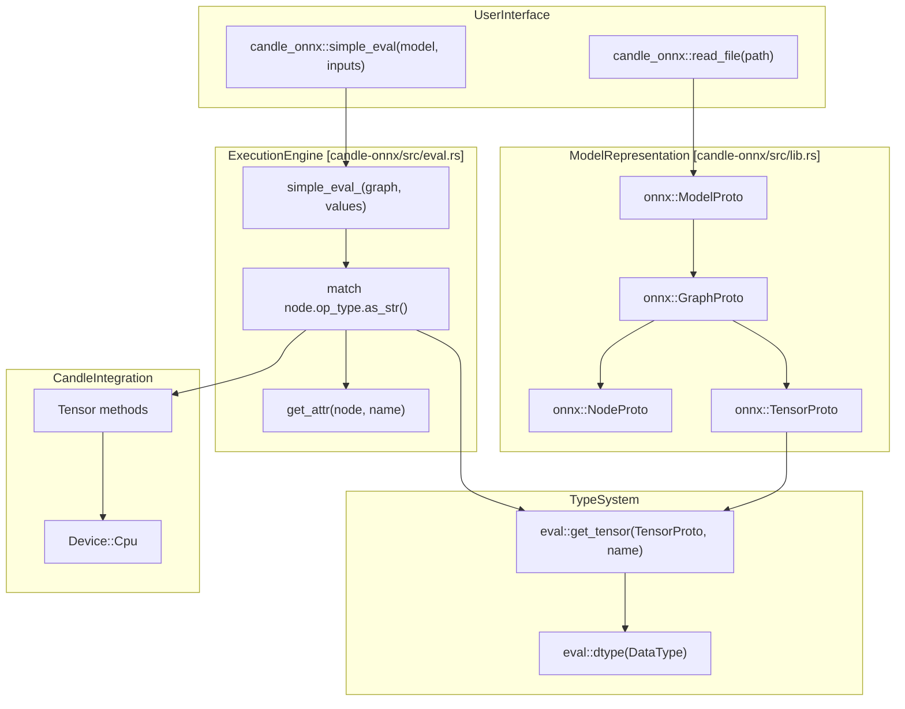
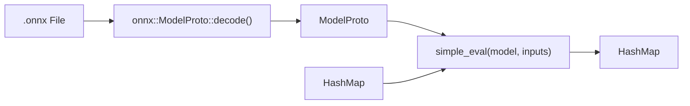
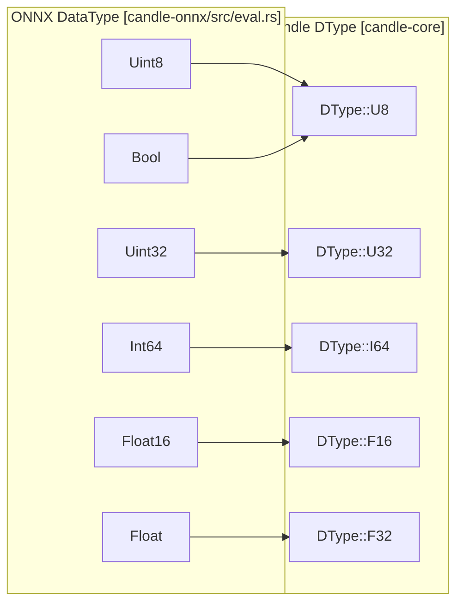
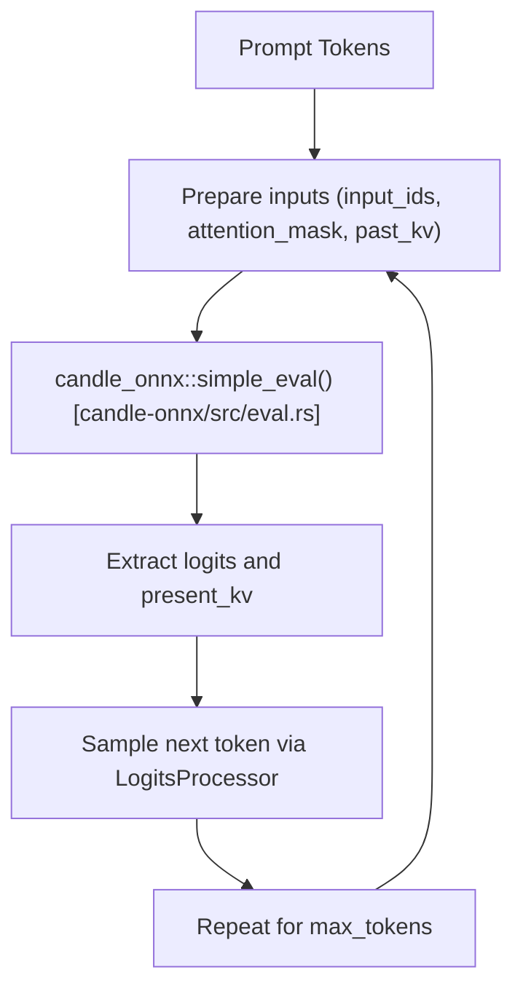

<!-- source: DeepWiki mcp.deepwiki.com · repo huggingface/candle · page 7.1 ONNX Model Support · fetched 2026-10-26 -->

# ONNX Model Support

Relevant source files

The following files were used as context for generating this wiki page:

- [candle-examples/examples/onnx-llm/README.md](candle-examples/examples/onnx-llm/README.md)
- [candle-examples/examples/onnx-llm/main.rs](candle-examples/examples/onnx-llm/main.rs)
- [candle-examples/examples/onnx/README.md](candle-examples/examples/onnx/README.md)
- [candle-examples/examples/onnx/main.rs](candle-examples/examples/onnx/main.rs)
- [candle-onnx/src/eval.rs](candle-onnx/src/eval.rs)
- [candle-onnx/src/lib.rs](candle-onnx/src/lib.rs)
- [candle-onnx/tests/ops.rs](candle-onnx/tests/ops.rs)
- [candle-pyo3/py_src/candle/onnx/__init__.py](candle-pyo3/py_src/candle/onnx/__init__.py)
- [candle-pyo3/src/utils.rs](candle-pyo3/src/utils.rs)

The `candle-onnx` crate provides an ONNX runtime implementation that enables Candle to execute models exported in the ONNX (Open Neural Network Exchange) format. This allows interoperability with models trained in other frameworks like PyTorch, TensorFlow, and scikit-learn by leveraging a `prost`-based parser and a direct evaluation engine.

**Scope**: This page covers the ONNX runtime architecture, operator implementations in `eval.rs`, and the evaluation pipeline used in examples like `onnx-basics`, `onnx-llm`, and `silero-vad`.

## Architecture Overview

The ONNX runtime in Candle is designed as a direct evaluation engine that processes ONNX computation graphs. It converts ONNX protocol buffer definitions into executable operations on Candle tensors, primarily targeting CPU execution.

### System Components

**Sources**: [candle-onnx/src/lib.rs:1-14](), [candle-onnx/src/eval.rs:11-22](), [candle-onnx/src/eval.rs:127-151](), [candle-onnx/src/eval.rs:192-209](), [candle-onnx/src/eval.rs:239-260]()

### Data Flow Pipeline

**Sources**: [candle-onnx/src/lib.rs:11-14](), [candle-onnx/src/eval.rs:9](), [candle-onnx/src/eval.rs:239-253]()

## Loading ONNX Models

### File Reading and Parsing
The `read_file` function handles the binary decoding of ONNX files using `prost`. It converts the raw byte stream into a structured `ModelProto`.

| Function | Purpose | Return Type |
|----------|---------|-------------|
| `read_file(path)` | Load ONNX model from file | `Result<ModelProto>` |
| `ModelProto::decode(bytes)` | Parse protobuf binary | `Result<ModelProto>` |

**Sources**: [candle-onnx/src/lib.rs:11-14]()

### Type and Tensor Conversion
ONNX data types are mapped to Candle `DType` via the `dtype` function [candle-onnx/src/eval.rs:11-22](). The `get_tensor` function [candle-onnx/src/eval.rs:192-209]() is responsible for converting `TensorProto` data (either from `raw_data` or typed fields like `float_data` or `int32_data`) into Candle `Tensor` objects on `Device::Cpu`.

**Sources**: [candle-onnx/src/eval.rs:11-22](), [candle-onnx/src/eval.rs:192-209]()

## Execution Model

### Graph Evaluation
The core logic resides in `simple_eval_` (called by `simple_eval` [candle-onnx/src/eval.rs:239-253]()), which iterates through the `graph.node` list.

1. **Initializers**: Tensors in `graph.initializer` are loaded into the value map first [candle-onnx/src/eval.rs:255-260]().
2. **Inputs**: Provided input tensors are validated against the graph's input metadata.
3. **Node Processing**: For each node, the `op_type` is matched against implemented operators.

**Sources**: [candle-onnx/src/eval.rs:239-260]()

### Attribute Handling
ONNX attributes are accessed using the `Attr` and `AttrOwned` traits, which provide type-safe retrieval for `i64`, `f32`, `[i64]`, `str`, `GraphProto`, and `Vec<String>` [candle-onnx/src/eval.rs:24-81](). The runtime also supports converting `Tensor` attributes directly [candle-onnx/src/eval.rs:83-125]().

| Method | Description |
|--------|-------------|
| `get_attr<T>` | Retrieves a reference to an attribute of type T [candle-onnx/src/eval.rs:140-151]() |
| `get_attr_opt<T>` | Optionally retrieves a reference to an attribute [candle-onnx/src/eval.rs:153-172]() |
| `get_attr_opt_owned<T>` | Optionally retrieves an owned attribute (e.g., `Vec<String>`) [candle-onnx/src/eval.rs:174-190]() |

**Sources**: [candle-onnx/src/eval.rs:24-125](), [candle-onnx/src/eval.rs:127-172](), [candle-onnx/src/eval.rs:174-190]()

## Operator Implementations

The `eval.rs` file implements ONNX operators using Candle's tensor API and `candle-nn` activations like `PReLU` [candle-onnx/src/eval.rs:6]().

| Category | Examples | Candle Backend Call |
|----------|----------|---------------------|
| Arithmetic | `Add`, `Sub`, `Mul`, `Div` | `broadcast_add`, `broadcast_sub`, etc. |
| Linear Algebra | `MatMul`, `Gemm` | `matmul` or `broadcast_matmul` |
| Shape | `Reshape`, `Transpose`, `Squeeze` | `reshape()`, `transpose()`, `squeeze()` |
| Activation | `Relu`, `Sigmoid`, `PReLU` | `relu()`, `sigmoid()`, `candle_nn::activation::PReLU` |

**Sources**: [candle-onnx/src/eval.rs:1-209](), [candle-onnx/tests/ops.rs:45-196]()

## Usage and Examples

### Image Classification (`onnx-basics`)
The `onnx` example demonstrates loading models like `SqueezeNet`, `EfficientNet`, or `EsrGan`. It uses `candle_onnx::read_file` to load the model and `simple_eval` to run inference on an image [candle-examples/examples/onnx/main.rs:67-71]().

**Sources**: [candle-examples/examples/onnx/main.rs:31-113]()

### Large Language Models (`onnx-llm`)
The `onnx-llm` example implements inference for models like `SmolLM-135M` [candle-examples/examples/onnx-llm/main.rs:26](). It demonstrates how to handle KV-caching by passing `past_key_values` and extracting `present` tensors through the ONNX graph [candle-examples/examples/onnx-llm/main.rs:116-186]().

**Sources**: [candle-examples/examples/onnx-llm/main.rs:64-186]()

### Testing Operators
The `candle-onnx/tests/ops.rs` file contains unit tests that manually construct `ModelProto` objects to verify individual operator logic.

| Test Case | Operation | Verification |
|-----------|-----------|--------------|
| `test_add_operation` | `Add` | Validates sum of two tensors [candle-onnx/tests/ops.rs:45-81]() |
| `test_sub_operation` | `Sub` | Validates subtraction [candle-onnx/tests/ops.rs:85-121]() |
| `test_mul_operation` | `Mul` | Validates multiplication [candle-onnx/tests/ops.rs:125-161]() |
| `test_div_operation` | `Div` | Validates division [candle-onnx/tests/ops.rs:165-196]() |

**Sources**: [candle-onnx/tests/ops.rs:1-196]()

---

