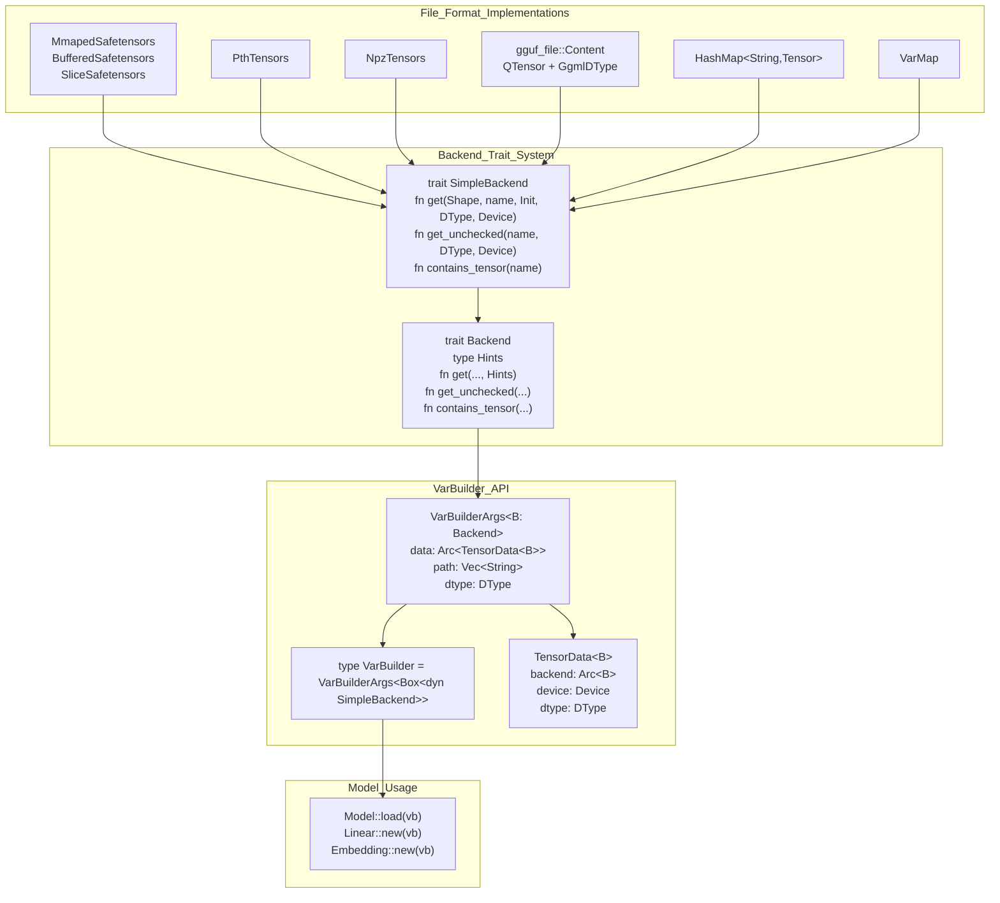
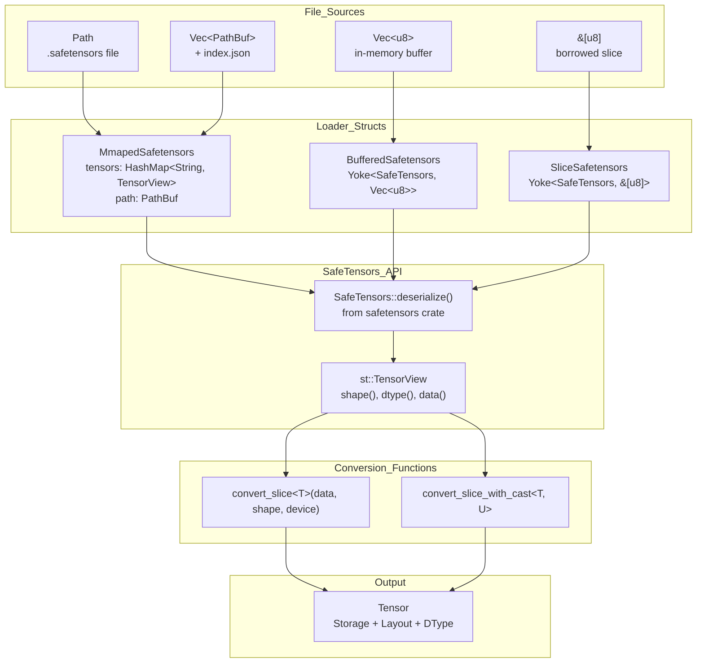
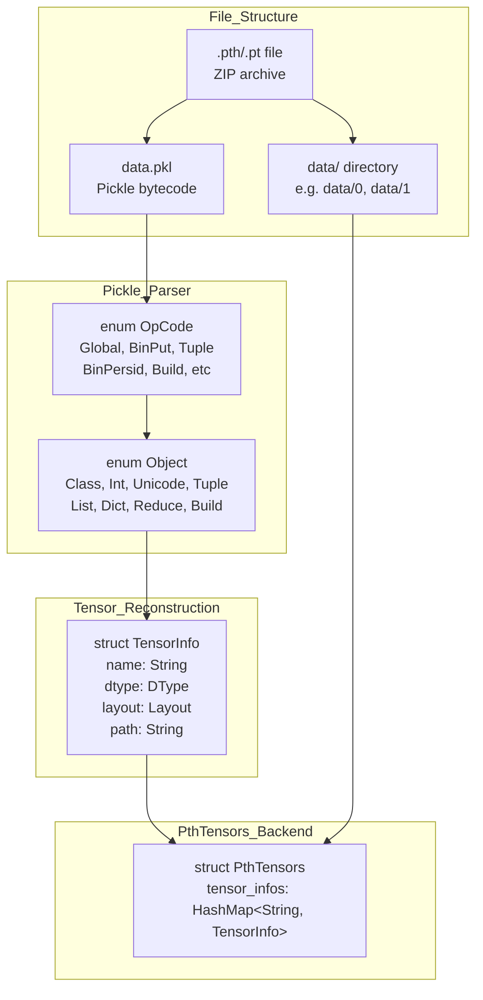

<!-- source: DeepWiki mcp.deepwiki.com · repo huggingface/candle · page 7.2 Model Format Support · fetched 2026-10-26 -->

# Model Format Support

<details>
<summary>Relevant source files</summary>

The following files were used as context for generating this wiki page:

- [candle-core/src/convert.rs](candle-core/src/convert.rs)
- [candle-core/src/cpu/erf.rs](candle-core/src/cpu/erf.rs)
- [candle-core/src/display.rs](candle-core/src/display.rs)
- [candle-core/src/npy.rs](candle-core/src/npy.rs)
- [candle-core/src/pickle.rs](candle-core/src/pickle.rs)
- [candle-core/src/safetensors.rs](candle-core/src/safetensors.rs)
- [candle-core/src/shape.rs](candle-core/src/shape.rs)
- [candle-core/tests/fortran_tensor_3d.pth](candle-core/tests/fortran_tensor_3d.pth)
- [candle-core/tests/pth.py](candle-core/tests/pth.py)
- [candle-core/tests/pth_tests.rs](candle-core/tests/pth_tests.rs)
- [candle-core/tests/test.pt](candle-core/tests/test.pt)
- [candle-core/tests/test_with_key.pt](candle-core/tests/test_with_key.pt)
- [candle-examples/examples/glm4/main.rs](candle-examples/examples/glm4/main.rs)
- [candle-examples/examples/llama_multiprocess/main.rs](candle-examples/examples/llama_multiprocess/main.rs)
- [candle-examples/examples/llama_multiprocess/model.rs](candle-examples/examples/llama_multiprocess/model.rs)
- [candle-examples/examples/llava/main.rs](candle-examples/examples/llava/main.rs)
- [candle-examples/examples/quantized-gemma/README.md](candle-examples/examples/quantized-gemma/README.md)
- [candle-examples/examples/quantized-gemma/main.rs](candle-examples/examples/quantized-gemma/main.rs)
- [candle-examples/examples/quantized-glm4/main.rs](candle-examples/examples/quantized-glm4/main.rs)
- [candle-examples/examples/quantized-lfm2/main.rs](candle-examples/examples/quantized-lfm2/main.rs)
- [candle-examples/examples/quantized-phi/main.rs](candle-examples/examples/quantized-phi/main.rs)
- [candle-examples/examples/quantized-qwen2-instruct/main.rs](candle-examples/examples/quantized-qwen2-instruct/main.rs)
- [candle-examples/examples/quantized-qwen3-moe/main.rs](candle-examples/examples/quantized-qwen3-moe/main.rs)
- [candle-examples/examples/quantized-qwen3/main.rs](candle-examples/examples/quantized-qwen3/main.rs)
- [candle-nn/src/var_builder.rs](candle-nn/src/var_builder.rs)
- [candle-transformers/src/models/quantized_gemma3.rs](candle-transformers/src/models/quantized_gemma3.rs)
- [candle-transformers/src/models/quantized_phi3.rs](candle-transformers/src/models/quantized_phi3.rs)
- [candle-wasm-examples/llama2-c/src/model.rs](candle-wasm-examples/llama2-c/src/model.rs)
- [tensor-tools/src/main.rs](tensor-tools/src/main.rs)

</details>


Candle provides native Rust implementations for loading model weights from multiple file formats without Python dependencies. All formats integrate through the `VarBuilder` abstraction in [candle-nn/src/var_builder.rs](), which provides a unified interface for parameter retrieval across formats and devices.

## Overview and VarBuilder Integration

The `VarBuilder` struct acts as the primary interface for loading model parameters. Different file formats are supported through implementations of the `SimpleBackend` trait, which defines how tensors are retrieved by name.

**VarBuilder Format Support Architecture**


Sources: [candle-nn/src/var_builder.rs:16-21](), [candle-nn/src/var_builder.rs:50-67](), [candle-nn/src/var_builder.rs:69-84]()

## Supported Model Formats

| Format | VarBuilder Constructor / Loader | Backend Implementation | File Location | Primary Use Case |
|--------|----------------------|----------------------|---------------|------------------|
| SafeTensors | `from_mmaped_safetensors()` | `candle::safetensors::MmapedSafetensors` | [candle-core/src/safetensors.rs]() | Primary format, memory-mapped loading |
| SafeTensors (buffered) | `from_buffered_safetensors()` | `candle::safetensors::BufferedSafetensors` | [candle-core/src/safetensors.rs]() | In-memory loading from `Vec<u8>` |
| SafeTensors (slice) | `from_slice_safetensors()` | `candle::safetensors::SliceSafetensors` | [candle-core/src/safetensors.rs]() | Zero-copy loading from `&[u8]` |
| PyTorch | `from_pth()` | `candle::pickle::PthTensors` | [candle-core/src/pickle.rs]() | Legacy PyTorch checkpoints |
| GGUF | `gguf_file::Content::read()` | `candle::quantized::gguf_file` | [candle-transformers/src/models/quantized_phi3.rs:18-38]() | Quantized models (LLaMA, Phi, Qwen) |
| NPZ | `from_npz()` | `candle::npz::Npz` | [candle-core/src/npy.rs]() | NumPy array format |
| Training | `from_varmap()` | `VarMap` | [candle-nn/src/var_builder.rs:6]() | Parameter initialization and saving |

Sources: [candle-nn/src/var_builder.rs:1-10](), [candle-core/src/npy.rs:1-10](), [candle-transformers/src/models/quantized_phi3.rs:18-38]()

## SafeTensors Format

SafeTensors is the primary format for model weights in Candle, providing secure, fast, and memory-efficient tensor storage. Candle supports multiple loading strategies through [candle-core/src/safetensors.rs]().

### SafeTensors Loading Strategies

**SafeTensors Loading Implementations**


Sources: [candle-core/src/safetensors.rs:1-10](), [candle-core/src/safetensors.rs:115-170]()

### MmapedSafetensors

Memory-mapped loading avoids loading entire files into RAM. The `MmapedSafetensors` struct maps files directly into the process address space.

**Key Features**:
- Zero-copy tensor access via memory mapping.
- Support for serialization back to file via `Tensor::save_safetensors` [candle-core/src/safetensors.rs:108-113]().
- Lazy loading - tensors loaded on demand from the underlying memory map.

Sources: [candle-core/src/safetensors.rs:1-10](), [candle-core/src/safetensors.rs:108-113]()

### SafeTensors Type Conversion

The loader handles alignment requirements and efficiently converts to native storage. Unaligned data is copied to aligned buffers before conversion to prevent undefined behavior during slice casting [candle-core/src/safetensors.rs:115-138]().

**Supported dtypes mapping**:
Candle maps its internal `DType` to the `safetensors` crate `Dtype` enum, including support for specialized types like `F8E4M3`, `F6E2M3`, and `F4` [candle-core/src/safetensors.rs:22-41]().

Sources: [candle-core/src/safetensors.rs:115-138](), [candle-core/src/safetensors.rs:43-64]()

## PyTorch Checkpoint Format (PTH)

Candle implements a custom pickle parser in [candle-core/src/pickle.rs]() to load PyTorch `.pth` and `.pt` files without requiring Python dependencies.

### Pickle Parser Architecture

The pickle parser handles the subset of pickle operations needed for tensor deserialization, including `OpCode::Global` for class resolution and `OpCode::BinPersId` for persistent storage references.

**PyTorch Pickle Loading Pipeline**


Sources: [candle-core/src/pickle.rs:14-49](), [candle-core/src/pickle.rs:105-129](), [candle-core/src/pickle.rs:208-234]()

### Layout Handling
PyTorch tensors can have various memory layouts. The parser identifies class names such as `torch._tensor._rebuild_from_type_v2` and `torch._utils._rebuild_parameter` to reconstruct tensor metadata including shape and storage offsets [candle-core/src/pickle.rs:221-234]().

Sources: [candle-core/src/pickle.rs:208-234]()

## GGUF and GGML Formats

Candle supports loading models in the GGUF format, primarily for quantized models. This is handled by the `gguf_file` module.

**Key Features**:
- Supports various GGUF quantization types (e.g., Q4_0, Q8_0, K-Quants) [candle-transformers/src/models/quantized_phi3.rs:18-19]().
- Used for efficient inference in large models like Phi-3, Qwen3, and Llama [candle-examples/examples/quantized-phi/main.rs:11-18](), [candle-examples/examples/quantized-qwen3/main.rs:11-16]().
- `gguf_file::Content` provides access to tensor metadata and data [candle-transformers/src/models/quantized_phi3.rs:30-38]().

**Usage Pattern**:
```rust
// Load a quantized model from a GGUF file
let mut file = std::fs::File::open(&model_path)?;
let model_content = gguf_file::Content::read(&mut file)?;
let w = model_content.tensor(&mut file, "weight_name", &device)?;
let qmatmul = QMatMul::from_qtensor(w)?;
```

Sources: [candle-transformers/src/models/quantized_phi3.rs:30-40](), [candle-examples/examples/quantized-phi/main.rs:202-205]()

## NPZ (NumPy) Format

Candle can load tensors stored in the NumPy `.npz` format and single arrays in `.npy` format. This is useful for interoperability with NumPy-based data. The `Header` struct in [candle-core/src/npy.rs]() handles the deserialization of the magic string and metadata.

**Key Features**:
- Direct parsing of NumPy headers, including `descr`, `fortran_order`, and `shape` [candle-core/src/npy.rs:63-68]().
- Converts NumPy dtypes (e.g., `f2`, `f4`, `f8`, `i4`, `u1`) to Candle `DType` [candle-core/src/npy.rs:164-180]().
- Detects and prevents loading of unsupported types like `bf16` or `f8e4m3` in the NPY format [candle-core/src/npy.rs:83-98]().

Sources: [candle-core/src/npy.rs:63-75](), [candle-core/src/npy.rs:109-180]()

## Sharded Model Loading

Large models are often distributed across multiple shards. Candle provides `ShardedSafeTensors` for distributed loading with tensor parallelism support.

**Sharding Logic**:
The `Shard` struct defines how a tensor is split across ranks [candle-examples/examples/llama_multiprocess/model.rs:102-108](). The `ShardedSafeTensors` builder is used to initialize the `VarBuilder` for multi-GPU inference [candle-examples/examples/llama_multiprocess/main.rs:183-185]().

```rust
// Load with sharding hints in a multi-process context
let vb = unsafe {
    candle_nn::var_builder::ShardedSafeTensors::var_builder(&filenames, dtype, &device)?
};
```

Sources: [candle-examples/examples/llama_multiprocess/model.rs:102-108](), [candle-examples/examples/llama_multiprocess/main.rs:183-185]()

## VarBuilder Path Management

VarBuilder provides hierarchical path management using `push_prefix` (aliased as `pp`) to navigate nested model structures [candle-nn/src/var_builder.rs:150-165]().

```rust
let layer_vb = vb.pp("model").pp("layers").pp("0");
// Accesses "model.layers.0.weight"
```

The path is stored as a `Vec<String>` and joined with dots during retrieval [candle-nn/src/var_builder.rs:186-192]().

Sources: [candle-nn/src/var_builder.rs:123-192]()

## Tensor-Tools Utility

The `tensor-tools` crate provides a CLI for inspecting and converting model files. It supports operations on `safetensors`, `npz`, and `pth` files.

**Key Operations**:
- **ls**: List tensors in a file.
- **inspect**: Show detailed tensor information (shape, dtype).
- **convert**: Convert between formats (e.g., PTH to SafeTensors).

Sources: [tensor-tools/src/main.rs:1-50]()

---

