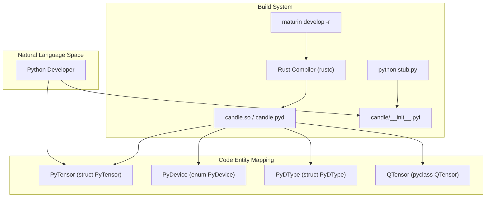
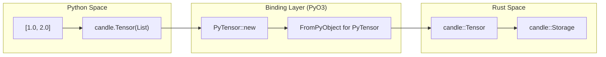
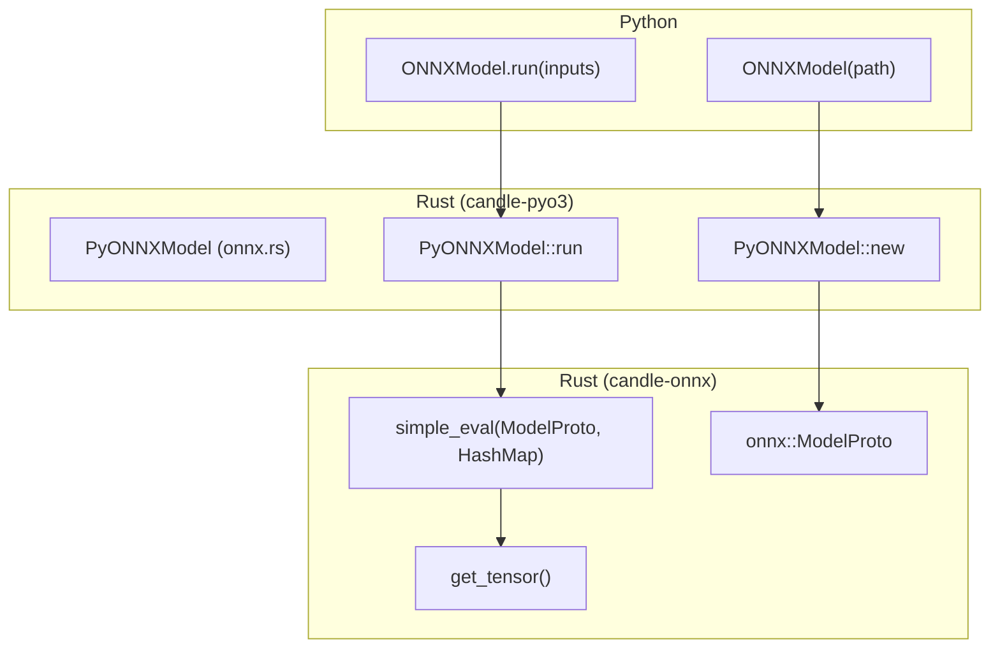

<!-- source: DeepWiki mcp.deepwiki.com · repo huggingface/candle · page 7.3 Python Bindings · fetched 2026-10-26 -->

# Python Bindings

Relevant source files

The following files were used as context for generating this wiki page:

- [Makefile](Makefile)
- [candle-core/src/dtype.rs](candle-core/src/dtype.rs)
- [candle-pyo3/.gitignore](candle-pyo3/.gitignore)
- [candle-pyo3/README.md](candle-pyo3/README.md)
- [candle-pyo3/_additional_typing/README.md](candle-pyo3/_additional_typing/README.md)
- [candle-pyo3/_additional_typing/__init__.py](candle-pyo3/_additional_typing/__init__.py)
- [candle-pyo3/build.rs](candle-pyo3/build.rs)
- [candle-pyo3/e5.py](candle-pyo3/e5.py)
- [candle-pyo3/py_src/candle/__init__.py](candle-pyo3/py_src/candle/__init__.py)
- [candle-pyo3/py_src/candle/__init__.pyi](candle-pyo3/py_src/candle/__init__.pyi)
- [candle-pyo3/py_src/candle/functional/__init__.py](candle-pyo3/py_src/candle/functional/__init__.py)
- [candle-pyo3/py_src/candle/functional/__init__.pyi](candle-pyo3/py_src/candle/functional/__init__.pyi)
- [candle-pyo3/py_src/candle/models/bert.py](candle-pyo3/py_src/candle/models/bert.py)
- [candle-pyo3/py_src/candle/models/llama.py](candle-pyo3/py_src/candle/models/llama.py)
- [candle-pyo3/py_src/candle/nn/__init__.py](candle-pyo3/py_src/candle/nn/__init__.py)
- [candle-pyo3/py_src/candle/nn/__init__.pyi](candle-pyo3/py_src/candle/nn/__init__.pyi)
- [candle-pyo3/py_src/candle/nn/linear.py](candle-pyo3/py_src/candle/nn/linear.py)
- [candle-pyo3/py_src/candle/testing/__init__.py](candle-pyo3/py_src/candle/testing/__init__.py)
- [candle-pyo3/py_src/candle/typing/__init__.py](candle-pyo3/py_src/candle/typing/__init__.py)
- [candle-pyo3/py_src/candle/utils/__init__.py](candle-pyo3/py_src/candle/utils/__init__.py)
- [candle-pyo3/py_src/candle/utils/__init__.pyi](candle-pyo3/py_src/candle/utils/__init__.pyi)
- [candle-pyo3/pyproject.toml](candle-pyo3/pyproject.toml)
- [candle-pyo3/quant-llama.py](candle-pyo3/quant-llama.py)
- [candle-pyo3/src/lib.rs](candle-pyo3/src/lib.rs)
- [candle-pyo3/src/onnx.rs](candle-pyo3/src/onnx.rs)
- [candle-pyo3/src/shape.rs](candle-pyo3/src/shape.rs)
- [candle-pyo3/stub.py](candle-pyo3/stub.py)
- [candle-pyo3/test.py](candle-pyo3/test.py)
- [candle-pyo3/test_pytorch.py](candle-pyo3/test_pytorch.py)
- [candle-pyo3/tests/bindings/test_module.py](candle-pyo3/tests/bindings/test_module.py)
- [candle-pyo3/tests/bindings/test_testing.py](candle-pyo3/tests/bindings/test_testing.py)
- [candle-pyo3/tests/native/test_shape.py](candle-pyo3/tests/native/test_shape.py)
- [candle-pyo3/tests/native/test_tensor.py](candle-pyo3/tests/native/test_tensor.py)

This page documents the `candle-pyo3` crate, which provides high-performance Python bindings for the Candle ML framework. These bindings expose the core Rust tensor operations, neural network modules, and model loading utilities to the Python ecosystem, enabling users to leverage Candle's efficiency with Python's flexibility.

## Architecture and Build System

The bindings are implemented using [PyO3](https://pyo3.rs), bridging Rust types like `Tensor`, `Device`, and `DType` to Python classes. The build process is managed by `maturin`, which handles the compilation of Rust code into a Python extension module.

### Build Process
The project uses a `pyproject.toml` and `Cargo.toml` configuration to define the extension.
*   **Compilation**: `maturin develop -r` compiles the Rust code with optimizations and installs it into the active virtual environment [candle-pyo3/README.md:1-9]().
*   **Feature Flags**: Backends like `mkl`, `accelerate`, and `onnx` are enabled via Cargo features and exposed to Python [candle-pyo3/src/lib.rs:14-30]().
*   **Type Stubs**: Since PyO3 modules are compiled binaries, `.pyi` stub files are generated using `stub.py` to provide IDE autocompletion and static type checking [candle-pyo3/stub.py:1-168](). The generation script inspects the compiled module and produces type hints in `py_src/candle/__init__.pyi` [candle-pyo3/py_src/candle/__init__.pyi:1-119]().

### Build and Entity Mapping
The following diagram illustrates how the build process transforms Rust source into accessible Python entities.

Title: Build System and Code Entity Mapping

Sources: [candle-pyo3/README.md:1-26](), [candle-pyo3/src/lib.rs:1-47](), [candle-pyo3/stub.py:1-20](), [candle-pyo3/py_src/candle/__init__.pyi:1-119]()

## Core API: Tensor and Device

The primary interface is the `Tensor` class, which wraps the underlying Rust `candle::Tensor` [candle-pyo3/src/lib.rs:32-34]().

### Data Flow: Python to Rust Tensor
When a tensor is created in Python via `candle.Tensor(...)`, the data is extracted from Python objects (lists, tuples, or scalars) and converted into Rust `Storage`. The `PyTensor` implementation uses a `Deref` to provide access to the inner `candle::Tensor` [candle-pyo3/src/lib.rs:36-42]().

Title: Data Flow from Python to Rust Storage

Sources: [candle-pyo3/src/lib.rs:31-42](), [candle-pyo3/src/lib.rs:170-222]()

### Key Classes and Methods
| Class | Role | Key Implementation Pointers |
| :--- | :--- | :--- |
| `PyTensor` | Main tensor handle | [candle-pyo3/src/lib.rs:34]() |
| `PyDevice` | Hardware abstraction (`cpu`, `cuda`, `metal`) | [candle-pyo3/src/lib.rs:75-80]() |
| `PyDType` | Data type handle (`f32`, `bf16`, `u8`, etc.) | [candle-pyo3/src/lib.rs:44-47]() |
| `QTensor` | Quantized tensor for inference | [candle-pyo3/py_src/candle/__init__.pyi:81-118]() |

### Device Management
Devices are managed as singletons for CUDA and Metal to prevent redundant initialization [candle-pyo3/src/lib.rs:72-73](). The `as_device()` method handles the transition from Python strings to Rust `Device` enums [candle-pyo3/src/lib.rs:91-113](). The `PyDevice` enum supports extraction from Python strings like "cpu", "cuda", or "metal" [candle-pyo3/src/lib.rs:116-129]().

## Neural Network Module (`candle.nn`)

The `candle.nn` module provides high-level layers implemented in Python that utilize the core tensor bindings. This includes common layers like `Linear`, `Embedding`, and `LayerNorm` [candle-pyo3/py_src/candle/models/bert.py:3-5]().

### Example: BERT Implementation
The BERT implementation in `candle-pyo3/py_src/candle/models/bert.py` demonstrates how to build complex architectures using the Python bindings:
*   **Self-Attention**: Uses `matmul`, `transpose`, and `softmax` [candle-pyo3/py_src/candle/models/bert.py:30-68]().
*   **Encoder Layers**: Chains multiple `BertLayer` instances [candle-pyo3/py_src/candle/models/bert.py:133-143]().
*   **Embeddings**: Combines word, position, and token type embeddings [candle-pyo3/py_src/candle/models/bert.py:146-165]().

## Quantization Support

Candle's powerful quantization system is fully exposed. Tensors can be quantized into various formats (e.g., Q4_0, Q8_0, K-Quants) directly from Python using the `quantize` method [candle-pyo3/test.py:27-28](). The `QTensor` class wraps the `candle::quantized::QTensor` and provides methods like `dequantize()` and `matmul_t()` [candle-pyo3/py_src/candle/__init__.pyi:86-103]().

### Quantized Llama Inference
The `quant-llama.py` example showcases how to replicate `llama.cpp` functionality:
1.  **Loading**: Uses `utils.load_gguf` or `utils.load_ggml` to read quantized weights [candle-pyo3/quant-llama.py:34-54]().
2.  **Mapping**: Renames GGUF tensor names (e.g., `blk.` to `layers.`) to match the internal model architecture [candle-pyo3/quant-llama.py:10-24]().
3.  **Inference**: Uses `QuantizedLlama` for autoregressive generation [candle-pyo3/quant-llama.py:58-71]().

Sources: [candle-pyo3/quant-llama.py:1-75](), [candle-pyo3/test.py:27-31](), [candle-pyo3/py_src/candle/__init__.pyi:81-118]()

## Interoperability and Utilities

### ONNX Support
If compiled with the `onnx` feature, the bindings allow loading and evaluating ONNX models [candle-pyo3/src/lib.rs:28-29](). The `candle-onnx` crate provides the core ONNX parsing and evaluation logic, with `candle-pyo3/src/onnx.rs` exposing this functionality to Python through `PyONNXModel` [candle-pyo3/src/onnx.rs:83-85](). The `run` method in Python calls `candle_onnx::eval::simple_eval` in Rust [candle-pyo3/src/onnx.rs:202-206]().

Title: ONNX Evaluation Pipeline

Sources: [candle-pyo3/src/lib.rs:28-29](), [candle-pyo3/src/onnx.rs:83-206](), [candle-pyo3/py_src/candle/__init__.pyi:1-119]()

### Testing Infrastructure
Candle provides a testing utility to ensure parity between Python and Rust operations. The `candle-pyo3/tests/native/test_tensor.py` suite validates tensor operations, slicing, quantization, and device transfers [candle-pyo3/tests/native/test_tensor.py:1-217]().
*   **Constructors**: Validates construction from scalars and lists [candle-pyo3/tests/native/test_tensor.py:8-20]().
*   **Indexing/Slicing**: Tests complex 2D/3D slicing and indexing via lists or other tensors [candle-pyo3/tests/native/test_tensor.py:43-79](), [candle-pyo3/tests/native/test_tensor.py:168-188]().
*   **Broadcasting**: Validates broadcasting in equality operations [candle-pyo3/tests/native/test_tensor.py:133-143]().

### Serialization
The `utils` module provides FFI wrappers for Candle's serialization formats:
*   `load_safetensors` / `save_safetensors`: Industry standard zero-copy format [candle-pyo3/py_src/candle/utils/__init__.pyi:52-70]().
*   `load_gguf`: For GGUF/llama.cpp models [candle-pyo3/py_src/candle/utils/__init__.pyi:44-49]().
*   `load_ggml`: Support for legacy GGML files [candle-pyo3/py_src/candle/utils/__init__.pyi:36-41]().

Sources: [candle-pyo3/src/lib.rs:1-222](), [candle-pyo3/py_src/candle/utils/__init__.pyi:1-70](), [candle-pyo3/tests/native/test_tensor.py:1-217]()

---

